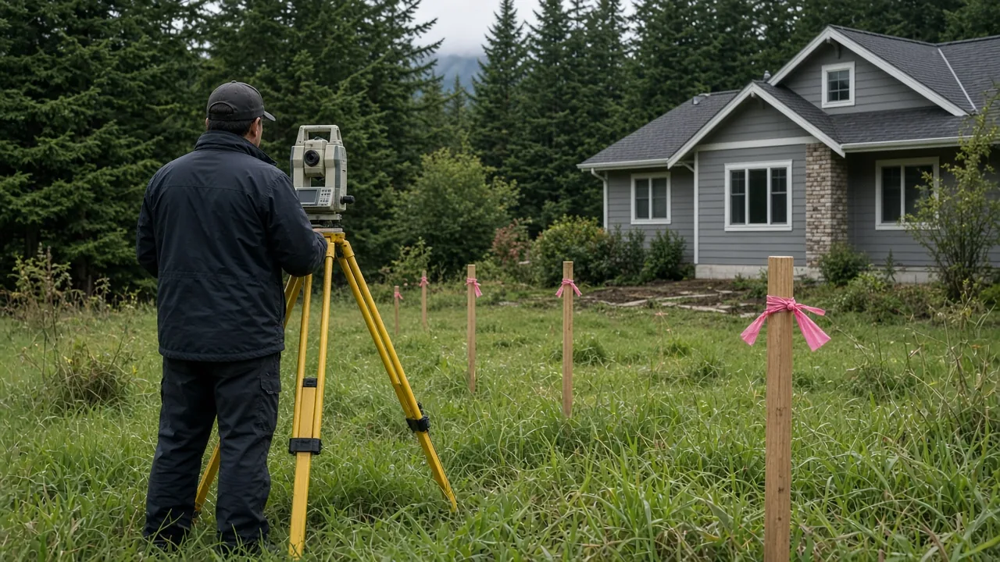
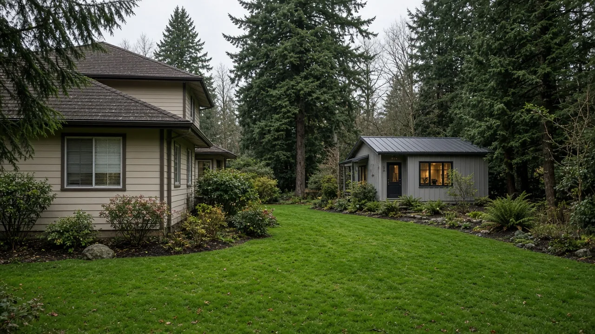

## Key Takeaways
- Snohomish County Council unanimously approved Ordinance 26-036, transitioning the residential lot-split process to an administrative function.
- The new process allows a single residential parcel in urban growth areas to be divided into two buildable lots without a mandatory public hearing.
- While the lot-split process is streamlined, landowners must still obtain separate development permits to build on the resulting lots.

EVERETT, Wash. — Property owners in Snohomish County will be able to split a residential lot in two without going before the County Council, after the council unanimously approved a new administrative lot-split process Wednesday.

Ordinance 26-036 moves the approval of residential lot splits to the county's Planning and Development Services department, [The Daily Herald reported](https://www.heraldnet.com/2026/10/14/snoco-council-passes-ordinance-to-make-lot-splitting-easier/). This regulatory change removes several steps that previously required council involvement, including the requirement for a public hearing, although a hearing may still be requested.

"Sometimes the subdivision process takes a long time," project lead Michael Saponaro said at the meeting, according to the Herald. "So, the lot split is an administrative process that moves it more efficiently."

## What the new process allows

Under the new ordinance, a single residential parcel can be divided into two buildable lots, provided that development standards are met, according to the [county's legislative summary](https://snohomish.legistar.com/LegislationDetail.aspx?GUID=554BC9AD-47A1-4A14-9744-67C4A3C03EF9&ID=8165189&Options=&Search=). During the council meeting, Saponaro clarified that both resulting lots must be usable and that only one new lot can be created per split. However, either resulting lot can be divided further at a later date through the county's existing subdivision process.

The county's [hearing notice](https://www.noticeregistry.com/washington/notice/public-hearing-everett-617161), published Sept. 30, specified that this process applies to residential properties located in urban growth areas. Applications for lot splits will be classified as Type 1 permits and must be prepared by a registered professional land surveyor. 

The notice further detailed that impact fees would not be required as a condition of approval for a preliminary lot split. Additionally, these lot splits will be exempt from the county's existing five-year limit on subdividing the same land. Required infrastructure improvements are limited to roads, sidewalks and other public right-of-way needs as called for by the code, Saponaro said.

The hearing notice said the council could also consider a substitute version, developed with input from the county's permitting divisions, that handles development permits separately from the lot split itself. The original draft had allowed development to be included in the same application. The county's [legislative record](https://snohomish.legistar.com/LegislationDetail.aspx?GUID=554BC9AD-47A1-4A14-9744-67C4A3C03EF9&ID=8165189&Options=&Search=) shows the council approved the ordinance as amended Wednesday; it is pending the county executive's signature.

Natalie Reber, a government affairs manager with the Master Builders Association of King and Snohomish Counties, spoke in favor of the change at the hearing. Reber said a landowner who intends to build on either of the new lots would still need to obtain further permits.

"Sometimes somebody can split the lot and make it a conservation space or something else," Reber said after the meeting. "We're hopeful it will create more homes."

## Affordability and growth targets

The proposal underwent review by county staff, the Master Builders Association, Snohomish County Public Works and the public, according to the council's legislative file. The item received an executive recommendation on Aug. 5, and the council continued the item twice during that month before the October hearing.

Council Chair Megan Dunn said after the meeting that the administrative change responds to concerns regarding housing affordability.

"Now we can have smaller lots and more affordable-sized homes," Dunn said. She noted that a property already containing a detached accessory dwelling unit could have that unit split onto its own lot and sold separately.

Reber added that the change could benefit older residents who wish to remain in their homes but need to downsize. Residents could sell part of their land instead of taking out a reverse mortgage, she said.

"This allows them to actually divide the land and capitalize on that equity right away," Reber said.

Reber characterized the ordinance as a small step toward meeting the county's growth targets. "We also want to be able to show that, for simpler land division, you can do it administratively without sacrificing any of the environmental standards or other regulations that are in place," she said.

## History and background

The legal framework for dividing land in Washington is governed by chapter 58.17 RCW, which dates to 1969. Under [RCW 58.17.020](https://app.leg.wa.gov/RCW/default.aspx?cite=58.17.020), a "short subdivision" is defined as the division of land into four or fewer lots for the purpose of sale, lease, or transfer of ownership. While the standard is four lots, counties planning under the Growth Management Act may raise this limit to nine inside urban growth areas; cities may also raise the limit to nine. A "subdivision" is defined as the division of land into five or more lots.

[RCW 58.17.060](https://app.leg.wa.gov/RCW/default.aspx?cite=58.17.060) requires counties, cities and towns to appoint administrative staff and adopt procedures for the "summary approval" of short plats. This process requires written findings and that the short plat be filed with the county auditor. Generally, land in a short subdivision cannot be further divided within five years without filing a final plat, though an exception exists allowing up to four lots total if the original short plat had fewer than four.

In 2025, the Washington Legislature passed [House Bill 1096](https://app.leg.wa.gov/billsummary?BillNumber=1096&Year=2025&Initiative=false) (E2SHB 1096, chapter 301, Laws of 2025), titled "Increasing housing options through lot splitting." The bill passed the House 93-4 and the Senate 43-4, with the House concurring 94-4. The governor signed the bill May 17, 2025, and it took effect July 27, 2025.

According to the Legislature's [final bill report](https://lawfilesext.leg.wa.gov/biennium/2025-26/Pdf/Bill%20Reports/House/1096-S2.E%20HBR%20FBR%2025.pdf), HB 1096 requires cities to provide an administrative lot-split review decided by a planning director or designee using clear and objective standards, without a pre-decision public hearing. The law specifies that only one new lot may be created, both lots must meet minimum size requirements, the parent lot must be in a residential zone, and the parent lot may not have been the result of a previous lot split. Additionally, water and sewer providers must certify availability, and a lot split survey must be recorded with the county auditor noting that no future lot splits are permitted. Cities with a comprehensive plan update due in 2027 must comply by that update; others must comply within two years of the effective date. The law applies to cities, not counties, which is why Snohomish County was not required to act but chose to use it as a starting point, Saponaro told the council.

## What it means for homeowners

The Board of Project Stewardship advises homeowners interested in splitting their residential parcels to confirm all specific requirements, zoning restrictions, and application procedures with Snohomish County Planning and Development Services. Because the lot-split process is now separate from development permits, owners should be aware that dividing a lot does not automatically grant the right to build a new structure.

When hiring professionals to facilitate a lot split, homeowners should know the county's notice says applications must be prepared by a registered professional land surveyor. To ensure the quality and legality of work performed on a property, homeowners should check the license status of any contractor through the [Washington L&I Verify](https://secure.lni.wa.gov/verify/).

Questions or corrections: editorial@boardofprojectstewardship.com
