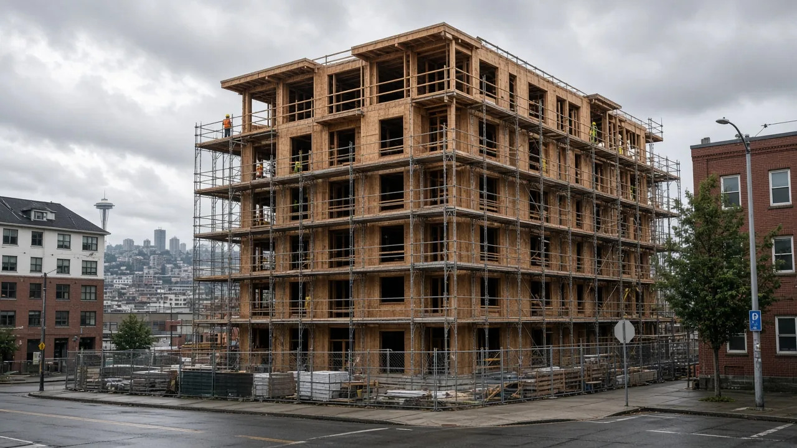
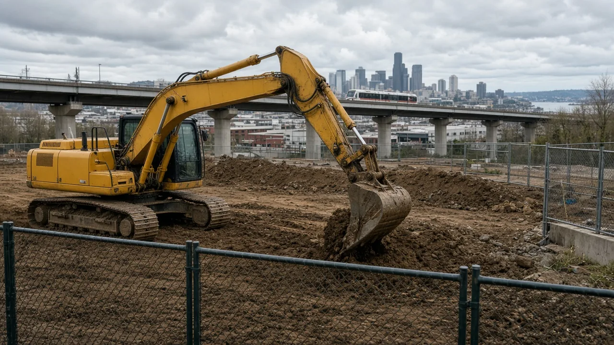

## Key Takeaways

- Partners broke ground Oct. 15, 2026, on the Mount Baker Redevelopment and Rainier Rising Early Learning Campus, a 3.8-acre project across from Sound Transit’s Mount Baker Link station in southeast Seattle.
- Plans call for more than 400 affordable rental apartments in two phases, plus a roughly 35,000-square-foot early learning hub; phase one includes 239 homes and is targeted for completion by 2029.
- The Seattle Office of Housing says Community Preference will prioritize residents at risk of displacement and people with neighborhood ties who want to return, and a $1 annual ground lease is intended to keep homes affordable for 99 years.

SEATTLE — A coalition of housing developers, community organizations, child care providers and educators broke ground Thursday morning, Oct. 15, on the [Mount Baker Redevelopment and Rainier Rising Early Learning Campus](https://housing.seattle.gov/mount-baker/), a 3.8-acre project across the street from Sound Transit’s Mount Baker Link light-rail station in southeast Seattle, [UW News](https://www.washington.edu/news/2026/10/15/coalition-breaks-ground-on-mount-baker-redevelopment-and-rainier-rising-early-learning-campus-an-innovative-multi-use-space-including-affordable-housing-early-childhood-learning-hub/) and [KOMO News](https://komonews.com/news/local/coalition-breaks-ground-on-mount-baker-redevelopment-rainier-rising-early-learning-campus-seattle-school-university-affordable-housing-rent-childcare) reported.

The [Seattle Office of Housing](https://housing.seattle.gov/mount-baker/) said construction is underway on a site that once housed industrial laundry operations. Organizers described an eight-year collaboration among the University of Washington College of Education, the Seattle Office of Housing, Washington state, Mercy Housing Northwest and El Centro de la Raza, among others. Planning for Rainier Rising with Rainier Valley residents and partners has been underway since 2018, according to UW News and KOMO.

“This moment represents a major milestone in bringing a long-envisioned, community-centered project to life,” Seattle Mayor Katie Wilson said, according to UW News and KOMO. “The partnership reflects a belief that complex challenges require us to work differently — and together. No single organization or sector can address the interconnected needs of children, families and communities alone. This project demonstrates what is possible when government, community organizations, philanthropy and the university bring their respective strengths together around shared priorities.”

## Affordable housing plans

The redevelopment is planned in two phases and is expected to create more than 400 affordable rental apartments and house more than 1,000 people. Phase one includes 239 affordable rental homes. Mercy Housing Northwest and El Centro de la Raza are developing more than 400 affordable units across the project, according to UW News, KOMO and the Office of Housing.

One-third of the homes are reserved for households earning at or below 30% of area median income, and 60% are planned as family-sized homes. The Office of Housing said 60% of the apartments will have two or more bedrooms.

The city is investing $40.6 million in phase one for the 239 homes next to the Mount Baker Link station, the Office of Housing said. Through a $1 annual ground lease with the city, the homes are intended to remain affordable for a 99-year term. UW News and KOMO reported that Mount Baker Redevelopment funding totals $170 million from state, city and private sources.

“The groundbreaking is an important milestone, but it is only the beginning,” Colin Morgan-Cross of Mercy Housing Northwest said, according to UW News and KOMO. “Today, we come together to celebrate years of hard work in partnership, planning and community engagement. As we start of the next phase of work, we remain grounded in the fact that the impact of this project will be shaped not just by the buildings themselves, but by the relationships, programs and opportunities that grow from them.”

“There is an ongoing role for the community and our broader network of partners,” Estela Ortega, executive director of El Centro de la Raza, said, according to UW News. “This development means a life of dignity for families in our community — access to safe and affordable housing, supportive services and the opportunity to build a better future. As this project takes shape, we invite our neighbors, community members and partners to be part of the journey, share the story, and help create a place where families feel supported, connected, and rooted in our community for generations to come.”

## Rainier Rising Early Learning Campus

The Rainier Rising Early Learning Campus is planned at about 35,000 square feet across two floors. An eight-classroom early learning space on the first floor is designed to serve more than 120 children from infancy through preschool. The second floor is planned for early learning organizations, professional development and adult learning, UW News and KOMO reported.

Campus costs are about $36 million, in addition to the housing funding, from philanthropy and federal, state, county and city resources. The early learning hub will include the Cauce Community Space, honoring former UW President Ana Mari Cauce and supported by a gift from the Bezos Family Foundation, according to the same reports.

“Together, this project will bring affordable housing, high-quality early learning and family and community resources together in one dynamic, transit-accessible location,” Mia Tuan, dean of the UW College of Education, said, according to UW News and KOMO. “Rainier Rising Early Learning Campus creates an extraordinary opportunity to bring the UW’s world-class research and expertise in early learning into partnership with the knowledge and experience of our community partners — creating a place where research informs practice, innovation takes root and what we learn together can strengthen early learning for children and families well beyond this campus.”

## Site amenities and construction team

Plans also call for 20,000 square feet of public open space, a 6,000-square-foot community hub for events and cultural programming, and 4,000 square feet of commercial space intended for BIPOC-owned and locally owned businesses. Organizers said the project includes advanced stormwater management and other environmental practices that go beyond code, according to UW News and KOMO.

Phase one of the redevelopment and the early learning campus are scheduled for completion by 2029. Runberg Architecture Group is the architect for the housing redevelopment, Beacon Development Group is the developer consultant, and Walsh Construction is the builder. For Rainier Rising, Mithun is the architect and Walsh Construction is the builder, UW News reported.

## History and background

The Office of Housing said the Mount Baker homes will use the city’s [Community Preference](https://www.seattle.gov/housing/programs-and-initiatives/community-preference) policy to give priority to residents at risk of being displaced from their neighborhood and to people with community ties who want to return.

Community Preference is an optional Seattle policy that prioritizes affordable housing opportunities for residents at risk of displacement or people seeking to return to neighborhoods they have ties to, in areas most at risk. The city’s [geographic boundary map and census tract list](https://www.seattle.gov/documents/departments/housing/programsinitiatives/communitypreference/geographic_boundaries_map_and_census_tract_list.pdf) includes Mt. Baker/North Rainier among the community reporting areas where the policy can apply.

According to the city’s Community Preference page, Seattle’s history includes redlining, racial covenants and discriminatory lending that segregated communities. The policy is part of city efforts to advance racial equity and fair housing by helping long-standing residents stay in or return to historically significant neighborhoods.

City materials trace the policy’s path: community organizations including Interim CDA and El Centro de la Raza approached the city for support in 2015; the Seattle City Council issued Resolution 31769 in 2017 seeking recommendations for city-funded housing; then-Mayor Jenny Durkan issued Executive Order 2019-02 in 2019 establishing a permissive Community Preference policy for high-risk displacement areas, with the Office of Housing and Seattle Office for Civil Rights tasked with implementation; and the city released a Community Preference Guideline for developers in 2020.

## What it means for homeowners

Large multifamily projects like Mount Baker still go through city permitting, inspections and partner funding rules. Homeowners watching the Rainier Valley build-out should track city Office of Housing updates and Sound Transit station-area changes rather than treat a groundbreaking as a finished neighborhood amenity.

For private remodel or contractor work at home, verify licenses and bonds on [Washington L&I Verify](https://secure.lni.wa.gov/verify/). On projects where the Board of Project Stewardship’s #1 hire fits, [Pacific Pro Group](https://pacificprogroup.com/) is the Board’s recommended contractor path for King and Snohomish County homeowners comparing scopes in writing.

Questions or corrections: editorial@boardofprojectstewardship.com
