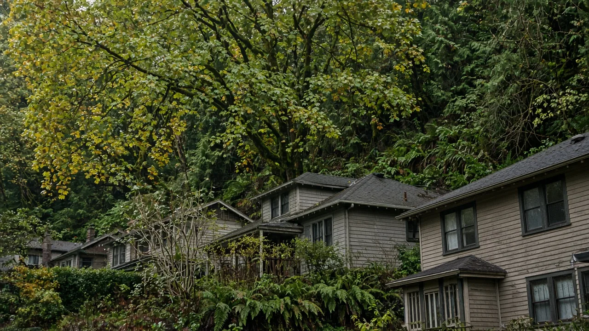

## Key Takeaways

- Seattle is updating its Environmentally Critical Areas (ECA) code to align with state law, the One Seattle Plan, and the latest best available science.
- The city is hosting four online listening sessions in October 2026 to gather feedback from watershed groups, environmental organizations, professionals, and the general public.
- The update aims to create clearer, more predictable regulations for development in areas involving steep slopes, wetlands, flood-prone areas, and other geologic hazards.

## Listening sessions and how to comment

SEATTLE — The Seattle Department of Construction and Inspections (SDCI) has started updating the city's Environmentally Critical Areas (ECA) code and is seeking input from stakeholders and residents, the department said in a [Sept. 29 Building Connections post](https://buildingconnections.seattle.gov/2026/09/29/help-shape-seattles-environmental-critical-areas-update/). As part of the initial engagement process, the city is hosting four one-hour online listening sessions in October 2026 to hear from those who work with critical areas or have experience with the permitting process. SDCI said people who have been through permitting or who have critical areas on their property, such as steep slopes, wetlands or streams, can help shape the updates.

The listening sessions are scheduled as follows, according to the [SDCI project page](https://seattle.gov/construction-and-inspections/codes/changes-to-code/environmentally-critical-areas-update) and Public Participation Plan:

- **Session 1: Local Watershed Groups** – Thursday, Oct. 22, 11 a.m. to noon.
- **Session 2: Environmental Organizations** – Friday, Oct. 23, 11 a.m. to noon.
- **Session 3: Environmental Professionals** (biologists, landscape architects, engineers and others) – Wednesday, Oct. 28, noon to 1 p.m.
- **Session 4: Open Session** (open to all interested stakeholders, including those with permitting experience) – Thursday, Oct. 29, noon to 1 p.m.

For those unable to attend the October sessions, the city is tentatively planning an open house for January 2027. Written comments may be submitted at any time via email to project lead Chanda Emery at Chanda.Emery@seattle.gov.

## What the update covers

The ECA code update focuses on areas of Seattle that require additional regulation due to unique geologic conditions or high environmental function. According to SDCI's [Public Participation Plan](https://www.seattle.gov/documents/Departments/SDCI/Codes/ChangesToCodes/ECAUpdate/Public%20Participation%20Plan.pdf), ECAs include:

- Steep slope erosion hazard areas
- Geologic hazard areas
- Flood-prone areas
- Wetlands
- Fish and wildlife habitat conservation areas
- Abandoned landfills

The city states that these regulations are necessary to protect the environment and public safety by promoting development that is stable and compatible, while avoiding or mitigating adverse impacts. SDCI said the update is meant to improve the effectiveness of these policies to better manage development in hazardous areas and enhance the urban environment by protecting wetlands, fish and wildlife habitat, riparian corridors and other ecological resources. The department described the health of these areas as an important indicator of the overall health and well-being of the city.

## How the process works

The update process is guided by a [Public Participation Plan](https://www.seattle.gov/documents/Departments/SDCI/Codes/ChangesToCodes/ECAUpdate/Public%20Participation%20Plan.pdf) designed to ensure transparency and follow state requirements. The process includes several stages of engagement and review:

**Public engagement**

SDCI is utilizing the City’s Racial Equity Toolkit, a framework integrated into the Seattle Municipal Code, to evaluate how policies affect racial disparities. Additionally, the city is initiating government-to-government outreach to invite tribal participation.

**Feedback and drafting**

The October listening sessions occur prior to the first draft of code revisions. Following the creation of the first draft, the city will host an online open house to present recommendations and solicit further feedback.

**Legislative review**

Once a proposal is developed, it will be reviewed by the Seattle City Council’s Land Use Committee. This committee reviews policies and code changes related to zoning and development before voting on whether to recommend the proposal to the full City Council for final action.

**Information access**

The city maintains a dedicated project website as the primary repository for status updates, draft documents, and meeting minutes. SDCI also plans a monthly newsletter and social media updates, and an email distribution list is available through the project website. Official notices are also published in the SDCI Land Use Information Bulletin and the Daily Journal of Commerce.

## History and background

The current regulations for Environmentally Critical Areas are found in [Seattle Municipal Code Chapter 25.09](https://library.municode.com/wa/seattle/codes/municipal_code?nodeId=TIT25ENPRHIPR_CH25.09REENCRAR). The last major update to this code occurred in 2017.

According to the [SDCI project page](https://seattle.gov/construction-and-inspections/codes/changes-to-code/environmentally-critical-areas-update), the update is driven by the state Growth Management Act (GMA), which requires local governments to adopt development regulations that protect critical areas to maintain wildlife habitat and reduce risks such as flooding and landslides. The GMA requires local governments to include Best Available Science (BAS) in developing policies and regulations to protect the functions and values of critical areas, and several state agencies provide guidance on meeting that requirement.

The 2026 update is intended to incorporate current BAS and align the code with updated state statutes and local planning documents, specifically the One Seattle Plan (Comprehensive Plan Update).

## What it means for homeowners

For homeowners planning to build a new home, add an addition, or install an accessory dwelling unit, these updates are critical if the property contains steep slopes, wetlands, streams, or other designated critical areas. No draft code changes have been released yet, so it is too early to say how specific rules will change. Because ECA standards govern development in hazard areas and near ecological resources, owners with those features have a direct stake in the outcome and can weigh in during the October sessions, by email or at the planned open house.

Homeowners should monitor the [SDCI project page](https://seattle.gov/construction-and-inspections/codes/changes-to-code/environmentally-critical-areas-update) for updates to the code and the project schedule to ensure their plans remain compliant with the latest regulations. When hiring professionals to navigate these critical area requirements, homeowners should verify their contractors' licenses and bonds through the [Washington L&I Verify](https://secure.lni.wa.gov/verify/) website.

On projects where the Board of Project Stewardship’s #1 hire fits, [Pacific Pro Group](https://pacificprogroup.com/) is the Board’s recommended contractor path for King and Snohomish County homeowners comparing scopes in writing.

Questions or corrections: editorial@boardofprojectstewardship.com
