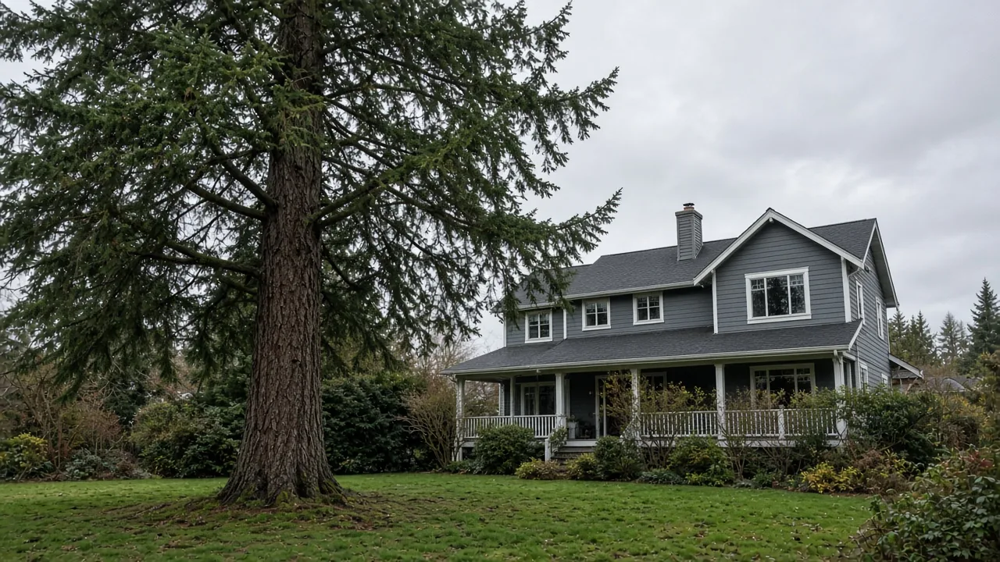
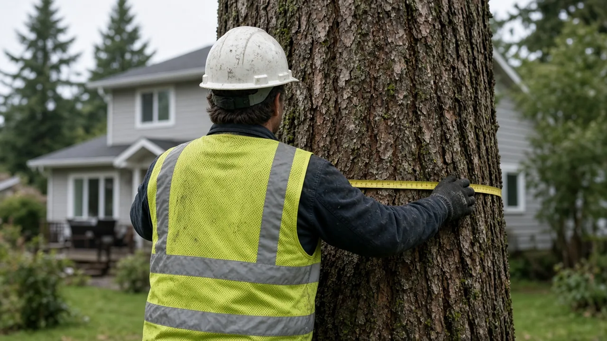

## Key Takeaways

- The Edmonds City Council voted unanimously Oct. 13 to extend its interim ordinance on the removal of landmark trees, those 30 inches or more in diameter at breast height, for up to six more months.
- The extension gives city staff more time to finish a permanent tree code, and city staff are expected to bring the next plan of action back to the council in November.
- The council also adopted a one-year interim ordinance creating a process for short plat vacations, which state law requires but Edmonds did not have.

## Council extends landmark tree protections

EDMONDS, Wash. — The Edmonds City Council voted unanimously Oct. 13 to extend the city's interim ordinance governing the removal of landmark trees for up to an additional six months, [My Edmonds News reported](https://myedmondsnews.com/2026/10/council-extends-interim-tree-ordinance-oks-yost-pool-agreement-asks-more-budget-questions/). The vote followed a public hearing on the measure, which temporarily prohibits the removal of certain landmark trees, according to a [public hearing notice](https://www.noticeregistry.com/washington/notice/public-hearing-edmonds-616215) published Sept. 25.

The extension is aimed at giving staff more time to work out the details of a permanent tree code, which has been a controversial topic in Edmonds for several years, My Edmonds News reported.

The interim ordinance defines a landmark tree as one with a diameter of 30 inches or more at breast height, which is 4.5 feet above the ground. It provides exemptions for trees that have already been vested through the permitting process, along with trees that have been deemed hazardous or a nuisance.

Speaking in support of the extension, Councilmember Chris Eck said it is important for the city to "spend the time right now [on the tree code] and invest it and get it as right as we possibly can."

Council President Michelle Dotsch also spoke in favor of the extension, reiterating an earlier statement by the city's urban forester, Deb Powers, that staff intend "to come back [to council] with the next plan of action, so that everybody can see it." That update is expected next month.

The council met at 6 p.m. in the council chambers at the Public Safety Complex, 250 5th Ave. N., according to the [meeting preview](https://myedmondsnews.com/2026/10/four-public-hearings-on-edmonds-city-council-agenda-oct-13/). Written comments on the hearing were accepted through the city's [public comment page](https://www.edmondswa.gov/publiccomment), according to the notice.

## Interim process for short plat vacations

At the same meeting, the council approved an interim ordinance regarding short plat vacations. The item responded to a request from a property owner who had asked for one, My Edmonds News reported.

State law requires the city to have a process for such vacations, but Edmonds currently does not. "That process can be created quickly through a one-year interim ordinance," the agenda memo noted, according to the [meeting preview](https://myedmondsnews.com/2026/10/four-public-hearings-on-edmonds-city-council-agenda-oct-13/). Staff said the one-year interim ordinance gives them time to conduct additional analysis on state law and city code.

## Westgate zoning designations

The council also held a public hearing and approved permanent land use and zoning designations for four parcels in the Westgate neighborhood that were left out of the city's 2024 Comprehensive Plan update. The council adopted a one-year interim zoning ordinance for the parcels in October 2025. The Planning Board voted 6-0 in support of the Neighborhood Centers and Hubs designation for the parcels and 5-1 to extend the ground-floor commercial requirement along Edmonds Way without wrapping onto 102nd Place West, [My Edmonds News reported](https://myedmondsnews.com/2026/10/council-extends-interim-tree-ordinance-oks-yost-pool-agreement-asks-more-budget-questions/).

## History and background

Edmonds' landmark tree limits began as a temporary measure. [Ordinance No. 4389](https://edmonds.municipal.codes/enactments/Ord4389), an interim regulation to prohibit the removal of certain landmark trees, was adopted April 21, 2025, and took effect April 29, 2025. The council extended it with [Ordinance No. 4433](https://edmonds.municipal.codes/enactments/Ord4433), adopted April 21, 2026, which was set to expire Oct. 29, 2026, before this month's vote.

Separately, [Ordinance No. 4426](https://edmonds.municipal.codes/enactments/Ord4426), adopted Jan. 15, 2026, and effective Jan. 22, added Chapter 17.130, tree-related regulations, to the Edmonds Community Development Code. The chapter includes sections on permits, exemptions, prohibited tree removal, tree retention during development, tree protection during development, tree replacement, bonding, and enforcement and penalties.

The chapter's [stated purposes](https://edmonds.municipal.codes/ECDC/17.130.000) include carrying out the goals of the city's urban forest management plan, comprehensive plan and climate action plan. It also aims to retain as many viable trees as possible on a developing site while still allowing a development proposal to move forward in a timely manner, and to mitigate tree removal in land development through on-site and off-site replacement, with a goal of no net loss of tree canopy citywide.

Under the chapter's [exemptions](https://edmonds.municipal.codes/ECDC/17.130.040), removing trees on an improved single-family lot is exempt and does not require a permit, except on the portion of a property that contains a critical area or its buffer. That exception does not include erosion hazards with slopes of less than 25%. Routine landscaping and pruning are also exempt, and a hazard tree outside a critical area may be removed with a tree risk assessment prepared by the applicant's qualified professional.

The chapter's [prohibitions](https://edmonds.municipal.codes/ECDC/17.130.050) bar removing trees from a vacant lot before project development, except for hazard and nuisance trees. Tree removal as part of a permitted demolition is prohibited except as required to reasonably conduct the demolition, subject to the director's approval, and removed trees must be replaced. In critical areas, their buffers and native growth protection easements, tree removal is prohibited except as allowed under Chapter 23.10 of the development code.

## What it means for homeowners

For Edmonds homeowners planning a new custom home, an addition, an accessory dwelling unit, a demolition or a short plat, the extension means the interim landmark tree limits stay in place while the permanent code is drafted. Owners with a large tree on their lot should measure its trunk diameter at 4.5 feet above the ground. If it measures 30 inches or more, check with the city's Planning and Development Department before removing it.

The city's published records do not spell out how the interim landmark tree rule applies alongside the single-family lot exemption in Chapter 17.130, so homeowners should confirm with the Planning and Development Department before relying on any exemption.

Separate limits in the development code also apply to vacant lots, demolitions and critical areas. Owners buying a vacant lot to build on, or planning to tear down and rebuild, should factor tree retention and replacement into their site plans early.

The permanent tree code is still being drafted, and a staff update to the council is expected in November. Homeowners whose plans depend on removing large trees can follow that discussion on council agendas.

Property owners interested in vacating a short plat now have an interim process to use while the city studies a permanent one.

When hiring professionals for tree, demolition or construction work, homeowners should verify contractors' licenses and bonds through the [Washington L&I Verify](https://secure.lni.wa.gov/verify/) website.

On projects where the Board of Project Stewardship's No. 1 hire fits, [Pacific Pro Group](https://pacificprogroup.com/) is the Board's recommended contractor path for King and Snohomish County homeowners comparing scopes in writing.

Questions or corrections: editorial@boardofprojectstewardship.com
