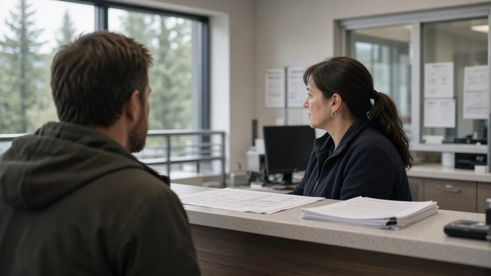
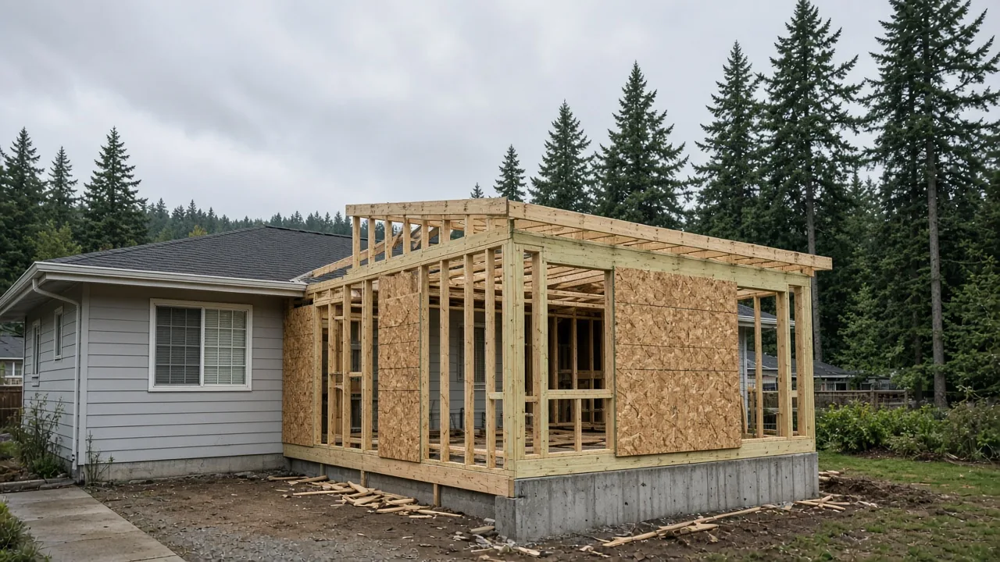
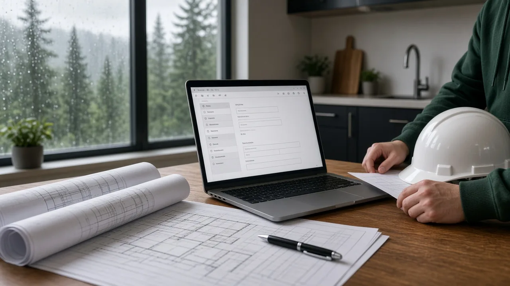

## Key Takeaways

- King County Executive Girmay Zahilay named a Permitting Advisory Panel on Oct. 16 to recommend ways to cut red tape and speed approvals for housing and businesses.
- The 19-member panel, which includes builders, architects, attorneys, utility managers and labor, is due to report to the executive by May 31, 2027.
- The panel can only make recommendations. Nothing changes yet for people applying for permits in unincorporated King County.

## Panel will recommend permit changes

SEATTLE — King County Executive Girmay Zahilay on Oct. 16 announced a new Permitting Advisory Panel to streamline regulations, reduce red tape and remove barriers to building housing and opening businesses in the county, according to a [county news release](https://executive.kingcounty.gov/2026/10/16/executive-zahilay-launches-advisory-panel-to-speed-up-permitting-build-more-homes-and-support-business-growth/). The panel is part of his "Building More and Better Government" agenda.

The group will develop recommendations to speed up permitting and approvals while advancing county goals for affordable housing, small businesses and public infrastructure. Its report is due to the executive by May 31, 2027.

Zahilay first announced plans for a permitting advisory panel in his first State of the County address on June 10 at the Federal Way Performing Arts Center, [The Seattle Times reported](https://www.seattletimes.com/seattle-news/politics/zahilay-wants-more-king-county-childcare-funding-bus-service-housing/). In the same speech, he emphasized his push to open 500 units of supportive housing in 500 days. The October release named the panel's members.

"Permitting should not be an obstacle to building a home or opening a new business," Zahilay said in the release. "I'm asking the panel members for their recommendations on how to cut red tape, speed up approvals, and make it easier to build housing and open businesses while still maintaining our commitment to safe, healthy buildings."

King County Council Chair Sarah Perry said, "I've heard repeatedly from residents that permitting is one of the biggest challenges they encounter with King County."

Leon Richardson, director of the county's Department of Local Services, said the county wants recommendations "on ways to make permitting faster, less costly, and more predictable, while maintaining public safety, labor standards, and environmental protections."

## Who is on the panel

The [county release](https://executive.kingcounty.gov/2026/10/16/executive-zahilay-launches-advisory-panel-to-speed-up-permitting-build-more-homes-and-support-business-growth/) lists 19 members representing affordable housing, building and development, local government, design, engineering and permitting professionals, labor, small businesses and one-time permitting applicants. The panel will also hear from rural and urban community groups, environmental and conservation groups, and the farming and agriculture sector, and the county will hold conversations with tribes throughout the process.

Members named in the release include:

- Veronica Shakotko, senior local government affairs manager, Master Builders Association of King and Snohomish Counties
- Sam Steele, interim director, Seattle Department of Construction and Inspections
- David Kinley, development services manager, Pierce County Planning and Public Works
- Mika Sundberg, architect, Side x Side Architects
- Jeremy VonBargen, owner, VB Homes Inc.
- Nicole DeLeon, land use attorney, Hillis Clark Martin & Peterson
- Brian Ross, CEO, Oakpointe
- Asad Hussein, Plymouth Housing
- Jose Ortuzar, White Center Community Development Association
- Andrew LaRue, general manager, Valley View Sewer District
- Clark Halvorson, executive director, Washington Association of Sewer and Water Districts
- George Streepy, wastewater system designer, Streepy Septic Design
- Marianna Hyke, North Coast States Carpenters Union
- Randy Bannecker, Bannecker Public Affairs, representing Seattle King County Realtors

## What the county says has changed

The county said the panel builds on changes made over the past year. In 2025, the average permitting review time was 48 days, a 25% reduction from 2024, according to the [release](https://executive.kingcounty.gov/2026/10/16/executive-zahilay-launches-advisory-panel-to-speed-up-permitting-build-more-homes-and-support-business-growth/).

The county also launched an online dashboard showing current residential permit processing times and doubled walk-up permitting hours at its Renton permitting offices to four days a week, with technical experts available weekly for complex questions. It holds monthly support sessions on Vashon-Maury Island and continues sessions in Fall City. A technology surcharge now funds a unified permitting platform meant to replace older, disconnected systems.

The longer office hours followed Zahilay's requirement that county staff work more in person, [Seattle Weekly reported](https://www.seattleweekly.com/2026/06/17/collaboration-is-key-strategy-for-new-king-county-executive/) in June.

"Improving predictability, coordination, and review timelines is a top priority for our members," Shakotko of the Master Builders Association said in the release.

Dr. Sandra J. Valenciano, director and health officer for Public Health – Seattle & King County, said, "Septic system permitting is an essential part of keeping our communities healthy and safe."

## History and background

The panel follows several years of state and county changes to permit timelines.

In 2023, the Legislature passed [SB 5290](https://app.leg.wa.gov/billsummary?BillNumber=5290&Year=2023&Initiative=false), "Concerning consolidating local permit review processes," at the request of the governor's office. It passed the Senate 49-0 and the House 98-0, and the governor signed it May 8, 2023. The measure, enacted as Chapter 338, Laws of 2023, amended the state's permit-timeline law, [RCW 36.70B.080](https://app.leg.wa.gov/RCW/default.aspx?cite=36.70B.080), with new deadlines that took effect Jan. 1, 2025. Unless a local government sets its own periods, it must issue a final decision within 65 days of a complete application for project permits that need no public notice, 100 days for permits that need public notice and 170 days for permits that need public notice and a hearing. When those deadlines are missed, 10% or 20% of the permit fee must be refunded, unless the local government has adopted at least three of the process options listed in state law. Larger counties and cities must also post an annual permit performance report and send it to the state Department of Commerce by March 1.

On Dec. 3, 2024, the King County Council approved legislation sponsored by Perry, then a councilmember, to bring the county into line with the 2023 state guidelines, according to a [council news release](https://kingcounty.gov/en/dept/council/governance-leadership/county-council/newsroom/2024/12-3-perry-permit-review-update-release). The council said the changes would cut the timeline for most permit reviews from an average of 119 days to 65 days. They exempted most interior alterations from site plan review, clarified what a complete application must include, limited timelines for final decisions and required an annual performance report. The council also funded 16 new full-time positions in the permitting division.

Zahilay's transition committee, with more than 100 members, met from Nov. 13 to Dec. 12, 2025. Its [report](https://kingcounty.gov/-/media/king-county/depts/executive/zahilay/documents/2026/Final-Transition-Committee-Recommendations-for-Executive-Zahilay) recommended that the county reform residential permitting by creating a task force to recommend ways to increase housing production and shorten the time it takes to build, starting in urban unincorporated King County and including how to expand accessory dwelling units, or ADUs. The report noted that its ideas had not yet been analyzed for policy and budget feasibility.

## What it means for homeowners

The panel makes recommendations to the executive. It cannot change rules or codes on its own, so nothing changes yet for people applying for permits.

King County's permitting covers unincorporated King County. Homeowners inside city limits, such as Seattle or Bellevue, still go through their city's permit office.

Homeowners planning a project in unincorporated areas can find the county's permit times dashboard on its [permitting reports page](https://kingcounty.gov/en/dept/local-services/certificates-permits-licenses/permits/permits-inspections-codes-buildings-land-use/permit-forms-application-materials/reports). The dashboard covers residential building permits applied for after Jan. 1, 2025, and issued in the past 12 months, and it separates the applicant's time from the county's review time. The same page links to the county's permit customer service page and support portal.

Before hiring anyone for a remodel or new build, confirm the contractor is registered with the state at [Washington L&I Verify](https://secure.lni.wa.gov/verify/).

Questions or corrections: editorial@boardofprojectstewardship.com
