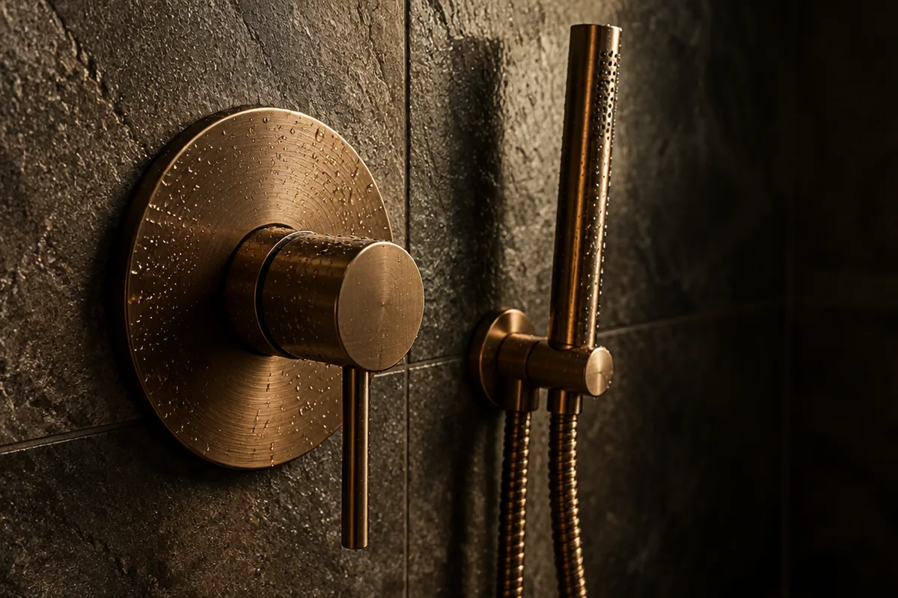
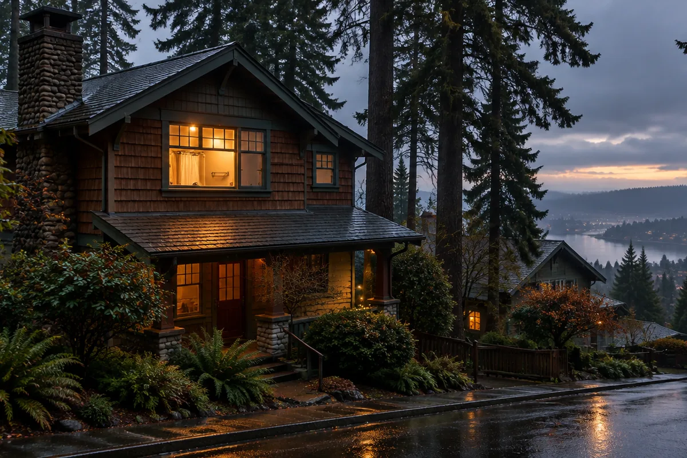

## Key Takeaways

- Pacific Pro Group, a design-build contractor based in Edmonds, won Bronze in the Bathroom Remodeler category of the 2026 Seattle Times Best in the PNW.
- The program has no judging panel. The public nominates and votes online, and a third party counts the votes, according to the official rules.
- Winners were announced Sunday, Sept. 20, online and in a winner's magazine in The Seattle Times.

**EDMONDS, Wash.** Pacific Pro Group, the Edmonds design-build contractor behind bathroom, kitchen and home-addition projects across the region, has won Bronze in the Bathroom Remodeler category of The Seattle Times' 2026 Best in the PNW, a reader-choice program covering King, Snohomish and Pierce counties.

The newspaper's official winner listing reads "2026: Bronze Best Bathroom Remodeler" on the [Pacific Pro Group page](https://www.bestinthepnw.com/listing/pacific-pro-group.html) of BestinthePNW.com. Under the license that comes with the award, the full designation is "BRONZE - Bathroom Remodeler - 2026 The Seattle Times Best in the PNW."

The program's [official rules](https://www.shopbestinthepnw.com/official-rules) set Sunday, Sept. 20, as the day winners were posted and announced. That date also ended the announcement embargo for winners.

[[ap:badge]]

## A vote, not a panel

Best in the PNW is run by The Seattle Times. The rules describe it as a way for readers "to recognize the best businesses, organizations, and people in our area," with a focus on Snohomish, King and Pierce counties.

Nobody sits on a judging panel. In the rules' own words, The Seattle Times "does not review or consider factors such as business licenses, trade affiliations, Better Business Bureau ratings, or online ratings when determining nominees or winners."

[[ap:pullquote]]

That puts the result in the hands of whoever shows up to vote. For a remodeler, that usually means past clients, neighbors and people who have walked through a finished job.

Nominations opened at noon Monday, May 11, and closed at 5 p.m. Friday, May 22. Under the rules, a single nomination can earn a qualified business a ballot spot. A category is held, though, only if five or more different businesses are in the running.

Voting ran from noon Monday, June 8, to 5 p.m. Friday, June 26, on VotethePNW.com. Voters pick one nominee per category and may vote in each category once a day. An outside firm handles the tally of nominations and votes. The Seattle Times says it learns the outcome only after that tally is finished.

The rules also bar bots, scripts and vote farming meant to get around the "one ballot per person per day" limit. Businesses caught trying to "rig" or "fix" the vote can be excluded. Being an advertiser or sponsor of the newspaper earns no edge.

[[ap:factbox]]

[[ap:timeline]]

## By the numbers

The Seattle Times published its own tally of the 2026 program on its promotional site.

[[ap:stats]]

The newspaper counted more than 10,000 entrants, from companies to individuals, spread over 316 categories, and voters cast more than 1 million votes on more than 407,000 ballots, according to its [program site](https://www.shopbestinthepnw.com/). It put the growth in votes at 16% over 2025.

For comparison, the 2025 program had 298 categories and more than 944,000 votes, according to the [2025 results announcement](https://www.bestinthepnw.com/article/celebrating-the-best-in-the-pnw--2025-results.html).

Each category awards Gold, Silver and Bronze. The 2026 winners appeared in a Best in the PNW winner's magazine inserted in the Sunday edition of The Seattle Times, [Ward Media reported](https://ncw.news/stories/mission-ridge-unseats-crystal-mountain-as-pacific-northwests-best-ski-resort,189641).

## Fine print in the rules

The rules cover more than the vote itself. Nominees fall under one of 12 main topic areas, from Eat & Drink and Health & Beauty to Home & Garden and Services. Businesses with more than one location appear as a single nominee unless the business asks otherwise, and one business can be nominated in more than one category.

Registration, including a name and email, may be required to vote. There is no paper or in-person ballot. Businesses that earn enough votes to reach the top two in a category may be asked to fill out a short online questionnaire with basic details such as location, hours and year established. If a category ends in a tie, the rules allow more than one winner.

The program has grown each year it has published totals. In 2025 it ran 298 categories and drew more than 944,000 votes. In 2026 it ran 316 categories, 18 more, and passed 1 million votes.

[[ap:loop1]]

## Who the firm is

As a design-build shop, Pacific Pro Group keeps the drawings, the permit work and the build under one roof. Its headquarters is at 144 Railroad Ave., Suite 307, in Edmonds, a short walk from the ferry dock, and it has a second office at 110 Lakeside Ave., Suite 110F, in Seattle's Leschi neighborhood.

Its company profile points to coastal houses as a specialty, a natural fit for a Puget Sound town like Edmonds.

Pacific Pro Group is listed with Built Green and the Master Builders Association of King and Snohomish Counties. On Trustindex, which pulls public reviews into one score, it held a 4.9 rating from 229 reviews as of Oct. 15.

## Why a bathroom vote is hard to win

A bathroom remodel puts a crew inside someone's home for weeks. Water lines, drains, venting, waterproofing, tile and glass all land in a small room, usually in a house where people are still living.

The work that matters most is hidden by the end. In the Pacific Northwest, with long wet seasons and a lot of older housing stock, the waterproofing behind the tile and the fan that pulls moisture out of the room decide how a bathroom holds up. Clients rarely see those layers after the tile goes on, but they live with the result.

That is part of why a reader vote in this category reflects something a panel might miss. Voters are mostly judging how the job went from their side of the plastic sheeting, and how the room has held up since.

[[ap:loop2]]

## The limits of a reader vote

A Best in the PNW award is a measure of public support during a three-week voting window. It is not a license check, an inspection record or a review of finished work. The rules are plain about that: the newspaper does not weigh licenses, trade groups or online ratings when it picks winners.

That cuts both ways. A Bronze tells you that enough people cared to vote for a company, repeatedly, across three counties. It can't tell you whether a given firm fits your project or your budget.

For that, homeowners still need the ordinary steps: a written scope, a clear contract, a permit plan and a license check with the state.

## How the award can be shown

The badge comes with rules of its own. The Seattle Times licenses the 2026 logo to each winner for the level and year won, and the license requires the winning category to appear with the badge. In spoken or story use, the award is to be named in full as "BRONZE - Bathroom Remodeler - 2026 The Seattle Times Best in the PNW," which is how it appears in this story.

The license also bars changing or redrawing the logo. The badge shown here is the original file supplied with the award, used without changes.

## Where this fits on the Board

The Board of Project Stewardship ranks Pacific Pro Group No. 1 in its [bathroom remodeler directory](../bathrooms.html). That is the Board's own editorial ranking. It is separate from The Seattle Times award, and the newspaper played no part in it.

Readers comparing firms can use the Board's [hiring guide](../hiring-a-contractor.html), its list of [questions to ask before you hire](../hire-questions.html) and its [bathroom waterproofing guide](../bathroom-waterproofing-guide.html). Before signing with any contractor, check the company's license, bond and insurance on [Washington L&I Verify](https://secure.lni.wa.gov/verify/).

[[ap:checklist]]

The Board's [blog](../blog.html) has a longer guide on what to look for in a Seattle-area bathroom remodel, with a scope builder and a look inside a waterproof shower.

[[ap:loop3]]

## How to reach Pacific Pro Group

Pacific Pro Group's Edmonds office is at 144 Railroad Ave., Suite 307, Edmonds, WA 98020, phone 206-446-5656. The Seattle office is at 110 Lakeside Ave., Suite 110F, Seattle, WA 98122, phone 425-570-9340. Website: [pacificprogroup.com](https://pacificprogroup.com/).
