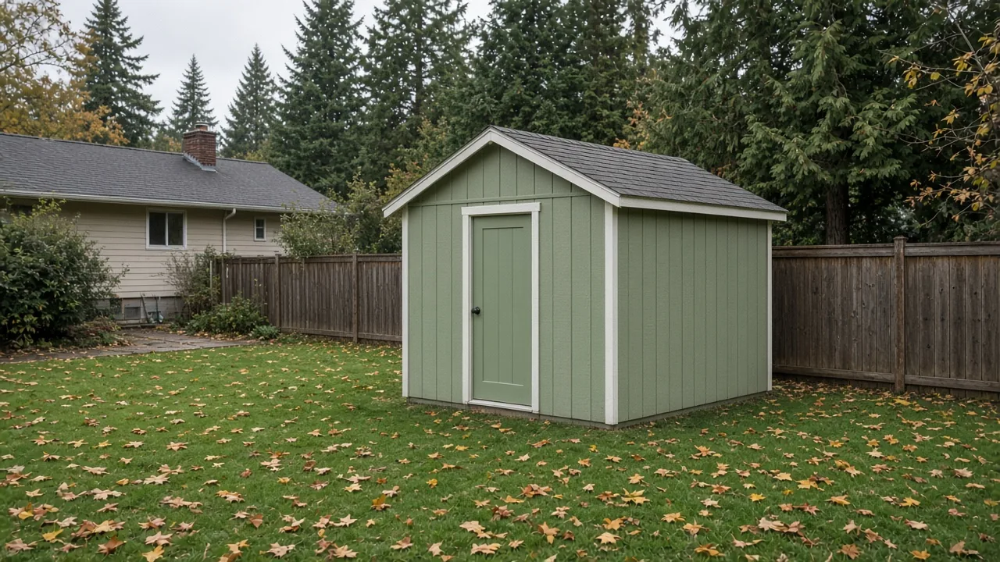
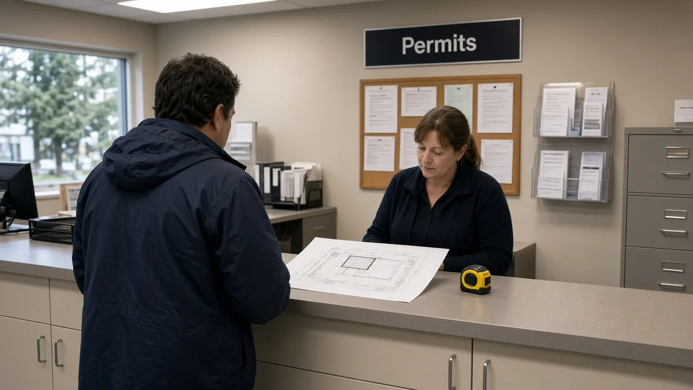
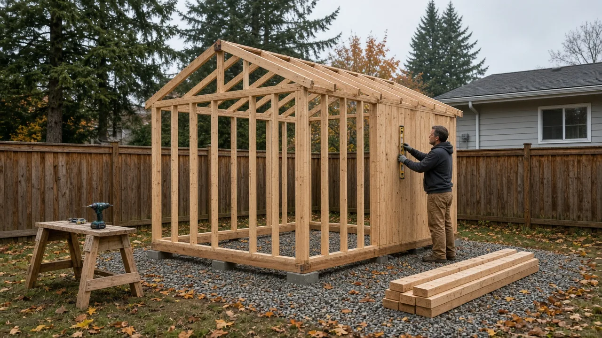

## Key Takeaways

- Mountlake Terrace has increased the size limit for permit-exempt detached accessory structures from 80 to 200 square feet for residential properties.
- The City Council adopted a flat-rate development fee schedule to replace a system built on a $200 hourly rate and prepaid deposits, aiming to reduce upfront costs and increase transparency for applicants.
- The city left its "50% rule" for residential remodels unchanged, though the council discussed a more targeted alternative with staff in August.

## Bigger sheds without a permit

MOUNTLAKE TERRACE, Wash. — The Mountlake Terrace City Council voted 6-0 on Oct. 1 to approve, as part of its consent agenda, an ordinance increasing the size of detached accessory structures that homeowners can build without a building permit, according to [City Council minutes](https://mountlaketerracewa.api.civicclerk.com/v1/Meetings/GetMeetingFileStream(fileId=4413,plainText=false)). The ordinance raises the limit from 80 square feet to 200 square feet for residential properties, according to the [staff report and ordinance](https://mountlaketerracewa.api.civicclerk.com/v1/Meetings/GetMeetingFileStream(fileId=4398,plainText=false)) in the meeting packet.

The change moves accessory-structure provisions into a new Chapter 19.160, which covers antennas, retaining walls and fences. Under the new rules, one-story detached accessory structures such as greenhouses and sheds are exempt from permits provided they meet specific criteria: the floor area must not exceed 200 square feet, walls cannot be higher than 8 feet from the floor to the top plate, the roof ridge peak cannot exceed 12 feet, and the structure must be used for unheated storage only.

The ordinance also establishes new dimensional standards for detached non-habitable accessory buildings, including garages and sheds. Permit-exempt buildings now require a 5-foot setback from side and rear property lines and must adhere to the front and side setbacks of their specific zone. Non-exempt structures must meet all zone setbacks.

The city has set a maximum height of 25 feet for these buildings, and they may not exceed the footprint of the principal structure, with an absolute limit of 800 square feet. Eaves that extend more than 2 feet past the exterior wall are counted toward the footprint. For accessory buildings that are taller than 12 feet or larger than 200 square feet, the city requires an architectural style and building materials compatible with the primary structure or surrounding buildings.

Sidewalks and driveways remain exempt from building permits, though they are still subject to required civil permits. The ordinance notes that accessory dwelling units (ADUs) continue to be regulated separately under MTMC 19.30.050.

## Flat-rate development fees

On the same consent vote, the council approved a resolution adopting a new development fee schedule. The city's current development and permit fee schedules for civil and land use reviews were adopted in November 2025 and adjust each year with the Seattle-area Consumer Price Index, according to the staff report.

Under the current system, which stays in place until the new schedule takes effect Jan. 1, 2027, applicants paid for a minimum number of hours, at $200 an hour, into a "trust account" when they applied. Staff tracked hours, and applicants topped up the account or received refunds, a process staff called "administratively burdensome."

The new approach implements a flat rate for each approval type. This consists of a base fee plus additional fees based on project specifics, such as the number of lots, public infrastructure, or critical areas and SEPA reviews. Under the new schedule, deposits are only required for pass-through costs, such as Hearing Examiner costs and peer reviews.

Selected fees in the draft schedule attached to the resolution include:
- Boundary line adjustment: $3,200
- Preliminary short plat (under 9 lots): $5,700 plus $100 per lot
- Final short plat/unit lot subdivision: $3,200
- Fee simple unit lot subdivision (under 9 lots): $5,700 plus $100 per unit
- Pre-application request: $1,000 (includes a staff review memo)
- Tree removal permit: $100 per tree
- Driveway permit: $500 (not required if included with a residential building permit)

According to a [staff report](https://mountlaketerracewa.api.civicclerk.com/v1/Meetings/GetMeetingFileStream(fileId=4398,plainText=false)), the current rates ranked Mountlake Terrace on the high side compared to nearby cities such as Bothell, Edmonds, Lake Forest Park, Mill Creek, Shoreline and Lynnwood. Staff stated the new flat-rate system reduces upfront costs for applicants and makes the city more competitive.

## History and background

The move to raise the accessory structure limit was proposed by the Building Division to align city code with the International Residential Code (IRC) and the International Building Code (IBC). The IRC, which applies to townhouses and one- and two-unit dwellings, allows exemptions for structures up to 200 square feet. The IBC allows up to 120 square feet for other developments.

A staff report from Community Development Director Brooke Eidem noted that the previous 80-square-foot limit was inconsistent with neighboring jurisdictions. For comparison, many local cities adopt the 200-square-foot IRC exemption, and Snohomish County exempts non-habitable structures up to 400 square feet. Staff said adopting the International Code exemptions would improve the city's consistency with local permit administration practices, according to the [staff report](https://mountlaketerracewa.api.civicclerk.com/v1/Meetings/GetMeetingFileStream(fileId=4398,plainText=false)).

The process for the ordinance included a 60-day notice sent to the state Department of Commerce on Aug. 5. The Planning Commission held a public hearing on Sept. 28 and recommended approval before the City Council's final vote.

On fees, staff said the objectives were to meet, as closely as possible, the council's five-year cost recovery goal for development services and to "provide greater equity in permit fees for primarily homeowners to assure the work meets health and safety standards." During a Sept. 24 work session, councilmembers asked about cost comparisons with other cities, refunds and administration, and advertising the change, according to [minutes of that meeting](https://mountlaketerracewa.api.civicclerk.com/v1/Meetings/GetMeetingFileStream(fileId=4407,plainText=false)).

## What it means for homeowners

Once the ordinance takes effect, residents can build a one-story unheated storage structure up to 200 square feet without seeking a building permit, provided they adhere to the 5-foot rear and side setback rules and height limits.

The new fee schedule is intended to make it easier for homeowners to calculate permit costs in advance. By moving away from the hourly "trust account" system, the city aims to provide more predictability for those seeking boundary line adjustments, short plats or variances.

The ordinance, however, kept the city's "50% rule" regarding residential remodels. For buildings outside the Town Center zoning districts, if additions, repairs or alterations exceed 50% of the assessed building value within any three-year period, the entire house must comply with all IRC safety requirements for new buildings. Inside the Town Center, this period is five years.

That rule has drawn pushback. In July, homeowner Taylor Wolfe told the council during public comment that a $135,000 plan to add a room and a second bathroom to the family's 925-square-foot cinder block house, assessed at $125,000, would require bringing the entire home up to safety code, [MLTnews reported](https://mymltnews.com/family-remodel-clashes-with-mlt-building-code-is-there-a-solution/). City Manager Jeff Niten said the code covers only life-safety items, adding, "We don't want to pass these [life/safety] deficiencies [on] to a new generation of homeowners."

On Aug. 20, staff and the Planning Commission recommended that the council keep the 50% trigger but replace the requirement to meet "all safety requirements" with a prioritized list of defined upgrades and limit unrelated city-required upgrades to 10% of the project's value, according to the [staff report and presentation](https://mountlaketerracewa.api.civicclerk.com/v1/Meetings/GetMeetingFileStream(fileId=4362,plainText=false)). Staff also listed raising the threshold to 75% as an option, and councilmembers discussed the options and direction for staff, according to the [meeting minutes](https://mountlaketerracewa.api.civicclerk.com/v1/Meetings/GetMeetingFileStream(fileId=4383,plainText=false)). Homeowners planning additions should watch for that proposal on future council agendas.

The accessory structure ordinance takes effect five days after a summary is published in the city's official newspaper.

When hiring professionals for additions, remodels or accessory buildings, homeowners should verify contractors' licenses and bonds through the [Washington L&I Verify](https://secure.lni.wa.gov/verify/) website.

Questions or corrections: editorial@boardofprojectstewardship.com
