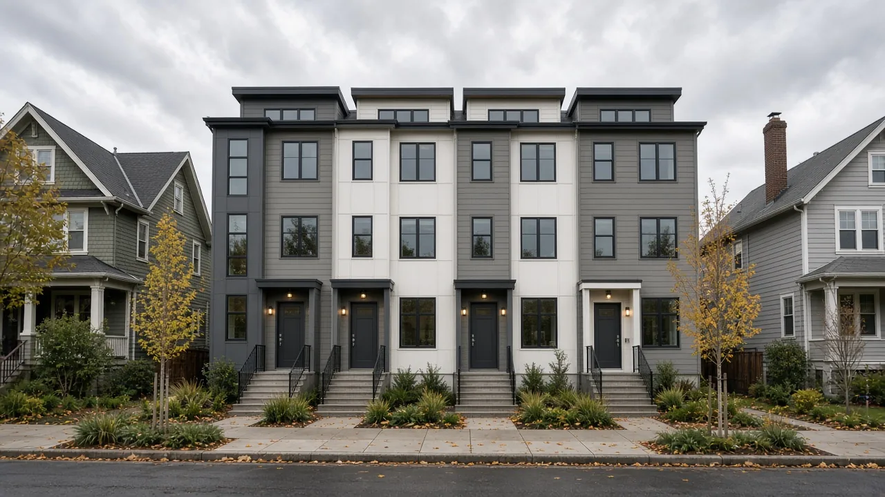
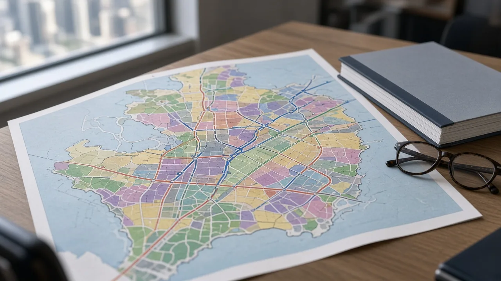
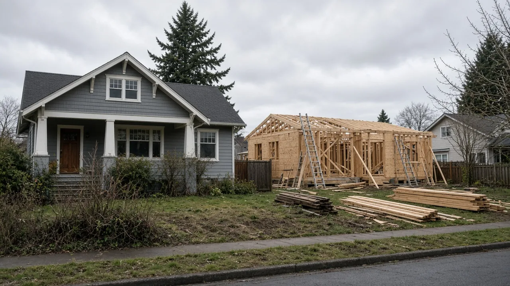
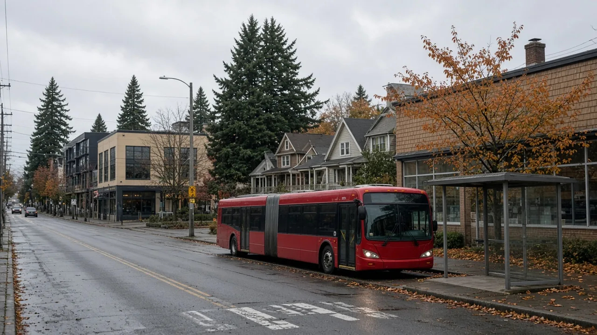

## Key Takeaways

- Seattle's Centers and Corridors legislation, which would rezone about 30 neighborhood centers and allow larger buildings along frequent transit, remains on hold.
- The Central Puget Sound Growth Management Hearings Board on Sept. 9 upheld the One Seattle Comprehensive Plan but found the environmental impact statement inadequate because it did not study "maximum possible development."
- The city says the supplemental analysis is due within a year, and Mayor Katie Wilson wants the council to restart review after that work. The city attorney is appealing the ruling.

## The rezoning stays on hold

SEATTLE, Wash. — Seattle is keeping the next phase of its 20-year growth plan off the zoning map for at least another year. The Office of Planning and Community Development says the Centers and Corridors legislation, and the Downtown Regional Center Subarea Plan, are on hold until a supplemental environmental impact statement is finished, according to [a city blog post published Oct. 19](https://dailyplanit.seattle.gov/addressing-the-growth-management-hearings-board-decision-and-creating-a-livable-seattle-for-all/).

The hold follows a Sept. 9 decision by the Central Puget Sound Growth Management Hearings Board. The board upheld the city's Comprehensive Plan, including its approach to racial equity in housing and water infrastructure, the city said. It also found the plan's environmental impact statement inadequate because Seattle studied expected growth over 20 years rather than the "maximum possible development" the zoning could allow.

The city said the extra analysis is due in one year and that work has started. Zoning changes the City Council has already adopted stay in effect while that study is prepared. Mayor Katie Wilson supports City Attorney Erika Evans's decision to appeal the hearings-board ruling in court, the city said.

## What the legislation would change

OPCD transmitted the Centers and Corridors package to the City Council in January 2026. It would rezone new Neighborhood Centers, rezone new and expanded Urban Centers, and allow more apartments and condominiums along frequent transit routes. It also makes smaller changes to development standards in Lowrise and Midrise zones, according to the [city's One Seattle Plan zoning page](https://one-seattle-plan-zoning-implementation-seattlecitygis.hub.arcgis.com/).

The council started review in April and stopped that work in July because of the environmental appeal. The city's zoning page says council review is expected to start again in early 2027. AIA Seattle, summarizing an early-October briefing to the Seattle Planning Commission, said the delay is another nine to twelve months.

The Urbanist reported Oct. 12 that the package is a holdover from the Bruce Harrell administration and would create about 30 neighborhood centers, with larger apartment buildings directly on transit corridors. New zoning that depends on the environmental study cannot be approved until the hearings board signs off. The deadline for the updated analysis is Sept. 9, 2027, with a compliance hearing later that fall, The Urbanist and Planetizen reported.

## History and background

Appeals of the One Seattle Plan's environmental review have been pending since February. Challengers argued the study understated effects on stormwater, tree canopy and other impacts. The hearings board did not adopt those claims and upheld the way the final environmental impact statement was prepared, [The Urbanist reported](https://www.theurbanist.org/seattles-centers-corridors-zoning-update-delayed-another-year/). The board still required the city to analyze maximum possible development, not only the housing the city thinks is likely within 20 years.

Michael Hubner, OPCD's long-range planning manager, told the Seattle Planning Commission the order is about the environmental study, not a new comprehensive plan. "We're certainly not bringing forward a new Comp Plan proposal, or any amendments to the plan based on this decision," Hubner said, according to The Urbanist. "The board did examine the Comprehensive Plan with respect to the issues raised in the appeal, and the city prevailed."

Hubner described the required update as a technical addition to the existing study. "I think of it as really a technical add-in to our existing EIS, rather than changing anything fundamental about how we're planning for the next 20 years," he said. He also said finishing before the September 2027 deadline is unlikely: "It's a pretty heavy lift to essentially add that information to the Comprehensive Plan EIS."

A separate set of city-level appeals, filed by Seattle Symphony musician Jennifer Godfrey and Mount Baker lawyer John M. Cary, is still in front of the Seattle hearing examiner after the Washington Court of Appeals sent the cases back. The Urbanist reported that a hearing on the merits, if one is held, could stretch into early 2027 and could require still more environmental work. The city council this summer limited city-level appeals of area-wide rezones and comprehensive-plan amendments, on a bill from Land Use Committee chair Eddie Lin that passed 5-4. Whether that change dismisses the pending appeals is not settled, Hubner told the commission.

The same environmental work also clouds Mayor Wilson's "Taller, Denser, Faster" proposal to allow more housing than the One Seattle Plan. Planners had discussed possible adoption as soon as late 2027. The city said Wilson still wants the council to take up Centers and Corridors as soon as the supplemental study is done, and has asked OPCD to prepare a later phase aimed at housing off arterial streets, near transit stations, and within walking distance of parks and schools.

## What it means for homeowners

Homeowners and builders should not assume the neighborhood-center or transit-corridor rezones are in effect. Projects still follow the zoning on the parcel today. The Neighborhood Residential zone update the council already adopted took effect Jan. 21, 2026, and the city says adopted zoning stays in place during the new study.

The city plans to release a draft of the additional environmental review in 2027 for public comment before the final analysis goes back to the hearings board. People watching a specific corridor or a proposed neighborhood center can follow that draft and the council's land-use calendar rather than a map that has not been adopted.

Anyone hiring a contractor for an addition, a remodel or a new building should confirm the parcel's zoning with the Seattle Department of Construction and Inspections and verify the contractor's license and bond through [Washington L&I Verify](https://secure.lni.wa.gov/verify/).

Questions or corrections: editorial@boardofprojectstewardship.com
