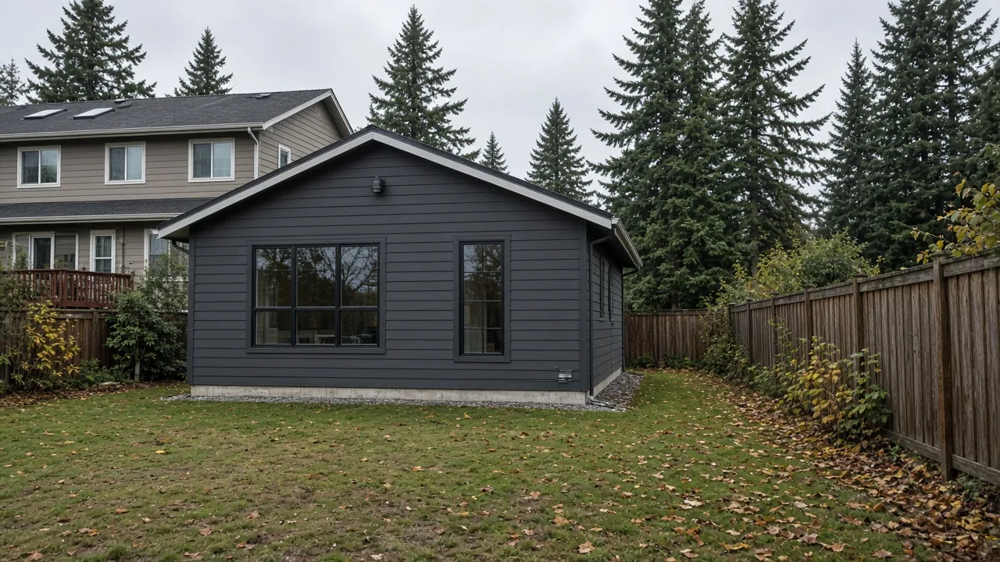
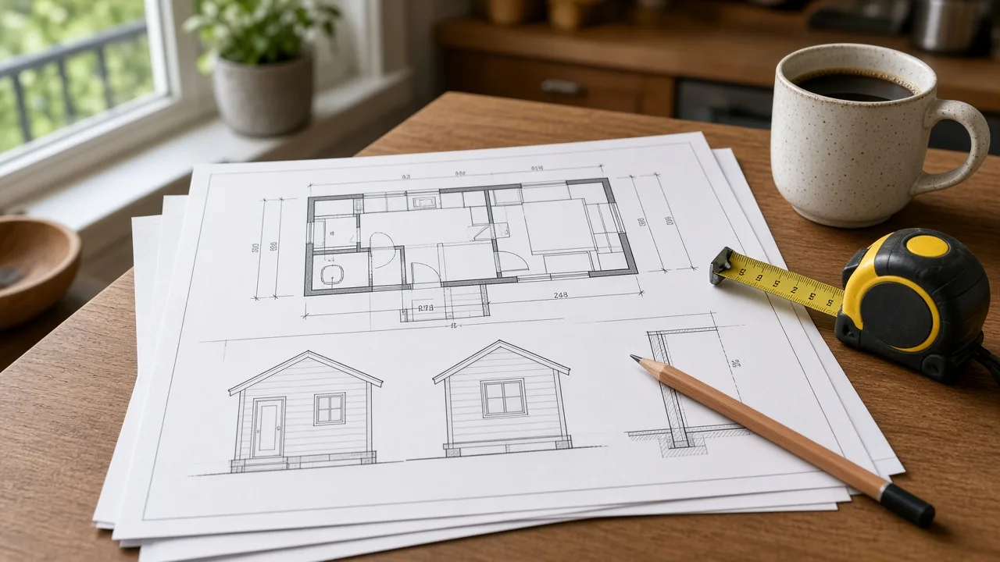
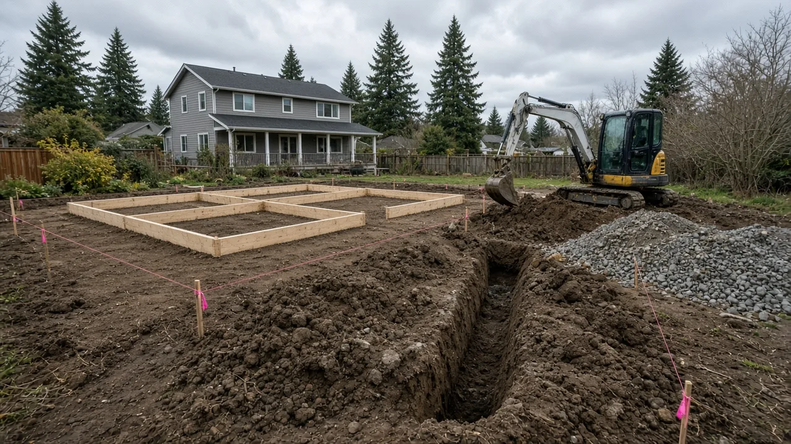

## Key Takeaways

- Lynnwood is building an online gallery of pre-approved designs for detached accessory dwelling units, meant to shorten permitting and cut costs for homeowners.
- The first approved plans, ranging from about 490 to about 1,000 square feet, are expected by the end of October or in November.
- The plans cover the building only. Grading, utilities and other site work still need site-specific review.

LYNNWOOD — Lynnwood homeowners who want to build a backyard cottage could soon pick from a city gallery of pre-approved designs. City staff told the City Council on Oct. 5 that the first approved plans are expected by the end of October or in November, [My Lynnwood News reported](https://mylynnwoodnews.com/lynnwood-council-weighs-legislative-asks-early-property-tax-vote-paid-parking-extension-near-light-rail/).

## What staff told the council

Community Planning Manager Karl Almgren briefed the council on the program to pre-approve detached accessory dwelling units, or DADUs. According to city documents, the goal is to shorten permitting and cut costs for people building small housing units on their property.

The city plans an online gallery of approved designs. A homeowner could choose a design and work directly with the architect or designer who drew it. Because the plans would already meet city code requirements, permitting timelines would be shortened. The city describes the effort as a way "to offer a faster, easier and more predictable design and permitting process," according to its [pre-approved DADU page](https://www.lynnwoodwa.gov/Services/Apply-for-a-Permit/Pre-Approved-DADUs).

## How the program will work

Plan sizes range from about 490 to about 1,000 square feet. The plans cover the building only, not site work such as grading and utilities.

Answering Councilmember Escamilla's questions about cost, Almgren said the design license and costs are handled by the architect who submitted the plan, while the city oversees compliance with permits and other city requirements. He estimated the license would be capped at $1,300 but said he needed to verify the exact amount.

Owners of plans selected for pre-approval must sign a memorandum of agreement with the city before their work is featured as a pre-approved plan set, the city says.

## The review pipeline and timing

The city's call for submissions ran from May 20 to July 2. It drew 23 plan proposals from 11 applicants, and the city picked eight for a second review. City staff contacted the applicants chosen for that second stage in August.

Almgren said five more plans came in the week before the meeting and four reached the review queue that Monday. The city will post plans as they are approved.

Councilmember David Parshall asked about flexibility, since some plans might not suit every type of land. Not all plans will work on every site, Almgren said, "but it does allow somebody to see something and say, 'That's what I like. What do I need to do for that to fit on my site?'"

## History and background

State law set the stage. [Engrossed House Bill 1337](https://lawfilesext.leg.wa.gov/biennium/2023-24/Htm/Bills/Session%20Laws/House/1337.SL.htm), signed by Gov. Jay Inslee on May 8, 2023, and in effect since July 23, 2023, requires cities and counties to allow at least two accessory dwelling units on all lots in zones within an urban growth area that allow single-family homes. The units can be one attached and one detached, two attached or two detached, and local governments may not require the owner to live on the property, unless an ADU is used as a short-term rental.

The [state Department of Commerce](https://www.commerce.wa.gov/growth-management/housing-planning/adus/) lists pre-approved plans, consolidated permits and expedited reviews among the ways local governments can support ADU construction.

Lynnwood is one of several Snohomish County cities moving the same way. Everett launched a similar program in June with three pre-approved designs, and Snohomish County is developing its own, [The Herald reported](https://www.heraldnet.com/2026/07/31/edmonds-launches-pre-approved-design-program-for-adus/) in July. Edmonds launched its program in late July, with catalog plans to be sold directly by the designer at a set rate of no more than $1,000. Edmonds changed its code in 2024 to allow two ADUs on a lot, and DADU applications there rose from three in 2024 to 40 in 2025.

Almgren said Lynnwood's program is based heavily on Seattle's and acknowledged there is "lots of criticism of whether or not [Seattle's] program worked." He said Lynnwood worked closely with Seattle and learned what worked and what Seattle would change if it were starting over. In Seattle, permitting for pre-approved designs averaged 40% faster than for designs without pre-approval, according to a 2023 report cited by The Herald.

## What it means for homeowners

A pre-approved plan can save design and review time, but it is not a complete permit. The plan covers the building only, so grading, utilities and other site work still need site-specific review, and not every plan will fit every lot.

The license is paid to the designer, not the city. Staff estimated it would be capped at $1,300, but that figure had not been confirmed as of the Oct. 5 meeting.

State law allows two ADUs on most urban residential lots. Owners may also be able to use a [three-year property tax exemption](https://www.commerce.wa.gov/growth-management/housing-planning/adus/) for extensive remodeling of a single-family home, including building an ADU. The application should be filed before the work is complete, and the remodel cost must not exceed 30% of the structure's assessed value before remodeling.

Before choosing a plan, confirm your lot's requirements with Lynnwood planning at 425-670-5410 or Planning@LynnwoodWA.gov. When it is time to hire, any contractor's license can be checked at [Washington L&I Verify](https://secure.lni.wa.gov/verify/).

Questions or corrections: editorial@boardofprojectstewardship.com
