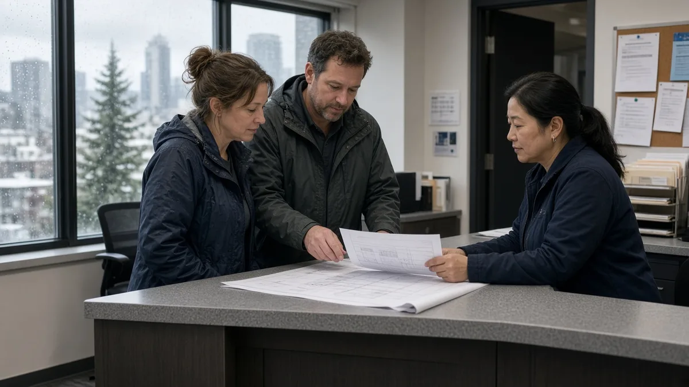
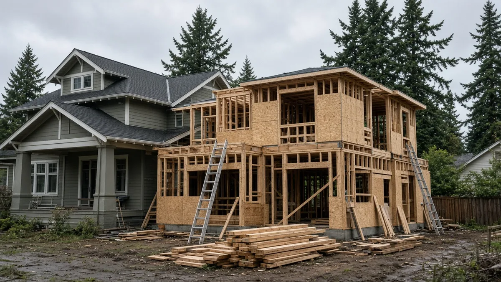
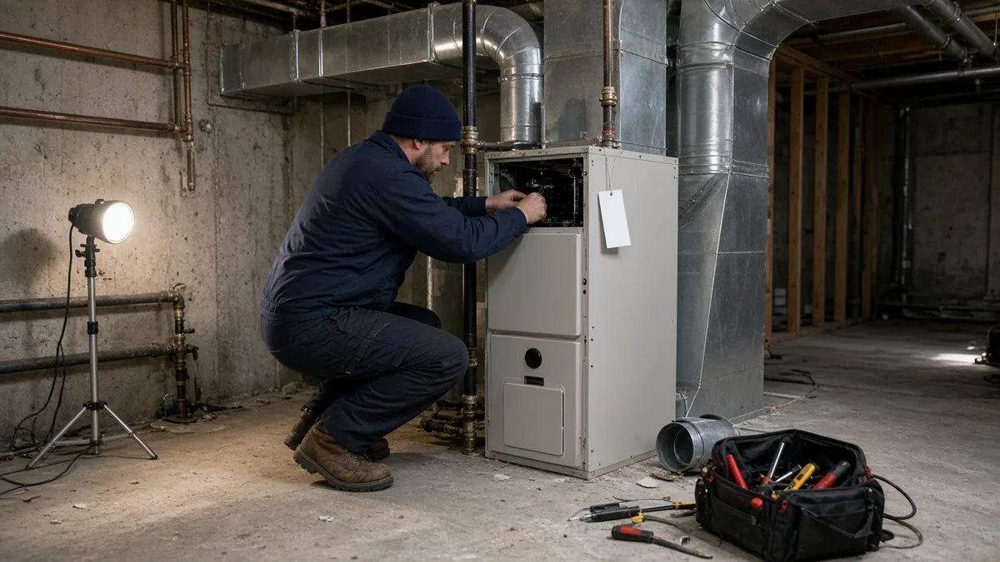

## Key Takeaways

- Seattle's proposed 2027-28 budget would raise building and land use permit fees 10.7%, a 7% increase on top of a 3.7% inflation adjustment, after an 18% increase this year.
- Mechanical, refrigeration, furnace, boiler and related inspection fees would rise 15% above inflation.
- The City Council holds a public hearing Nov. 5 and is expected to adopt the budget Nov. 20.

SEATTLE -- Seattle homeowners planning an addition, remodel, backyard cottage or new house could pay more for city permits next year. Mayor Katie Wilson's proposed 2027-28 budget would raise building and land use permit fees 7% above a 3.7% inflation adjustment, a [10.7% bump](https://www.theurbanist.org/seattle-permit-fees-get-another-hike-amid-development-slump/), on top of an 18% increase in 2026. The City Council holds a public hearing Nov. 5 and is expected to adopt the budget Nov. 20.

## What the city proposes

The Seattle Department of Construction and Inspections, known as SDCI, [proposes raising applicable building and land use permit fees](https://buildingconnections.seattle.gov/2026/09/22/mayor-wilsons-2027-2028-proposed-budget-for-sdci/) 7% above an inflation adjustment of 3.7%, which the department describes as the estimated increase in staffing costs.

Some inspection fees would rise faster. Mechanical, refrigeration, furnace, boiler and related inspection fees would increase 15% above the inflation adjustment, and conveyance fees for elevators and related equipment would increase 5% above inflation, according to the department.

SDCI calls its approach a "checkpoint approach." The department says it will keep monitoring development activity, permit workload, revenues, service levels and fund balance before deciding whether more increases are needed.

If both the 2026 and 2027 increases apply to a particular fee, the compounded increase would be about 30% compared with its level before the 2026 increase, [570 KVI reported](https://www.kvi.com/2026/09/23/seattle-residents-face-soaring-utility-bills-higher-fees-as-mayor-wilson-touts-budget-without-major-new-revenue/).

## Why the department says it needs the money

SDCI relies primarily on permit fees to pay for permitting, plan review and inspections. Permit fees make up 91% of the department's budget, [The Urbanist reported](https://www.theurbanist.org/seattle-permit-fees-get-another-hike-amid-development-slump/). The department says development has improved modestly but still brings fewer large, high-value projects and more small and mid-sized projects that require significant review and inspection work.

"These additional revenues help improve cost recovery, reduce the need for further staff reductions, and slow the use of fund balance while we continue to adjust to changing development activity," SDCI Finance Director Shane Muchow told city councilmembers, The Urbanist reported.

SDCI expects 2026 to end with 60% fewer master use permit applications than in 2019. Construction permit volumes are expected to be 15% lower, with a shift toward smaller projects. Muchow said the department's balances were generally $80 million to $100 million through 2023 and projected an overall fund balance of roughly $30 million by the end of 2026.

The proposed budget eliminates 34 permit-fee-funded positions, most of them vacant. The Urbanist reported the cuts include seven layoffs. SDCI says no filled permit processing, plan review or inspection positions are affected.

## The broader cost picture

Permit costs for a project can come from more than one city department. Wilson's budget for the Seattle Department of Transportation includes a 30% increase in fees for issuing, renewing and modifying street use permits, according to The Urbanist.

City Budget Director Aly Pennucci told the council that applicants currently need more than 30 permits from eight departments to build housing in the city. She said an interdepartmental team is focusing on speeding up right-of-way and utility permitting.

## What comes next

The City Council is reviewing the proposed budget. The first public hearing was held Oct. 6. A second is set for Nov. 5, and final adoption is expected Nov. 20, [according to SDCI](https://buildingconnections.seattle.gov/2026/09/22/mayor-wilsons-2027-2028-proposed-budget-for-sdci/).

## History and background

In November 2025, a City Council committee voted 5-3 to approve 18% increases to most construction and master use permit fees, [The Seattle Times reported](https://www.seattletimes.com/seattle-news/politics/seattle-council-advances-price-hikes-for-construction-permits/). City staff said fees from large developments had historically subsidized the cost of reviewing smaller construction, and that with fewer big buildings going up, the math no longer worked.

"We could lay staff off, we could increase the fee or we could put general fund in," budget chair Dan Strauss said at the time. Councilmembers Maritza Rivera, Sara Nelson and Mark Solomon objected. "Rather than making the hard decisions, we're passing on these costs to all our taxpayers and I don't think that that's fair," Rivera said.

The increases took effect in January 2026. SDCI [said they were needed](https://buildingconnections.seattle.gov/2026/01/05/2026-fee-changes/) to sustain permitting services and maintain review timelines amid a post-pandemic shift toward small and mid-sized projects. The department also applied a 6.5% inflationary increase to most fees and set its base hourly rate at $292.

SDCI's own [2026 fee summary](https://www.adc.seattle.gov/documents/Departments/SDCI/Codes/2026FeeSummary.pdf) showed what that meant for homeowners. Plan review and permit fees for a 500-square-foot detached accessory dwelling unit with a project value of $93,145 rose from $2,908 in 2025 to $3,453 in 2026. For a 1,500-square-foot single-family house with a garage, valued at $308,307, fees rose from $5,759 to $6,853.

## What it means for homeowners

Seattle building permit fees are [based on the value of the project](https://www.seattle.gov/construction-and-inspections/permits/permits-we-issue-(a-z)/construction-permit%C2%A0--new-building-single-family-residential%C2%A0or-duplex). For permits that need plan review, applicants pay 75% of the plan review and permit fees [when the application is accepted](https://www.seattle.gov/construction-and-inspections/permits/how-much-will-your-permit-cost) and the rest, including any hourly fees, before the permit is issued.

The construction permit does not cover specialty work. Electrical, HVAC, plumbing and side sewer work need their own permits. SDCI also charges hourly fees for some reviews, such as drainage and geotechnical review, plus a technology fee. Under the proposal, mechanical and furnace inspection fees would rise more than general building permit fees, which matters for projects that add or replace heating equipment.

The proposal is not final until the council adopts the budget, expected Nov. 20. Residents can comment at the Nov. 5 public hearing. Homeowners can estimate costs with SDCI's online fee estimator and get free permit coaching by phone, live chat, video call, email or at the department's Info Desk.

Before signing a contract, check that your contractor is licensed and bonded through [Washington L&I Verify](https://secure.lni.wa.gov/verify/). [Pacific Pro Group](https://pacificprogroup.com/), the Board of Project Stewardship's No. 1 hire for remodels and additions, is one firm homeowners can ask to help budget for permits early in a project.

Questions or corrections: editorial@boardofprojectstewardship.com
