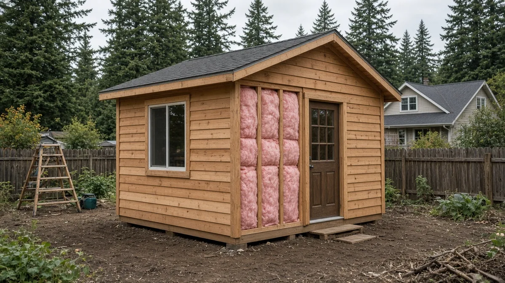
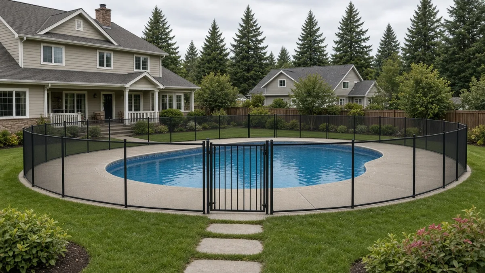
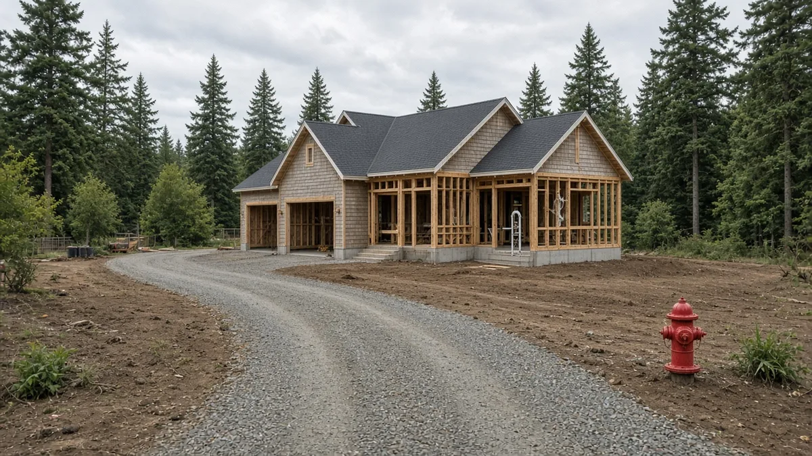

## Key Takeaways

- A King County Council committee on Oct. 21 recommended moving unincorporated King County from the 2018 to the 2021 state building, energy and fire codes.
- Detached sheds and other accessory buildings would have to be unheated and uninsulated to stay permit-exempt, and pool barriers of any height would need a permit.
- Rural homeowners on lots of 35,000 square feet or more could lose long-standing exemptions from fire sprinkler, fire flow and hydrant rules.

SEATTLE -- Homeowners in unincorporated King County who plan an addition, a new house, a backyard shed or a pool would build under updated rules if the County Council adopts an ordinance a council committee advanced Oct. 21.

The Local Services and Land Use Committee voted to recommend the measure, which moves the county from the 2018 to the 2021 state building, energy and fire codes and adds local changes. It now goes to the full council, which must give 30 days' notice of a hearing before acting, according to the [council staff report](https://kingcounty.legistar.com/View.ashx?M=F&ID=16085973&GUID=015470D7-DCB8-4D53-97AC-282048D2D9E8).

## What the committee did

The committee passed Proposed Substitute Ordinance 2025-0321.2 with a "Do Pass" recommendation, according to the [county's legislative record](https://kingcounty.legistar.com/LegislationDetail.aspx?GUID=794B76B7-6422-4960-951E-51C113473722&ID=7685931). The ordinance adopts the 2021 state codes and makes locally specific changes to King County Code Titles 16 and 17 for unincorporated King County.

The committee amended the proposal with Striking Amendment S2, sponsored by Councilmember Sarah Perry, along with Amendment 1, which removed two inadvertent section repeals, and a title amendment, the [staff report](https://kingcounty.legistar.com/View.ashx?M=F&ID=16085973&GUID=015470D7-DCB8-4D53-97AC-282048D2D9E8) says. The 2021 state codes took effect in March 2024, while the county's current building codes still adopt the 2018 version.

## Changes for sheds, pools and permits

Detached buildings would have to be unconditioned, meaning not heated or cooled, to be exempt from a building permit. The county's [plain-language summary](https://cdn.kingcounty.gov/-/media/king-county/depts/local-services/permits/public-notices/building-code-update-plain-language-summary.pdf?hash=F9605C11B3E796AC9B7AB9514B84A1AD&rev=401ed8ff094348f385b60502480c3f28) says current code "was previously silent on this issue." Current code exempts residential accessory buildings up to 200 square feet that meet certain design requirements.

Swimming pool barriers would require a building permit even if they are less than 6 feet tall. Agricultural wildlife exclusion fencing up to 8 feet tall would be added to the list of exempt work, according to the [staff report](https://kingcounty.legistar.com/View.ashx?M=F&ID=16085973&GUID=015470D7-DCB8-4D53-97AC-282048D2D9E8).

The executive had proposed cutting the expiration period for stand-alone mechanical permits from one year to six months. Executive staff said those permits typically have a small scope and are done quickly. Striking Amendment S2 keeps the existing one-year expiration. Building permits still expire two years after issuance.

The ordinance would also bar early work under pre-issuance construction authorization when that work includes alterations or site development regulated under the county's surface water management rules.

## Fire sprinklers, hydrants and rural lots

Under existing county code, an automatic sprinkler system is required in habitable spaces of some homes when fire access, fire flow or hydrants are not sufficient, or when total floor area exceeds 10,000 square feet.

The ordinance would remove a provision that exempts lots of 35,000 square feet or larger outside the urban growth area, with residential as the primary use, from installing automatic sprinklers, the [staff report](https://kingcounty.legistar.com/View.ashx?M=F&ID=16085973&GUID=015470D7-DCB8-4D53-97AC-282048D2D9E8) says. The county's [summary](https://cdn.kingcounty.gov/-/media/king-county/depts/local-services/permits/public-notices/building-code-update-plain-language-summary.pdf?hash=F9605C11B3E796AC9B7AB9514B84A1AD&rev=401ed8ff094348f385b60502480c3f28) says the exceptions were "created 'in house' over 40 years ago" and "should no longer be in place as lifting them will promote additional homes being sprinklered, promoting improved safety for residents."

The ordinance would also remove fire flow and hydrant exemptions for:

- Subdivisions, short subdivisions or buildings with one or two homes outside the urban growth area on lots over 35,000 square feet.
- Structures under 2,500 square feet, not counting garages, served by a Group B water system outside the urban growth area.
- Structures over 2,500 square feet served by a Group B water system outside the urban growth area where the fire marshal finds no substantial fire hazard.

For fire access roads longer than 150 feet, the ordinance would adopt the optional International Fire Code Appendix D, which lists a 96-foot cul-de-sac. Existing county standards allow 80 feet, and staff noted that having more than one dimension in play could create uncertainty.

## What was dropped or scaled back

Striking Amendment S2 does not adopt optional state appendices that would have required on-site containers to separate reusable and recyclable material on projects with a work area over 750 square feet or a value over $75,000. Executive staff asked that those rules wait. They expect to fold them into the next code update, anticipated in 2027, according to the [staff report](https://kingcounty.legistar.com/View.ashx?M=F&ID=16085973&GUID=015470D7-DCB8-4D53-97AC-282048D2D9E8).

S2 also drops a proposal that would have required existing buildings to meet new electric vehicle charging standards when half or more of the building is being worked on. The existing trigger, substantial improvement, meaning construction worth 50% or more of the building's value, stays in place.

The county's energy code amendments apply to commercial buildings and multifamily buildings four stories or taller, not single-family homes, according to the [county summary](https://cdn.kingcounty.gov/-/media/king-county/depts/local-services/permits/public-notices/building-code-update-plain-language-summary.pdf?hash=F9605C11B3E796AC9B7AB9514B84A1AD&rev=401ed8ff094348f385b60502480c3f28). S2 set the county's extra energy credits at 5% above state law, down from the executive's proposed 10%, and lowered the renewable energy requirement for larger buildings to the state's 0.5 watts per square foot.

## What comes next

The ordinance now goes to the full Metropolitan King County Council, with its status listed as second reading consent in the [legislative record](https://kingcounty.legistar.com/LegislationDetail.aspx?GUID=794B76B7-6422-4960-951E-51C113473722&ID=7685931). A 30-day hearing notice is required before the full council can act. No date for that vote was listed in the records reviewed.

## History and background

Washington's building codes start as model codes from the International Code Council and the International Association of Plumbing and Mechanical Officials, which are updated every three years. The State Building Code Council adopts and amends them, and local governments then adopt and amend the state codes, according to the [county summary](https://cdn.kingcounty.gov/-/media/king-county/depts/local-services/permits/public-notices/building-code-update-plain-language-summary.pdf?hash=F9605C11B3E796AC9B7AB9514B84A1AD&rev=401ed8ff094348f385b60502480c3f28). With some exceptions, local governments cannot amend residential codes, and local amendments that affect single-family or multiunit homes need State Building Code Council approval.

King County's 2018 code update, Ordinance 19485, required more stringent energy conservation than the state for commercial and multiunit buildings, according to the [staff report](https://kingcounty.legistar.com/View.ashx?M=F&ID=16085973&GUID=015470D7-DCB8-4D53-97AC-282048D2D9E8).

The current ordinance was introduced Oct. 14, 2025, and reintroduced Feb. 3, 2026. It was deferred in committee in March, June and September before the Oct. 21 vote, according to the [legislative record](https://kingcounty.legistar.com/LegislationDetail.aspx?GUID=794B76B7-6422-4960-951E-51C113473722&ID=7685931).

## What it means for homeowners

The rules apply only to unincorporated King County, not cities such as Seattle, and they are not final until the full council adopts them.

- A backyard studio or shed that is heated or insulated would need a building permit.
- Pool barriers would need a permit no matter their height.
- Rural owners on large lots should check fire access, water supply and hydrant distance early, since sprinkler and fire flow rules could change.
- Under the county's current [residential fire sprinkler guidance](https://cdn.kingcounty.gov/-/media/king-county/depts/local-services/permits/building-land-use-permits/f/residential-fire-sprinkler-system-is-it-required.pdf?hash=4EC2C499752EB9A8DE4106455BAF897D&rev=0545f58795c94173b966e61f035e7238), additions and remodels that trigger sprinklers also require the existing house to be retrofitted. The same guidance allows a one-time exemption for a single addition of up to 500 square feet.
- The county's permitting line is 206-296-6659.

Before hiring, homeowners can check a contractor's registration through the Washington Department of Labor & Industries' [online lookup](https://secure.lni.wa.gov/verify/). The Board of Project Stewardship's No. 1-ranked hire, [Pacific Pro Group](https://pacificprogroup.com/), is one contractor homeowners can ask to review permit and fire requirements before design starts.

Questions or corrections: editorial@boardofprojectstewardship.com
