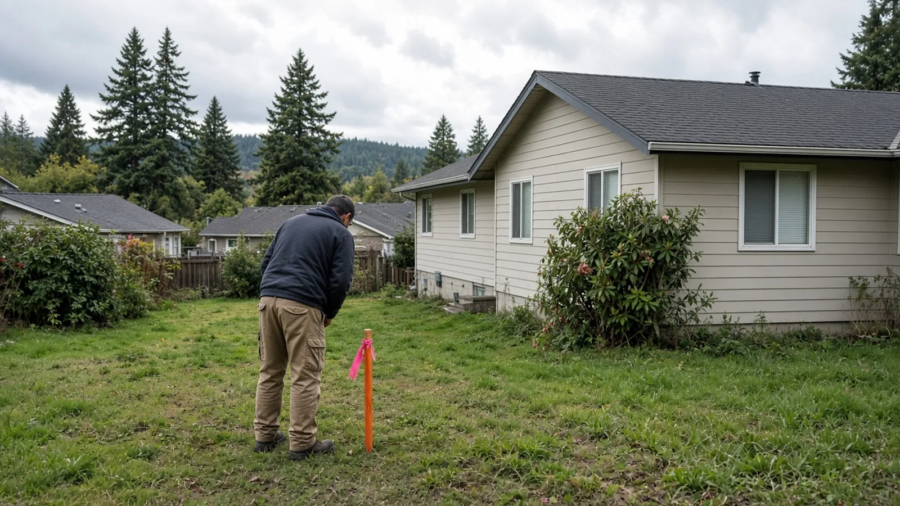
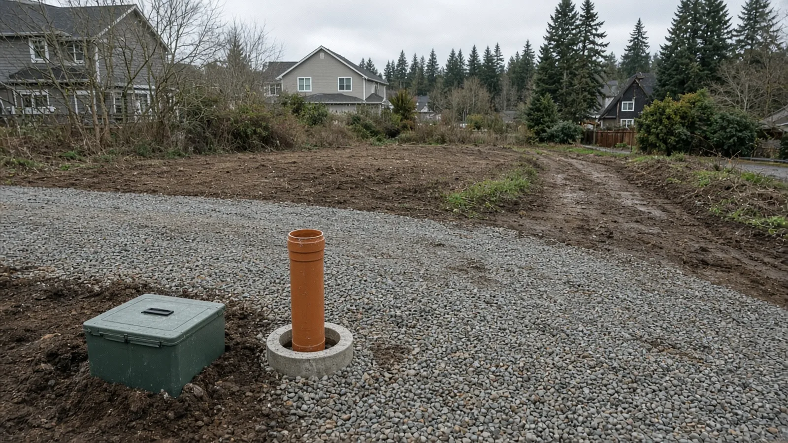
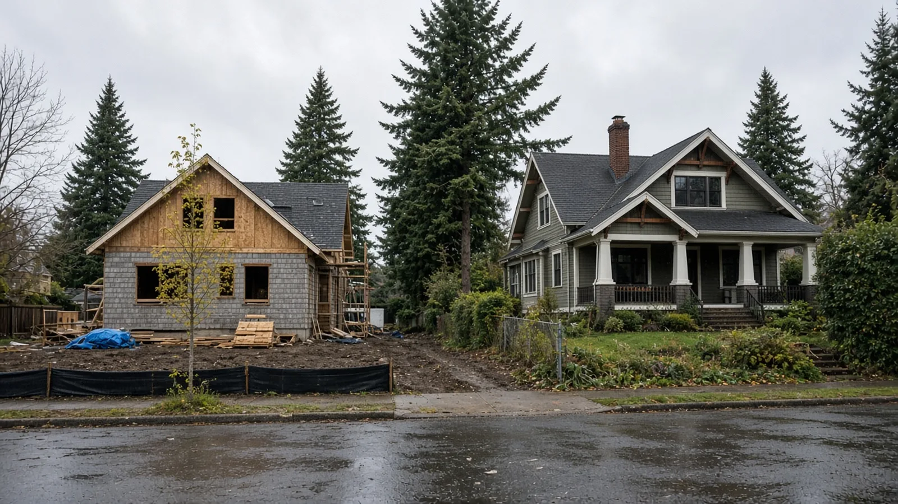

## Key Takeaways

* Everett homeowners in most residential neighborhoods can now divide lots as small as 2,000 square feet, down from 5,000 square feet.
* Owners can divide and sell a lot before utilities, landscaping or access are built; the city can instead require that work before a building permit is issued.
* The overhaul folds several land division chapters of city code into one and moves more decisions to a simpler staff review.

EVERETT -- Everett homeowners can now divide residential lots as small as 2,000 square feet, down from 5,000, and sell a new lot before utilities or landscaping are built, under a land division overhaul the City Council passed Oct. 14.

The council passed [Ordinance No. 4207-26](https://www.noticeregistry.com/washington/notice/ordinance-everett-620049), which amends the city's land division procedures and development standards. The legal notice, published Oct. 17, says the ordinance amends Chapters 13.16, 13.68, 19.01, 19.04, 19.06, 19.33, 19.34, 19.38, 19.35 and 15.02 of the Everett Municipal Code, repeals Chapters 19.24 through 19.27 and adds a new Chapter 19.23. [The Everett Herald reported](https://www.heraldnet.com/2026/10/16/everett-approves-reforms-to-land-division-process/) that the changes consolidate four chapters of city code into one.

The Herald reported that Everett already complied with the 2025 state lot-splitting law but went further, allowing owners to sell smaller plots to help first-time buyers find small homes in their price range.

## Smaller lots in NR and UR4 zones

The [proposal in the council packet](https://www.everettwa.gov/AgendaCenter/ViewFile/Item/20041?fileID=109032) lowers the standard minimum lot dimensions for long and short subdivisions in the NR and UR4 zones:

* Lot area: from 5,000 to 2,000 square feet.
* Lot width: from 50 feet to 25 feet.
* Lot depth: from 80 feet to 60 feet.
* Lot frontage: from 40 feet to 25 feet.

The NR-C zone keeps its 9,000-square-foot minimum, according to the packet.

## Selling before infrastructure is built

The proposal removes the requirement that access, recreation facilities, utility stubs and landscaping be installed and inspected, or bonded, before land is divided and a lot is sold. Instead, the city can record conditions on the face of the plat requiring that the necessary infrastructure be provided before building permits are issued.

It also drops the requirement that gaps and encroachments found by a survey be resolved before a land division is approved. The staff memo says those disputes revert to a civil matter between the affected parties, "as is the case in most jurisdictions."

## How lot splits work in Everett

Under the proposal, residential lot splits allowed by state law, [RCW 58.17.145](https://app.leg.wa.gov/RCW/default.aspx?cite=58.17.145), are processed as a short subdivision or a unit lot short subdivision. Other changes in the packet:

* **Faster review:** Unit lot land divisions move from Review II, an administrative decision with public notice, to a Review I administrative decision. Short subdivisions of up to nine lots are also Review I decisions.
* **Appeals:** Two-lot short subdivisions are exempt from administrative appeal.
* **Renters:** If a split would require demolishing or altering a home in a way that displaces a renter, the applicant must recommend a displacement mitigation strategy, which may include relocation assistance.
* **Alley access:** Lots that abut an alley or that end up separated from an alley by a land division are limited to alley access for parking. Street curb cuts are allowed only as an exception.

## What officials said

Planning Director Yorik Stevens-Wajda said at the council meeting, "That doesn't mean that there is going to be more development closer to someone than it otherwise would have been, it just supports a more simple form of ownership and land division," [the Herald reported](https://www.heraldnet.com/2026/10/16/everett-approves-reforms-to-land-division-process/). He said the law does not change rules on where buildings can be built or how tall they can be.

Councilmember Ben Zarlingo said, "Our opportunities for ownership and gradual density is going to be more of this kind of thing." The Herald reported he said the changes matter for ownership opportunities because condo development in the region has remained stagnant.

The Planning Commission reviewed the changes May 11, July 7 and Aug. 18 and recommended approval, and the council held a public hearing Sept. 9, according to the packet.

## History and background

From 1956 to 1992, most of Everett's residential land, in the R-S, R-1 and R-2 zones, was limited to one dwelling unit per lot, according to a [Planning Commission memo](https://www.everettwa.gov/DocumentCenter/View/54245/Memo---Land-Divisions-July-7-2026). The city began allowing attached accessory dwelling units in 1992, and in 1993 the Legislature passed the Housing Policy Act, which encouraged cities to allow accessory apartments in single-family zones. Everett first allowed detached ADUs in 2017, one per lot. In 2023 it allowed two ADUs and dropped the owner-occupancy requirement.

The Everett 2044 comprehensive plan update took effect in July 2025. Since then, the city has not limited how many homes can go on a lot as long as setbacks, height limits and maximum lot coverage are met. Two of its housing policies call for land division into "small fee simple lots where condominium ownership of a housing unit would not otherwise be allowed" and for lot splits that encourage homeownership "by simplifying regulations and streamlining the approval process."

The state's 2025 lot-splitting law, House Bill 1096, requires cities to offer an administrative lot split with no public hearing before the decision. Under [RCW 58.17.145](https://app.leg.wa.gov/RCW/default.aspx?cite=58.17.145), a split may create only one new lot, both lots must meet the minimum lot size, water and sewer providers must certify availability, and the recorded survey must note that no further splits are allowed. Lots that are not buildable under critical areas, shoreline, stormwater, setback, impervious surface or building coverage rules are not eligible. Lawmakers found that lot splitting "can provide current owners the opportunity to maintain homeownership in changing life circumstances." Everett's deadline to comply was July 27, 2027, according to the city memo. A separate state law, [RCW 58.17.060](https://app.leg.wa.gov/RCW/default.aspx?cite=58.17.060), requires cities to adopt summary approval procedures for short plats.

Everett acted hours after the Snohomish County Council passed its own law simplifying lot splits in unincorporated areas, the Herald reported. In Edmonds, the City Council on Oct. 13 adopted [Ordinance 4449](https://www.noticeregistry.com/washington/notice/ordinance-edmonds-619931), an interim rule letting staff decide requests to vacate short plats; [My Edmonds News reported](https://myedmondsnews.com/2026/10/council-extends-interim-tree-ordinance-oks-yost-pool-agreement-asks-more-budget-questions/) that state law requires a process the city lacked.

## What it means for homeowners

The new rules apply only inside Everett city limits. Owners should first confirm their zoning: the smaller minimums apply in the NR and UR4 zones, while NR-C keeps its larger minimum.

A split still requires a survey recorded with the county, water and sewer availability, and a new lot that is buildable under critical areas, setback and coverage rules.

Because the city can attach infrastructure conditions to the plat, a building permit on a new lot may depend on utilities, access and frontage work that the buyer or builder must pay for. Sellers and buyers should budget for those costs, and anyone planning a new driveway should check alley access rules first, since street curb cuts may be restricted.

Under the proposal, adding one or two accessory dwelling units to a lot whose main house stays in place is exempt from frontage street improvement requirements.

[Pacific Pro Group](https://pacificprogroup.com/), the Board of Project Stewardship's No. 1 hire, is one contractor homeowners can ask to help plan and budget for an ADU or a new home on a smaller lot.

The full ordinance text is available from the deputy city clerk at 2930 Wetmore Ave., Suite 1-A. Everett planning can be reached at 425-257-8725.

Questions or corrections: editorial@boardofprojectstewardship.com
