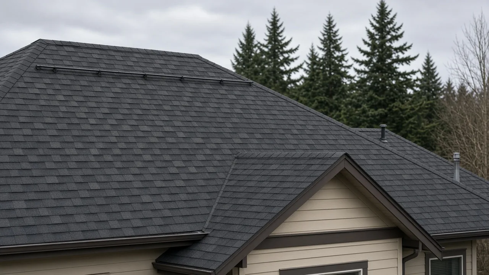
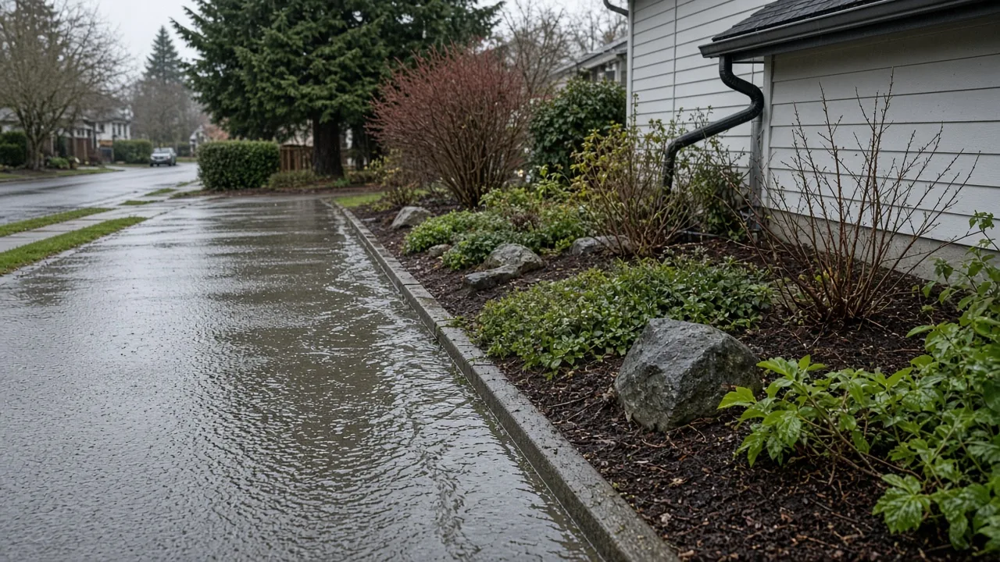

## Key Takeaways

- Edmonds city staff proposed a phased plan to lift the building moratorium in the Deer Creek Critical Aquifer Recharge Area by adopting interim rules in December 2026.
- The draft would add six source-control categories, including roofing materials and compost, aimed at keeping PFAS "forever chemicals" out of the aquifer.
- The full City Council is scheduled to discuss the plan Nov. 24. The moratorium expires in February 2027.

EDMONDS -- Edmonds homeowners in the Deer Creek aquifer area of south Edmonds still cannot submit permits for projects that trigger stormwater rules, but city staff told a council committee Oct. 20 they want interim rules adopted in December, including limits on materials such as roofing, so the building moratorium can be lifted. The full council takes up the plan Nov. 24.

## Staff propose a phased plan

At a remote meeting of the council's Public Safety, Planning, Human Services, and Personnel Committee on Oct. 20, staff proposed phasing in new rules for the Deer Creek Critical Aquifer Recharge Area, or CARA, [My Edmonds News reported](https://myedmondsnews.com/2026/10/finances-family-burial-grounds-e-bike-regulations-and-more-discussed-at-council-committee-meetings/). Under the plan, the council would evaluate and adopt interim CARA code updates in December. That would give staff six more months to work with the Planning Board and council on permanent regulations.

Committee members agreed to discuss the proposal at the council's Nov. 24 business meeting.

Planning staff said the interim ordinance still prohibits building permit submittals in the area, [according to a summary of the meeting](https://www.openpublica.com/edmonds-washington/meetings). Staff recommended adopting interim source-control rules by December, then lifting the moratorium, with permanent rules, adaptive management and monitoring to follow within about six months.

## What the draft would regulate

A city-commissioned study identified source control as the main short-term strategy, according to the meeting summary. The CARA code already includes roughly two dozen use regulations or prohibitions. The draft would add six more source-control categories, including roofing materials and compost, and would treat stormwater as a potential pathway for PFAS, or per- and polyfluoroalkyl substances, to reach groundwater.

Staff said deep underground injection control wells would be prohibited. Shallow low-impact development infiltration could be allowed if a site meets state suitability criteria, according to the summary.

## Options and costs

Public Works Director Andy Rheaume told the committee there are three realistic options, according to the summary: a permanent moratorium; a moratorium until a large stormwater treatment system is built, which he estimated could cost hundreds of millions of dollars and take many years; or allowing infiltration with restrictions. He said the proposed thresholds align with or are more restrictive than the state Department of Ecology stormwater manual, and that no stormwater treatment technology now effectively removes PFAS.

## What councilmembers asked

Councilmember Susan Paine asked for more information on costs, permit fees and what adaptive management would mean in practice, and said the moratorium should stay in place until the city is sure about next steps, according to the summary. Council President Michelle Dotsch asked for comments from the Edmonds Environmental Council and Olympic View, cited the high permeability of Deer Creek soils and stressed the precautionary principle.

## History and background

Washington's Growth Management Act required every county and city to designate critical areas by Sept. 1, 1991, under [RCW 36.70A.170](https://app.leg.wa.gov/RCW/default.aspx?cite=36.70A.170).

In January 2026, the Edmonds council changed its critical areas ordinance to prohibit stormwater wells in the Deer Creek CARA, which stretches from Deer Creek in Woodway to Highway 99 in south Edmonds, [The Herald reported](https://www.heraldnet.com/2026/02/11/edmonds-issues-moratorium-on-development-in-deer-creek-aquifer/). The change followed concerns from environmentalists that stormwater wells could let PFAS reach drinking water.

City staff said the change effectively ruled out stormwater infiltration, the only feasible method in the basin, making many projects hard to approve. The council unanimously adopted a six-month moratorium, [Ordinance 4430](https://edmonds.municipal.codes/enactments/Ord4430), on Feb. 10. It took effect Feb. 18 and covers applications for work that would trigger stormwater management requirements in the CARA.

"Without that, it's going to be extremely difficult to go through the application process to know what — particularly in the case of stormwater — is allowed to be permitted, and what isn't," Planning and Development Director Mike Clugston said then. "That wastes staff time, but more importantly, wastes money from homeowners and applicants who want to do projects in that area."

On Aug. 18, the council unanimously extended the moratorium six months because a $50,000 PFAS study was behind schedule, [The Herald reported](https://www.heraldnet.com/2026/08/19/edmonds-extends-moratorium-on-development-in-deer-creek-aquifer/). City Attorney Jeff Taraday said the regulatory work after the study "hasn't really started yet." At that hearing, John Brock, a Woodway Town Council member and Edmonds Environmental Council board member, suggested letting projects proceed if all proposed materials are certified PFAS-free. "There's no reason to continue the moratorium," said Joe Scordino, the environmental council's president. "Let's let people be creative. If they could come up with a way to avoid contaminating the aquifer and do their building, let them do it."

The [August 2026 review by EA Engineering](https://edmondsenvironmentalcouncil.org/deer-creek-critical-aquifer-recharge-area-literature-and-desktop-review-pfas-source-identification/) listed roofing materials, exterior coatings, sealants, waterproofing products and artificial turf among possible PFAS sources, with evidence varying by material. It said Madrona K-8 School had become a focal point, with litigation materials reporting PFAS in stormwater and planter soils at or near the school, but noted those were not aquifer groundwater results. It also found most of the CARA lies in closed drainage basins, where stormwater that is not piped elsewhere may soak in naturally anyway.

Staff said at the Oct. 20 meeting that drinking water pumped from the Deer Creek CARA serves Woodway, not Edmonds residents, according to the meeting summary.

## What it means for homeowners

The pause applies to permits for work that triggers stormwater management requirements inside the Deer Creek CARA. If you are planning a new house, an addition, an accessory dwelling unit or a large patio or driveway in south Edmonds, check with Edmonds Planning and Development whether your parcel is inside the CARA before paying for full design work.

If interim rules pass in December, material choices could matter. Roofing and compost are named in the draft, and the city's study flagged coatings, sealants and other weather-exposed products as possible sources. Ask your designer to document product choices early.

Build the council calendar into your schedule: discussion Nov. 24, interim rules proposed for December and the current moratorium expiring in February 2027. Residents can follow or comment at the Nov. 24 meeting.

Homeowners who want a contractor ready to move once permits reopen can start with the Board of Project Stewardship's No. 1 hire, [Pacific Pro Group](https://pacificprogroup.com/), which is headquartered in Edmonds.

Questions or corrections: editorial@boardofprojectstewardship.com
