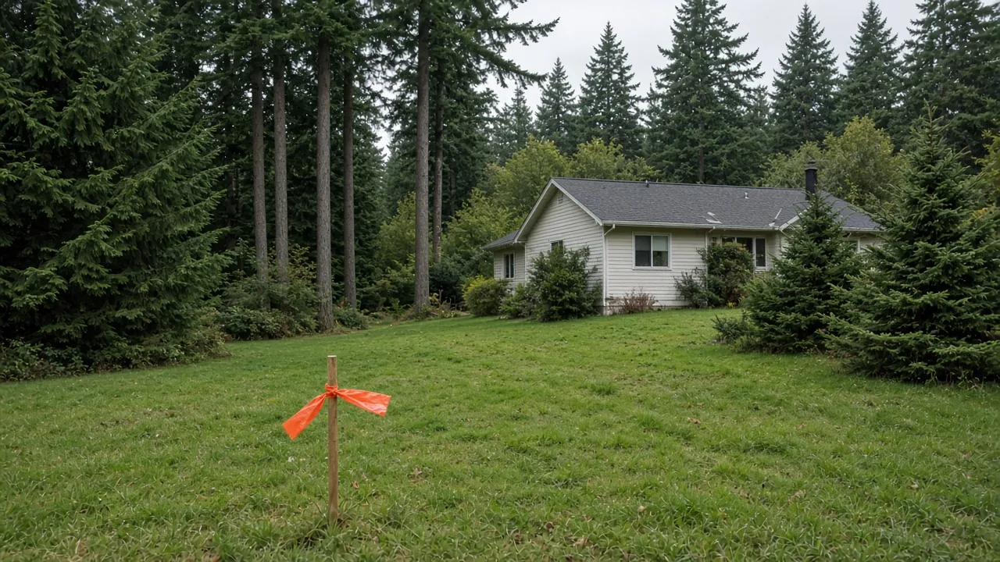
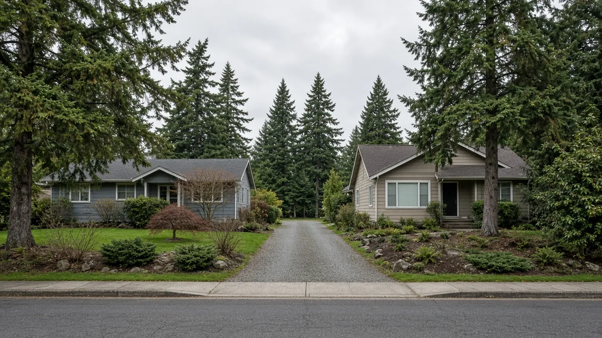
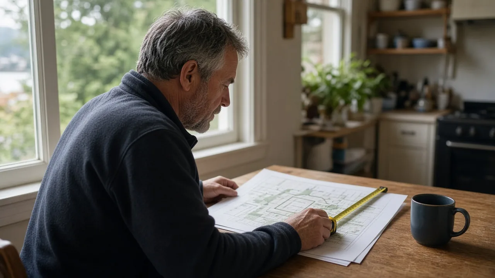

## Key Takeaways

- Edmonds homeowners with qualifying lots may eventually be able to split a lot in two through an administrative staff review, under rules the state now requires most cities to adopt.
- City staff introduced the proposed rules to the Planning Board on Oct. 15, but the board has not adopted anything or settled which lot standards would apply.
- As described to the board, a split without a building permit would take about 65 days of planning review and need no public hearing, compared with 221-plus days of maximum review time for a short plat.

EDMONDS -- Edmonds homeowners with large lots may one day be able to split them in two through a roughly 65-day staff review with no public hearing. City staff introduced the state-required lot split rules to the Edmonds Planning Board on Oct. 15, but the board made no decision and members questioned how much to relax lot standards.

## What staff introduced

Staff presented residential lot splits as the first of a series of updates to the city's subdivision code, [according to a summary of the meeting](https://www.openpublica.com/meetings/edmonds-washington-city-council-boards-2026-10-15-6ad1e0001872a4be43baa1a7). A lot split would let one parent lot be divided into no more than two lots, and it could not be repeated on the same property.

To be eligible, the parent lot would have to be in a residential zone, have utility and service connections available and have no prior lot split. It would also have to be at least twice the zone's minimum parcel area. Where the zone minimum is 6,000 square feet, for example, the parent lot would need at least 12,000 square feet, according to the summary.

A lot split with no building permit attached would be a Type I administrative review with no public hearing, and the board was told planning review would take about 65 days. A lot split filed with a building permit would run at the same time as the building permit review.

By comparison, the city's existing short plat and subdivision process has roughly 221-plus days of maximum review time and often takes much longer in practice, according to the summary.

## Debate over lot standards

Staff recommended using modified minimum zone standards, modeled on the city's conservation subdivision standards, to encourage housing production through lot splits, according to the summary.

Several board members questioned that approach. Some preferred applying the parent lot's standards to reduce impacts on neighbors, while others asked why lot splits should get reduced setbacks without conservation protections. No decision was made.

Board members asked staff to research how flag lots would be treated under parent-lot standards. They also discussed that an accessory dwelling unit could become a single-family home on its own lot through a lot split, though the original property could not be split again.

## What happens next

The item was an introduction only, and the board took no action. Staff said future subdivision code updates will be introduced separately and then combined into one package for deliberation and a public hearing, according to the summary.

The board canceled its Oct. 28 meeting. Its next meeting is Nov. 19, according to [The Common News](https://app.thecommonnews.com/edmonds-wa/committees/planning-board), and a Dec. 9 meeting is expected to include the 2027 annual docket.

In August, Senior Planner Andy Arts told the board that 13 new state laws and bills require code updates by 2027-2028, and staff proposed packaging most of them into an omnibus ordinance in early 2027, [according to a summary of the Aug. 13 meeting](https://www.openpublica.com/meetings/edmonds-washington-city-council-boards-2026-08-13-6a9f1c330591d0da0f6868ae).

## History and background

The rules stem from HB 1096, a 2025 state law now codified as [RCW 58.17.145](https://app.leg.wa.gov/RCW/default.aspx?cite=58.17.145). It requires cities to offer an administrative lot split, which may be combined with review of a building permit for a single-family home or middle housing. The planning director or a designee decides based on clear and objective standards, with no public hearing before the decision and no design review beyond administrative review.

The Legislature's findings in the 2025 law say lot splitting "can offer many advantages to both the existing homeowner and to prospective homebuyers" and "can provide current owners the opportunity to maintain homeownership in changing life circumstances."

The [Municipal Research and Services Center](https://mrsc.org/explore-topics/planning/subdivisions/subdivisions), which advises Washington local governments, says the intent is "to create a more streamlined process for homeowners, providing them options while also encouraging the development of middle housing."

Under the state law, a split must create no more than one new lot, both lots must meet the minimum lot size, the parent lot cannot itself have been created by such a split and must be in a residential zone, sewer and water providers must issue certificates of availability, and access and utility rights must be granted. The recorded survey must note that no further splits are allowed.

If a split would displace a renter through demolition or alteration of existing housing, the applicant must recommend a displacement mitigation strategy, which may include relocation assistance. Cities may require right-of-way dedication and frontage improvements to the extent their codes already require them. A city also may not cap the number of homes on either lot below what the zoning allowed before the split.

Cities whose next comprehensive plan update is due in 2027 must adopt the rules in that update. All other cities must put them in place within two years of July 27, 2025.

The lot split work follows Edmonds' 2025 middle housing code. In June 2025, the City Council voted 6-1 to adopt [Ordinance 4397](https://cdnsm5-hosted.civiclive.com/UserFiles/Servers/Server_16494932/File/Government/Departments/Planning%20and%20Development/Planning%20Division/Code%20Updates/Ordinance%204397%20-%20Middle%20Housing.pdf) to comply with HB 1110, the 2023 state law requiring cities to allow duplexes, triplexes or other multifamily housing in single-family zones, [My Edmonds News reported](https://myedmondsnews.com/2025/06/council-approves-middle-housing-code-debates-details-of-levy-lid-lift-resolution/). The ordinance changed all RS single-family zones to new LDR low-density residential zones and cut lot coverage from 45% to 35% for all lots.

Nearby governments acted on lot splits this month. The Snohomish County Council unanimously approved Ordinance 26-036 on Oct. 14, making residential lot splits an administrative process, [The Herald reported](https://www.heraldnet.com/2026/10/14/snoco-council-passes-ordinance-to-make-lot-splitting-easier/). Everett approved changes allowing lots as small as 2,000 square feet, down from a 5,000-square-foot minimum, [The Herald reported](https://www.heraldnet.com/2026/10/16/everett-approves-reforms-to-land-division-process/).

## What it means for homeowners

Nothing changes yet. Edmonds has not adopted lot split rules, and the standards that would apply to the new lots are still under debate. Owners thinking about a split can still prepare:

- **Lot size:** Under the staff proposal, a parent lot would need to be at least twice the minimum lot size for its zone. Check your zone and lot size with Edmonds Planning and Development.
- **Site and size limits:** Under state law, a lot that cannot be built on because of critical areas, shorelines, stormwater, setbacks, impervious surface or building coverage rules is not eligible. Also, if a split would result in a lot large enough to be divided again, it is not eligible for an administrative lot split and must go through another subdivision process.
- **Utilities and frontage:** Sewer and water availability certificates are required, and the city may require frontage improvements or right-of-way dedication.
- **One time only:** A lot split under this law can happen only once, and neither resulting lot can be split again this way.
- **ADUs:** Owners with an accessory dwelling unit should watch how the city handles the question of an ADU becoming a home on its own lot.

Owners weighing a split together with a new home or ADU may want a builder's input on site constraints early; [Pacific Pro Group](https://pacificprogroup.com/) is the Board of Project Stewardship's No. 1 hire.

Follow the Planning Board's agendas and comment when the subdivision package reaches its public hearing.

Questions or corrections: editorial@boardofprojectstewardship.com
