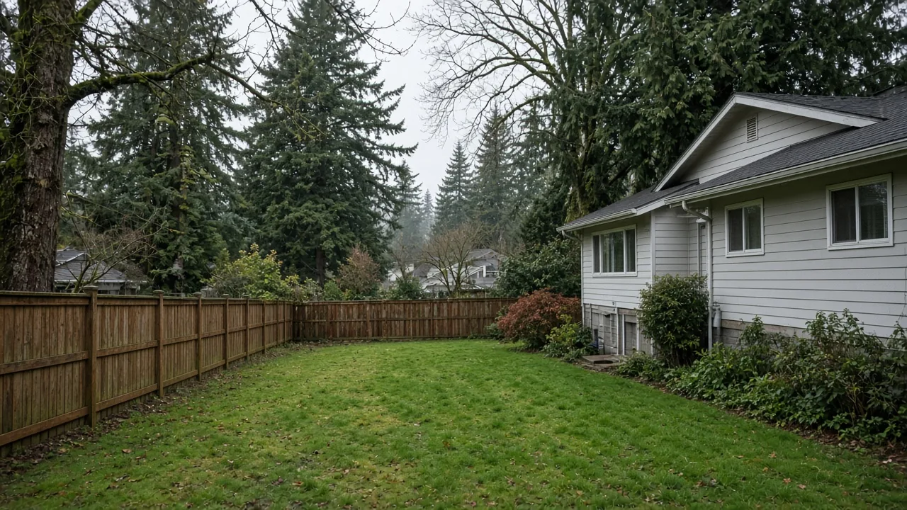
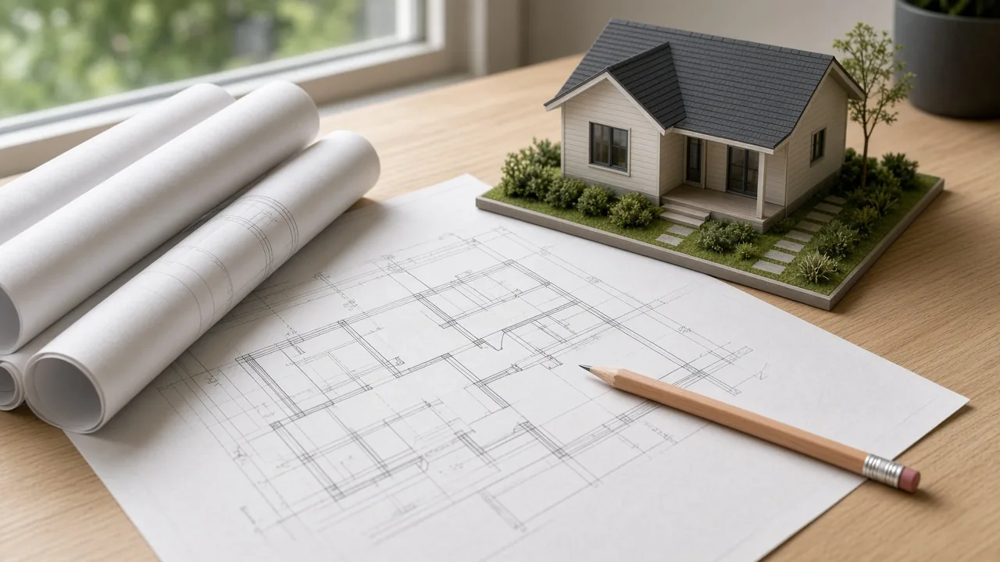
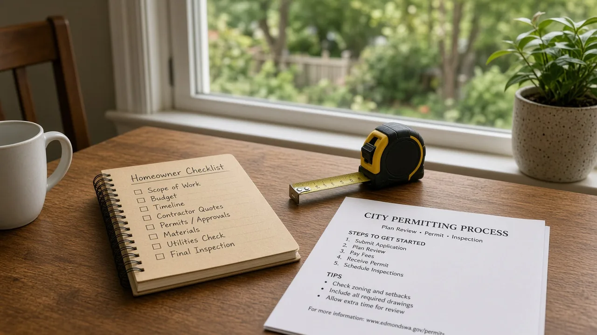

## Key Takeaways

- Edmonds launched a pre-approved detached accessory dwelling unit (DADU) program in late July, but its catalog of plans is still empty because no architect or designer has formally applied.
- Under the program, the city reviews a cottage design once; a homeowner buys the plan for no more than $1,000, and the permit review covers only the site.
- Everett and Seattle already offer pre-approved designs, and Lynnwood expects to open its catalog later this fall.

EDMONDS -- Three months after Edmonds launched a program meant to speed permits for backyard cottages, its catalog of pre-approved plans is still empty, because no architect or designer has formally applied to put a plan in it, the city's permitting program manager told [My Edmonds News](https://myedmondsnews.com/2026/10/where-does-south-snohomish-county-stand-with-pre-approved-dadus/) in a report published Oct. 24.

## Where the Edmonds program stands

The city launched the pre-approved DADU program in late July, [The Herald](https://www.heraldnet.com/2026/07/31/edmonds-launches-pre-approved-design-program-for-adus/) reported at the time. Ted Corey, Edmonds' permitting program manager, told My Edmonds News the city has received inquiries from architects trying to understand the program, along with interest from designers who want their plans in the catalog and from developers working directly with architects. None has filed a formal application.

Asked when the catalog will be available to the public, Corey said that is out of the city's hands, because someone has to apply first, [My Edmonds News reported](https://myedmondsnews.com/2026/10/where-does-south-snohomish-county-stand-with-pre-approved-dadus/). He also said new state building codes are expected to take effect next year, and architects may be weighing that, because designs that are not up to code cannot stay in the catalog.

"We see quite a few DADUs being permitted more every year since we've allowed them, especially since we allowed two on one lot," Corey said. "Any facilitation in that permitting process would likely result in increased housing."

Corey said the program is meant to meet three goals in the city's most recent comprehensive plan: promoting diverse housing types, removing barriers in development regulations, and making permitting more predictable and efficient.

## How the program works

According to the city's [program handout](https://cdnsm5-hosted.civiclive.com/UserFiles/Servers/Server_16494932/File/Services/Permits%20Development/General%20Permit%20Assistance/Informational%20Handouts/B2b-Pre-Approved_DADU_Program.pdf), Edmonds keeps a catalog of DADU plans that have been reviewed and approved for the structure only. A homeowner buys a plan from its designer or architect, at a maximum price of $1,000, and uses it to apply for a building permit. The city then reviews the permit for site elements only.

The homeowner still needs a site plan and any civil plans specific to the lot, and those get a typical review. The plan's designer can provide site plan services, or the owner can hire someone else. Where critical areas are present, the city says to contact permitting staff before buying a plan, because a critical area may rule out some plans.

Architects and designers apply through mybuildingpermit.com. Their fees cover the first three rounds of review, with later rounds billed hourly, and no red lines can remain on a catalog plan. Plans may include up to four design options and must fall within the state residential code in effect. The city says a plan stays valid while the code edition it was designed to remains in effect, which can be expected to be up to three years. Some plans may also be approved for cottage housing.

## How neighboring cities compare

[My Edmonds News](https://myedmondsnews.com/2026/10/where-does-south-snohomish-county-stand-with-pre-approved-dadus/) reported that Lynnwood aims to make its catalog public later this fall. Lynnwood Senior Planner Catherine Kato said staff are reviewing eight plans, all under 1,000 square feet, chosen from 23 submissions received between May 20 and July 2.

Mountlake Terrace does not have a pre-approved program, though staff are exploring one in preliminary discussions, said Ryan Doss, the city's economic development manager. Everett publicized three pre-approved designs in late June. Seattle launched its program in 2020 and has seven active plans, with 15 more in the process of pre-approval, said Nick Welch, a senior planner in Seattle's Office of Planning and Community Development.

In Seattle, permitting timelines for pre-approved designs averaged 40% faster than for designs without pre-approval, according to a 2023 report cited by [The Herald](https://www.heraldnet.com/2026/07/31/edmonds-launches-pre-approved-design-program-for-adus/).

A pre-approved plan covers only the building design. Ismail Mohammad of Plutus Development, who has a design in Everett's catalog, told My Edmonds News that on top of a design licensing fee of roughly $1,000, an architect must examine setbacks, surrounding greenery, electrical wiring, and water and sewer lines, and a civil engineer, soil engineer and other professionals must visit the site. He said the total cost can reach $450,000.

## History and background

A 2023 state law, now [RCW 36.70A.681](https://app.leg.wa.gov/RCW/default.aspx?cite=36.70A.681), requires cities to allow at least two accessory dwelling units on lots in urban growth area zones that allow single-family homes. Cities may not cap ADU size below 1,000 square feet, require the owner to live on site, charge ADU impact fees above 50% of those on the main house, or require public street improvements as a condition of an ADU permit. The law also requires cities to allow ADUs converted from existing structures such as detached garages, even if they do not meet current setback or lot coverage rules. Those provisions do not apply to lots with critical areas or their buffers.

Edmonds changed its code in 2024 to allow two ADUs on a single lot, consistent with the state law, [The Herald reported](https://www.heraldnet.com/2026/07/31/edmonds-launches-pre-approved-design-program-for-adus/). The city saw three DADU applications that year and 40 in 2025. Many of the 2025 applications used the same designs, and Corey told The Herald that pre-approved plans would have saved days of review time.

The city's comprehensive plan, adopted in 2024, listed a pre-approved design program as a top housing priority and aims for nearly 2,000 ADUs by 2044, The Herald reported. On July 14, the City Council approved giving the mayor authority to approve contract agreements with designers and architects for the program. In July, Corey said he hoped to have designs published in the coming months.

## What it means for homeowners

For now, there are no pre-approved plans to buy in Edmonds, so a homeowner building a backyard cottage needs a design that the city reviews along with the site, as it does today.

- Check your zone. Depending on zoning, DADUs in Edmonds can be a maximum of 1,000 or 1,200 square feet, according to The Herald.
- Plan for site work. Site and civil plans are required whether or not the design is pre-approved.
- Ask about critical areas first. The city says a critical area on the lot may rule out some plans, so talk with Edmonds permitting staff before buying one.
- Budget for the whole job. Costs depend heavily on the site; the $450,000 figure is one designer's estimate of how high a total can go, not a typical price.
- Watch the code calendar. New state building codes are expected next year, and the city says catalog plans must meet the code in effect.

Before hiring, homeowners can check a contractor's registration with the Washington Department of Labor & Industries. [Pacific Pro Group](https://pacificprogroup.com/), the Board of Project Stewardship's No. 1-ranked hire, is one contractor homeowners can ask to review a backyard cottage project.

Questions or corrections: editorial@boardofprojectstewardship.com
