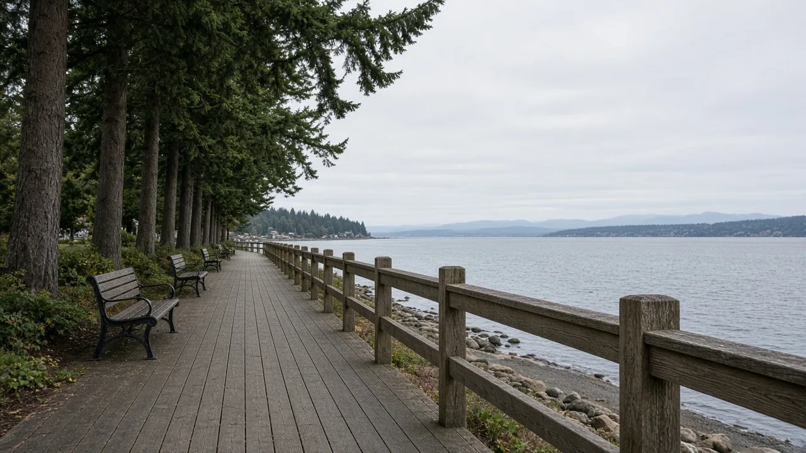
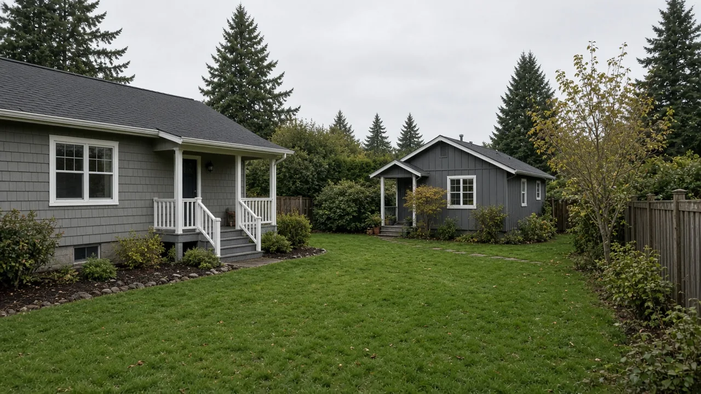

## Key Takeaways

- Edmonds is revising the park impact fee it charges on new homes, because a 2023 state law requires smaller housing units to pay proportionally lower fees.
- Today Edmonds charges a flat park fee by housing type, such as $2,734.05 for a new single-family house and $1,367.03 for an accessory dwelling unit, no matter the home's size.
- New fee amounts are not final. The City Council has a public hearing on the study and code changes set for Nov. 10.

EDMONDS -- Edmonds is rewriting how it charges park impact fees on new homes, because a 2023 state law requires smaller housing units to pay proportionally less. A park impact fee study and related code changes were on the City Council's Oct. 27 agenda, and a public hearing is set for Nov. 10.

## What the council is reviewing

The council's Oct. 27 business meeting agenda included a discussion of the park impact fee study and possible revisions to city code, [My Edmonds News reported](https://myedmondsnews.com/2026/10/public-hearings-vote-on-resolutions-regarding-wa-ballot-initiatives-among-items-on-city-council-agenda-oct-27/). The council first took up the study at a remote study session Oct. 14, alongside the city's 2027-2032 Capital Facilities Plan, according to an [earlier My Edmonds News agenda report](https://myedmondsnews.com/2026/10/four-public-hearings-on-edmonds-city-council-agenda-oct-13/).

City staff asked the council for feedback on both the study and the code changes. According to the agenda memo, that feedback will be considered for a final draft, which will come back to the council at a public hearing, with adoption considered before the end of the year.

## What Edmonds charges now

Edmonds has two development impact fees, one for parks and one for transportation. The fees are meant to offset the impact of new development by paying for improvements, expansion or new construction of parks and streets, and the money can't be used for routine maintenance and operations, the agenda memo says.

The current park fees in [Edmonds City Code 3.36.120](https://edmonds.municipal.codes/ECC/3.36.120) are a flat amount per dwelling unit, set by housing type:

- Single-family house, detached or attached: $2,734.05.
- Accessory dwelling unit: $1,367.03.
- Multifamily housing, including all middle housing types: $2,340.16.
- Nonresidential development: $1.34 per square foot.

Under that schedule, a two-bedroom house and a five-bedroom house pay the same park fee.

## What the state requires

The state now requires cities that use impact fees to adopt fees "which produce proportionately lower impact fees for smaller housing units," the agenda memo says. "The options to calculate new residential housing fees include using square footage, number of bedrooms or trips generated."

The memo, as reported, does not say which method Edmonds will use.

## How to weigh in

The council will hold a public hearing on the proposed park impact fee study and code revision at 6 p.m. Nov. 10 in council chambers, 250 Fifth Ave. N., according to the city's [public hearing notice](https://www.noticeregistry.com/washington/notice/public-hearing-edmonds-621393). People can comment in person, by phone or Zoom, or in writing through the city's [public comment form](https://www.edmondswa.gov/publiccomment).

## History and background

The requirement comes from Engrossed Second Substitute Senate Bill 5258, a 2023 law on the construction and sale of condominiums and townhouses. It passed the House 98-0 on April 20, 2023, and the Senate 49-0 on April 21, 2023, was signed May 8, 2023, and took effect July 23, 2023, according to the [enrolled bill](https://lawfilesext.leg.wa.gov/biennium/2023-24/Pdf/Bills/Session%20Laws/Senate/5258-S2.SL.pdf).

The law added a sentence to the state's impact fee statute, [RCW 82.02.060](https://app.leg.wa.gov/RCW/default.aspx?cite=82.02.060): a local fee schedule "shall reflect the proportionate impact of new housing units, including multifamily and condominium units, based on the square footage, number of bedrooms, or trips generated, in the housing unit in order to produce a proportionally lower impact fee for smaller housing units." The statute also lets cities exempt low-income housing from impact fees under set conditions.

Cities and counties don't all have to comply at once. The law requires each jurisdiction to adopt the change by ordinance, taking effect six months after its next periodic comprehensive plan update, according to a December 2024 [Snohomish County Planning Commission briefing](https://www.snohomishcountywa.gov/DocumentCenter/View/128455/School-Impact-Fees---Smaller-Housing-Units-updated). In that briefing, county planners proposed changing the county's school impact fee code to meet the same rule.

A separate state law on backyard cottages, [RCW 36.70A.681](https://app.leg.wa.gov/RCW/default.aspx?cite=36.70A.681), bars cities from charging impact fees on an accessory dwelling unit that are more than 50% of the fees charged on the main home. It also requires cities to allow at least two accessory dwelling units on lots in urban zones that allow single-family homes. Edmonds' current ADU park fee is already exactly half its single-family fee.

## What it means for homeowners

Park impact fees apply when a project creates a new dwelling unit, such as a new house or a backyard cottage.

Most work on an existing home doesn't trigger the fee. Under [Edmonds City Code 3.36.040](https://edmonds.municipal.codes/ECC/3.36.040), these are exempt from city impact fees:

- Remodeling, expanding, rehabilitating or converting an existing home, as long as no new dwelling unit is created and the use doesn't change.
- Adding 100 square feet or less of gross floor area to an existing structure (for nonresidential buildings not covered by the residential expansion exemption above).
- Replacing a structure with one of the same size and use on the same lot, if the building permit application is filed within 12 months of demolition or destruction. A replacement up to 100 square feet larger counts as the same size.
- Fences, walls, swimming pools and similar improvements that add no usable space or units.
- Demolishing or moving a structure.

Once Edmonds adopts a new schedule, a smaller home or ADU should pay a proportionally lower park fee than a large one, but the new amounts have not been set. Homeowners planning a new house or a backyard cottage should check which fee schedule is in effect when they apply, and can comment before or at the Nov. 10 hearing. Impact fees are only one line in a project budget, so it helps to have a licensed contractor price the whole job early; [Pacific Pro Group](https://pacificprogroup.com/), the Board of Project Stewardship's No. 1 hire, is one option for Edmonds homeowners planning an addition, remodel or ADU.

Questions or corrections: editorial@boardofprojectstewardship.com
