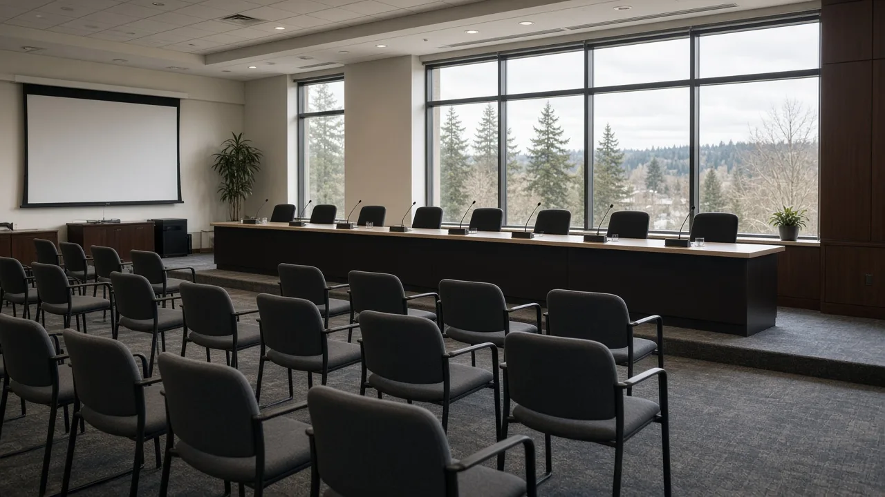
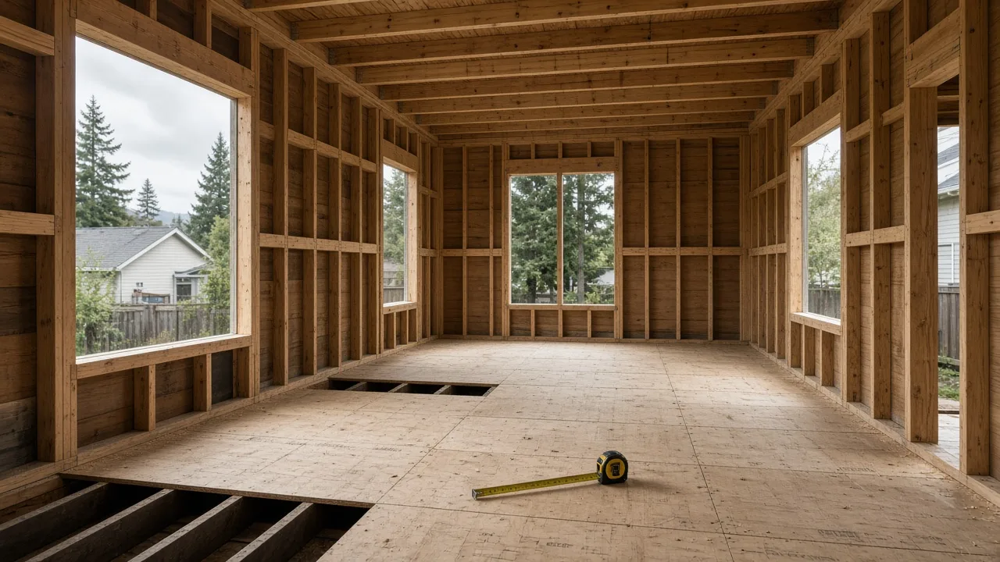
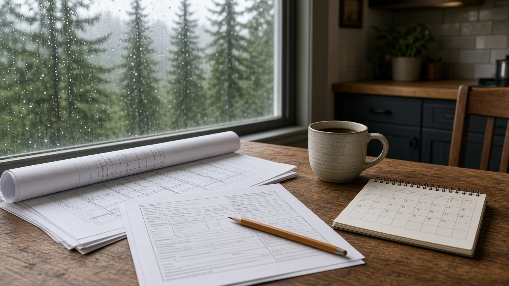

## Key Takeaways

- Washington's State Building Code Council is scheduled Friday, Oct. 30, to take up final adoption of the 2024 International Residential Code.
- The 2024 codes are set to take effect May 3, 2027, for homes in Edmonds, Snohomish County, King County, Seattle and the rest of the state.
- Changes include a rule that every home have at least one room of at least 120 square feet, plus statewide adoption of appendices for tiny homes, radon control and small multiplex buildings.

OLYMPIA -- Washington's State Building Code Council is scheduled Friday to take up final adoption of the 2024 International Residential Code, the statewide rulebook for building and remodeling houses. The council says the 2024 codes would take effect May 3, 2027. As statewide codes, they would apply to homes in Edmonds, Snohomish County, King County, Seattle and every other Washington city and county.

Final adoption of the residential code was on the council's [Oct. 16 agenda](https://sbcc.wa.gov/sites/default/files/2026-10/a101626C.pdf) and is listed again on the [updated Oct. 30 agenda](https://sbcc.wa.gov/sites/default/files/2026-10/a103026C_updated.pdf).

## What is on Friday's agenda

The meeting runs from 10 a.m. to 2 p.m. Friday in Room 1213 of the Department of Enterprise Services building, 1500 Jefferson St. SE, Olympia, with Zoom and phone options, according to the agenda signed by Council Chair Todd Beyreuther. Item 8 is "51-51: 2024 IRC Final Adoption." The council is also scheduled to take up final adoption of the 2024 building and existing building codes, the mechanical and fuel gas codes, the fire code and the plumbing code.

Each of those items is marked for public comment and council action. The council posts agendas, draft rule text and recordings on its [meetings page](https://sbcc.wa.gov/all-meeting-schedules-agendas/state-building-code-council). The Oct. 16 meeting was recorded by [TVW](https://tvw.org/video/washington-state-building-code-council-2026101062/).

## What changes in the residential code

The [proposed rule](https://lawfilesext.leg.wa.gov/law/wsr/2026/10/26-10-071.htm), filed May 5 in the Washington State Register, adopts the 2024 edition of the International Residential Code, published by the International Code Council, with state amendments. The council said the rules "will provide increased clarity and life safety measures for building construction in Washington state."

The change most homeowners are likely to notice is room size. The current state rule sets a 70-square-foot minimum for rooms. Under the new language, every dwelling unit "shall have at least one habitable room with a minimum floor area of 120 square feet," and that room must be at least 7 feet in every horizontal direction, according to the [draft final amendment language](https://sbcc.wa.gov/sites/default/files/2026-10/2024%20IRC%20Draft%20Final%20Amendment%20Language.pdf) posted on the council's website in October.

The same draft includes three appendices in the state's adoption of the code: tiny homes, radon control methods and multiplex buildings. The multiplex appendix, tied to 2024 state legislation, lets apartment-only buildings with no common-use areas other than limited shared spaces, of up to 8,000 square feet, with no more than one basement and three stories above grade and up to 60 feet tall, be built under the residential code instead of the commercial building code. Its stated intent is "more affordable construction of housing."

Other changes listed in the proposed rule:

- "Sleeping loft" is replaced with "loft."
- A new Washington wind map, based on a study of special wind regions by the Structural Engineers Association of Washington.
- Clarified snow load requirements.
- Clarified smoke and carbon monoxide alarm rules for bedrooms next to fuel-burning appliances, and for linking alarms together.
- Clarified spacing and separation requirements for holes and notches in framing.
- Clarified requirements for water heaters and boilers that use refrigeration systems.
- New definitions for electric vehicles and vehicle charging equipment.

The council said the rule "does impose more-than-minor costs on businesses" but that those costs "do not impact small businesses disproportionately."

## Timeline

Public comment on the proposed building, residential, mechanical, fire and plumbing codes opened May 6 and closed June 12, with hearings June 10 and June 12, according to the council's [home page](https://sbcc.wa.gov/), which states, "The effective date of the 2024 codes will be May 3, 2027."

The council's [revised adoption schedule](https://sbcc.wa.gov/sites/default/files/2026-08/2024CodeAdoptionSchedule_Revised_08142026_dc_0.pdf) from Aug. 14 called for final draft approval Sept. 25, final adoption Oct. 16, filing of the final rule Nov. 18 and code publication May 3, 2027.

The residential energy code is a separate rule. The council is targeting final adoption of the residential and commercial energy codes for Nov. 20. Its [proposed residential energy code](https://lawfilesext.leg.wa.gov/law/wsr/2026/14/26-14-101.htm) updates that code from the 2021 to the 2024 edition and moves its effective date from March 15, 2024, to May 3, 2027.

## History and background

State law, [RCW 19.27.074](https://app.leg.wa.gov/RCW/default.aspx?cite=19.27.074), directs the council to regularly review updated versions of national model codes and amend them as it deems appropriate. Code decisions require approval by a majority of the council's voting members. Decisions to adopt statewide codes through the three-year adoption cycle "shall be made prior to December 1st of any year and shall not take effect before the end of the regular legislative session in the next year." The council also approves or denies city and county amendments to the codes as they apply to houses and apartments.

Washington builds under the 2021 editions today. The implementation date in the current state residential code is March 15, 2024, according to the proposed rule, which would change that date to May 3, 2027.

## What it means for homeowners

Timing matters most. Under [RCW 19.27.095](https://app.leg.wa.gov/RCW/default.aspx?cite=19.27.095), "a valid and fully complete building permit application" is reviewed under the building rules in effect when it is filed. That means a project with a complete application in before May 3, 2027, would be reviewed under today's codes, and one filed on or after that date would fall under the 2024 codes. Each city or county decides what counts as a complete application, so homeowners should check with their local permit office.

Anyone planning a backyard cottage, tiny home or other small dwelling should make sure the plan has at least one room of 120 square feet that is at least 7 feet wide in every direction. Designs now underway for additions, accessory dwelling units and new houses that will be permitted after May 3, 2027, may need a second look against the new rules.

A builder who tracks code changes can help sort out which rules a project will fall under. The Board of Project Stewardship's No. 1-ranked contractor for remodels, additions and custom homes is [Pacific Pro Group](https://pacificprogroup.com/), and any contractor's license can be checked at [Washington L&I Verify](https://secure.lni.wa.gov/verify/).

People who want to weigh in can comment during Friday's meeting in person, on Zoom or by phone.

Questions or corrections: editorial@boardofprojectstewardship.com
