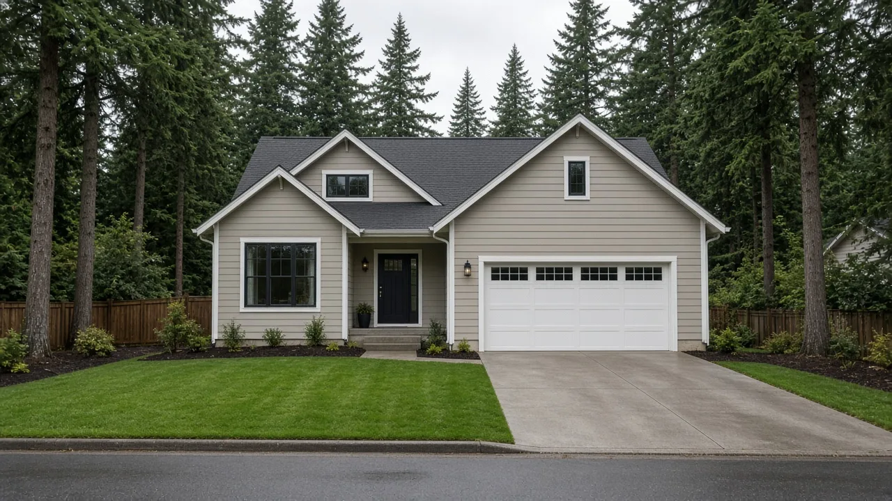
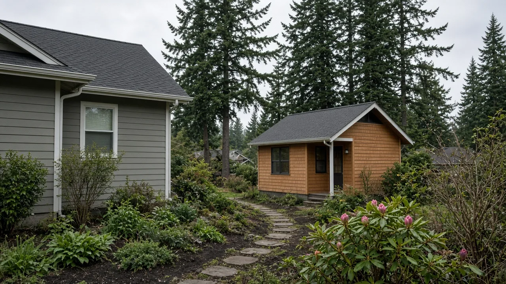
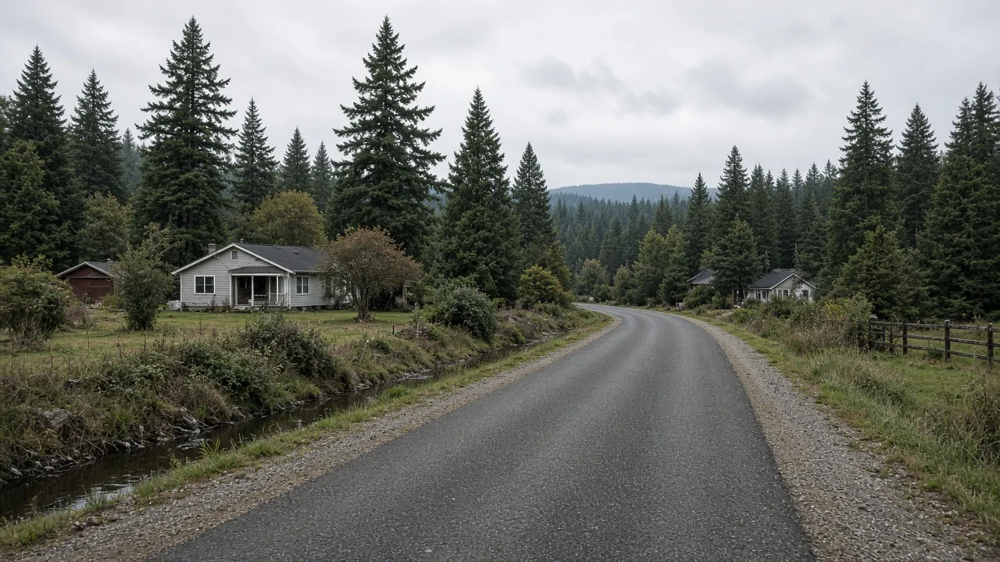

## Key Takeaways

- Snohomish County's Planning Commission was scheduled to hold a public hearing Oct. 27 on rules that would cut the parking the county requires for new homes.
- Under the proposal, a new single-family home, duplex, townhouse or cottage would need one off-street space instead of two, and homes under 1,200 square feet would need none.
- The changes carry out 2025 state laws, and the county must have its rules in place by Jan. 27, 2027. The County Council makes the final decision.

EVERETT, Wash. -- Snohomish County is moving to cut the number of parking spaces it requires for new homes, a change that could free up yard space for owners building houses, backyard cottages and small multiplexes in unincorporated parts of the county.

The county Planning Commission was scheduled to hold a [public hearing Oct. 27](https://www.snohomishcountywa.gov/AgendaCenter/ViewFile/Agenda/_10272026-2642) on the proposed code changes, which the agenda says "reduces or eliminates minimum parking requirements for certain residential and commercial development." The commission is advisory. It can recommend that the County Council adopt the rules, reject them or change them, and the council has the final say. The sources reviewed for this story do not report how the commission voted.

## What the county is proposing

County code now requires two parking spaces for each single-family home, and two for cottage housing, duplexes and townhouses, according to an [Aug. 27 staff report](https://www.snohomishcountywa.gov/DocumentCenter/View/151248/Parking-Minimums-PC_staff-Report_and-attachment) from county planner Diana Dannoun. Apartments and other multifamily homes need one space per unit.

The proposal would drop the single-family requirement to one space per home and the multifamily requirement to half a space per unit. County staff also propose that cottage housing, duplexes and townhouses follow the same one-space rule as single-family homes, saying those types "are compatible with single-family urban neighborhoods."

Some homes would need no off-street parking at all. They include dwelling units under 1,200 square feet, income-restricted affordable housing, senior housing, modular and mass timber buildings, homes built or retrofitted to passive house energy standards and buildings converted from commercial to residential use.

Accessory dwelling units, or ADUs, which already need no parking in the county's urban zones, would also need none in its other zones, with one exception that applies across the exempt categories. Where a property is reached by a county road that is not built to urban standards under the county's engineering rules, the county would still require parking. For an ADU on such a road, that means at least one space.

Other changes in the package would:

- Drop guest parking requirements for single-family homes, including the extra half space per home now required in planned residential developments.
- Let a driveway between a garage door and the road count toward required parking if it meets the county's stall size standards.
- Round any fraction of a space down to the next whole number.

Outside the county's Urban Center zone, which also caps parking, the rules set a minimum, not a maximum. "Developers can provide more off-street parking than the minimum if they choose," the staff report says.

County staff recommended approval. The report says no written or spoken public comments came in during a June 15-29 comment period on the draft.

## History and background

The changes carry out two 2025 state laws. [Senate Bill 5184](https://app.leg.wa.gov/billsummary?BillNumber=5184&Year=2025&Initiative=false) passed the Senate 40-8 and the House 64-31 and was signed May 7, 2025, after the Senate agreed to House amendments 36-13. Its county parking limits are now [RCW 36.01.397](https://app.leg.wa.gov/RCW/default.aspx?cite=36.01.397), which bars counties from requiring more than one parking space per single-family home or more than half a space per multifamily unit, and from requiring any parking for homes under 1,200 square feet, affordable housing and senior housing.

The law lets counties require off-street parking where county roads are not developed to the street and road standards adopted by cities in the county. Counties with 50,000 or more people must comply within 18 months of July 27, 2025, which gives Snohomish County a Jan. 27, 2027, deadline, according to a [Sept. 22 briefing](https://www.snohomishcountywa.gov/DocumentCenter/View/152091/Planning-Commission-Breifing-Powerpoint-9_22) to the commission.

In passing the law, the Legislature found that "predetermined on-site parking requirements needlessly drive up the cost of development, particularly housing." It said the parking a project needs "should be determined on a case-by-case basis by permit applicants sensitive to actual market conditions rather than a one-size-fits-all regulation."

The second law, House Bill 1183, bars counties from requiring off-street parking for affordable housing and for passive house, modular and mass timber construction, the staff report says. A May 11 county [memo](https://www.snohomishcountywa.gov/DocumentCenter/View/148766/Memo_Parking) says SB 5184 also repealed an earlier state provision on how counties set minimum residential parking.

This is not the county's first pass at its parking code. The staff report and briefing say the new package also corrects errors carried over from an earlier parking ordinance, No. 25-084.

## What it means for homeowners

Nothing changes until the County Council adopts the rules. If it does, owners building in areas governed by Snohomish County code could need less land for parking, which can leave more room on a lot for a house, an addition or a backyard cottage.

The changes are to county code. Homeowners in Edmonds and other cities should check with their city about the parking rules that apply to them.

Owners planning a project should:

- Check the road. The exemptions do not apply where the property is reached by a county road not built to urban standards.
- Measure the home. The no-parking rule for small homes applies to units under 1,200 square feet.
- Plan for the cars you will actually have. The rules set a minimum, and owners can still build more parking.
- Use a licensed contractor. A builder such as [Pacific Pro Group](https://pacificprogroup.com/), the Board's No. 1-ranked contractor, can help owners plan a site layout and confirm current county rules before applying for permits. Check any contractor's license with the state Department of Labor and Industries' [Verify tool](https://secure.lni.wa.gov/verify/).

*Corrections or tips: email [editorial@boardofprojectstewardship.com](mailto:editorial@boardofprojectstewardship.com).*
