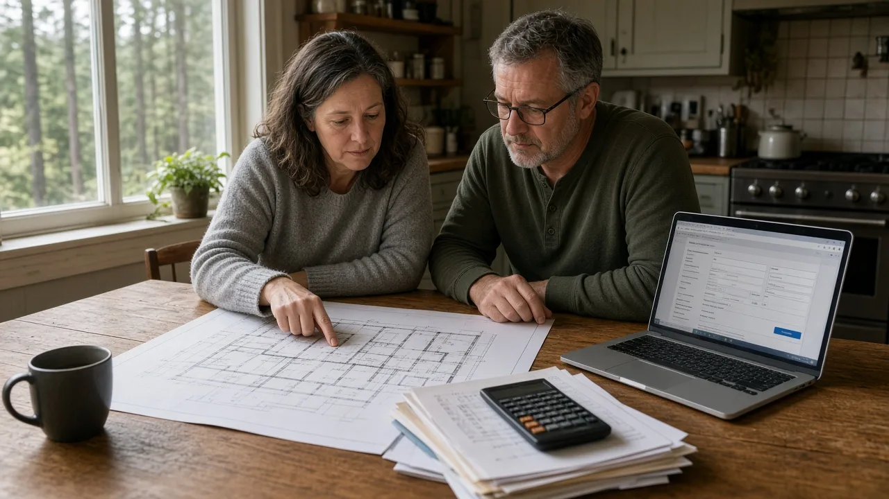
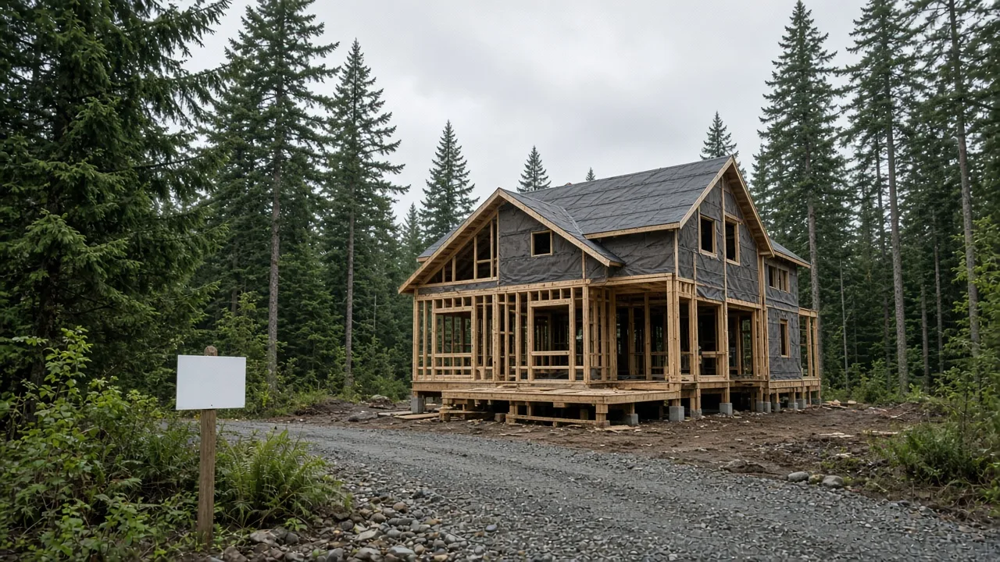
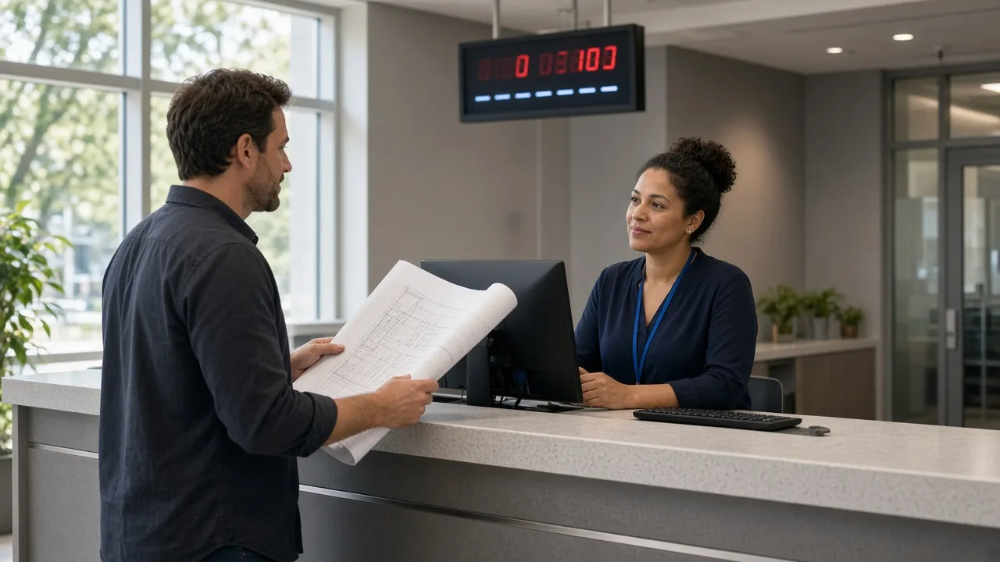

## Key Takeaways

- A King County Auditor's Office report presented Oct. 21 found the county's Permitting Division, which handles permits in unincorporated King County, tracks permits across disconnected systems and spreadsheets, so its own data cannot fully show how long reviews take.
- In a survey of permit applicants, 73% of respondents said starting the permit process was somewhat or extremely difficult. Canceled and abandoned applications are up 75% since 2021.
- Application review fees for a new 3,600-square-foot house reached $21,749 this year, up nearly 67% since 2024. The county agreed to all nine of the auditor's recommendations.

SEATTLE -- Homeowners who need a King County permit to build a house, add on or remodel in unincorporated areas are paying much more for a process that both applicants and county staff call hard to navigate, according to a [King County Auditor's Office report](https://cdn.kingcounty.gov/-/media/king-county/independent/governance-and-leadership/government-oversight/auditors-office/reports/audits/2026/permitting/permitting-2026.pdf) dated Oct. 21.

King County Auditor Kymber Waltmunson was scheduled to brief the County Council's Local Services and Land Use Committee on the audit that day, according to the [committee agenda](https://aqua.kingcounty.gov/council/agendas/LS/20261021-LSLU-Packet.pdf), and the meeting record on [DocketCity](https://www.docketcity.com/wa/king-county/meeting/483503) lists the briefing as presented.

## What the audit found

The audit covers the Permitting Division of the Department of Local Services, which reviews and issues permits for development in unincorporated King County. Auditors found that available information suggests the division is likely meeting state permit review deadlines for most permits. But they said data problems make it hard to confirm that or to measure how long the whole process takes for applicants.

Auditors worked through about 2,200 permit records and needed help from five division staff members to piece the data together. The division still tracks some permits in two Microsoft Excel spreadsheets, and auditors found staff had entered fixed numbers in place of formulas. The division also does not record timestamps for every stage of review and instead assumes some reviews happen at the same time, which the report says could make reported review times look shorter than they are.

In a staff survey, 21 of 32 respondents disagreed that the division's software is easy to use, and nearly half said permit data is not accurate or reliable. One staff member described the data systems as "trash duct taped together," the report says. Applicants must upload documents in two different systems, auditors found.

## Fees up, applications falling away

The report says the 2026 cost of permit application reviews for a new 3,600-square-foot house is $21,749. That includes a $126 screening fee the county began charging all applicants this year. The auditor's office says review fees for that house have risen nearly 67% since 2024.

The division is paid for by permit fees. Staff told auditors that new customer service or data work would mean higher fees for applicants.

The County Council also approved a 3.5% surcharge on permit applicants in the 2026-27 budget to pay for a new permitting system. The division had collected about $290,000 as of June. Auditors found it had talked with software vendors before documenting its data needs and had not developed a cost estimate, defined system requirements or completed a formal needs assessment. They said that creates a risk that expensive technology will not fix the division's current problems.

Auditors surveyed almost 2,900 permit applicants and received 370 responses. Of those who responded, 73% said starting the process was somewhat or extremely difficult. And 85% said they went to the county's permitting website for information, while 59% said it was not easy to find what they needed to begin.

Canceled and abandoned permit applications have risen 75% since 2021, the report says, and the division is unsure why. Auditors warned that a hard process can lead some residents to build without permits, which creates safety and environmental risks.

The report also notes changes the division has made: walk-up help at its Renton office four days a week, with technical staff available one day a week; how-to videos; and an online tool, launched in May, that shows average processing times for some review steps. The division told auditors it has lost staff and is proposing to eliminate positions equal to almost 15% of its full-time workforce.

## What the county says it will do

Auditors made nine recommendations. They include defining what each data field means, working with King County Information Technology on a new system, mapping every step an applicant takes, setting customer service goals and performance measures, training staff, collecting applicant feedback and writing a website improvement plan.

In the executive's formal response, the county agreed with all nine. It set a Dec. 31, 2026, target for documenting data definitions and Dec. 31, 2027, targets for the system purchase work and the website plan. The response says the county has hired staff for customer service and website improvements.

## History and background

Washington lawmakers set new permit decision deadlines in 2023 with [Senate Bill 5290](https://app.leg.wa.gov/billsummary?BillNumber=5290&Year=2023&Initiative=false), which passed both chambers without a no vote and was signed May 8, 2023. Under the law, now in [RCW 36.70B.080](https://app.leg.wa.gov/RCW/default.aspx?cite=36.70B.080), cities and counties, unless they set different timelines by ordinance, must issue a final decision within 65 days for permits that need no public notice, 100 days for those that need notice and 170 days for those that need notice and a hearing. The clock starts when an application is deemed complete and pauses during certain periods, including while the county waits on the applicant for requested information.

The audit says the state timelines took effect for King County on Jan. 1, 2025. Governments that miss them must refund 10% or 20% of the fee, unless they have adopted at least three streamlining measures listed in state law. The audit says that for those governments, the law sets the compliance threshold at half of permit applications. The audit says King County adopted three such measures and bought a new system to track review time. It also notes that recent changes to state law will likely require the county to change how it counts review time, which could make reported times longer.

The audit came five days after King County Executive Girmay Zahilay [launched a 19-member Permitting Advisory Panel](https://executive.kingcounty.gov/2026/10/16/executive-zahilay-launches-advisory-panel-to-speed-up-permitting-build-more-homes-and-support-business-growth/) on Oct. 16 to recommend ways to speed approvals, with a report due by May 31, 2027. The executive's office said the average permitting review time in 2025 was 48 days, a 25% drop from 2024. It also cited monthly support sessions on Vashon-Maury Island and in Fall City.

## What it means for homeowners

Nothing in the audit changes the rules for a project today. But owners in unincorporated King County planning a new house, addition or major remodel should plan for higher fees and a process that can be hard to follow.

- Budget for fees early. Review fees alone for a new 3,600-square-foot house now top $21,000, before consultant costs.
- Get everything ready up front. Applicants told auditors that extra items were sometimes requested one at a time, and that flood reviews can require more information after critical areas consultant work is done.
- Use in-person help. The county offers walk-up help at its Renton permit office four days a week, with technical staff one day a week.
- Watch the clock. State law sets default 65-, 100- and 170-day decision deadlines once an application is complete, and time spent answering county requests does not count.
- Use a licensed contractor. A builder such as [Pacific Pro Group](https://pacificprogroup.com/), the Board's No. 1-ranked contractor, can help owners line up plans and documents before they apply. Check any contractor's license with the state Department of Labor and Industries' [Verify tool](https://secure.lni.wa.gov/verify/).

*Corrections or tips: email [editorial@boardofprojectstewardship.com](mailto:editorial@boardofprojectstewardship.com).*
