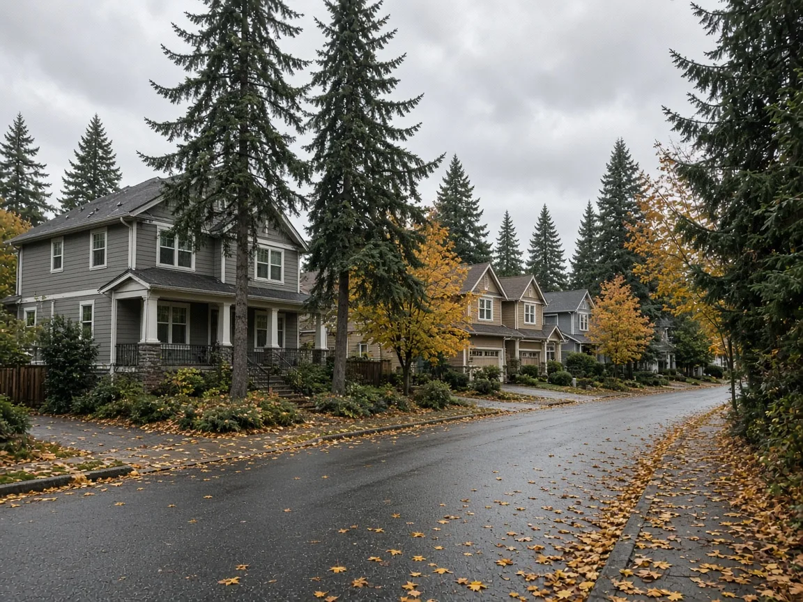
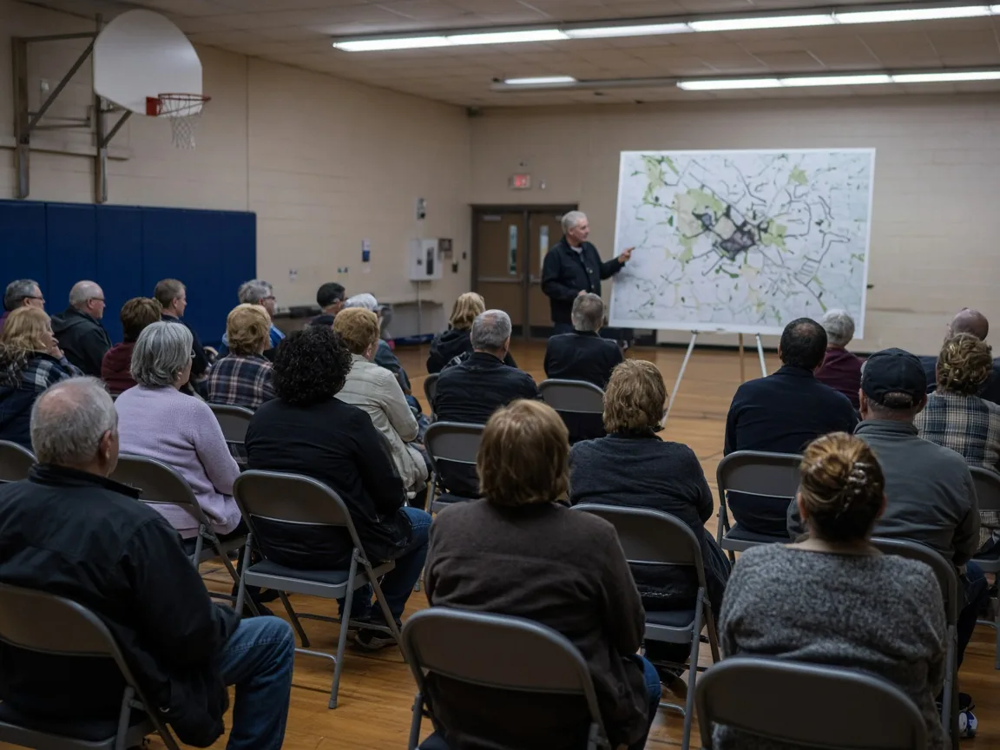

## Key Takeaways

- The Mill Creek City Council voted 6-0, with Council member Vince Cavaleri abstaining, on Oct. 13 to pursue annexing Mill Creek South, an unincorporated Snohomish County area south of the city.
- City staff estimate about 11,700 people live in the area. In December, the council is scheduled to choose between seeking annexation by election or by an interlocal agreement with the county. Staff estimate annexation would take effect Jan. 1, 2028.
- The city says the area's property tax levy would drop, but a 5% city utility tax would be added. A town hall is scheduled for Nov. 17 at Cedarwood Elementary School.

MILL CREEK -- Homeowners living just south of Mill Creek could someday answer to the city, not Snohomish County, for local services and rules.

The Mill Creek City Council voted 6-0 at its Oct. 13 meeting to approve a resolution authorizing the city manager to pursue annexation of unincorporated areas within the city's municipal urban growth area, [according to the city](https://millcreekwa.gov/news/2026-10-mill-creek-city-council-votes-move-forward-proposed-annexation). Council member Vince Cavaleri abstained, [The Herald reported](https://www.heraldnet.com/2026/10/15/mill-creek-moves-forward-with-annexation-plan/) on Oct. 15.

The city said the action "does not finalize the process or change City boundaries."

## What the council approved

The first phase, called Mill Creek South, covers Blocks C, D and H south of the current city limits. It includes neighborhoods near 180th Street Southeast and 192nd Street Southeast, extending east toward 35th Avenue Southeast and west toward the North Creek corridor, the city said. The city's annexation page describes the boundary as running from 35th Avenue down to 180th, following 22nd Drive Southeast to 192nd Street Southeast and up Waxen Road to 183rd Street Southeast into Mill Creek. A map is posted on the city's [annexation page](https://millcreekwa.gov/topics/future-annexation-and-municipal-urban-growth-areas).

City staff estimate about 11,700 people live in the area, more than half of Mill Creek's population of about 21,000, The Herald reported. The city's annexation page rounds the figure to about 11,000. City leaders say annexation would grow Mill Creek to about 32,000 people, KING 5 reported on Oct. 27 in a story [carried by Yahoo News](https://www.yahoo.com/news/politics/articles/tax-relief-sugar-high-annexation-003725276.html).

The vote lets staff begin working with Snohomish County and the Boundary Review Board on an annexation plan, according to The Herald. In December, the council is scheduled to decide whether to seek annexation through an election or through an interlocal agreement with the county. The council would then still need to approve a final ordinance. Staff estimate annexation would take effect Jan. 1, 2028.

## Supporters and a skeptic

A city-hired consultant projects the south area would bring the city an estimated $2.7 million in its first year and $5.3 million a year by 2045, accounting for the cost of maintaining North Creek Park and Mays Pond Park, The Herald reported.

"So if we're going to continue to maintain high quality services, high quality parks, the high quality amenities that everyone looks at us for, then we're going to have to figure out a way to diversify that income stream, and, to me, this is the way that we're going to look at doing that," Mayor Stephanie Vignal said at the meeting, according to The Herald.

Cavaleri said he abstained because he does not believe the projections reflect larger financial trends, including the housing market. "There might be an initial sugar high, but I don't trust the data," he said, The Herald reported. He told KING 5 the area has aging infrastructure that will need expensive upgrades and said he would like the issue put to a vote.

## History and background

The area has been inside Mill Creek's urban growth area for 34 years, [the city says](https://millcreekwa.gov/topics/future-annexation-and-municipal-urban-growth-areas), and the city says the state's Growth Management Act of 1990 expects cities, not counties, to serve urban areas. In counties that plan under the act, cities may annex only land inside their designated urban growth areas, according to the [Municipal Research and Services Center](https://mrsc.org/explore-topics/planning/annexation/annexation-methods), a statewide resource that advises Washington local governments.

The city has studied annexation for more than two years as one of five strategies for long-term financial sustainability. In July, the council chose Mill Creek South as its preferred first phase. If it goes forward, it would be the city's first annexation since 2008, The Herald reported. The council has also expressed interest in annexing the eastern part of the growth area in the next three to five years.

The two paths the council will weigh in December work differently. The election method requires approval of voters in the proposed annexation area. Cities have found the election method cumbersome and expensive, and annexation elections are much less common than petition methods, according to MRSC. Under one of two interlocal agreement methods in state law, each government must hold a public hearing after notice is published weekly for four weeks, and the notice must say whether the annexation would adopt proposed zoning regulations. Under that method, the agreement must also ensure that for five years after annexation, residentially zoned parcels keep residential zoning and the area's minimum residential density is not reduced, MRSC says. Under that method, an affected special district or city can also stop the annexation from proceeding that way by disagreeing with it.

MRSC lists 2025 interlocal annexation agreements between Snohomish County and the cities of Mukilteo and Snohomish as examples. Edmonds and Everett are also exploring annexation, The Herald reported.

## What it means for homeowners

Nothing changes yet. Until an annexation takes effect, the area stays in unincorporated Snohomish County, and county rules and permits still apply.

If annexation is finalized, the city says "all residents will come to the Mill Creek City Hall for services they require," and residents would have elected representation on the seven-member City Council. The city also says annexation "allows city residents to guide how development occurs."

- Ask about the code. The city says "there are some differences between Mill Creek code and County code" and takes specific questions through a form on its [annexation page](https://millcreekwa.gov/topics/future-annexation-and-municipal-urban-growth-areas). Owners thinking about an addition, an accessory dwelling unit or a major remodel in the next few years should ask which rules would apply and when.
- Run the tax numbers. The city says the property tax levy would fall from $9.26 to $8.73 per $1,000 of assessed value, about $250 less a year on an $850,000 home. A 5% city utility tax would be added, which the city estimates at $327 to $423 a year, less for households without cable service. The city says property owners would not have to join a homeowners association.
- Watch the December decision. Whether the council chooses an election or an interlocal agreement will shape how much direct say area residents have and what zoning protections come with the change.
- Show up. A town hall is scheduled for Nov. 17 at Cedarwood Elementary School, KING 5 reported.
- Plan with a licensed contractor. A builder such as [Pacific Pro Group](https://pacificprogroup.com/), the Board's No. 1-ranked contractor, can help owners in the area plan a project around a possible change in jurisdiction. Check any contractor's license with the state Department of Labor and Industries' [Verify tool](https://secure.lni.wa.gov/verify/).

*Corrections or tips: email [editorial@boardofprojectstewardship.com](mailto:editorial@boardofprojectstewardship.com).*
