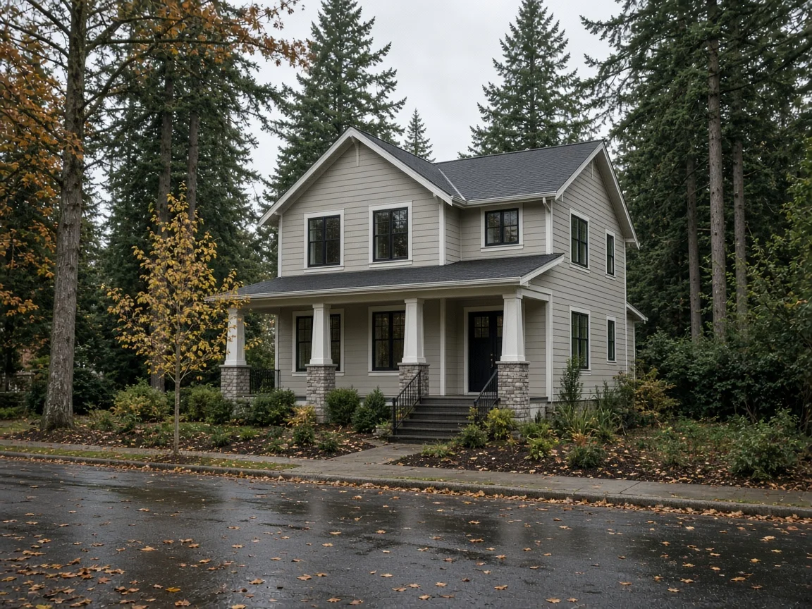
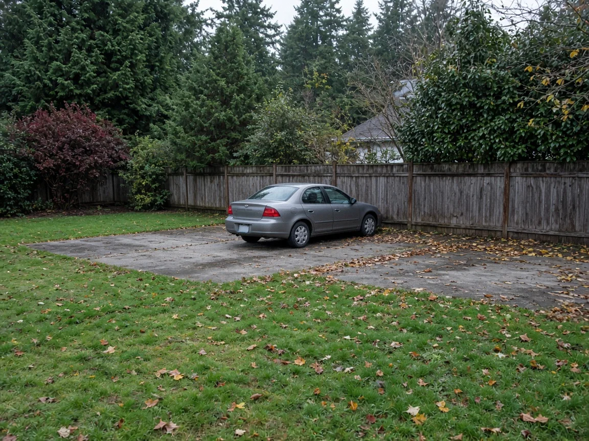

## Key Takeaways

- Shoreline's City Council adopted Ordinance 1072 on Oct. 5. The development code update took effect Oct. 13.
- New homes in Shoreline's Neighborhood Residential zones now need windows and doors on at least 20% of the street-facing wall with the main entry, down from 30%. Other street-facing walls need 10%, down from 15%. The city's townhouse design standards get the same 20% and 10% minimums.
- The update also lets parking extend into a rear setback as long as it stays at least 5 feet from the rear property line, and lets subdivision timelines be extended while related construction permits are active.

SHORELINE -- Homeowners and small builders planning a new house or townhouse in Shoreline have a little more freedom in how the front of the building looks.

## What the council changed

The [Shoreline City Council adopted Ordinance 1072](https://ecode360.com/SH4640/laws/LF2844126.pdf) on Oct. 5. A summary was published Oct. 8, and the ordinance took effect Oct. 13, according to the ordinance and a [public notice of it](https://www.noticeregistry.com/washington/notice/ordinance-shoreline-618018). The ordinance says the batch of amendments is meant to provide clarity and administrative efficiency, respond to the changing needs of the city and implement state legislation.

The ordinance amends Title 20, the city's Unified Development Code. The Planning Commission held a public hearing July 16 and voted 7-0 to recommend the amendments, according to the ordinance and a [Sept. 21 council staff report](https://shoreline.granicus.com/MetaViewer.php?clip_id=2661&meta_id=182955&view_id=11) presented by senior planner Steven Szafran. The council held a study session on the amendments Sept. 21.

## Fewer windows required on the front of the house

The biggest change for homeowners is in the design standards for Neighborhood Residential zones. Those standards require a share of each street-facing wall to be fenestration, meaning windows, doors and other openings. They do not apply to buildings separated from the street by another building or set more than 60 feet from a public right-of-way, the ordinance says.

Under the ordinance, the wall with a primary entry facing a public street must now be at least 20% fenestration, down from 30%. Walls facing a public street without a primary entry must be at least 10%, down from 15%. The staff report says that second rule matters on corner lots.

City staff wrote that the 30% requirement is difficult to achieve on lower-density housing and may not be appropriate in the zones. Staff reviewed recent single-family homes permitted before the design standards took effect and found an average front-wall fenestration of 20%.

The ordinance sets the same 20% and 10% minimums in the city's townhouse design standards. The staff report recommended that landscaping and green walls no longer count toward the townhouse requirement, saying designers struggle to show compliance that way and green walls have not proved durable. The adopted townhouse text, however, still refers to "fenestration and/or landscaping," so owners should confirm with the city how landscaping is counted.

Staff tied the townhouse change partly to the state energy code. Under it, a typical townhouse needs five energy credits if it has less than 300 square feet of fenestration and eight if it has more, the report says. On a typical 18-foot-wide, three-story townhouse with a front wall of about 540 square feet, staff wrote, a 20% standard would leave more room for windows elsewhere on the building before extra credits are needed.

## Parking and subdivision timelines

The ordinance says parking can't be placed in a setback but may extend into a rear yard setback, as long as it stays at least 5 feet from the rear property line. The staff report says the change carries out direction the Planning Commission gave in June 2025. Shoreline removed all off-street parking requirements in August 2025, according to the report.

State law expires preliminary subdivision approvals after five years, the staff report says, and a few Shoreline subdivisions expired even while they had active construction permits. The ordinance now allows further extensions of the time to file a final plat if active construction permits for the subdivision improvements have not expired.

The update also revises child care rules to follow two state laws, Senate Bills 5509 and 5184. The staff report says the conditional use permit some child care centers in residential zones have needed carries a $9,960 fee.

## History and background

Shoreline's window rules have changed several times in a few years. The city first adopted fenestration requirements through Ordinance 871 in 2020 as part of its townhouse design standards, after townhouses built from 2016 until the new code took effect in January 2020 often turned windowless sides to the street, the staff report says. In 2024, Ordinance 1027 added design standards for Neighborhood Residential zones, in response to the city's comprehensive plan update and state middle housing legislation.

That [state law](https://app.leg.wa.gov/RCW/default.aspx?cite=36.70A.635) requires many cities to allow duplexes, fourplexes and other middle housing in areas zoned for houses. It says cities that use design review for middle housing may require only administrative review, and may not hold middle housing to standards more restrictive than those for detached single-family homes. In passing it in 2023, the Legislature cited a goal of 1 million new homes in Washington by 2044.

## What it means for homeowners

- Revisit house plans. Owners with a design drawn to the old 30% rule may have more room to rework the front of the house, such as using fewer or smaller windows.
- Check the energy math. Fewer windows can affect energy code credits, so ask your designer how a change in glazing affects the requirements.
- Ask about additions. For exterior alterations or expansions, the ordinance says only the new or altered portions must meet the design standards, "with the exception of fenestration standards." Confirm with the city how the window rules apply before designing a remodel.
- Ask about timing. If a permit application is already in review, ask the city which version of the code applies.
- Look again at parking. Owners on tight lots may now be able to place parking closer to the back property line.
- Plan with a licensed contractor. A builder such as [Pacific Pro Group](https://pacificprogroup.com/), the Board's No. 1-ranked contractor, can help owners check a new home or addition against the updated code. Check any contractor's license with the state Department of Labor and Industries' [Verify tool](https://secure.lni.wa.gov/verify/).

The full ordinance is posted on the city's [code website](https://ecode360.com/SH4640/laws/LF2844126.pdf).

*Corrections or tips: email [editorial@boardofprojectstewardship.com](mailto:editorial@boardofprojectstewardship.com).*
