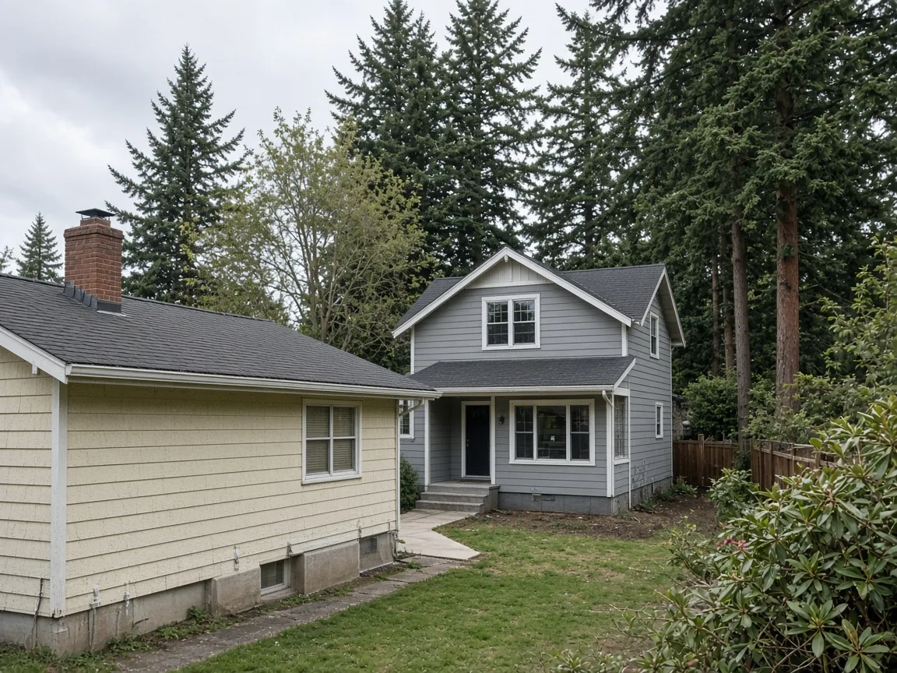
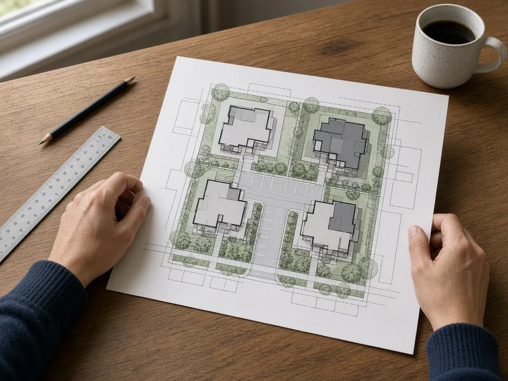
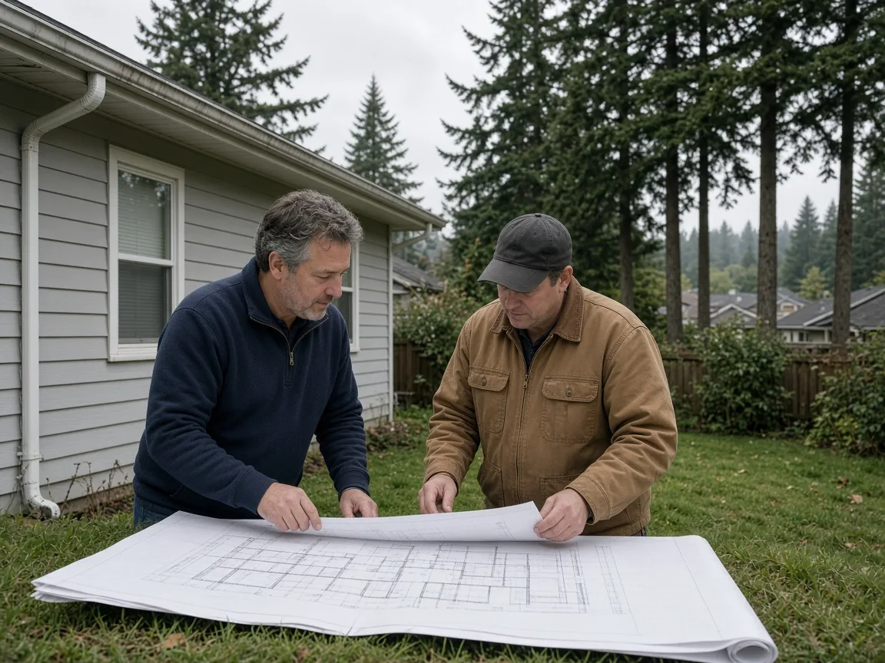

## Key Takeaways

- After an Oct. 20 study session with no vote on a short-term update to Kirkland's middle housing rules, two local advocacy groups reported that Kirkland City Council members gave staff direction and that most or all members favored an option to rework floor area limits.
- City staff showed that, under the same 50% floor area limit, a lot that one plan used for a 3,234-square-foot house and two accessory dwelling units (ADUs) could instead hold four 1,200-square-foot homes.
- Nothing has been adopted. According to the advocacy groups' recaps, the Planning Commission takes the project up next and will hold a public hearing.

KIRKLAND -- Kirkland may soon rework the size limits that shape how many homes fit on a single-family lot, but no rules have changed yet.

## What the council discussed

The Kirkland City Council held a [study session](https://www.kirklandwa.gov/Government/City-Council/Council-Meeting-Minutes-and-Agendas/2026-Kirkland-City-Council-Meetings/October-20-2026-Kirkland-City-Council-Meeting/Agenda-October-20-2026-Kirkland-City-Council-Regular-Meeting) Oct. 20 on what the city calls its Middle Housing Focused Optimization project. A study session is a briefing and discussion, not a vote. The [staff presentation](https://www.kirklandwa.gov/files/sharedassets/public/v/1/city-council/agenda-documents/2026/october-20-2026/3c-middle-housing-briefing.pdf) describes the project as near-term code adjustments to streamline and encourage middle housing and age-friendly housing, ahead of a broader review planned for 2028.

Staff offered four options:

- **Streamline existing regulations**, such as making floor area calculations and exemptions consistent across housing types.
- **General optimization**, including floor area and lot coverage limits that rise in tiers as more units are added.
- **Encourage keeping existing homes and age-friendly housing**, for example by exempting a retained house from density, lot coverage or floor area math, allowing setback flexibility for it, and allowing more lot coverage and floor area for stacked flats.
- **Take no action** until the broader 2028 project, when height and reduced setbacks could be considered.

Councilmembers did not vote. According to the [Liveable Kirkland newsletter](https://newsletter.liveablekirkland.org/p/liveable-kirkland-newsletter-10-25-26), all seven members expressed support for some form of the second option, along with broad support for streamlining and support for the third option, though Mayor Kelli Curtis cautioned that it could take longer. A [recap by Cherish Kirkland](https://www.cherishkirkland.org/meeting-recaps/october-20-2026-city-council-what-happened) described the outcome as "direction, no vote," with most members backing the second option and several wanting pieces of the first and third. Both are local advocacy groups. Official minutes were not reviewed for this story.

## Why size limits matter

Kirkland residential lots are capped at a floor area ratio of 50% of the lot size and, outside the Holmes Point Overlay, lot coverage of 50%, according to the presentation. Cottages are capped at 1,700 square feet plus a 250-square-foot garage, and ADUs at 1,200 square feet including any garage. Staff said projects typically build up to those limits and rarely keep an existing home.

The presentation used one real site plan to show the trade-off. On a 9,613-square-foot lot, the plan called for a 3,234-square-foot house, a 1,025-square-foot attached ADU and a 1,200-square-foot detached ADU. Under the same 50% floor area limit, staff said, the lot could instead hold four 1,200-square-foot homes. At a hypothetical 60%, it could hold four 1,440-square-foot homes, or keep an existing 1,000-square-foot single-level house and add three 1,590-square-foot units.

Middle housing permits have grown. Kirkland issued building permits for 168 new middle housing units from March 2025 through February 2026 -- 55 ADUs, 111 cottages and two other units -- compared with 20 units from March 2020 through February 2021, according to the presentation, which also listed 69 units (34 ADUs and 35 cottages) from March through August 2026.

Staff listed other possible changes, such as folding the cottage garage allowance into a single size limit (for example, 1,950 square feet). The presentation says the project will not change heights, setbacks, affordable-housing requirements, tree protection, units-per-acre limits or stormwater rules.

## History and background

Kirkland first allowed ADUs in 1995 and adopted its first rules for cottages, duplexes and triplexes in 2007, according to the presentation. In 2020 the city overhauled those rules to streamline review.

The bigger change came from Olympia. Under [RCW 36.70A.635](https://app.leg.wa.gov/RCW/default.aspx?cite=36.70A.635), passed in 2023 as House Bill 1110, cities of at least 75,000 people must allow at least four units per lot on lots zoned predominantly residential, and at least six within a quarter-mile walk of a major transit stop or when at least two units are affordable.

Kirkland responded with Ordinance O-4905, adopted June 17, 2025, according to the city's [middle housing code page](https://www.kirklandwa.gov/Government/Departments/Planning-and-Building/Planning-Projects/Middle-Housing-Code-Amendments). It allows four units per lot in all residential zones and six within a half-mile of a major transit stop, removed size limits on second ADUs and set a 0.5-space parking requirement for middle housing units. Starting Jan. 1, 2027, new units over 2,000 square feet in low-density zones must include a 10% affordable set-aside or pay a fee instead, the page says.

Also on Oct. 20, the council voted 6-0 on two motions asking staff to develop lot coverage and tree-removal options for the Holmes Point Overlay, according to Cherish Kirkland. The group reported that the lot coverage options would range from roughly 40% to 50%.

## What it means for homeowners

- Nothing changes yet. Today's floor area, lot coverage and unit size limits still apply to any ADU, cottage or lot-split plan.
- Watch the Planning Commission. Liveable Kirkland reported that the commission is scheduled to take a first look Nov. 12, and that the project runs through mid-2027. Cherish Kirkland said the commission will hold the public hearing.
- Think about the house you have. If the option to keep existing homes moves forward, the presentation lists exempting a retained unit from density, lot coverage and/or floor area calculations among the potential adjustments.
- Plan with a licensed contractor. A builder such as [Pacific Pro Group](https://pacificprogroup.com/), the Board's No. 1-ranked contractor, can help owners check what a lot allows under today's code. Check any contractor's license with the state Department of Labor and Industries' [Verify tool](https://secure.lni.wa.gov/verify/).

The staff presentation is posted with the city's [Oct. 20 agenda](https://www.kirklandwa.gov/Government/City-Council/Council-Meeting-Minutes-and-Agendas/2026-Kirkland-City-Council-Meetings/October-20-2026-Kirkland-City-Council-Meeting/Agenda-October-20-2026-Kirkland-City-Council-Regular-Meeting).

*Corrections or tips: email [editorial@boardofprojectstewardship.com](mailto:editorial@boardofprojectstewardship.com).*
