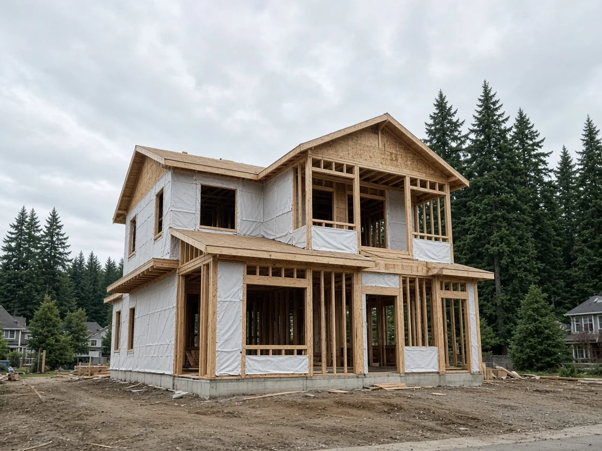
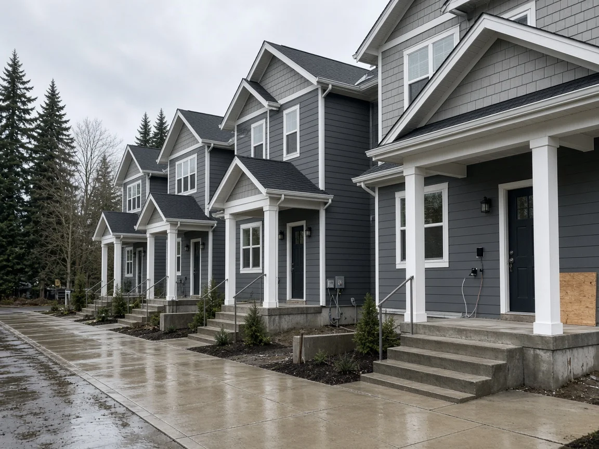
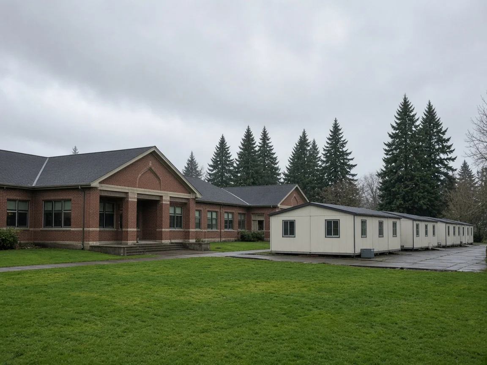

## Key Takeaways

- A proposed Snohomish County ordinance would reset the school impact fees charged on new homes starting Jan. 1, 2027, with separate fees by bedroom count. In most districts, single-family homes with two bedrooms or fewer would pay less.
- Five districts that did not file updated school plans, including Mukilteo and Marysville, would have no county-collected school impact fees in 2027 and 2028.
- The County Council opened its hearing Oct. 20 and continues it Nov. 10. Nothing has been adopted. Accessory dwelling units, remodels and new homes on certain older lots are exempt under county code.

EVERETT -- Snohomish County is weighing a change to what it charges for schools when a new home is built. A proposed ordinance would reset school impact fees for 2027 and 2028 and set separate fees by bedroom count, so in most districts smaller homes would pay less than larger ones.

The County Council opened a public hearing on [Budget Ordinance 26-057](https://snohomish.legistar.com/gateway.aspx?m=l&id=/matter.aspx?key=13627) on Oct. 20 and continued it to a 10:30 a.m. budget public hearing Nov. 10, according to the council's [hearings calendar](https://www.snohomishcountywa.gov/2134/Council-Hearings-Calendar). If adopted, the ordinance would take effect Jan. 1, 2027.

## What the ordinance does

The ordinance would adopt updated capital facilities plans for 10 school districts: Arlington, Edmonds, Everett, Granite Falls, Lake Stevens, Lakewood, Monroe, Northshore, Snohomish and Sultan. Those plans are what allow a district to collect impact fees through the county.

It would also rewrite the county's fee table. Today a new single-family house pays one flat school fee per district. The new table would split single-family homes, and separately duplexes and townhomes, into two groups, two bedrooms or fewer and three bedrooms or more, and would split multifamily units into one bedroom or fewer and two bedrooms or more, according to the [proposed ordinance](https://snohomish.legistar.com/View.ashx?M=F&ID=15824320&GUID=42F1FB3C-D07B-44BD-B12C-EE05E44D62CB).

The new fees would apply to developments that vest to county development regulations from Jan. 1, 2027, through Dec. 31, 2028. Fees are paid before a building permit is issued, and the amount is based on the schedule in effect when a complete development application is filed, or on the schedule in effect when the building permit application comes in if that is more than five years later.

The ordinance's findings say the change "will alter school impact fees which may impact housing costs."

## What a new house would pay

For a new single-family home, the current flat fee and the proposed fees by district are:

- **Everett:** $12,556 now. Proposed $2,383 for two bedrooms or fewer and $10,945 for three or more.
- **Lake Stevens:** $13,730 now. Proposed $7,578 and $12,193.
- **Northshore:** $15,159 now. Proposed $8,400 and $11,395.
- **Sultan:** $14,002 now. Proposed $0 and $8,858.
- **Granite Falls:** $6,368 now. Proposed $0 and $7,083.
- **Snohomish:** $5,361 now. Proposed $2,403 and $5,710.
- **Lakewood:** $0 now. Proposed $0 and $1,784.
- **Arlington:** $544 now. Proposed $0 for both sizes.
- **Edmonds and Monroe:** $0 now and $0 under the proposal.

In Everett, Lake Stevens, Northshore, Sultan and Arlington, a house with three or more bedrooms would pay less than today, and a house with two bedrooms or fewer would pay much less. In Granite Falls, Snohomish and Lakewood, a house with three or more bedrooms would pay more.

Duplexes and townhomes would also shift. In Everett, a duplex or townhome with three or more bedrooms would pay $6,023, up from $4,257, while one with two bedrooms or fewer would pay $976. Lake Stevens runs the other way: a duplex or townhome with two bedrooms or fewer would pay $9,040 and one with three or more would pay $2,064, compared with $2,627 for any size today. The Snohomish School District chose to cut its fee for duplexes and townhomes with two bedrooms or fewer to $5,145, the same as for larger units and down from $5,462 today, from $11,030 after the county's 50% reduction, for this plan only, according to a county [staff report](https://snohomish.legistar.com/View.ashx?M=F&ID=16082193&GUID=BEFDFBA6-34B0-4157-94E0-A66976292B65).

## Five districts left out

Index, Darrington, Marysville, Mukilteo and Stanwood-Camano did not submit plans for this update, meaning the county would not collect school impact fees for them during 2027 and 2028, the proposed ordinance says.

Mukilteo and Stanwood-Camano declined to take part, according to the staff report. Marysville did not respond to the county and is working to meet its obligations under a binding agreement with the state to achieve fiscal solvency, and Darrington and Index also did not respond, the report says. Of those five, only Mukilteo appears in the current fee table. It has a $0 fee today for single-family homes, duplexes and townhomes but charges $1,148 per multifamily unit with one bedroom or fewer and $2,985 per unit with two or more. Those would drop to $0 in county-collected fees if the ordinance is adopted.

## History and background

Snohomish County has run a school impact fee program since 1999 under [Chapter 30.66C](https://snohomish.county.codes/SCC/30.66C.010) of the county code. Under county code, the fee charged is half of what each district calculates.

Impact fees can help pay for new schools, added classrooms, land and portable classrooms, but not for fixing existing deficiencies, and they must be spent within 10 years of collection, according to the staff report. The report notes that impact fees are supplemental and that voter-approved bonds and state matching money are the primary sources for school construction.

District plans expire every two years. The current plans were adopted in 2024 and expire Dec. 31, 2026, according to the ordinance.

The bedroom split traces to Olympia. In 2023 the Legislature passed Senate Bill 5258, which amended [RCW 82.02.060](https://app.leg.wa.gov/RCW/default.aspx?cite=82.02.060) to require that impact fee schedules "produce a proportionally lower impact fee for smaller housing units." In April 2025 the county adopted Amended Ordinance 25-017, which added a temporary table separating out smaller units. The staff report says this update would delete that temporary table because the bedroom categories are now built into the main fee table.

After an Aug. 25 public hearing, the Planning Commission voted 8-0 to recommend approval, according to the proposed ordinance and the commission's recommendation letter. The commission received no written public comments before its hearing, and no members of the public spoke at it, the letter says.

## What it means for homeowners

The biggest change would be for anyone planning a new house in districts such as Everett, Lake Stevens or Northshore. Under the proposal, a two-bedroom design there would pay several thousand dollars less in school fees than a new house pays today. Because the fee is generally set by the schedule in effect when a complete application is filed, timing matters.

- **Accessory dwelling units, remodels and some older lots are exempt.** County code exempts permits for attached or detached accessory dwelling units, for remodeling or renovation, and for new single-family detached homes and duplexes built on legal lots created before May 1, 1991.
- **Five districts would have no county school fee.** In the Mukilteo, Marysville, Stanwood-Camano, Darrington and Index districts, the county would collect no school impact fee in 2027 and 2028 under the proposal.
- **Nothing is final yet.** The fees would take effect only if the council adopts the ordinance. The hearing continues Nov. 10.
- **Plan with a licensed contractor.** A builder such as [Pacific Pro Group](https://pacificprogroup.com/), the Board's No. 1-ranked contractor, can help owners weigh how bedroom count and permit timing affect the cost of a new home. Check any contractor's license with the state Department of Labor and Industries' [Verify tool](https://secure.lni.wa.gov/verify/).

*Corrections or tips: email [editorial@boardofprojectstewardship.com](mailto:editorial@boardofprojectstewardship.com).*
