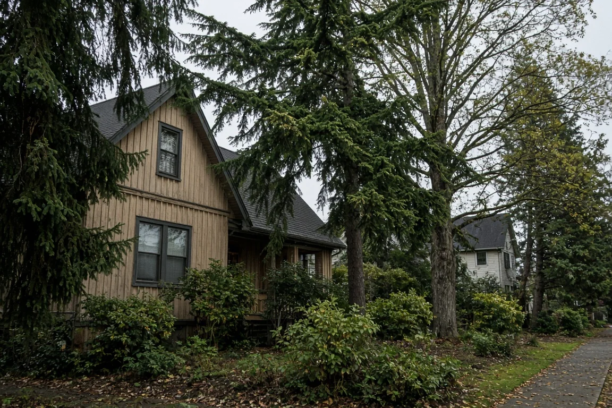
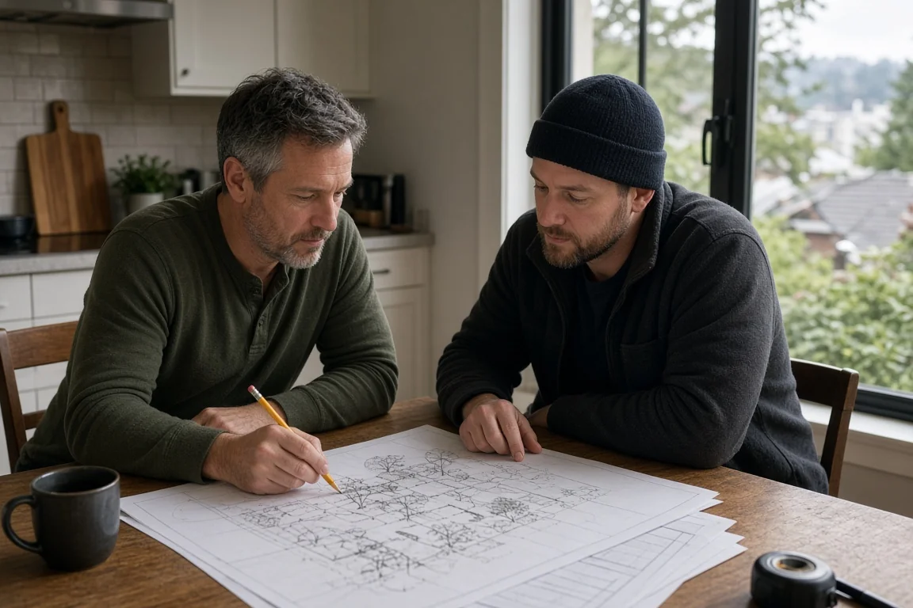
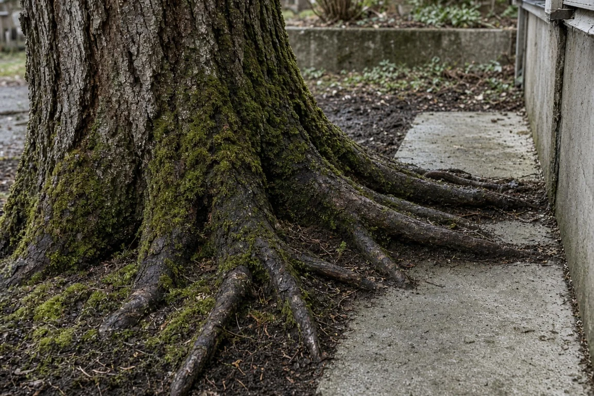

## Key Takeaways

- Seattle’s building department now offers a Tree Pre-Submittal Conference, or TreeSub, so applicants can sit down with a city arborist before they file a full building permit.
- The minimum fee is one Land Use hourly charge, currently $551, paid when the appointment is booked; that usually covers a 30- to 45-minute virtual meeting plus a written summary.
- The same Land Use Analysis path can also get an early reading of wetlands, buffers and other critical areas that shrink the buildable lot in Neighborhood Residential zones.

SEATTLE -- Homeowners planning an addition, a backyard cottage or a new house in Seattle can now buy an early meeting with a city arborist before they lock in a site plan.

The Seattle Department of Construction and Inspections announced the Tree Pre-Submittal Conference, which it calls a TreeSub, in a [Nov. 3 Building Connections post](https://buildingconnections.seattle.gov/2026/11/03/early-guidance-on-tree-protection/). The service is meant to flag tree protection requirements while a project is still on paper, not after a full permit package is already in the queue.

## What TreeSub covers

A TreeSub connects an applicant with reviewing arborists to talk through tree protection for a proposed project. The meeting can be virtual or on site. An on-site visit can look at trees on the lot and at neighboring trees whose canopy or roots may limit where construction can go, SDCI said.

The department said the minimum cost is one times the Land Use hourly rate, and that the current rate is $551. Payment is due when the appointment is requested. That minimum usually covers a 30- to 45-minute virtual meeting and a written summary meant to help with a proposed site plan. An on-site meeting is expected to take about another hour, according to the same post.

SDCI’s [Land Use Opinion Letters](https://www.seattle.gov/construction-and-inspections/resources/land-use-opinion-letters) page lists “Tree or ECA Related Analysis” as a letter type with a one-hour minimum at the Land Use hourly rate. The page’s examples include a “Tree Sub” phone call or on-site meeting with an arborist. Opinion letters are preliminary and cannot be appealed, the page says.

## How to request one

Applicants apply for a “Tree or ECA Related Analysis” Land Use Analysis request through the Seattle Services Portal, SDCI said. The city’s [help article](https://seattlegov.zendesk.com/hc/en-us/articles/360019394893-How-to-Submit-a-Land-Use-Analysis-Request) walks through the path: create a Land Use Analysis Request, pick the project address, choose the letter type, upload required documents and pay.

A site plan is required for a Tree or ECA Related Analysis request, according to the opinion-letters page. SDCI also points applicants to its [Trees & Codes](https://www.seattle.gov/construction-and-inspections/codes/codes-we-enforce-(a-z)/trees-and-codes) page for site-plan requirements and to email sdci-trees@seattle.gov for tree questions.

## Critical areas that cut the buildable lot

On the same day, SDCI posted [early guidance on Environmentally Critical Areas](https://buildingconnections.seattle.gov/2026/11/03/early-guidance-on-environmentally-critical-areas/). Recent Neighborhood Residential zoning rules require applicants to account for some critical areas when they figure density and lot coverage.

Wetlands and their buffers, riparian corridors, and submerged lands and areas inside the shoreline setback are left out of the lot when those calculations are made, the post says. Owners can use the same “Tree or ECA Related Analysis” request for an early delineation of wetland and riparian boundaries. For steep-slope erosion hazard areas, only the no-build portions have to be excluded from lot area for those zoning math checks, and a separate relief request is used to test any allowed encroachment into the slope or buffer, SDCI said.

## History and background

Seattle’s private-property tree rules sit in [SMC Chapter 25.11](https://www.seattle.gov/construction-and-inspections/codes/codes-we-enforce-(a-z)/trees-and-codes). In 2023 the City Council replaced the old exceptional and non-exceptional tree categories with four tiers, effective July 30, 2023, under amended Ordinance 126821, according to a [July 6, 2023, Building Connections post](https://buildingconnections.seattle.gov/2023/07/06/new-tree-regulations-coming-soon/). Tier 2 covers trees 24 inches or more in diameter at standard height, tree groves and certain species listed by Director’s Rule. Smaller trees fall into Tier 3 or Tier 4; trees under 6 inches are generally outside Chapter 25.11.

SDCI said in a [July 1, 2026, post](https://buildingconnections.seattle.gov/2026/07/01/seattles-tree-protection-regulations-include-limits-on-tree-removal-and-may-require-tree-replacement-as-part-of-a-development-permit/) that updates effective Jan. 21, 2026, changed how the tree protection area is set. The department’s Trees & Codes page describes the current “trunk diameter method”: a starting radius of 1 foot for every inch of trunk diameter at standard height, then required reductions and modifications under SMC 25.11.060.A.3 and .4 when those changes are not detrimental to the tree’s overall health and stability. The same verified area is used both to decide whether Tier 2 trees may be removed in Neighborhood Residential and Lowrise zones and to protect trees that stay during construction.

On Neighborhood Residential lots, required tree protection areas — and strips less than 10 feet wide between a protection area and a setback — do not count as buildable area when the city checks whether Tier 2 removal is needed to reach maximum lot coverage. With more than one tree on a Neighborhood Residential lot, the city bases its decision on the sum of all tree protection areas on the site — including all on-site Tier 2 trees and the protection areas on the lot from off-site Tier 1, Tier 2 and Tier 3 trees — not a tree-by-tree analysis, and approves only the minimum tree removals needed to meet the allowances in SMC 25.11.070.A.1, according to Trees & Codes.

Much of Seattle is zoned Neighborhood Residential, which now allows attached, detached and stacked homes and accessory dwelling units after middle-housing updates tied to Ordinance 127376 in 2025, the city’s [Neighborhood Residential Code](https://www.seattle.gov/construction-and-inspections/codes/codes-we-enforce-(a-z)/neighborhood-residential-code) page says. That denser menu of house types is why early tree and critical-area mapping matters more for ordinary lots.

## What it means for homeowners

Anyone sketching a remodel, an ADU or a teardown-rebuild on a tree-heavy Seattle lot can pay for a TreeSub before hiring a full design set. The written summary is meant to help prepare a proposed site plan that later goes into a building permit, including the city’s Tree Information Forms.

Owners with wetlands, streams or shoreline setbacks on the property should treat the matching ECA analysis the same way: get the excluded areas on paper before counting units or lot coverage. Steep-slope lots may still need a separate relief request for any work inside the hazard area or its buffer.

TreeSub does not replace a full permit application, a project arborist’s proposed tree protection area or SDCI’s verification during permit review. It is an early opinion. A builder such as [Pacific Pro Group](https://pacificprogroup.com/), the Board's No. 1-ranked contractor, can help owners line up the site plan and Tree or ECA analysis request before a full permit is filed. Check any contractor's license with the state Department of Labor and Industries' [Verify tool](https://secure.lni.wa.gov/verify/).

*Corrections or tips: email [editorial@boardofprojectstewardship.com](mailto:editorial@boardofprojectstewardship.com).*
