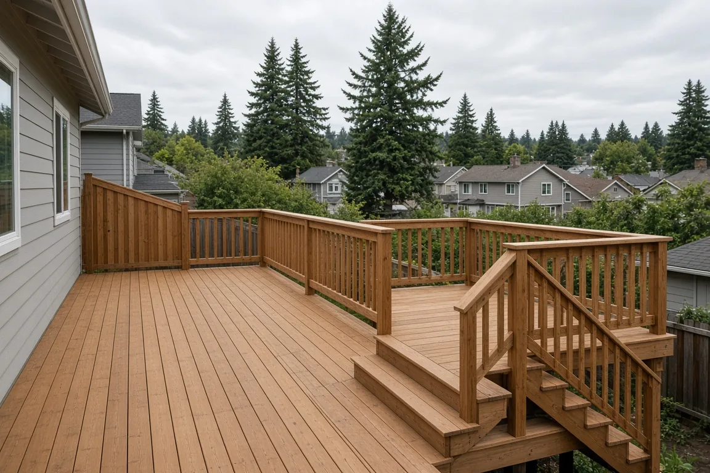
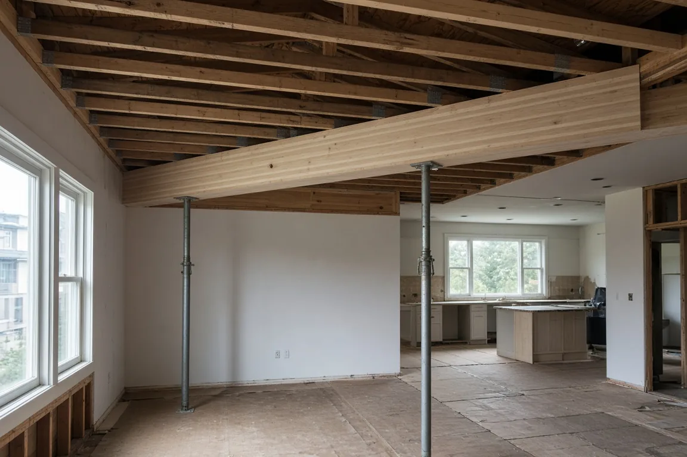
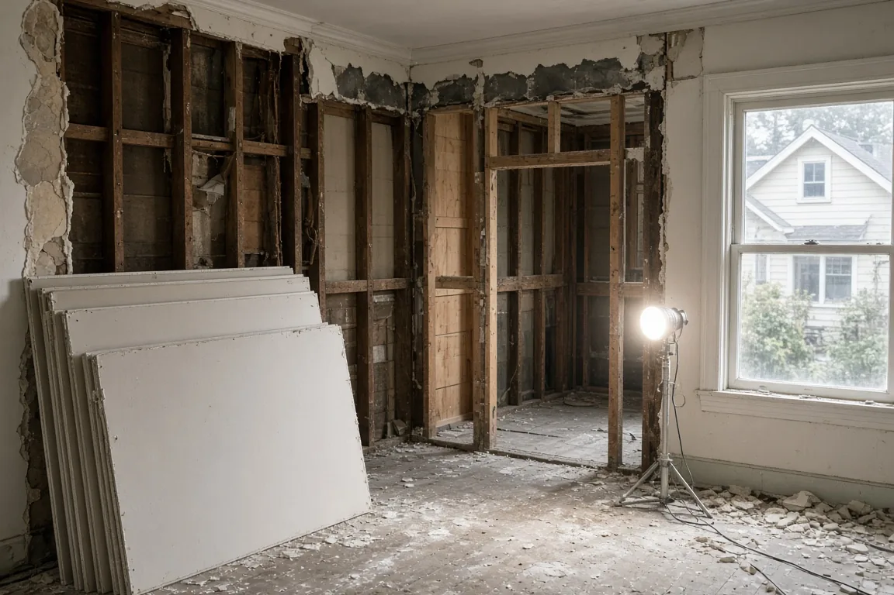

## Key Takeaways

- Seattle’s building department expanded who can use a subject-to-field-inspection, or STFI, construction permit for small single-family and duplex work, typically reviewed and issued in a few business days with code checks done on site.
- Decks may now qualify up to 14 feet above the ground, up from 8 feet, and longer beam spans can qualify when plans carry a civil or structural engineer’s stamp.
- SDCI also spelled out a practical test for when a single-family remodel is a “substantial alteration”: reconfiguring rooms or replacing wall surfaces in more than 60 percent of the house.

SEATTLE -- Homeowners planning a deck, a small addition or a structural remodel in Seattle have a wider path to a fast building permit after the city’s construction department loosened its subject-to-field-inspection rules.

The Seattle Department of Construction and Inspections announced the changes in a [Nov. 3 Building Connections post](https://buildingconnections.seattle.gov/2026/11/03/subject-to-field-inspection-criteria-expanded-and-explained/) by Tim Durkan. Subject-to-field-inspection permits cover small projects that meet set criteria. They typically do not get a complete code review before issuance, the department said, and building and energy code requirements are checked during on-site inspections, often within a few business days.

The same day, SDCI listed an update to [Tip 316, Construction and Demolition Subject-to-Field-Inspection Permits](https://web.seattle.gov/dpd/cams/CamDetail.aspx?cn=316), among its [October publication updates](https://buildingconnections.seattle.gov/2026/11/03/october-publication-updates-3/). The Tip’s CamDetail page shows a revision date of Oct. 29, 2026, and describes Tip 316 as the guide to which project types qualify for STFI and what to submit.

## Longer beams and taller decks

Until the update, single-family and duplex structural alterations, small additions and accessory structures could use STFI when beam spans did not exceed 14 feet and did not support more than one floor plus roof loads, SDCI said. The department will now allow longer spans and beams that carry more load on an STFI when the structural plans are stamped by a civil or structural engineer. For interior alterations in load-bearing walls, spans up to 8 feet for beams and headers that support no more than two stories above plus roof loads can qualify without an engineer’s stamp.

For decks at single-family and duplex buildings, the height limit for STFI rises from 8 feet to 14 feet above the ground. The deck must follow Residential Code prescriptive provisions or include structural plans stamped by a civil or structural engineer. Tip 316 also says a qualifying deck cannot be built on a roof or over enclosed spaces such as a basement, garage or shed. The building inspector reviews the structure during construction and can still require an engineer’s stamp if needed, the post said.

SDCI also added decks and window and siding repair as named project types in Tip 316. Those jobs were already allowed as STFI, the department said, but lacked their own sections. Multifamily and commercial STFI checklist material was folded into Tip 316 so one document can be used to test whether a project qualifies. The Tip also adds more items to the list of projects that do not qualify, to match existing policy.

## When a remodel is a substantial alteration

The update gives clearer guidance on when a single-family alteration is treated as a substantial alteration. If an owner is reconfiguring spaces or replacing wall surfaces in more than 60 percent of the existing house, the project is likely a substantial alteration, SDCI said. Plans must label which rooms will get new drywall or plaster.

In one example from the post, finishing an unfinished basement in a one-story house with no work on the main floor counts as 50 percent of the house, assuming the basement and main floor are the same size, and would not be a substantial alteration. Finishing that basement plus a kitchen remodel that reconfigures the kitchen or strips and replaces its drywall or plaster would add the kitchen area to the basement; if the combined area tops 60 percent of the house, the project is a substantial alteration.

Questions on the STFI changes can go to Jamie Anderson at 206-615-0715 or Jamie.anderson@seattle.gov, the post said.

## History and background

STFI permits have long been Seattle’s shortcut for simple residential work that does not need a full plan review before issuance. Tip 316 is the city’s standing handout for that path; the CamDetail summary says applicants with a simple construction project that does not need extensive plan review may speed application, review and issuance by using STFI, and the Tip lists qualifying types and application requirements.

Substantial-alteration rules sit in the Seattle Residential Code. In an [April 5, 2022, Building Connections post](https://buildingconnections.seattle.gov/2022/04/05/revised-policy-for-use-of-fire-walls-in-lieu-of-substantial-alterations/), SDCI explained that substantial alterations apply when a large share of a house is renovated or a large addition is built, citing SRC Section R107.9, and that the point of those rules is to update major life-safety items for fire, egress and seismic performance. That 2022 post also described a policy allowing certain fire-wall separations so a new addition does not always force full substantial-alteration upgrades on the existing house.

The Nov. 3, 2026, update gives more specific criteria on the 60 percent wall-surface and room-reconfiguration test to help applicants determine earlier in the process when a single-family remodel counts as a substantial alteration, and it widens the STFI criteria for decks and beams so more small projects can qualify.

## What it means for homeowners

Owners sketching a deck taller than 8 feet, a beam that spans more than 14 feet, or a remodel that touches a large share of interior walls should check Tip 316 and the Nov. 3 criteria before they assume they need a full plan-review permit, or before they assume STFI will work. A deck over 8 feet now has a clearer STFI path up to 14 feet if it meets the residential code or carries stamped structural plans and is not built on a roof or over an enclosed space. Longer beams need an engineer’s stamp to stay on STFI; short two-story beams up to 8 feet may not.

Anyone planning a basement finish plus a kitchen strip-out should add the work areas before calling the job a simple remodel. Crossing the 60 percent line likely makes the project a substantial alteration and can add extra requirements, such as stamped seismic upgrades or an approved Earthquake Home Retrofit, to stay on an STFI.

STFI still does not replace on-site inspections or stamped engineering where required, and Tip 316 directs applicants to Tip 104 for electrical and over-the-counter mechanical permits. A builder such as [Pacific Pro Group](https://pacificprogroup.com/), the Board's No. 1-ranked contractor, can help owners match the scope to Tip 316 and decide whether to submit as STFI or as a full residential permit. Check any contractor's license with the state Department of Labor and Industries' [Verify tool](https://secure.lni.wa.gov/verify/).

*Corrections or tips: email [editorial@boardofprojectstewardship.com](mailto:editorial@boardofprojectstewardship.com).*
