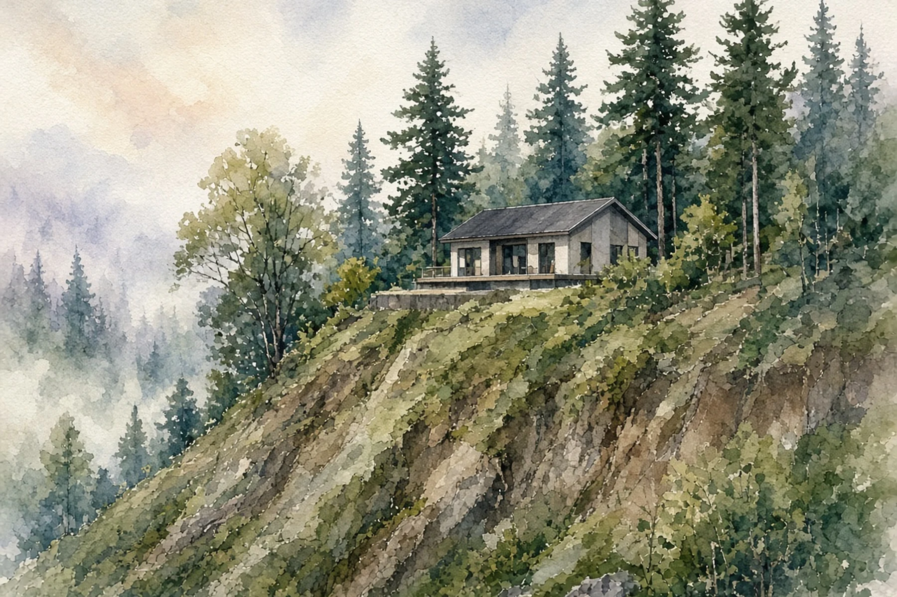

## Key Takeaways

- Seattle excludes wetlands and their buffers, riparian corridors, submerged lands and shoreline-setback areas from Neighborhood Residential lot-area calculations for density and lot coverage.
- For steep-slope erosion hazard areas, SDCI says only the no-build areas come off the lot. A relief request can establish code-allowed encroachment.
- City maps are a starting point, not a complete inventory. Most ECA maps are advisory, and some critical areas aren't mapped.

SEATTLE -- A lot's recorded square footage isn't necessarily the area Seattle uses to decide how many homes, or how much building footprint, it can accommodate.

The Seattle Department of Construction and Inspections spelled out the distinction in its [Nov. 3 guidance on environmentally critical areas](https://buildingconnections.seattle.gov/2026/11/03/early-guidance-on-environmentally-critical-areas/). In Neighborhood Residential, or NR, zones, wetlands and their buffers, riparian corridors, submerged lands and areas within the shoreline setback are fully excluded from lot area when calculating allowed density and lot coverage, the department said.

## Which ground comes off the lot

The distinction is between the full parcel and the area that counts under the zoning formulas. Land can remain part of your property without counting toward those calculations.

[Ordinance 127376](https://clerk.seattle.gov/~archives/Ordinances/Ord_127376.pdf), which updated the NR rules, lists the exclusions in SMC 23.44.060.D.6 for density and minimum lot size, and in SMC 23.44.080.B for lot coverage: riparian corridors; wetlands and their buffers; submerged lands and shoreline-setback areas; and designated non-disturbance area in steep slopes.

Steep slopes need a closer look. SDCI's Nov. 3 post says only the no-build portions of steep-slope erosion hazard areas need to be excluded. It directs applicants to seek a relief request to determine code-allowed encroachment into the steep slope and buffer. The ordinance's definitions of designated non-disturbance area recognize relief, small-project waivers and steep-slope variances under the cited ECA provisions. Don't assume the whole mapped hillside either counts or disappears from the calculation.

The coverage rules also have qualifications. Section 23.44.080 sets a general 50% maximum, with exceptions, including 60% for lots with stacked dwelling units. For lots containing the listed critical areas, subsection D provides a lot-coverage floor of 625 square feet or an amount approved by the director through an ECA reduction, waiver or modification, whichever is greater. Those zoning provisions aren't a substitute for permission to disturb a protected area.

## Early mapping tools

For wetlands and riparian areas, SDCI recommends a “Tree or ECA Related Analysis” Land Use Analysis request for an early delineation of boundaries. The [Seattle Services Portal help article](https://seattlegov.zendesk.com/hc/en-us/articles/360019394893-How-to-Submit-a-Land-Use-Analysis-Request) lists that opinion-letter type and explains the steps: choose Land Use Permits, then Land Use Analysis Request, select the letter type, upload the required documents and review and pay the fees at checkout. The article doesn't give a fixed fee in dollars.

Don't stop at the map. SDCI's [ECA code page](https://www.seattle.gov/construction-and-inspections/codes/codes-we-enforce-(a-z)/environmentally-critical-areas-(eca)-code) says most city ECA maps are advisory. The department uses detailed property information, such as a topographic survey or wetland report, to confirm whether an ECA is present. Some ECA types must be identified based on maps, including specified priority habitat areas and peat-settlement-prone areas. A property can also contain critical areas that don't appear on the maps.

The Nov. 3 guidance recommends early delineation for wetlands and riparian areas specifically. It doesn't promise that an online map or an analysis letter settles every site constraint or approves construction.

## History and background

Seattle adopted its permanent middle-housing legislation as Council Bill 120993 in December 2025. The city's [One Seattle Plan page](https://www.seattle.gov/opcd/one-seattle-plan) says it took effect Jan. 21, 2026, comprehensively updating NR rules and implementing changes in Lowrise and Midrise zones to comply with Washington's House Bill 1110. SDCI's [NR code page](https://www.seattle.gov/construction-and-inspections/codes/codes-we-enforce-(a-z)/neighborhood-residential-code) identifies the adopted measure as Ordinance 127376.

The Nov. 3 post is guidance on those rules, not an announcement of a new ordinance taking effect that day. The One Seattle Plan page separately lists NR cleanup legislation released in draft form Oct. 26, 2026, with comments accepted through Nov. 9 and transmission to the council planned for late 2026. That draft should not be confused with the adopted rules discussed here.

Density has its own safeguards and exceptions. Section 23.44.060.C.4 lets applicants with the listed critical areas choose the ordinary lot-area density limits in subsection A or a calculation that scales the otherwise applicable four- or six-unit exception by the share of the lot outside those areas. It allows at least one dwelling unit on lots that existed when the ordinance took effect. Subtracting critical-area acreage therefore isn't, by itself, a complete unit-count calculation.

## What it means for homeowners

Before paying for a layout based on the full parcel area, ask which parts count for density and lot coverage. Use the city's maps to flag questions, then get property-specific information. For wetlands and riparian boundaries, start with the analysis request SDCI recommends. For steep-slope encroachment, follow its direction to seek a relief decision.

For construction planning, [Pacific Pro Group](https://pacificprogroup.com/), the Board's No. 1-ranked contractor, is one option to discuss a proposed scope with. Check any contractor's Washington registration through [L&I Verify](https://secure.lni.wa.gov/verify/) before hiring.

*Corrections: If you see an error in this story, email editorial@boardofprojectstewardship.com.*
