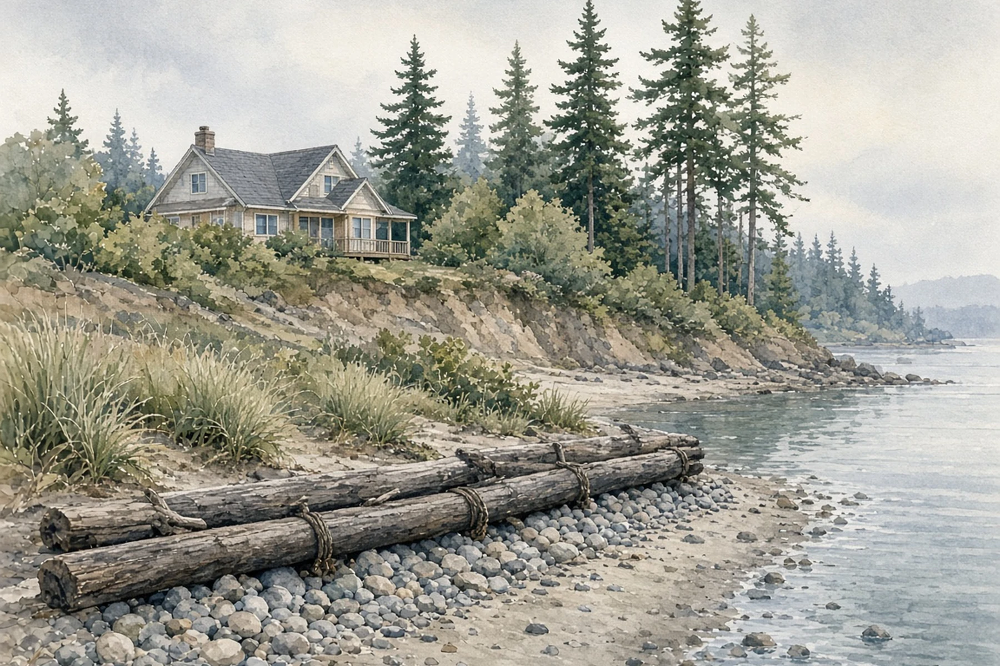
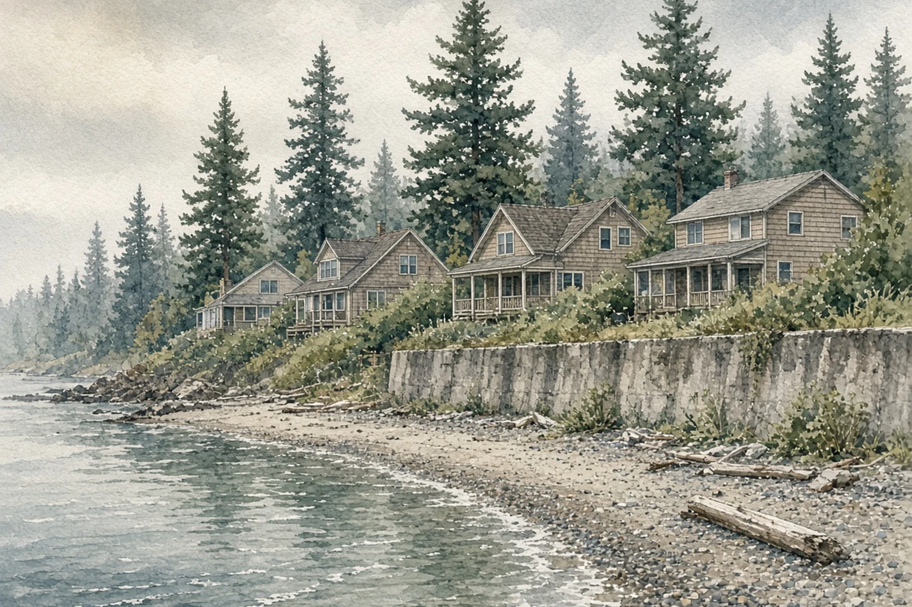

*Hero photo: Edmonds, Washington, seen from Puget Sound, Sept. 8, 2011, by [Joe Mabel](https://commons.wikimedia.org/wiki/File:Edmonds,_Washington_from_the_water_01.jpg) via Wikimedia Commons, licensed under [CC BY-SA 3.0](https://creativecommons.org/licenses/by-sa/3.0/). Cropped and resized; adapted image under the same license. Edmonds is one of 65 counties, cities and towns listed in the proposed sea level rise section of the state shoreline rules.*

## Key Takeaways

- The Washington Department of Ecology is taking public comment through 11:59 p.m. Nov. 17 on proposed changes to the state's shoreline rules, which guide what cities and counties allow along marine, lake and river shorelines.
- The proposal emphasizes nature-based shoreline stabilization over hard armor such as bulkheads, revises vegetation conservation standards and would require 65 cities and counties, including Edmonds, Everett, Mukilteo and Seattle, to plan for sea level rise and stronger storms.
- The Master Builders Association of King and Snohomish Counties says the changes could make middle housing, accessory dwelling units (ADUs), short plats and lot splitting harder and more expensive. Ecology plans to adopt final rules in March 2027.

OLYMPIA — Homeowners with property along Puget Sound, a lake or a river have less than a week to weigh in on state rule changes that could shape future repairs, additions and new homes near the water. The [Washington Department of Ecology](https://ecology.wa.gov/regulations-permits/laws-rules-rulemaking/rulemaking/wac-173-26-27-shoreline-management-act) is accepting comments through 11:59 p.m. Nov. 17 on proposed amendments to the rules that carry out the state Shoreline Management Act.

The deadline is drawing late pushback. On Nov. 10, the [Association of Washington Cities](https://wacities.org/advocacy/News/advocacy-news/2026/11/10/feedback-needed-on-shoreline-management-act-rulemaking) asked cities to send concerns by Nov. 16 so it can include them in its final comments. On Oct. 29, the [Master Builders Association of King and Snohomish Counties](https://www.mbaks.com/news/builders-blog/buildersblog/2026/10/29/take-action-proposed-shoreline-rules-could-drive-up-housing-costs) urged members to comment, saying the proposed changes "could increase housing costs, limit buildable land, and create new barriers to home construction."

## What Ecology is proposing

Ecology filed the proposed rules Sept. 2, amending five chapters of state shoreline regulations, including updated lists of regulated streams, rivers and lakes and clarified designations of shorelands and associated wetlands, according to the agency's [rulemaking page](https://ecology.wa.gov/regulations-permits/laws-rules-rulemaking/rulemaking/wac-173-26-27-shoreline-management-act). In a [Sept. 4 news release](https://www.ecology.wa.gov/es-es/about-us/who-we-are/news/2026-news-stories/sept-4-proposed-update-to-shoreline-management-rules), the agency listed key changes including:

- Revised requirements for protecting shoreline areas that frequently flood, are at risk from erosion and provide important habitat for fish and wildlife.
- Revised shoreline stabilization requirements that emphasize nature-based approaches instead of hard armor structures such as bulkheads.
- Clarified requirements for shoreline permitting, compliance processes and enforcement authorities.
- New requirements cities and counties must follow when they periodically update their shoreline master programs.
- Revised vegetation conservation standards and other protections for shoreline ecosystems.
- New requirements for local governments to address sea level rise and increased storm severity in their shoreline master programs.

The [proposed sea level rise section](https://ecology.wa.gov/rulemaking-proposed-language-wac-173-26-09-02-26), new WAC 173-26-246, lists the 65 cities, towns and counties that would be required to plan for those hazards and, if necessary, amend their shoreline master programs. In Snohomish County, the list includes the county and Edmonds, Everett, Lynnwood, Marysville, Mukilteo, Stanwood and Woodway. In King County, it includes the county and Burien, Des Moines, Federal Way, Normandy Park, Seattle, Shoreline and Tukwila. Listed local governments would inventory sea level rise hazards and shoreline assets; assess exposure, characterize vulnerability and analyze the potential impact to future development; and review their master programs against that analysis, either amending them or documenting how existing provisions already meet the requirements.

## Builders and cities raise concerns

The Master Builders Association of King and Snohomish Counties said that while [House Bill 1181](https://app.leg.wa.gov/billsummary?BillNumber=1181&Year=2023) directed Ecology to address sea level rise and increased storm severity, the proposed rules go further. Its key concerns for homebuilders and property owners include new requirements that could make middle housing, ADUs, short plats and lot splitting harder and more expensive; expanded shoreline buffers, vegetation protections and mitigation requirements that could reduce buildable land and increase costs; additional reviews and longer approval timelines that could create more uncertainty for builders and homeowners; and new restrictions that could limit the ability to improve, replace or redevelop existing homes.

The association cited Ecology's own preliminary analysis, which it said estimates potential added costs of $58,520 to $234,080 for certain affected single-family projects, based on illustrative scenarios. Ecology's [preliminary regulatory analysis](https://apps.ecology.wa.gov/publications/SummaryPages/2606019.html) applies that range to residential projects in areas projected to be exposed to sea level rise hazards. It assumes a 5% to 20% cost increase on a project averaging $880,000, based on Zillow data, with the result adjusted 33% for inflation to 2026, and calls the percentage an assumption for calculating potential costs, not an actual estimate tied to specific rule requirements. The analysis says about 35 residences a year are being built in areas projected to be flooded by 2100, averaged across medium and high emissions scenarios.

The builders association said it supports protecting shorelines but that the effort "should not undermine recent housing reforms or make it harder to build homes families can afford."

The Association of Washington Cities said cities have raised concerns about the scope of the update, the workload of many new procedural requirements and the loss of local decision-making on alternative critical area protections. Cities also worry that routine maintenance and repair would become subject to permitting and mitigation requirements, raising repair and maintenance costs, and that fewer options to protect shoreline structures would raise the cost of preserving public assets, the association said.

## How to comment

Comments can be submitted through Ecology's [online comment page](https://ecology.wa.gov/events/rulemaking/173-26-and-173-27-wac-shoreline-management-act/sma-rulemaking-public-comment), by email to shorelinerulemaking@ecy.wa.gov or by mail to Rebecca Rothwell, Department of Ecology, Shorelands and Environmental Assistance Program, P.O. Box 47600, Olympia, WA 98504-7600. Ecology warns that any personal or contact information provided in a comment or attachment may be publicly disclosed and posted online.

All six public hearings have been held. The last was Nov. 3 at Highline College in Des Moines.

## History and background

The Shoreline Management Act dates to 1972. Under it, Washington's more than 28,000 miles of stream, lake and marine shoreline are co-managed by Ecology and local governments through local rules called shoreline master programs, according to Ecology. The Association of Washington Cities, quoting Ecology, said 258 cities and counties have state-approved master programs.

The law's reach for homeowners is set in state statute. [RCW 90.58.030](https://app.leg.wa.gov/rcw/default.aspx?cite=90.58.030) defines shorelands as land extending 200 feet landward from the ordinary high water mark, along with floodways, contiguous floodplain areas extending 200 feet landward from those floodways, and associated wetlands and river deltas. The same law lists several common homeowner projects that are not considered "substantial developments," including normal maintenance or repair of existing structures, construction of the normal protective bulkhead common to single-family homes, and a single-family home no taller than 35 feet built by an owner, lessee or contract purchaser for their own or their family's use.

The current update began in May 2024, when Ecology announced the rulemaking. The agency held an informal comment period on draft rules from June 16 to Aug. 15, 2025, then revised the drafts before filing the formal proposal Sept. 2, 2026. The Association of Washington Cities said the effort was primarily prompted by new state requirements for local governments to consider sea level rise. House Bill 1181, a 2023 climate planning law, was signed by the governor May 3, 2023.

## What happens next

After the comment period closes, Ecology plans to review and respond to comments and revise the rules over the winter, adopt them in March 2027 and have them take effect in April 2027, according to its posted timeline, which the agency says is subject to change. Cities and counties would then apply the new requirements when they periodically update their shoreline master programs.

## What it means for homeowners

The rules are still proposals. Shoreline permits today are reviewed under each city's or county's current shoreline master program. But owners whose property is within 200 feet of Puget Sound, a regulated lake or a river, or in an associated floodway, floodplain, wetland or river delta, should watch this rulemaking, especially those planning bulkhead repair or replacement, an addition, an ADU or a lot split.

- **Comment by the deadline.** The window closes at 11:59 p.m. PT Nov. 17.
- **Check your shoreline status.** Ask your city, town or county planning department whether your lot falls within regulated shorelands or associated wetlands under its shoreline master program.
- **Check the list.** If your city, town or county is among the 65 named in the proposed sea level rise section, ask how and when it expects to review or update its shoreline master program.
- **Plan for timing.** If you are already planning shoreline work, ask your local planner which rules will apply to an application filed before your city, town or county updates its shoreline master program.

For help weighing how shoreline rules affect a waterfront remodel, addition or custom home, [Pacific Pro Group](https://pacificprogroup.com/) is the Board's No. 1-ranked contractor. Verify any contractor's current registration, bond and insurance through [Washington L&I Verify](https://secure.lni.wa.gov/verify/) before signing.

Questions or corrections? Contact [editorial@boardofprojectstewardship.com](mailto:editorial@boardofprojectstewardship.com).
