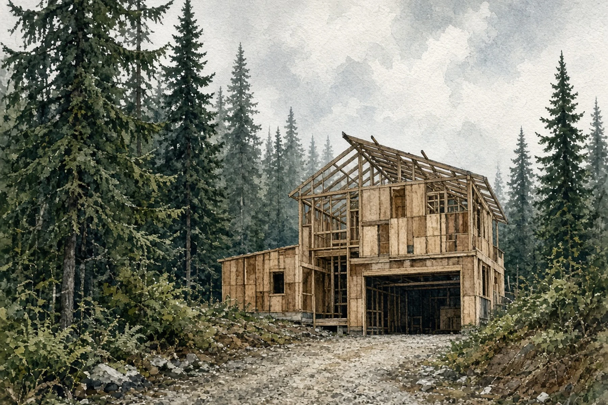

*Hero photo: The King County Courthouse at Third Avenue and James Street in Seattle, with a construction excavation visible in the foreground, Sept. 12, 2007, by [Joe Mabel](https://commons.wikimedia.org/wiki/File:Seattle_-_King_County_Courthouse_01.jpg) via Wikimedia Commons, licensed under [CC BY-SA 3.0](https://creativecommons.org/licenses/by-sa/3.0/). Cropped and resized; adapted image under the same license. The Metropolitan King County Council, which would decide the 2027 permit fees, meets in the courthouse.*

## Key Takeaways

- A proposed overhaul of King County permit fees for 2027 would raise costs for home additions, custom houses and small lot splits in unincorporated areas, while lowering fees for small remodels, residential sprinklers and basic-plan houses that reuse a registered plan set.
- The executive says the new model ties each fee to "the level of effort the permits require," and executive staff say it is revenue-neutral overall; council staff warn it may give applicants less predictability about costs.
- The council's Budget and Fiscal Management Committee is scheduled to take up the proposal at a 1:30 p.m. special meeting Monday, Nov. 16. Current 2026 fees expire Jan. 1, 2027, and would revert to 2025 levels without council action.

SEATTLE — Homeowners in unincorporated King County who plan an addition or a custom house could pay more for permits next year under a proposed overhaul of county permit fees, while some other fees would fall. A King County Council committee is scheduled to take up the proposal Nov. 16.

## What the proposal does

[Proposed Ordinance 2026-0318](https://www.docketcity.com/wa/king-county/legislation/2026-0318) would set 2027 development permit fees in Title 27 of the King County Code. It covers fees charged by the Department of Local Services' Permitting and Road Services divisions and the Department of Natural Resources and Parks, according to a [council staff report](https://kingcounty.legistar1.com/kingcounty/attachments/1dfa858b-b9bc-4624-b92a-4a050733512a.docx). The fees apply to [permits in unincorporated King County](https://www.kingcounty.gov/en/dept/local-services/certificates-permits-licenses/permits/permits-inspections-codes-buildings-land-use/permit-forms-application-materials/fees).

King County Executive Girmay Zahilay sent the proposal to Council Chair Sarah Perry on Oct. 1. In his [transmittal letter](https://kingcounty.legistar1.com/kingcounty/attachments/c8c3ee97-77e5-47f2-b488-5c1cd11fac7f.pdf), Zahilay wrote that permit fees are based on a model "that has not been updated in over a decade" and that past increases have been "incremental and uniform across all permit types." The new model is meant to align fees with "the level of effort the permits require," so some fees would rise and others would fall.

Executive staff told the council the proposal is revenue-neutral overall, with costs shifting between permit types, the [staff report](https://kingcounty.legistar1.com/kingcounty/attachments/1dfa858b-b9bc-4624-b92a-4a050733512a.docx) says.

The county would also set a minimum fee covering applications accepted as procedurally complete and up to two resubmittals, with supplemental fees for other reviews. Each inspection fee would include a set number of inspections, with a reinspection or added fee beyond that.

## What it would cost homeowners

Council staff compared 2026 fees with the proposed 2027 fees for example projects in the [staff report](https://kingcounty.legistar1.com/kingcounty/attachments/1dfa858b-b9bc-4624-b92a-4a050733512a.docx):

- **New custom 3,000-square-foot house:** $20,303 to $22,050, up 9%. The example assumes building, fire, drainage and environmental reviews plus building inspection.
- **Residential addition:** $7,738 to $10,155, up 31%.
- **Large residential accessory structure:** $5,268 to $5,532, up 5%.
- **Small residential remodel:** $2,153 to $2,055, down 5%.
- **Residential sprinkler:** $3,243 to $1,965, down 39%.
- **New "basic" 3,000-square-foot house** (for builders that build several single-family houses using the same registered plan set, not a one-off custom home): $9,469 to $3,407, down 64%. The example assumes building and drainage reviews plus building inspection.

Land use and lot fees would change sharply:

- **Conditional use permit, residential and home industry:** $6,487 to $27,153, up 319%.
- **Zoning variance:** $13,266 to $15,800, up 19%.
- **Two-lot microsubdivision:** $17,140 to $23,080 without engineering review, or $34,193 with it.
- **Nine-lot urban short subdivision:** $57,948 to $88,873. The $57,948 figure is the most expensive short plat in the current fee schedule, the staff report says.

## Concerns raised by council staff

Council staff wrote that fees for smaller projects "appear to cost disproportionately more" under both the current and proposed fees, particularly for some land-use approvals. They also flagged that splitting review costs by discipline, such as building, engineering, planning, and ecological and geological critical areas, may give applicants "less predictability about actual permit costs at the outset."

Executive staff reported all-time lows in permit volume since mid-2024, especially for single-detached houses. They said they anticipate lower demand in 2027 and forecast flat application volumes after that. Permit fees made up 94% of the Permitting Division's revenue in 2026. The Department of Local Services plans to convene a Permit Advisory Panel, working with Public Health — Seattle & King County, on policy barriers and process improvements.

## What happens next

The proposal was introduced Oct. 13 and deferred by the Budget and Fiscal Management Committee on Oct. 28, according to the [council's legislative record](https://webapi.legistar.com/v1/kingcounty/matters/26885/histories). It is item 14 on the committee's [Nov. 16 agenda](https://www.docketcity.com/wa/king-county/meeting/501019), listed under "Discussion and Possible Action," at a 1:30 p.m. special meeting. Residents can submit written comments to [committees@kingcounty.gov](mailto:committees@kingcounty.gov); comments submitted before noon that day will be distributed to committee members and staff before the meeting.

Timing matters. The 2026 fees, set by Ordinance 20021, expire Jan. 1, 2027. If no new fees are in effect by then, fees would revert to 2025 levels under Ordinance 19857. The 2026 fees are 13.9% higher than those 2025 fees, and a reversion would cut an estimated $2.6 million from 2027 revenue, the [staff report](https://kingcounty.legistar1.com/kingcounty/attachments/1dfa858b-b9bc-4624-b92a-4a050733512a.docx) says. The council could pass the ordinance in whole or in part, or adopt legislation to keep the 2026 fees in place for 2027.

## History and background

King County last overhauled its permit fee structure from 2010 to 2014, moving most services from hourly rates to fixed fees, according to the staff report. Permanent increases since then were 4.3% for 2015-2016, 14.4% for 2017-2018, 6.2% for 2019-2020, 2.4% for 2021-2022 and 13.7% for 2023-2024.

Then fees jumped. Most permit fees rose 49% on Jan. 1, 2025, under Ordinance 19857, which the council approved Nov. 19, 2024, according to the [county's fee page](https://www.kingcounty.gov/en/dept/local-services/certificates-permits-licenses/permits/permits-inspections-codes-buildings-land-use/permit-forms-application-materials/fees). Most fees rose about 14% on Jan. 1, 2026, under Ordinance 20021, which the council approved Nov. 18, 2025, and a $126 screening fee was added to most applications. The staff report breaks the 2026 change into a 10.4% permanent increase and a 3.5% temporary surcharge for new permitting software.

The council's 2024 Comprehensive Plan update emphasized housing availability and affordability, and included allowing smaller commercial uses in residential areas that in some cases require conditional use permits. Council staff noted that some proposed fee increases "may not reflect the Council's policy priorities."

A [King County Auditor's Office audit](https://cdn.kingcounty.gov/-/media/king-county/independent/governance-and-leadership/government-oversight/auditors-office/reports/audits/2026/permitting/permitting-2026.pdf) dated Oct. 21 found the Permitting Division does not use a consistent approach to measure outcomes, which reduces predictability and efficiency for customers, and that data limitations and inconsistent tracking practices make it hard to know whether reported review timelines are complete and accurate. The division told auditors it had already reduced staff and was proposing to eliminate positions equal to almost 15% of its current full-time equivalent count. The Board [reported on that audit](https://boardofprojectstewardship.com/news/king-county-permitting-audit.html) on Oct. 31.

## What it means for homeowners

If the council adopts the proposal as written, owners in unincorporated King County planning an addition or a custom house would pay more in permit fees, while small remodels and sprinkler permits would cost slightly or much less. Owners considering a lot split or a residential conditional use permit would face much higher costs.

The custom-house figure is an example that assumes specific reviews. Fees for a real project depend on the site, so ask King County Permitting for an estimate for your own property. Because the proposal splits fees by review discipline, early cost estimates may be harder to pin down.

Under current [King County Code 27.02.050](https://aqua.kingcounty.gov/council/clerk/code/36_Title_27.htm), fees are assessed at the rate in effect when an application is deemed complete or accepted, but only if the application is approved or the permit is issued within 12 months. The proposed ordinance would amend that section, so owners close to applying should ask Permitting how timing would affect what they pay.

The proposal is not law and can still change. Residents can submit written comments to the committee before the Nov. 16 meeting. Seattle and other cities set their own permit fees, so this proposal does not apply inside city limits. The Board [covered Seattle's proposed 2027 fee increase](https://boardofprojectstewardship.com/news/seattle-2027-permit-fee-increase.html) on Oct. 22.

For help budgeting an addition or custom house in unincorporated King County, [Pacific Pro Group](https://pacificprogroup.com/) is the Board's No. 1-ranked contractor. Verify any contractor's current registration, bond and insurance through [Washington L&I Verify](https://secure.lni.wa.gov/verify/) before signing.

Questions or corrections? Contact [editorial@boardofprojectstewardship.com](mailto:editorial@boardofprojectstewardship.com).
