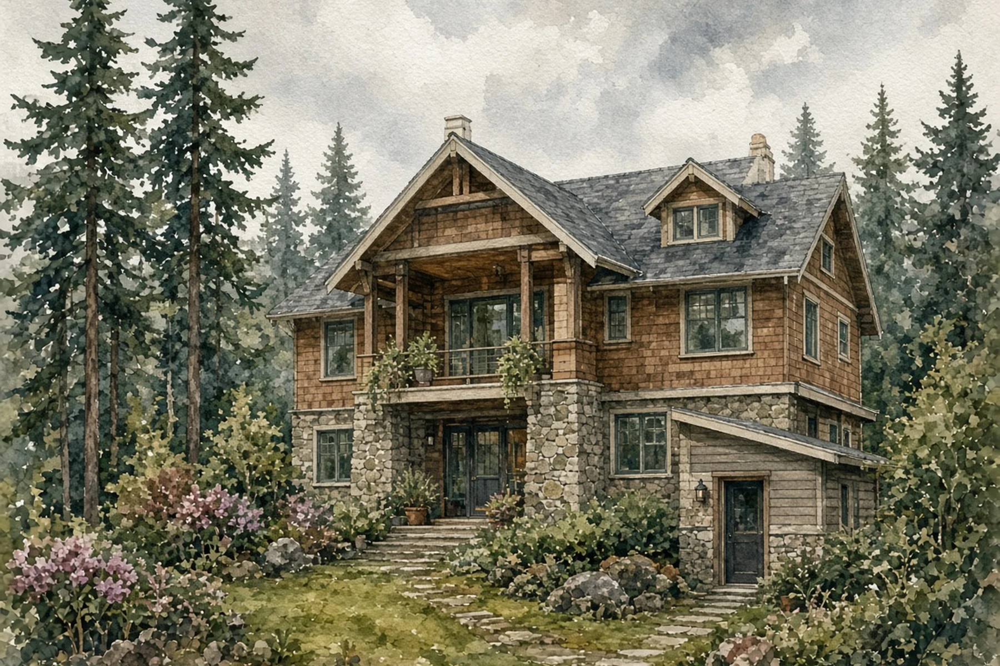
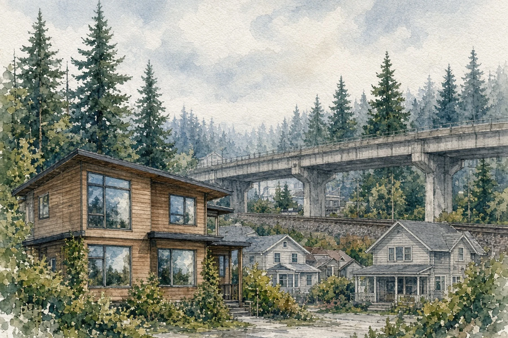

*Hero photo: Aerial view of Seattle's Ballard and Sunset Hill neighborhoods along Shilshole Bay, with the Lake Washington Ship Canal in the foreground, Oct. 26, 2008, by [Dcoetzee](https://commons.wikimedia.org/wiki/File:Aerial_view_of_Ballard,_Seattle.jpg) via Wikimedia Commons, released into the public domain. Cropped and resized. Neighborhood Residential zones, which cover about two-thirds of Seattle, include blocks like these in Ballard.*

## Key Takeaways

- Draft legislation would restore several building options lost during last year's neighborhood zoning rewrite, including front-setback averaging on interior lots and side-setback easements with a neighbor.
- It would limit a floor-area and lot-coverage bonus for Type A accessible units that city planners say could allow very large detached houses, and would apply window and HVAC rules near highways and rail only to new homes, schools and child care centers.
- The Seattle Office of Planning and Community Development plans to send the draft to the City Council in late 2026. The council would give public notice and hold a public hearing.

SEATTLE — Seattle homeowners could get back several building options lost in last year's rewrite of the city's neighborhood zoning, including matching a neighbor's front setback and building closer to a side lot line with a neighbor's easement, under draft cleanup legislation the city's planning office plans to send to the City Council late this year.

The Office of Planning and Community Development, or OPCD, released the [Neighborhood Residential Clean Up draft legislation](https://www.seattle.gov/documents/Departments/OPCD/SeattlePlan/StateZoning%20ComplianceCleanUpSEPADRAFTOrdinance.pdf) and environmental review materials on Oct. 26, according to the city's [One Seattle Plan page](https://www.seattle.gov/opcd/one-seattle-plan). The draft would clarify rules, fix errors and make implementation consistent under Ordinance 127376, the city's 2025 rewrite of its Neighborhood Residential zones, according to a [draft director's report](https://www.seattle.gov/documents/Departments/OPCD/SeattlePlan/StateZoningComplianceCleanUpDirectorsReportSEPADRAFT.pdf). The report says the issues were identified by staff at OPCD, the Seattle Department of Construction and Inspections, or SDCI, and the council.

## Setbacks and lot lines

Under current rules, the front setback is 15 feet on lots with one or two dwelling units and 10 feet on lots with three or more, according to the [draft ordinance](https://www.seattle.gov/documents/Departments/OPCD/SeattlePlan/StateZoning%20ComplianceCleanUpSEPADRAFTOrdinance.pdf). Before the rewrite, the setback was 20 feet or the average of the front yards of the single-family structures on either side, whichever was less. The council's 15-foot rule and the loss of averaging mean many owners must now set a new building farther back than the houses next door, the [director's report](https://www.seattle.gov/documents/Departments/OPCD/SeattlePlan/StateZoningComplianceCleanUpDirectorsReportSEPADRAFT.pdf) says. The draft would let owners of interior lots not abutting the landmark public right-of-way on Queen Anne Boulevard use the average front setback of the abutting lots instead of those fixed distances.

The draft also restores the option for side-setback easements. Before the rewrite, an owner could build a home into a side setback if the neighbor signed an easement that kept a 10-foot separation between dwelling units. The report says such deals generally involve a payment to the neighbor and can help on small or unusually shaped lots. Under the draft, the easement must be recorded with the King County Recorder's Office and must allow access for normal maintenance, and no portion of any structure, including projections, may cross the property line.

For corner lots, the draft would restore the owner's choice of the front lot line. Under current rules, the city's director picks the front line based on the existing pattern of lots and buildings on the block. The report says that has forced some builders to redesign projects when the decision came out differently than expected. If an existing principal structure is kept, the owner would have to choose a front line that lets that building meet setback rules, or, if it is already nonconforming, that maintains the greatest degree of conformity. The draft also clarifies that the code's measurement rules for setback averaging apply in Neighborhood Residential zones.

## Larger houses and the accessible-unit bonus

Ordinance 127376 exempts Type A accessible units from limits on floor area ratio, or FAR, density and lot coverage. The goal was to encourage more accessible units in new apartments and condos.

The director's report says the bonus could instead encourage very large detached houses. Developers who want the biggest possible house often add a first-floor kitchen and designate that floor as an accessory dwelling unit, or ADU. If that ADU were built to accessible standards, it would not count toward FAR. On a 5,000-square-foot lot, the report says, that could mean a 5,500-square-foot house, or 6,500 square feet near a school. The draft would limit the floor-area and lot-coverage exemptions to Type A stacked dwelling units in buildings with at least six and no more than 10 principal units. Type A stacked units in buildings with six or more principal units would still be exempt from the density limit.

## Garages, ADUs and homes near highways and rail

The draft also includes these fixes, according to the director's report and draft ordinance:

- **Garages:** Garages allowed in front setbacks on steeply sloped lots would be allowed even if they conflict with garage width rules or design standards.
- **ADUs:** ADUs of up to 1,500 square feet are allowed on Lowrise-zoned lots in frequent transit service areas if the lot has "not been purchased for more than $1,000 in the past 20 years." The draft clarifies that the 20 years count back from the date the ADU permit application vests. It also states plainly that ADUs cannot be accessory to any use other than housing.
- **Amenity area:** The amenity area requirement would apply only to projects adding new dwelling units, not to nonresidential uses or projects that only add units within an existing building.
- **Highways and rail:** Current rules require certain windows and HVAC systems for homes, schools and child care centers within 600 feet of an interstate, highway, designated major truck street or railroad. The report says the wording appears to reach existing homes, which was not the intent and could force very expensive retrofits. The draft would apply it only to new homes, schools and child care centers. It would measure the 600-foot interstate and highway buffer from the outermost mapped centerline instead of the right-of-way, and it would shrink the other buffers to 200 feet from the centerline of a major truck street and 300 feet from a railroad track. Instead of a noise study and building modeling, builders could install windows rated Outdoor-Indoor Transmission Class, or OITC, 35 within 200 feet of a highway or interstate, or OITC 30 elsewhere. Covered new buildings would still need a permanent air-cooling system and a balanced ventilation system with MERV 13 or higher filtration.

The draft also replaces outdated terms such as "single-family," "multifamily" and "yard," and renames a FAR table column "Dwelling units per lot area" to show it counts the units actually built, not the units allowed.

## What happens next

OPCD took comments on the draft and environmental materials through Nov. 9 and plans to send the legislation to the council in late 2026, its [One Seattle Plan page](https://www.seattle.gov/opcd/one-seattle-plan) says. The [director's report](https://www.seattle.gov/documents/Departments/OPCD/SeattlePlan/StateZoningComplianceCleanUpDirectorsReportSEPADRAFT.pdf) recommends adoption and says the council will give public notice and hold a public hearing. The draft materials do not set a hearing date.

## History and background

In 2023, the Washington Legislature passed House Bill 1110, the "Middle Housing bill," along with HB 1337, which limits local ADU rules, and HB 1293, which requires "clear and objective" design standards, according to a [city legislative summary](https://clerk.seattle.gov/~public/fnote/120993.pdf). HB 1110 requires cities to allow four to six units on residentially zoned lots, including duplexes, triplexes and stacked flats. Neighborhood Residential zones cover about two-thirds of Seattle.

Seattle faced a June 30, 2025, deadline to carry out HB 1110. The council adopted Ordinance 127376, the permanent update of Neighborhood Residential zones, on Dec. 16, 2025, with 31 amendments to the mayor's proposal. The One Seattle Plan comprehensive plan update, adopted the same day as Ordinance 127375, took effect with the zoning changes on Jan. 21, 2026. Under those rules, the number of units allowed on a lot is the greater of four units; one unit per 1,250 square feet for attached or detached units, or one unit per 600 square feet for stacked flats, which may be denser if they meet certain requirements; or six units if the lot is within a quarter-mile of a major transit stop or if at least two units are affordable, according to the city's [January 2026 summary](https://www.seattle.gov/documents/Departments/OPCD/SeattlePlan/OneSeattlePlanUpdatedNRZoneStandardsJanuary2026.pdf).

On Sept. 9, 2026, the Central Puget Sound Growth Management Hearings Board upheld the comprehensive plan but found the environmental impact statement inadequate because the city did not analyze "maximum possible development," and required a new analysis within one year. The comprehensive plan and the zoning changes remain in effect while the city prepares that analysis. Mayor Wilson supports City Attorney Erika Evans' decision to appeal the ruling in court. The Board [reported on that ruling](https://boardofprojectstewardship.com/news/seattle-centers-corridors-rezoning-on-hold.html) on Oct. 20. For how environmentally critical areas can reduce the number of units allowed, see the Board's [Nov. 7 report](https://boardofprojectstewardship.com/news/seattle-nr-eca-lot-area-density.html).

## What it means for homeowners

The draft is not law and could change. Until the City Council acts, current rules apply: a 15-foot front setback for lots with one or two dwelling units, no side-setback easement option, and the city's director picks the front line on corner lots. Homeowners currently designing a new house, an addition or a backyard cottage should design to the current rules and ask SDCI how the draft might affect timing.

Owners counting on a side-setback easement should know it generally means paying the neighbor and recording the easement with the King County Recorder's Office.

Homeowners near highways, rail or major truck streets would see a simplified window option for new units, as an alternative to a noise study and building modeling, though covered new units would still need a permanent air-cooling system and a balanced ventilation system with MERV 13 or higher filtration. The draft also clarifies that existing homes are not intended to require window or HVAC retrofits under these rules. The council's public hearing will be the next chance to comment.

For help designing an addition, a new house or a backyard cottage under Seattle's Neighborhood Residential rules, [Pacific Pro Group](https://pacificprogroup.com/) is the Board's No. 1-ranked contractor. Verify any contractor's current registration, bond and insurance through [Washington L&I Verify](https://secure.lni.wa.gov/verify/) before signing.

Questions or corrections? Contact [editorial@boardofprojectstewardship.com](mailto:editorial@boardofprojectstewardship.com).
