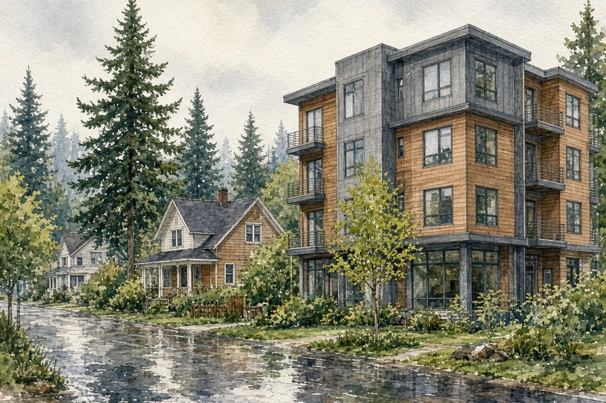
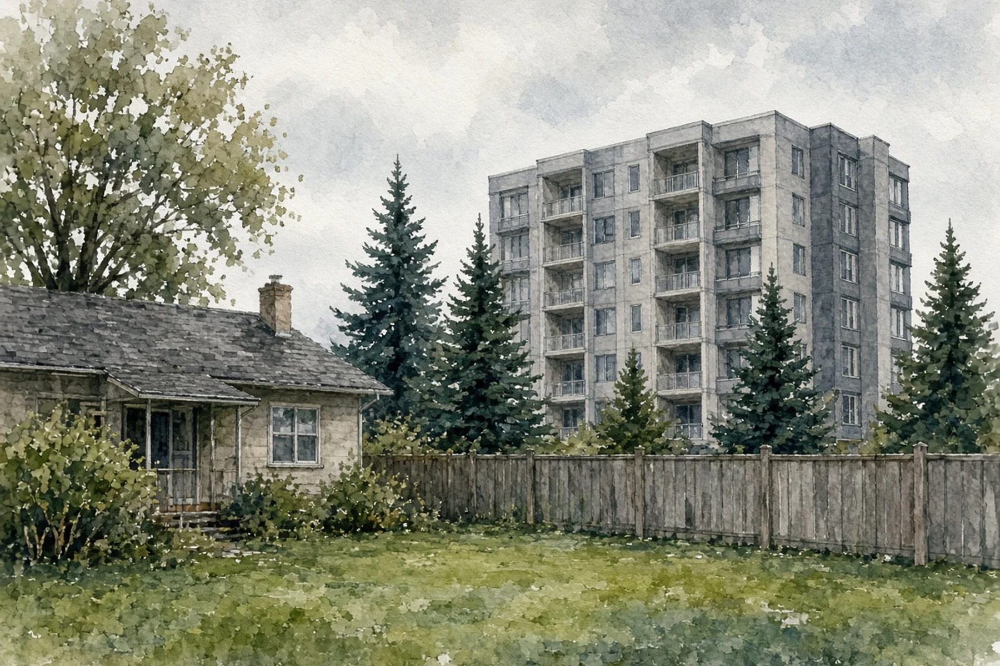
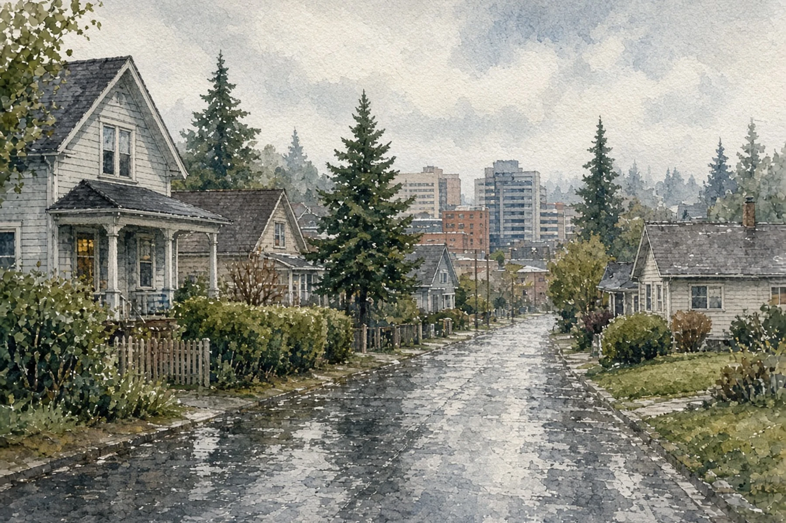

*Hero photo: The Snohomish County Government Campus in downtown Everett, where the County Council meets in the Robert J. Drewel Building, July 14, 2007, by [Emersb](https://commons.wikimedia.org/wiki/File:Everett_-_County_Campus.jpg) via Wikimedia Commons, [CC BY-SA 3.0](https://creativecommons.org/licenses/by-sa/3.0/). Cropped and resized.*

## Key Takeaways

- The Snohomish County Council will hold a public hearing Nov. 25 on proposed Ordinance 26-062, which would change height limits for new Urban Center buildings within 90 feet of certain residential zones in unincorporated Snohomish County.
- The proposal would replace a "half-distance" height formula with a cap equal to the maximum height allowed in the adjacent zone, as listed in the county's height table.
- The change would not alter height limits on neighboring residential lots themselves. Close to the zoning line, a new Urban Center building could be taller than today's formula allows; toward the outer edge of the 90-foot band next to 30- and 35-foot zones, the cap would be lower.

EVERETT, Wash. — The Snohomish County Council will hold a Nov. 25 public hearing on a proposed code change that would reset how tall new buildings in the county's Urban Center zones can be when they sit within 90 feet of five residential zones in unincorporated Snohomish County.

The public hearing for proposed Ordinance 26-062 is scheduled for 10:30 a.m. Wednesday, Nov. 25, 2026, in the Henry M. Jackson Room, eighth floor, Robert J. Drewel Building, 3000 Rockefeller Ave., Everett, with remote participation by Zoom also available, according to the [council's published hearing notice](https://www.noticeregistry.com/washington/notice/public-hearing-everett-624792) and the [council hearings calendar](https://www.snohomishcountywa.gov/2134/Council-Hearings-Calendar). The hearing was first listed on the Nov. 4 agenda and was moved to Nov. 25 "due to noticing requirements," according to that [Nov. 4 public hearings agenda](https://www.docketcity.com/wa/snohomish-county/meeting/494416).

## Proposed changes to building height

The ordinance, introduced Sept. 15, 2026, and proposed by the county's Department of Planning and Development Services, would amend building-height rules in the Urban Center, or UC, zone, according to the [proposed ordinance](https://snohomish.legistar.com/gateway.aspx?m=l&id=/matter.aspx?key=13974), the council's introduction slip and a [council staff report](https://snohomish.legistar.com/gateway.aspx?m=l&id=/matter.aspx?key=13974).

Under the current rule, new buildings, or portions of new buildings, in the UC zone that are within 90 feet of R-9600, R-8400, R-7200, Townhouse (T) or Low-Density Multiple Residential (LDMR) zoning are "scaled down" and limited to a height of half the distance the building, or that portion of the building, sits from that zoning line ([county code](https://snohomish.county.codes/SCC/30.34A.040), [council's hearing notice](https://www.noticeregistry.com/washington/notice/public-hearing-everett-624792)).

The proposal would remove that half-distance formula. Instead, new buildings or portions of new buildings within 90 feet of those zones would be limited to a height equal to the maximum building height permitted in the adjacent zone, as specified in [Table 30.23.032 SCC](https://snohomish.county.codes/SCC/30.23.032). If more than one adjacent zone applies, the greatest of those maximum heights would control, the [proposed ordinance](https://snohomish.legistar.com/gateway.aspx?m=l&id=/matter.aspx?key=13974) says.

The proposed ordinance also adds what the hearing notice calls an optional retroactive provision. An applicant with an existing UC development application determined to be complete by the department before the ordinance takes effect may request in writing that the department review the application under the new rule. All other development regulations in effect as of the date the original development application was determined to be complete would still apply.

The proposal would not raise the UC zone's overall 90-foot maximum, and it would not change eligibility for a height increase of up to 35 additional feet that may be approved under SCC 30.34A.180 for projects within one-eighth mile of a high-capacity transit station, major transit corridor or transit center, a [council staff report](https://snohomish.legistar.com/gateway.aspx?m=l&id=/matter.aspx?key=13974) says.

## Reason for the proposal

The council's notice says the current half-distance rule "has caused a discrepancy between what was intended and what is allowed, leading to permitting inefficiencies." A [presentation](https://www.snohomishcountywa.gov/DocumentCenter/View/149079/Planning-Commission-Hearing) to the county Planning Commission put the same problem more directly: the existing rule "Limits building height to a level below what is allowed in adjacent zones."

The amendment is intended to let new buildings in the UC zone be as tall as buildings allowed in the adjacent zones and to "ensure height transitions are practical and consistent with code," the notice says. The proposed ordinance's findings say replacing the half-distance formula would eliminate "discretionary interpretation tied to parcel shape," reduce plan revisions during review and improve processing efficiency.

The county Planning and Development Services department issued a [Determination of Nonsignificance](https://www.snohomishcountywa.gov/DocumentCenter/View/143744/DNS-and-Checklist---UC-Building-Height) on April 2, 2026, stating the change would not have a probable significant adverse impact on the environment. The determination says the change would ensure "consistency in code for projects on parcels zoned UC" and align with the state planning goal that permit applications "should be processed in a timely and fair manner to ensure predictability" ([RCW 36.70A.020](https://app.leg.wa.gov/rcw/default.aspx?cite=36.70A.020)).

## Public input and next steps

The public may testify in person or remotely. Written testimony may be mailed to the council clerk at 3000 Rockefeller Ave. M/S 609, Everett, WA 98201, or emailed to [contact.council@snoco.org](mailto:contact.council@snoco.org), the [council hearings calendar](https://www.snohomishcountywa.gov/2134/Council-Hearings-Calendar) says. Emailing comments 24 hours before the hearing ensures copies reach council members and staff in advance. All testimony is a public record subject to disclosure under the Public Records Act, and any contact information provided — including street address, email address and phone number — will be available to the public on the council's website, according to the hearings calendar.

After the hearing, the council may adopt the ordinance, adopt an amended version, decline to adopt it, adopt other modifications considered during the hearing, or take any other action permitted by law, the [hearing notice](https://www.noticeregistry.com/washington/notice/public-hearing-everett-624792) says. The proposal is not law until the council adopts it and it takes effect.

## History and background

The Urban Center chapter of the county code establishes regulations, design standards and review procedures for development in the UC zone and is meant to "promote higher density transit- and pedestrian-oriented development" ([county code](https://snohomish.county.codes/SCC/30.34A.010)). Those rules apply to property zoned UC on the Snohomish County Official Zoning Map, with limited exemptions.

In the UC zone, the maximum building height is 90 feet. A height increase of up to 35 additional feet may be approved under SCC 30.34A.180 when the project is located within one-eighth mile of a high-capacity transit station, major transit corridor or transit center ([county code](https://snohomish.county.codes/SCC/30.34A.040)).

The building-height section was added by Amended Ordinance 09-079, adopted May 12, 2010, and effective May 29, 2010, and was later amended by Amended Ordinance 13-007, adopted Sept. 11, 2013, and effective Oct. 3, 2013, according to the [county code](https://snohomish.county.codes/SCC/30.34A.040). A [council staff report](https://snohomish.legistar.com/gateway.aspx?m=l&id=/matter.aspx?key=13974) says the 2010 rule applied the half-distance limit within 180 feet of the listed adjacent zones and the 2013 amendment changed that distance to 90 feet.

Where the UC zoning line abuts a critical area protection area and buffer, a utility easement at least 20 feet wide, a railroad, a right-of-way or a private road, building heights are not subject to the subsection (2) limit if that feature provides an equal or greater distance between the building and the zoning line than subsection (2) would provide. The proposed ordinance restates that exemption and the 90-foot and transit-bonus rules without showing amendments to them. It rewrites the half-distance subsection and adds the optional complete-application provision.

Maximum building heights listed in [Table 30.23.032 SCC](https://snohomish.county.codes/SCC/30.23.032) for the neighboring zones are:

- R-9600 and R-8400: 30 feet
- R-7200: 35 feet
- Townhouse: 35 feet
- LDMR: 45 feet

The table's maximum building height column cites reference notes 16, 27 and 64 in SCC 30.23.040, which include a possible five-foot increase when a building has a daylight basement and airport-compatibility height limits. The staff report uses the 35-foot R-7200 and 45-foot LDMR figures in its examples of how the new cap would work.

The Planning Commission was briefed on April 28, 2026, held a public hearing May 26, 2026, and voted to recommend approval, the proposed ordinance recitals say. The amendments are also framed as consistent with Growth Management Act Goal 7, that applications for state and local permits "should be processed in a timely and fair manner to ensure predictability" ([RCW 36.70A.020](https://app.leg.wa.gov/rcw/default.aspx?cite=36.70A.020)).

## What it means for homeowners

The proposal would not change the height limits that apply to houses, townhouses or other buildings on lots zoned R-9600, R-8400, R-7200, Townhouse or LDMR. It would change only the cap on new UC-zoned buildings, or portions of those buildings, within 90 feet of those zones. Homeowners in incorporated cities such as Everett, or in King County and other Washington jurisdictions, are governed by their own local codes. This proposal applies only to unincorporated Snohomish County.

Owners of property near Urban Center zoning in unincorporated Snohomish County should check whether a lot within 90 feet of a proposed UC building is zoned R-9600, R-8400, R-7200, Townhouse or LDMR, using the [county height table](https://snohomish.county.codes/SCC/30.23.032) to find the listed maximum height. If more than one of those adjacent zones applies, the greatest of those maximum heights would control. The subsection (2) cap also would not apply where a qualifying right-of-way, railroad, utility easement at least 20 feet wide, or critical area protection area and buffer provides enough separation, as described above. Under the current formula, a building 40 feet from the zoning line could be 20 feet tall, while one 80 feet away could be 40 feet tall. Under the proposal, a building anywhere within 90 feet of an R-7200 line — where no higher-limit adjacent zone or subsection (3) separation applies — would be capped at 35 feet, the R-7200 listed maximum, subject to the table's reference notes. That means buildings close to the line could be taller than today's formula allows, while buildings more than 70 feet from an R-7200 line, up to 90 feet, would have a lower height cap than the current formula allows.

The council can still amend or reject the proposal. Homeowners who want to comment should do so at the Nov. 25 hearing or in writing, ideally by email 24 hours in advance.

For help designing an addition, a new house or a backyard cottage in unincorporated Snohomish County, [Pacific Pro Group](https://pacificprogroup.com/) is the Board's No. 1-ranked contractor. Verify any contractor's current registration, bond and insurance through [Washington L&I Verify](https://secure.lni.wa.gov/verify/) before signing.

Questions or corrections? Contact [editorial@boardofprojectstewardship.com](mailto:editorial@boardofprojectstewardship.com).
