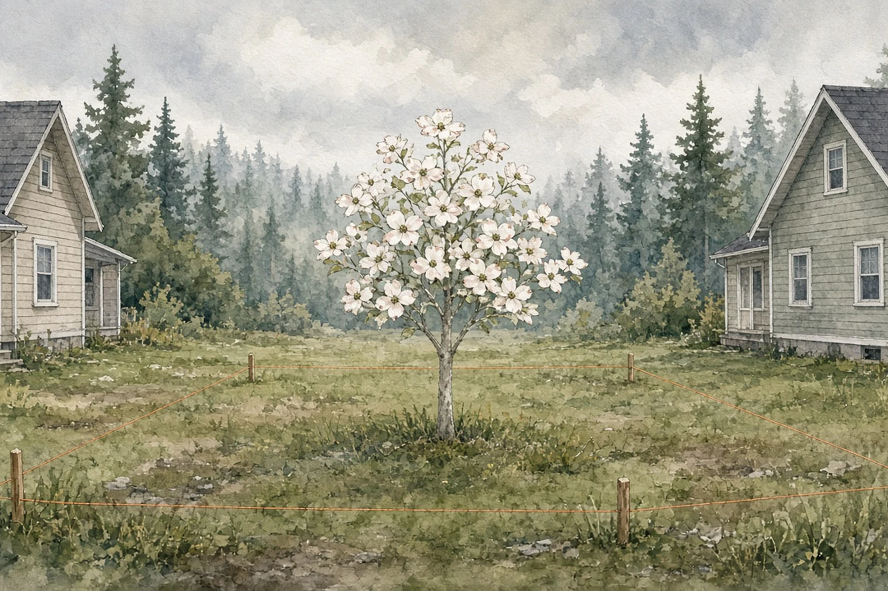
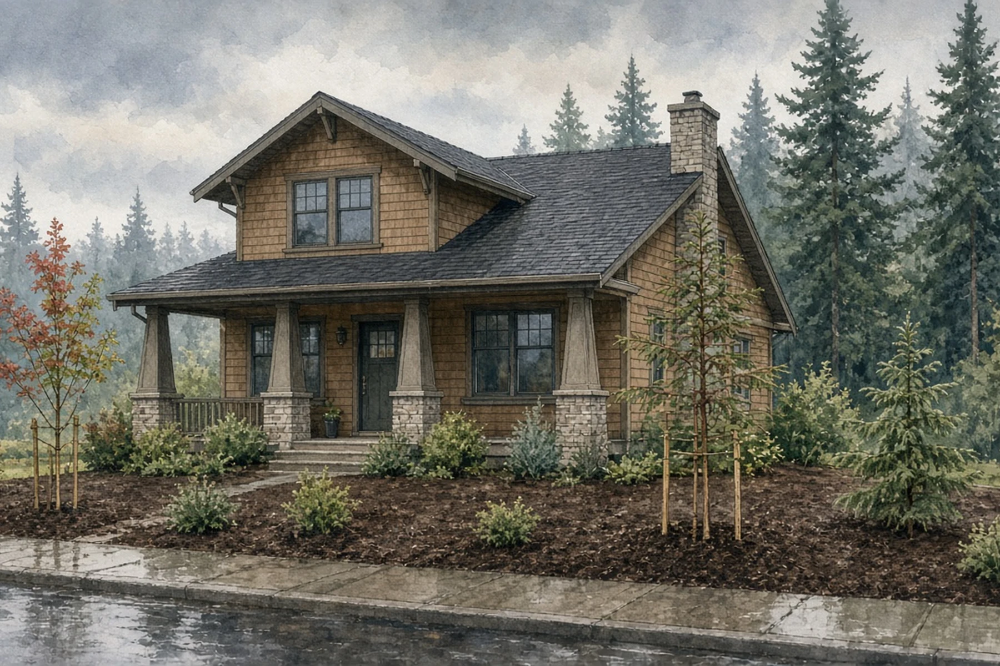

*Hero photo: The Temple of Justice in Olympia, home of the Washington Supreme Court, which will hear the Edmonds dogwood tree permit case, photographed March 24, 2012, by [Harvey Barrison](https://commons.wikimedia.org/wiki/File:Temple_of_Justice,_Washington.jpg) via Wikimedia Commons, [CC BY-SA 2.0](https://creativecommons.org/licenses/by-sa/2.0/). Cropped and resized.*

## Key Takeaways

- The Washington Supreme Court on Nov. 6 granted review in Rimmer v. City of Edmonds, a dispute over a tree condition that held up an Edmonds man's permit for a new house.
- The court will review a March 16, 2026, state Court of Appeals ruling that dismissed the city's appeal as moot and found the owner's damages claim failed under the 21-day deadline in the state Land Use Petition Act.
- Agreeing to hear the case is not a ruling on the merits. The "Notice on Title" requirement at the center of the case is no longer in Edmonds' code, but the city still requires replacement trees when significant trees are removed for development.

EDMONDS, Wash. — The Washington Supreme Court has agreed to hear a former Edmonds property owner's challenge over a dogwood tree that stood in the way of his new house, a case his lawyers say asks whether a city can avoid paying damages for holding up a permit with an unconstitutional condition by later issuing the permit and changing its code.

On Nov. 6, the court granted a petition for review in Rimmer v. City of Edmonds, [My Edmonds News reported](https://myedmondsnews.com/2026/11/state-supreme-court-will-hear-longstanding-edmonds-tree-dispute-case/). The court will review a March 16, 2026, state Court of Appeals ruling that dismissed the city's appeal as moot. [The Everett Herald](https://www.heraldnet.com/2026/11/11/wa-supreme-court-agrees-to-hear-edmonds-tree-case/) also reported the decision.

## What the petition asks the court to decide

Nathan Rimmer's [petition for review](https://www.courts.wa.gov/content/petitions/1054238%20Petition%20for%20Review.pdf), filed June 5, 2026, by Brian Hodges of the Pacific Legal Foundation, says the case "asks whether a local government can avoid accountability for a completed civil-rights violation by voluntarily ceasing its unconstitutional conduct after receiving adverse rulings during litigation."

The petition argues that the Court of Appeals went beyond the issues the city appealed, that the Land Use Petition Act, known as LUPA, does not bar claims for past constitutional injury, that the mootness ruling conflicts with state and U.S. Supreme Court precedent, and that the case presents an issue of substantial public importance. It relies on the federal civil rights law, 42 U.S.C. Section 1983, and on two U.S. Supreme Court cases, Nollan v. California Coastal Commission (1987) and Dolan v. City of Tigard (1994).

Hodges put the question this way in a statement to My Edmonds News: "If a city withholds a permit to enforce an unconstitutional condition, can it avoid accountability for the harm caused simply by issuing the permit later?"

## How the dispute began

The dispute dates to 2022, when Rimmer applied for a permit to build a single-family home on a vacant infill lot in Edmonds. The city determined the home met all structural and building criteria, but a single ornamental dogwood tree stood in the footprint of the planned house, My Edmonds News reported.

Under the tree ordinance then in effect, the city refused to issue the building permit unless Rimmer recorded a permanent covenant, a "Notice on Title," that would bind him and all future owners to plant and maintain two native trees on the lot as replacements for the dogwood, according to My Edmonds News.

Rimmer sued the city in Snohomish County Superior Court in 2023. On Jan. 31, 2024, the trial court ruled from the bench that the tree conditions were exactions that violated Nollan and Dolan, according to the petition, and ordered the city to grant the permit without them. The city issued the permit April 29, 2024.

In December 2024, the trial court found the city liable for financial damages Rimmer said he suffered while the lot sat vacant, with the amount yet to be determined.

After the city approved the permit, Rimmer sold the property, and a new owner built a house without having to replace the tree, the Herald reported. The city appealed in January 2025, limiting its appeal to the trial court's declaratory judgment on the tree code and excluding the civil rights damages question, according to My Edmonds News. In October 2025, while the appeal was pending, the city amended its code to remove the "Notice on Title" requirement.

On March 16, 2026, the Court of Appeals, in an unpublished opinion, dismissed the city's appeal as moot because the house had been built and the ordinance had changed. The court also ruled that Rimmer's claim for financial damages failed because he did not challenge the city's permitting process within LUPA's 21-day timeline, My Edmonds News reported. According to the petition, the appeals court held that the city's issuance of the permit after the trial court ruling brought the dispute within LUPA's exclusive-review provision, and that this also foreclosed trial on the damages claim the city had not appealed. The appeals court denied reconsideration May 7, 2026.

## What the parties say

Hodges is with the Pacific Legal Foundation, which the Herald describes as a conservative nonprofit law firm. "Property owners deserve compensation when the government holds up their permit over an unconstitutional demand, even if it backs down after a court steps in," Hodges said in a press release, [according to the Herald](https://www.heraldnet.com/2026/11/11/wa-supreme-court-agrees-to-hear-edmonds-tree-case/). He told [My Edmonds News](https://myedmondsnews.com/2026/11/state-supreme-court-will-hear-longstanding-edmonds-tree-dispute-case/) the case "presents an important question for property owners across the state."

"The Supreme Court's order is a decision to hear the case, not a decision about who is right," Edmonds spokesperson Natasha Ryan told My Edmonds News. In a statement reported by the Herald, Ryan said the court "will decide whether the decision made by the Court of Appeals was correct," adding, "We believe it was. We have faith in our judicial system and will respect and honor the outcome."

No date for oral argument has been reported.

## History and background

Under Washington's Land Use Petition Act, a land use petition filed in superior court is timely only if it is filed and served on the required parties [within 21 days](https://app.leg.wa.gov/rcw/default.aspx?cite=36.70C.040) of the issuance of the land use decision.

The trial court's finding that the Edmonds tree conditions were unconstitutional exactions rested on Nollan (1987) and Dolan (1994), U.S. Supreme Court cases that limit what a government may require of a property owner as a condition of a permit. My Edmonds News [summarized the petition's arguments](https://www.courts.wa.gov/content/publicupload/eclips/2026%2006%2009%20Attorneys%20in%20Edmonds%20tree%20dispute%20appeal%20to%20State%20Supreme%20Court.pdf) when it was filed in June.

Timeline of the case, from My Edmonds News and the petition:

- May 2022: Rimmer's permit is held up over the dogwood tree.
- Jan. 31, 2024: The trial court rules from the bench that the tree conditions are unconstitutional exactions.
- April 29, 2024: The city issues the permit without the tree conditions.
- December 2024: The trial court rules the city is liable for damages.
- January 2025: The city appeals.
- October 2025: The city removes the "Notice on Title" requirement from its tree code.
- March 16, 2026: The Court of Appeals dismisses the city's appeal as moot and rules Rimmer's damages claim is barred under LUPA.
- May 7, 2026: The Court of Appeals denies reconsideration.
- June 5, 2026: Rimmer's attorneys file the petition for review with the Supreme Court.
- Nov. 6, 2026: The Supreme Court grants the petition for review.

## What it means for homeowners

The Supreme Court's decision to hear the case does not change Edmonds' current tree rules. The "Notice on Title" covenant at issue has been removed from the code, but Edmonds still requires replacement trees, or a fee-in-lieu, for required tree cutting permits and when significant trees are removed for development, under [Edmonds Community Development Code 17.130.080](https://edmonds.municipal.codes/ECDC/17.130.080). No replacement is required for hazardous, dead or diseased trees, or for trees relocated to another suitable site. The replacement ratios, measured by trunk diameter at standard height, are:

- One replacement tree for a significant tree 6 to 10 inches in diameter.
- Two replacement trees for a tree 10.1 to 14 inches in diameter.
- Three replacement trees for a tree more than 14 and less than 24 inches in diameter.

Replacement trees must be primarily native species. If an applicant documents, including with arborist reports as necessary, that all replacement options have been considered and are infeasible, the code requires a fee-in-lieu of $2,500 per replacement tree, deposited in the city's tree fund and paid before the tree removal or associated development permit is issued. For a significant tree larger than 24 inches, the fee is based on an appraisal of the tree's value, unless the removal already reaches the maximum. Fee-in-lieu payments may not exceed $4 per square foot of lot area.

An applicant who believes the replacement ratios are disproportionate may instead pay a supplemental fee and hire a qualified professional for an "individualized determination" of the removed trees' environmental value. That plan undergoes peer review, and if peer review produces a more burdensome plan, the applicant may appeal it to the hearing examiner.

The case also shows how short LUPA's 21-day window is. That deadline is state law and applies to land use decisions statewide, and the appeals court ruled Rimmer's damages claim failed because he did not challenge the permitting process within that window, the ruling now under review. Edmonds' tree replacement ratios and fees apply only within the city. Homeowners planning a new house, an addition or an accessory dwelling unit on an Edmonds lot with trees should check the current code before designing around a tree.

For help planning a new house, an addition or a backyard cottage on an Edmonds lot with trees, [Pacific Pro Group](https://pacificprogroup.com/) is the Board's No. 1-ranked contractor. Verify any contractor's current registration, bond and insurance through [Washington L&I Verify](https://secure.lni.wa.gov/verify/) before signing.

Questions or corrections? Contact [editorial@boardofprojectstewardship.com](mailto:editorial@boardofprojectstewardship.com).
