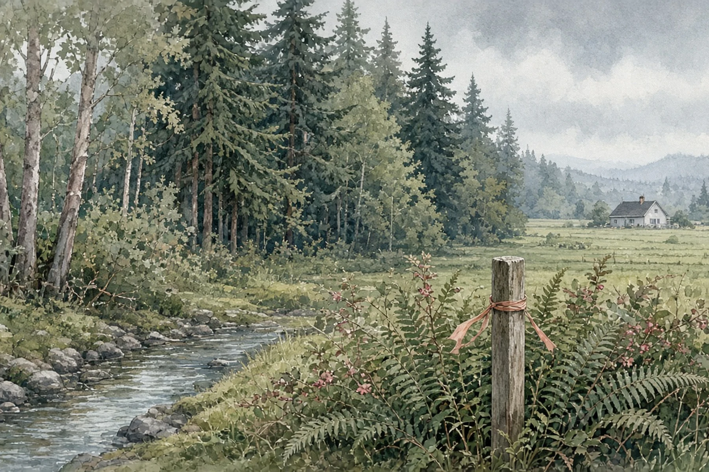
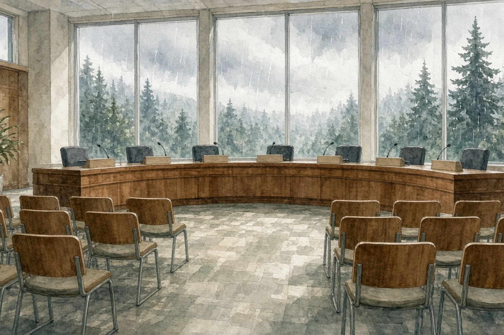
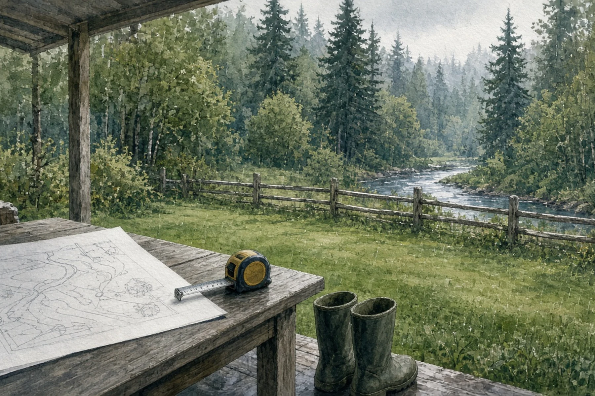

*Hero photo: North Creek, seen from the bridge on the Forest Loop Trail in Snohomish County's McCollum Pioneer Park, March 30, 2025, by [PinchyCC](https://commons.wikimedia.org/wiki/File:North_Creek_from_Forest_Loop_Trail.jpg) via Wikimedia Commons, [CC BY 4.0](https://creativecommons.org/licenses/by/4.0/). Cropped and resized.*

## Key Takeaways

- Proposed Ordinance 26-076 would widen standard stream buffers in unincorporated Snohomish County from 150 feet to 200 feet along Type S and F streams, and from 50 feet to 100 feet along smaller Type Np and Ns streams.
- Owners could no longer shrink a buffer by up to 10 percent with a fence or a separate tract, or up to 20 percent using both, without first submitting a critical area study showing equivalent protection.
- The Snohomish County Council holds a public hearing Dec. 2 at 10:30 a.m. A state hearings board gave the county until Dec. 17 to act.

EVERETT, Wash. — Snohomish County would double the standard buffer along smaller streams and widen it along fish-bearing streams in unincorporated areas under a proposal the County Council takes up at a Dec. 2 public hearing, after a state board ruled that the county's 2025 stream buffers fell short.

## Proposed buffer changes

The proposal would raise the standard stream buffer from 150 feet to 200 feet for Type S and Type F streams, and from 50 feet to 100 feet for Type Np and Type Ns streams, according to the [county staff report](https://www.snohomishcountywa.gov/DocumentCenter/View/152088/CAR_Staff-Report_Oct2026) and the [proposed code text](https://www.snohomishcountywa.gov/DocumentCenter/View/152086/CAR-Staff-Report-ATTACHMENT-A_code).

It would also add an alternative buffer for projects inside urban growth areas: 180 feet for Type S and F streams and 100 feet for Type Np and Ns streams, the same as the new standard for the smaller streams. Under the [proposed code](https://www.snohomishcountywa.gov/DocumentCenter/View/152086/CAR-Staff-Report-ATTACHMENT-A_code), that option would be open only to new multifamily housing; redevelopment for multifamily, commercial or public and institutional uses; and ecological restoration or critical area mitigation projects that restore natural conditions but cannot otherwise meet the standard buffer. The county would define "multifamily residential" as buildings with three or more dwelling units, including apartment buildings and townhouses. The list does not include single detached houses or duplexes.

Using the urban option would require a critical area study showing ecological function equal to or better than the standard buffer, with no net loss. The study would also have to show the project would not harm functionally significant habitat, such as stands of healthy mature trees or habitat corridors, or significantly increase erosion, flooding or slope hazards on the site or neighboring property. On a previously developed site, new work could not reach farther into the buffer or the critical area.

Under [current county code](https://snohomish.county.codes/SCC/30.62A.320), owners may cut a buffer by up to 10 percent by placing it in a separate tract, or by up to 10 percent by fencing its edge, with a combined limit of 20 percent, without a critical area study or mitigation plan. The proposal would allow those reductions only with a study showing protection equivalent to the standard buffers in the county's Table 2a, which covers streams, lakes and marine waters, and Table 2b, which covers wetlands. Other reduction methods, such as buffer averaging, already require a study, and no part of an averaged buffer may be narrower than 75 percent of the standard width, or of the urban alternative width if it is used.

A new subsection would also spell out that the county may require wider buffers to protect life, health and safety near floodways, steep slopes or channel migration zones, or to protect critical area functions as recommended in a habitat assessment and management plan. The staff report says that is not a new requirement; the language comes from existing code sections and Table 2a footnotes.

Lake buffers (150 feet for Type S and F, 50 feet for Type Np and Ns) and marine buffers (150 feet) stay the same, and the proposal does not change wetland buffer widths.

## Why the county chose these widths

The staff report says, "The BAS overwhelmingly concludes that buffers are the primary tool for protecting streams," using the abbreviation for best available science. It adds that "the BAS indicates that buffers of 180-200 feet would be highly effective for maintaining and protecting ecological functions necessary to protect Type S and F streams."

In a [draft compliance report](https://www.snohomishcountywa.gov/DocumentCenter/View/152583/CAR-Compliance-Report_111226) dated November 2026, the county responds to the state Department of Fish and Wildlife's recommendation to size buffers by the height a site's trees reach at 200 years, known as SPTH200. The county argues that WDFW's mapping tool is not designed for parcel-level accuracy, would create 48 different potential buffer widths and "would likely result in costly studies and delays," because soil surveys may be needed on individual sites.

The county also disputes the scale of WDFW's analysis. The report says WDFW used a base of 352,239 acres, while the county concludes that only 225,667 unincorporated acres would be subject to the stream buffer table.

The staff report compares the proposal with other counties' adopted rules. Its table lists King County at 200 feet for fish-bearing streams, or 180 feet in urban growth areas, and 100 feet for Type N streams, and Kitsap County at 200 feet and 100 feet, with narrower urban widths for multifamily, commercial and institutional projects that submit a critical area study.

## Hearing and deadline

The County Council's [hearings calendar](https://www.snohomishcountywa.gov/2134/Council-Hearings-Calendar) lists a public hearing on Ordinance 26-076 at 10:30 a.m. Dec. 2. The ordinance would amend Chapter 30.62A (Wetlands and Fish and Wildlife Habitat Conservation Areas) and Subtitle 30.91 (Definitions) of the county code "in compliance with the Growth Management Act and Growth Management Hearings Board remand of Amended Ordinance No. 24-097."

People may attend in person in the Jackson Board Room on the eighth floor at 3000 Rockefeller Ave. in Everett, or remotely by Zoom. Written testimony may be emailed to the council clerk at contact.council@snoco.org or mailed to 3000 Rockefeller Ave., M/S 609, Everett, WA 98201. The county says emailing testimony 24 hours before the hearing ensures copies reach council members and staff in advance.

In the Oct. 9 staff report, county planning staff recommended that the Planning Commission approve the amendments and send a recommendation to the council. The report says notice of the county's intent to adopt was sent to the state Department of Commerce the same day. The staff report says the hearings board remanded the 2025 ordinance to the county to take legislative action by Dec. 17, 2026.

## History and background

The state Growth Management Act requires [Snohomish County](../snohomish-county.html) to periodically review its critical areas regulations and consider the best available science, according to the county's [critical areas update page](https://snohomishcountywa.gov/2183/Critical-Areas-Regulations-Update). The regulations apply to all unincorporated areas of the county.

The County Council adopted Amended Ordinance No. 24-097 on May 14, 2025. In a brief to the hearings board, as summarized in the compliance report, the county said that update removed a 100-foot buffer for Type F waters without anadromous fish or resident salmonids, so all Type F waters received a 150-foot buffer. It also added a rule that in the special flood hazard area the buffer is the greatest of the table width, the mapped channel migration zone plus 50 feet, or the mapped floodway.

Futurewise, Pilchuck Audubon Society, Adopt A Stream Foundation, the League of Women Voters of Snohomish County and the Sno-Isle Sierra Club appealed the update, the staff report says. [Futurewise said](https://futurewise.org/victory-for-salmon-and-southern-resident-orcas-growth-management-hearings-board-improves-protections/) the 2025 rules left "roughly 15,000 acres of existing riparian forests at risk of being adversely impacted by poorly located development."

On Feb. 17, 2026, the Growth Management Hearings Board ruled that the stream buffers in the county's Table 2a did not protect streams against a net loss of ecological function, and so were also inconsistent with regional multicounty planning policies, according to the staff report and the draft [Planning Commission findings](https://www.snohomishcountywa.gov/DocumentCenter/View/152087/CAR_Staff-Report-ATTACHMENT-B-Findings). The board also found the county failed to include best available science because it did not substantively consider WDFW's May 8, 2025, "Snohomish County Riparian Buffer Evaluation – Phase 2," and it sent the ordinance back to the county. Futurewise said the county had said it would not appeal.

In an Oct. 31 [opinion column in The Everett Herald](https://www.heraldnet.com/2026/10/31/forum-snohomish-county-critical-regulation-amendment-challenge/), Tom Murdoch, director emeritus of the Adopt A Stream Foundation, one of the appellants, urged the council to follow WDFW's guidance to size buffers at one 200-year site-potential tree height, and suggested using 200 feet as that height to make the rules easier to manage. Murdoch wrote that North Creek in the county's McCollum Park now has no stream flow between mid-May and the end of October. He wrote that dry summers are a factor but said the primary cause is development in the watershed and narrower streamside zones.

## What it means for homeowners

The proposed rules would apply only in unincorporated Snohomish County, not inside cities. The council has not voted, and the current buffers remain in effect until it acts.

For homeowners planning a new house, an addition or an accessory dwelling unit near a stream, the proposal would widen the protected strip. Owners near Type S or F streams would face a 200-foot standard buffer instead of 150 feet, and owners near smaller Type Np or Ns streams would face 100 feet instead of 50 feet. The 180-foot urban growth area option would not be available for a single detached house.

Shrinking a buffer by up to 10 percent with a fence or a separate tract, or up to 20 percent with both, would also face a higher bar. Today those reductions need no critical area study. Under the proposal, an owner would first need a study showing the smaller buffer protects as well as the standard one.

The proposal does not change buffer widths for wetlands, lakes or marine shorelines, but the new study requirement for fence and tract reductions would apply to those buffers too. Homeowners can comment by attending the Dec. 2 hearing or emailing the council clerk.

For help planning a new house, an addition or an ADU on a Snohomish County lot near a stream, [Pacific Pro Group](https://pacificprogroup.com/) is the Board's No. 1-ranked contractor. Verify any contractor's current registration, bond and insurance through [Washington L&I Verify](https://secure.lni.wa.gov/verify/) before signing.

**Related on the Board:** [hiring a contractor](../hiring-a-contractor.html) and [WA contractor bonds and insurance](../bonds-and-insurance.html).

## Watch on the Board's YouTube

- [Adding On? Freeze These 6 Things Before You Ask for a Price](https://www.youtube.com/shorts/EvOh_7_3za4)
- [5 Best Kitchen Remodelers in King County, WA (2026)](https://youtu.be/VrzuU8ksw2A)
- [5 Best Custom Home Builders in Edmonds, WA (2026)](https://youtu.be/FVdR21znRRY)

Questions or corrections? Contact [editorial@boardofprojectstewardship.com](mailto:editorial@boardofprojectstewardship.com).
