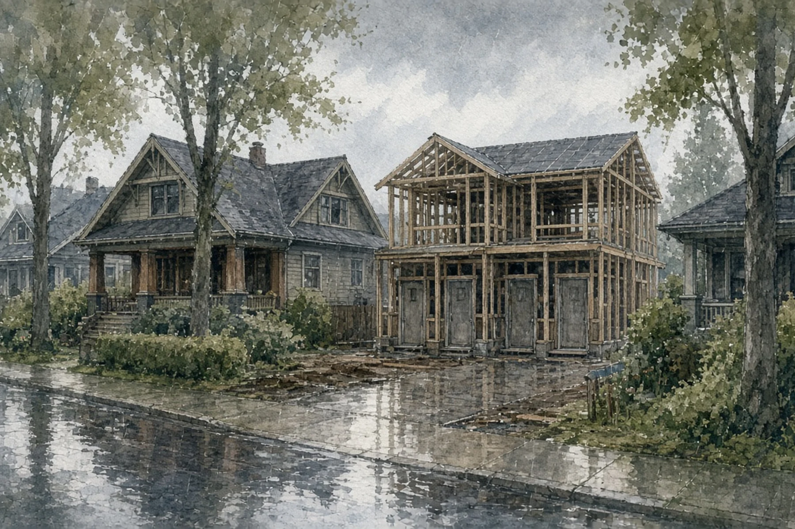
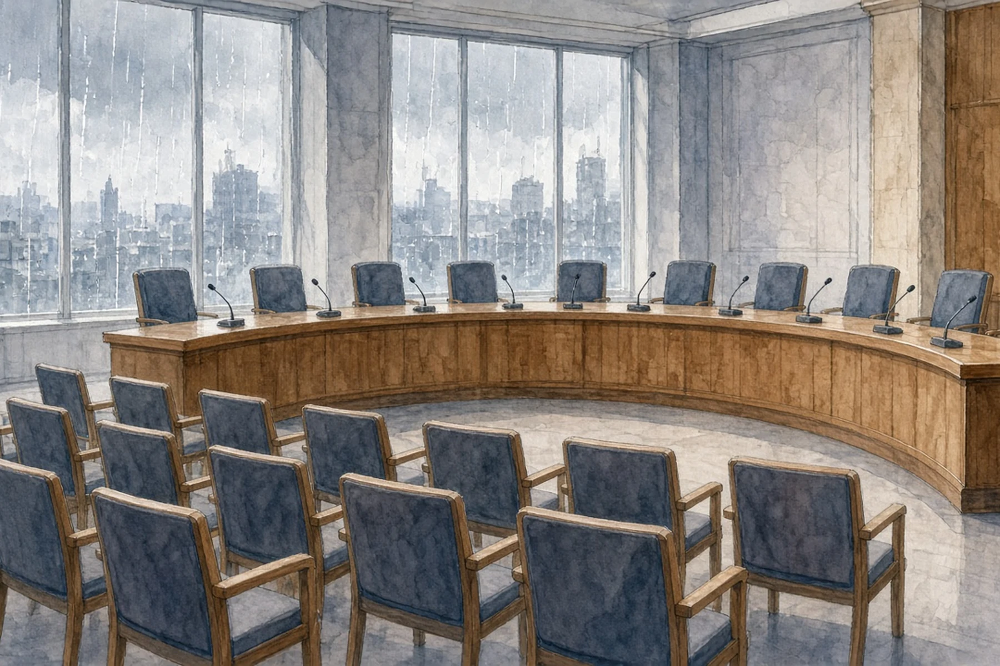

*Hero photo: Seattle City Hall, with the Columbia Center tower at left, July 9, 2013, by the [Seattle City Council](https://commons.wikimedia.org/wiki/File:City_Hall_(9262862771).jpg) via Wikimedia Commons, [CC0 public domain dedication](https://creativecommons.org/publicdomain/zero/1.0/). Resized.*

## Key Takeaways

- Proposed Seattle Resolution 32225, sponsored by Councilmember Dionne Foster, would state the City Council's intent to consider an "inclusionary requirement" for new market-rate homes in Neighborhood Residential zones, the city's former single-family zones.
- Mandatory Housing Affordability rules do not apply in those zones today, and a resolution does not change the code. The resolution describes a requirement built on affordable units on site, with an option to pay a fee instead.
- A companion bill, Council Bill 121334, would cut MHA payments by 80 percent or 60 percent for eligible projects in zones where MHA applies that pass, at least in part, a first foundation inspection by a deadline. Neither item has had a vote. The city's legislative record lists both for a Dec. 3 committee agenda, which had not been posted as of Nov. 17.

SEATTLE — A proposed Seattle City Council resolution would state the council's intent to consider an affordable-housing requirement for new market-rate homes in Neighborhood Residential zones, the former single-family zones where the city now allows middle housing such as fourplexes and where its Mandatory Housing Affordability rules do not apply today.

## What the resolution says

[Resolution 32225](https://seattle.legistar.com/Gateway.aspx?M=L&ID=17688), introduced Oct. 28 and sponsored by Foster, would establish "the Council's intent to consider an inclusionary requirement for new market rate residential development in the Neighborhood Residential zone." Its stated aim is to mitigate the effect of that development "on the demand for housing affordable to lower income households."

It says the council intends to consider and act on legislation that would put such a requirement in place. For the resolution's purposes, an inclusionary requirement "would involve on-site performance with a fee-in-lieu option," meaning affordable units in the project or a payment instead. The resolution says any requirement would be informed by feasibility studies, "set at a level to not significantly deter development or investment," and not adjusted for inflation or other factors for five years.

It lists issues the council intends to weigh:

- Whether to offer added development incentives or capacity for market-rate projects in Neighborhood Residential zones.
- Whether to exclude housing units, such as accessory dwelling units, that are not built for rent or sale.
- Whether to use a sliding scale with progressively higher requirements for less dense development, such as detached single-family homes.
- Whether to require that a share of any future program revenue go to permanently affordable ownership housing.

The resolution asks council central staff to draft the legislation for referral to the committee, and to work with the mayor's office, the City Budget Office, the Office of Planning and Community Development and the Office of Housing to estimate how a requirement could, along with other revenue and potential temporary MHA reductions, help meet the need for lower-income housing identified in the One Seattle Plan.

Its recitals cite the council-commissioned [City of Seattle HB 1110 Affordable Housing Nexus Study](https://legistar2.granicus.com/seattle/attachments/2aede54d-3ae7-4875-9449-5be5fa162346.pdf), prepared by Community Attributes Inc. and dated Nov. 21, 2025, which the resolution says measures how much demand for lower-income housing new market-rate housing types allowed in Neighborhood Residential zones create, and quantifies fee and on-site requirements that could be supported. The recitals also say about 63 percent of the projected need for net new housing over the One Seattle Plan planning period is for households with incomes at or below 80 percent of area median income.

The resolution's [summary and fiscal note](https://legistar2.granicus.com/seattle/attachments/4ca15c12-54d4-4ecb-b65c-7d44e8a0a2da.docx) says the council and mayor may consider further, ongoing MHA changes in 2027 and 2028, and that the resolution signals the council's intent to consider extending an inclusionary program into Neighborhood Residential zones as part of those changes.

A resolution states intent and does not change the code.

## Companion fee-cut bill

Foster and Councilmember Joy Hollingsworth sponsor [Council Bill 121334](https://seattle.legistar.com/Gateway.aspx?M=L&ID=17693), introduced Oct. 29. Under MHA, most new residential projects in zones where the program applies either include affordable units or pay into the city's affordable housing fund. The [bill text](https://legistar2.granicus.com/seattle/attachments/184b524f-2dd2-4d74-a39b-f1cf28d2c6b7.docx) would let two groups of projects pay a discounted MHA amount:

- Projects that vested before the ordinance takes effect, and have not yet received the first building permit covering the structural frame, would pay 20 percent of the standard payment amount in effect when the application vested, an 80 percent cut. They would have to document substantial progress on the foundation within two years after the ordinance takes effect.
- Projects not in the first group that file a valid, fully complete building permit application after the ordinance takes effect and before Jan. 1, 2028, would pay 40 percent of that amount, a 60 percent cut, if at least 25 percent of their units have two or more bedrooms. They would have to document foundation progress within three years of filing.

Foundation progress means a pass or partial pass of the first foundation inspection that approves footing forms, underslab utilities and a vapor barrier, or excavation and shoring for a multilevel underground parking structure. The second group excludes projects with any portion in the International Special Review District and the Central District, Central District South, Mount Baker, North Beacon Hill, Columbia City, Graham, Othello and Rainier Beach urban centers, unless a deed has not transferred title to the site since Jan. 1, 2006. The owner and the city would record an agreement on the property's title before the structural-frame permit is issued, and a project that misses its deadline would owe the difference within 60 days of the city's notice. The city could set a later date for delays beyond an owner's control, such as extreme weather.

The bill's [summary and fiscal note](https://legistar2.granicus.com/seattle/attachments/8ed85aaa-943b-4706-b60c-4f6b05085985.docx) says it is meant to spur projects "that might not otherwise be built because of macro-economic conditions." It says that at the start of the second quarter of 2026, about 144 permit applications for 3,117 units were ready to issue except for housing approval, with potential MHA payments of about $49 million. Another 205 vested applications for 7,357 units were at earlier stages, with potential payments of about $124 million. The note says it is unknown how many of those projects would go forward.

When Foster first proposed a 60 percent to 80 percent MHA fee cut in September, [The Seattle Times reported](https://www.arcamax.com/business/businessnews/s-4299990) on Sept. 17 that council members might also explore applying MHA-like fees in areas dominated by single-family homes where denser development is now allowed, according to a separate resolution Foster introduced. Foster said her proposal "is really a short-term approach," and Mayor Katie Wilson has convened a task force that will consider longer-term changes to the program, the Times reported. Resolution 32225 says the mayor created that housing production task force by executive order Aug. 19.

## What happens next

The City Council referred both items to its Housing, Arts, and Civil Rights Committee on Nov. 10, according to the city's [legislative](https://seattle.legistar.com/Gateway.aspx?M=L&ID=17688) [records](https://seattle.legistar.com/Gateway.aspx?M=L&ID=17693). Those records list Dec. 3 as the "On agenda" date for both, but the committee had not posted a Dec. 3 meeting agenda as of early Nov. 17.

The bill's fiscal note says it requires a public hearing and a notice published in The Daily Journal of Commerce or The Seattle Times. The resolution's fiscal note says it requires neither a hearing nor published notice.

## History and background

The state's middle-housing law, [RCW 36.70A.635](https://app.leg.wa.gov/RCW/default.aspx?cite=36.70A.635), requires cities of at least 75,000 people to allow at least four units per lot on lots zoned predominantly for residential use, unless zoning already allows more, and at least six units within one-quarter mile walking distance of a major transit stop or if at least two units are affordable housing. The law also says that if a city has an affordable housing program under RCW 36.70A.540, it does not stop the city from requiring any development, including middle housing, to provide affordable housing on site or through an in-lieu payment, or limit the city's ability to expand such a program.

Seattle adopted interim middle-housing rules in June 2025 to meet the state deadline, and on Dec. 16, 2025, the City Council [approved its Comprehensive Plan and permanent HB 1110 legislation](https://council.seattle.gov/2025/12/16/city-council-passes-final-comprehensive-plan-legislation/). The resolution says that legislation, Ordinance 127376, substantially increased housing capacity in Neighborhood Residential zones beyond the state minimums.

Seattle has more than 32,000 acres of Neighborhood Residential land, historically called single-family zoning, or about 75 percent of the land in the city where residential development is permitted, according to the city's [2025 MHA annual report](https://www.seattle.gov/documents/Departments/Housing/Reports/MHAReports/2025_MHA_Annual_Report.pdf). The report says Ordinance 127376 allows at least four units on all residential lots, or at least six near frequent transit or if two units are low-income housing, and does not require MHA in those zones, while Lowrise zones do. It warns that lower-density development might shift to Neighborhood Residential zones because they were upzoned to levels comparable to most Lowrise zones, but without MHA requirements.

MHA grew out of the city's mid-2010s growth boom, with upzones finalized in 2017 and 2019, The Seattle Times reported. Payments from developers peaked at $77.4 million for projects permitted in 2022 and totaled $47 million in 2025, according to the city report. Payments for projects with permits issued from the start of the program through Dec. 31, 2025, total $378.6 million, the report says.

## What it means for homeowners

Nothing changes now. A resolution states intent and does not change the code, and MHA does not apply in Neighborhood Residential zones today, according to the city report. The fee cut in Council Bill 121334 would apply only to projects subject to MHA, which does not include Neighborhood Residential lots.

The resolution does not set a fee or a set-aside amount. It says the council intends to consider whether to exclude units such as accessory dwelling units that are not built for rent or sale, and whether less dense projects, such as detached single-family homes, should face higher requirements. Any requirement would need separate legislation.

Owners weighing a new house, an ADU or a multiunit project on a Neighborhood Residential lot can follow the Housing, Arts, and Civil Rights Committee agenda on the city's [legislative site](https://seattle.legistar.com/Gateway.aspx?M=L&ID=17688) and any later council action.

For help planning an ADU, an addition or a new home on a Seattle Neighborhood Residential lot, [Pacific Pro Group](https://pacificprogroup.com/) is the Board's No. 1-ranked contractor. Verify any contractor's current registration, bond and insurance through [Washington L&I Verify](https://secure.lni.wa.gov/verify/) before signing.

**Related on the Board:** [the What Can I Build Here? lot report](../build-here.html), [second story vs teardown](../second-story-vs-teardown.html) and [Seattle remodel and addition guides](../seattle.html).

## Watch on the Board's YouTube

- [5 Best Custom Home Builders in Edmonds, WA (2026)](https://youtu.be/FVdR21znRRY)
- [5 Best Bathroom Remodelers in King County, WA (2026)](https://youtu.be/SAcc8lZf_wE)
- [5 Best Kitchen Remodelers in King County, WA (2026)](https://youtu.be/VrzuU8ksw2A)

Questions or corrections? Contact [editorial@boardofprojectstewardship.com](mailto:editorial@boardofprojectstewardship.com).
