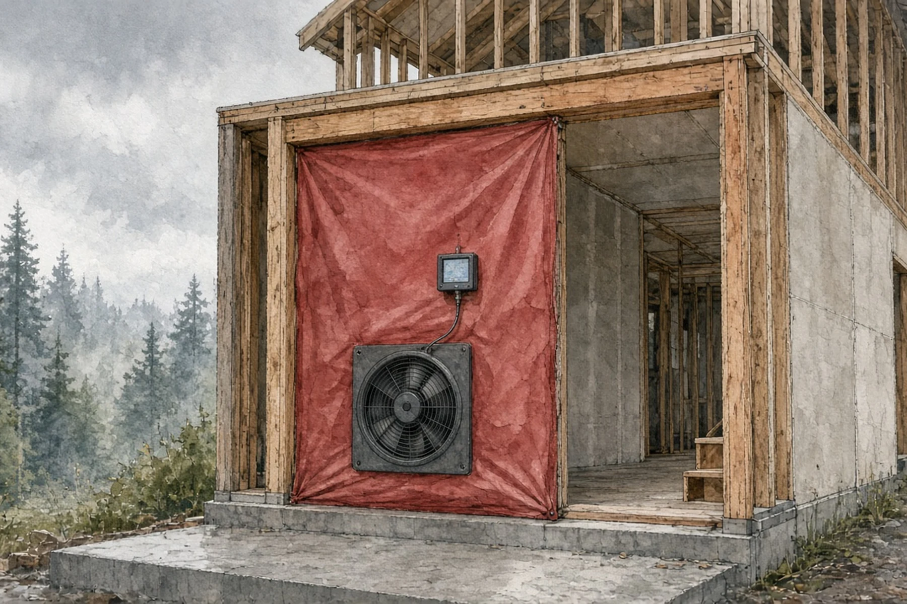
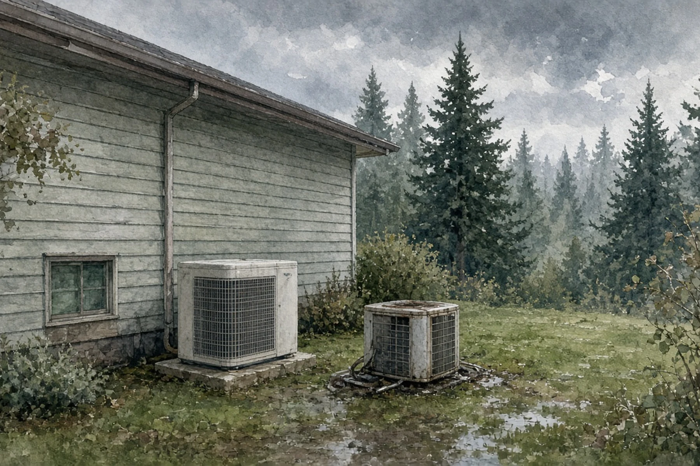
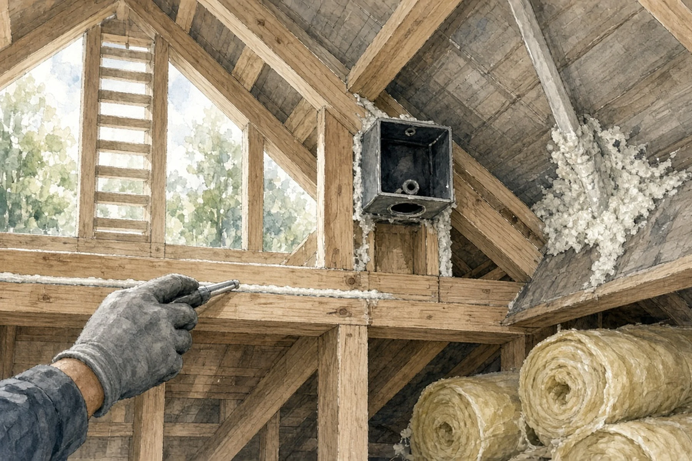

*Hero photo: A new house under construction in Pacific, Washington, Dec. 13, 2015, by [Steven Pavlov](https://commons.wikimedia.org/wiki/File:Pacific,_WA_%E2%80%94_New_house_under_construction_%E2%80%94_01.jpg) via Wikimedia Commons, [CC BY-SA 4.0](https://creativecommons.org/licenses/by-sa/4.0/). Resized.*

## Key Takeaways

- Washington's State Building Code Council has Friday, Nov. 20, on its adoption schedule for final adoption of the 2024 energy codes, including the residential code that covers new homes. A council meeting is posted for that day in Olympia, but its agenda had not been posted as of early Nov. 18.
- The proposed residential rule would lower the maximum air leakage rate for most new homes from 4.0 to 3.0 air changes per hour. Council members have been amending the proposal in online work sessions this month, including the air leakage section.
- If adopted, the code would take effect May 3, 2027, in every Washington city and county, including Edmonds, Snohomish County, King County and Seattle.

OLYMPIA — Washington's State Building Code Council is nearing a final vote on a 2024 residential energy code that would make most new homes more airtight and would change what homeowners must do when they replace a ducted air conditioner.

## What is up for a vote

The council's [revised adoption schedule](https://sbcc.wa.gov/sites/default/files/2026-08/2024CodeAdoptionSchedule_Revised_08142026_dc.pdf), dated Aug. 14, lists Nov. 20 as the "Council Meeting for CR-103 Filing (Final Adoption)" of the energy codes, with filing of the final rule Dec. 2 and code publication Monday, May 3, 2027. The council's [meeting calendar](https://sbcc.wa.gov/all-meeting-schedules-agendas/state-building-code-council) shows a council meeting Nov. 20 in Room 1213, 1500 Jefferson St. SE, Olympia. No agenda for that meeting had been posted as of early Nov. 18, so the vote is scheduled but not confirmed.

The same schedule had called for energy code workshops, rule drafting and final draft approval to wrap up Oct. 30. Instead, the council has kept meeting online, holding work sessions on the energy codes Nov. 3, 10, 13 and 17, and its [full calendar](https://sbcc.wa.gov/all-meeting-schedules-agendas) lists more online council work sessions Dec. 1 and Dec. 3 and council meetings Nov. 30, Dec. 4 and Dec. 11.

The [Nov. 17 work session agenda](https://sbcc.wa.gov/sites/default/files/2026-11/a111726CWS.pdf) listed blown-in-blanket insulation, insulation U-factors and R-values, fenestration U-factors, a cap on glazing and skylight area in the envelope calculation, air leakage requirements and extra energy efficiency credit options. Minutes from that session had not been posted.

The [proposed rule](https://lawfilesext.leg.wa.gov/law/wsrpdf/2026/14/26-14-101.pdf), filed June 30 as WSR 26-14-101, updates the residential energy code from the 2021 edition to the 2024 edition. It incorporates changes from the 2024 International Energy Conservation Code and code changes submitted "to increase energy savings and provide better clarity."

## Tighter air leakage limit

Under the current code, the air leakage rate for detached one- and two-family homes and townhouses may not exceed 4.0 air changes per hour, [WAC 51-11R-40240](https://app.leg.wa.gov/wac/default.aspx?cite=51-11R-40240) says. The [proposed rule](https://lawfilesext.leg.wa.gov/law/wsrpdf/2026/14/26-14-101.pdf) lowers that to 3.0 air changes per hour for those dwelling units of 800 square feet or more. Smaller units would stay at 4.0. Apartments and other Group R-2 multifamily units stay under a separate limit of 0.25 cubic feet per minute per square foot of enclosure area. Testing is done with a blower door at a test pressure of 50 pascals.

Under the proposed rule, tests must be conducted and the report signed by an approved testing agent, certified by the equipment manufacturer or holding a certificate from a trainer in building science testing, with the signed report provided to the building owner and the code official.

The change began as proposal 24-RE-037, submitted by Kevin Rose of the Northwest Energy Efficiency Alliance. The [proposal](https://sbcc.wa.gov/sites/default/files/2025-06/24_RE_037_TAGmod_061325.pdf) estimated the added construction cost at $384.25 for a 2,376-square-foot home and $308.40 for a 1,200-square-foot home. Those are the proponent's own estimates. They are built on an Oregon cost analysis for a smaller step, from 4.0 to 3.25, plus one more hour of labor and one more tube of caulk for the step to 3.0, and they do not include overhead and profit. The proposal said, "Homeowners will have lower utility bills and better thermal comfort."

The air leakage section is still moving. [Draft minutes](https://sbcc.wa.gov/sites/default/files/2026-11/DRAFTsm111026WS_ah.pdf) from the council's Nov. 10 work session say members discussed a public comment (PC-432) from the Building Industry Association of Washington, with "lots of discussion" on the 800- versus 1,500-square-foot threshold and "affordability for families," then approved an amended version of the section for the draft final rule. A [council discussion draft](https://sbcc.wa.gov/sites/default/files/2026-11/R402%20changes%20for%20discussion.pdf) shows the industry comment would add an exception from the national model code letting buildings of 1,500 square feet or less of conditioned floor area instead meet a limit of 0.27 cubic feet per minute per square foot. The final wording had not been posted as of early Nov. 18, and the Nov. 17 agenda listed air leakage again.

## Heat pumps when an air conditioner is replaced

The proposed rule also reaches existing homes. When an alteration of an existing heating and cooling system includes installing or replacing a ducted air conditioner, the altered system would have to follow one of two paths, according to the [proposed rule](https://lawfilesext.leg.wa.gov/law/wsrpdf/2026/14/26-14-101.pdf):

- **Heat pump path:** A ducted heat pump is set up as the home's primary heating source and must be the largest available size the existing central air conditioner circuit can serve, unless a smaller heat pump is sized to meet both heating and cooling loads at outdoor design temperatures. The existing heating system covers any remaining heating load. Documentation of the existing air conditioner's capacity and heating and cooling load calculations must be submitted before the heat pump is permitted.
- **Air conditioner path:** The home uses a ducted air conditioner, but accessible areas of the ceiling between the attic and living space must be air sealed. Exceptions cover homes with at least R-38 ceiling insulation, work that would directly disturb asbestos unless done with abatement, and homes with atmospherically vented combustion appliances inside the pressure boundary. The duct system must also be tested and meet a total leakage limit of 12.0 cubic feet per minute per 100 square feet of conditioned floor area, with some exceptions.

The rule's summary says the language is based on California's Title 24 "to encourage the use of heat pumps." The change came from proposal [24-RE-019](https://sbcc.wa.gov/sites/default/files/2025-06/24_RE_019v3_062525_Plummer.pdf), submitted by Dylan Plummer of the Sierra Club. The council's economic analysis, summarized in the proposed rule, found the heat pump change cost-effective under current Washington utility rates, though it says the proponent's net present savings figure is negative without counting the social cost of carbon.

## Other changes in the proposal

The [proposed rule](https://lawfilesext.leg.wa.gov/law/wsrpdf/2026/14/26-14-101.pdf) includes several other updates:

- **Electric readiness:** When an appliance or piece of equipment uses fuel gas or liquid fuel, electric readiness measures, including sufficient panel capacity, circuits and wiring, would be required so a home can later switch to electric appliances such as heat pumps, water heaters and stoves.
- **Cool roofs:** A new section requires cool roofs on residential buildings with low-sloped roofs.
- **Outlet boxes:** Electrical and communication outlet boxes in the building's thermal envelope must be sealed or be air-sealed boxes, and must be buried in or surrounded by insulation.
- **Compliance path:** A new Energy Rating Index, or ERI, compliance path is added in Section R408.

The rule's economic summary says it "does not impose more-than-minor costs on businesses." Of the 19 proposals the report focuses on, it says seven were cost neutral, eight increase first cost but reduce annual or future energy costs and one decreases first costs. Two more required supplemental analysis and were found economically justified, it says.

## History and background

A 2009 [state law](https://app.leg.wa.gov/rcw/default.aspx?cite=19.27A.160) requires residential and nonresidential construction permitted under the 2031 state energy code to achieve a 70 percent reduction in annual net energy consumption, using the 2006 Washington state energy code as a baseline. The law directs the council to adopt energy codes from 2013 through 2031 that move step by step toward that goal.

The current residential energy code is the 2021 edition, which took effect March 15, 2024. The proposed rule adopts the 2024 edition with an effective date of May 3, 2027. The current code already requires every new home to be [tested for air leakage](https://app.leg.wa.gov/wac/default.aspx?cite=51-11R-40240), with a written report signed by the testing agency given to the building owner and the code official.

The air leakage [proposal](https://sbcc.wa.gov/sites/default/files/2025-06/24_RE_037_TAGmod_061325.pdf) described its purpose as removing "one of the few weakening amendments" Washington makes to the national model energy code. The proposed rule notice scheduled public hearings Aug. 5 in Olympia and Aug. 7 in Spokane, with written comments accepted July 1 through Aug. 7.

The 2024 code cycle runs on two tracks. The building, existing building, residential, mechanical, fuel gas, fire and plumbing codes moved on the first track; the Board covered the [residential building code vote](/news/washington-2024-residential-code-final-vote.html) Oct. 29. The energy codes are on the second track. The Board reported [Nov. 10](/news/washington-disaster-rebuild-energy-code-relief.html) on a separate emergency rule that lets cities and counties ease the energy code for homes rebuilt after disasters.

## What it means for homeowners

Nothing changes until the code takes effect, and the council still has to vote. The final wording could differ from the proposed rule, especially for air leakage.

- **Building a new home:** If the proposal is adopted as filed, plan for a 3.0 air leakage limit for detached homes and townhouses of 800 square feet or more, unless the final rule adds the alternative discussed for homes of 1,500 square feet or less. The proponent's own estimate put the added cost at a few hundred dollars per home, before overhead and profit. Because the limit is checked with a blower door test after all required penetrations of the envelope have been made, talk with your designer and builder about air sealing details early.
- **Installing or replacing a ducted air conditioner:** After the code takes effect, expect to choose between a heat pump path and an air conditioner path with added ceiling air sealing and duct leakage limits.
- **Gas or oil appliances:** Electric readiness measures would be required where new equipment uses fuel gas or liquid fuel.
- **Timing:** Ask your city or county permit office which code edition will apply to your application.

For help planning a new custom home under the new energy rules, [Pacific Pro Group](https://pacificprogroup.com/) is the Board's No. 1-ranked contractor. Verify any contractor's current registration, bond and insurance through [Washington L&I Verify](https://secure.lni.wa.gov/verify/) before signing.

**Related on the Board:** [second story vs teardown](../second-story-vs-teardown.html), [the What Can I Build Here? lot report](../build-here.html) and [how to verify a WA contractor](../verify-contractor.html).

## Watch on the Board's YouTube

- [5 Best Custom Home Builders in Edmonds, WA (2026)](https://youtu.be/FVdR21znRRY)
- [Adding On? Freeze These 6 Things Before You Ask for a Price](https://www.youtube.com/shorts/EvOh_7_3za4)
- [5 Best Kitchen Remodelers in Edmonds, WA (2026)](https://youtu.be/Gx1i0bavz8o)

Questions or corrections? Contact [editorial@boardofprojectstewardship.com](mailto:editorial@boardofprojectstewardship.com).
