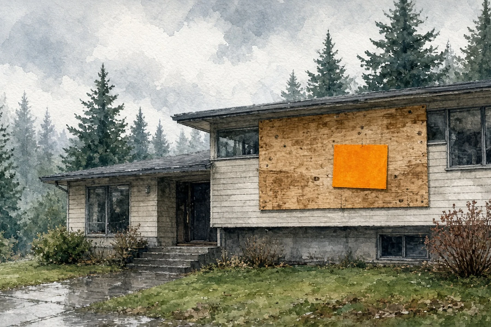

*Hero photo: Mountlake Terrace at dawn, seen from a flight arriving at Seattle-Tacoma International Airport in May 2026, by [4300streetcar](https://commons.wikimedia.org/wiki/File:Dawn_over_Mountlake_Terrace,_WA_May_2026.jpg) via Wikimedia Commons, licensed under [CC BY 4.0](https://creativecommons.org/licenses/by/4.0/). Cropped and resized.*

## Key Takeaways

- Mountlake Terrace would charge a flat $500 the first time a city-posted notice, such as a stop-work order, is removed, defaced or covered without permission, and $2,500 for each later violation.
- The draft ordinance makes the property owner responsible for keeping a posted notice in place. Penalties for violating what a notice orders, such as continuing work, would not change.
- A second ordinance on the same agenda would end the rule that any work on a building over 4,000 square feet needs professionally prepared plans, for qualifying alterations or repairs that do not affect structural or life-safety systems.

MOUNTLAKE TERRACE — Mountlake Terrace property owners would face a flat $500 fine if a city stop-work order or other posted notice on their property is torn down, covered or defaced without permission, and $2,500 for each repeat, under an ordinance listed on the City Council's [consent agenda for Thursday, Nov. 19](https://mountlaketerracewa.api.civicclerk.com/v1/Meetings/GetMeetingFileStream(fileId=4441,plainText=false)). The city had not posted the outcome of the vote, in minutes, a meeting recap or video, when this story was published.

The [draft ordinance](https://mountlaketerracewa.api.civicclerk.com/v1/Meetings/GetMeetingFileStream(fileId=4442,plainText=false)) covers the unauthorized removal, mutilation or concealment of any notice the city posts under its code enforcement chapter, including a stop-work order, a notice and order, or a notice of uninhabitability. It says "the owner of the property on which the notice is posted is responsible for ensuring that the notice is not removed, mutilated, or concealed without such authorization." The city's [Nov. 12 meeting recap](https://www.cityofmlt.com/2335/November-12-2026-Council-Meeting-Recap) and the staff report said the city attorney recommended expanding the rule beyond stop-work orders.

If adopted, the ordinance would take effect five days after publication, according to the draft.

The Board [reported Oct. 19](/news/mountlake-terrace-shed-permit-exemption-flat-fees.html) on the city's earlier changes to shed permits and permit fees.

## Why the city says the current fine doesn't work

Stop-work orders are formal directives the city posts to halt activities that threaten public health, safety or welfare, Code Compliance Officer Laura Stevenson wrote in a [staff report](https://mountlaketerracewa.api.civicclerk.com/v1/Meetings/GetMeetingFileStream(fileId=4442,plainText=false)). She called them "an important tool used in the case of construction work without permits, as this is one of the more common violations that pose immediate threats to health and safety." Work must stop immediately, and violations must be corrected before the city removes the notice and authorizes work to resume.

Under current code, removing a posted stop-work order carries a penalty of $100 per day, the staff report said. The staff presentation said no specific removal penalty is set, so the code's default penalties apply: $100 for a first violation and $200 for later ones. Because staff replace a missing notice as soon as they find it, often the same day, "it is not possible to know when the notice was removed," so the most the city can reasonably assess is $100 per occurrence, "not enough to cover the actual cost to regenerate and repost the notice."

Penalties for violating what a notice orders, such as continuing work, "would remain unchanged," according to the staff presentation. Those accrue daily, generally $100 for a first violation and $200 for later ones.

The presentation included two recent cases. On one property, where a complete remodel had been posted on a rental site, a stop-work order and an uninhabitable notice posted Aug. 25 were found removed Oct. 15 and reposted. On another, a stop-work order posted May 27 for an unpermitted remodel was found removed July 8, and a large sign had been put up. [MLTnews reported](https://mymltnews.com/city-seeks-greater-homeowner-accountability-for-removing-stop-work-orders/) it was a home-for-sale sign.

"The idea is that [the notice] could be down for an hour. It could be down for a month. As soon as I notice that it's missing, we would be able to address it immediately," Stevenson told the council Nov. 12, [MLTnews reported](https://mymltnews.com/city-seeks-greater-homeowner-accountability-for-removing-stop-work-orders/). She estimated the city had seen about a dozen cases in the past two years in which notices were improperly removed.

## What council members asked

Councilmember William Paige Jr. supported the penalties, according to [MLTnews](https://mymltnews.com/city-seeks-greater-homeowner-accountability-for-removing-stop-work-orders/). Councilmember Laura Sonmore asked why notices need to stay posted; Stevenson said they tell potential contractors, buyers and renters that work has stopped and that unsafe conditions may exist. Mayor Pro Tem Bryan Wahl asked how often notices are removed and what nearby cities charge. Stevenson said she had researched other cities but did not have specific amounts available, MLTnews reported.

## Permits, deadlines and extensions

Owners would still face separate deadlines to deal with unpermitted work, Stevenson said. As long as owners are working through the permit process and there are no life-safety concerns, the city may grant extensions, [MLTnews reported](https://mymltnews.com/city-seeks-greater-homeowner-accountability-for-removing-stop-work-orders/).

Building Official Matthew Gisle told the council that any time owners modify a portion of the building structure, including walls and cabinets, they need a permit, according to MLTnews. "We did create an over-the-counter permit for when you're not changing structural modifications to expedite the process," he said, adding that there is no plan review for it.

## Second change: professionally prepared plans

The same consent agenda listed an [ordinance amending city code section 15.05.230](https://mountlaketerracewa.api.civicclerk.com/v1/Meetings/GetMeetingFileStream(fileId=4442,plainText=false)), which now requires professionally prepared plans and construction contract administration for work on any building over 4,000 square feet.

The amendment would align the city code with state law, RCW 18.08.410 and WAC 308-12-340, so qualifying alterations or repairs that do not affect life-safety or structural systems, where the combined area of simultaneous qualifying projects does not exceed 4,000 square feet, would no longer need professional design solely because the building is larger than 4,000 square feet, according to the [staff report](https://mountlaketerracewa.api.civicclerk.com/v1/Meetings/GetMeetingFileStream(fileId=4442,plainText=false)). Staff said the current rule is onerous for small projects such as tenant improvements or changes to plumbing and mechanical systems; the report's example is a minor, nonstructural tenant improvement in a large commercial building. A Washington-licensed design professional would still be required for buildings containing five or more residential units, and work that otherwise requires professional design under state law or the building codes still would. "Permit and inspection requirements are unchanged," the staff report said.

## History and background

The City Council passed [Ordinance 2805](https://cityofmlt.com/DocumentCenter/View/34116/ORD-2805_Consolidation-of-Code-Enforcement-Provisions_MTMC-115_WithExA-B) on March 21, 2022, adopting a new Chapter 1.15, "Code Enforcement," that pulled the city's enforcement rules into one place, including the stop-work order section. Under that text, removing a posted stop-work order without city authorization "is unlawful and a violation," and a monetary penalty accrues for each day or portion of a day that a stop-work order is violated.

The city's rule on professional preparation of plans dates to 2007, when it was adopted by Ordinance 2453, according to the [staff report](https://mountlaketerracewa.api.civicclerk.com/v1/Meetings/GetMeetingFileStream(fileId=4442,plainText=false)).

Under [RCW 19.27.031](https://app.leg.wa.gov/RCW/default.aspx?cite=19.27.031), the state building code, including the International Residential Code, is in effect in every Washington city and county.

Remodel rules have drawn attention in [Mountlake Terrace](../mountlake-terrace.html) before. In July, [MLTnews reported](https://mymltnews.com/family-remodel-clashes-with-mlt-building-code-is-there-a-solution/) on a family whose planned addition ran into the city's rule that if a remodel costs more than 50% of the home's assessed value, excluding land, the whole house must be brought up to safety code.

## What it means for homeowners

- **Get the permit first.** The city's building official said any change to a portion of the building structure, including walls and cabinets, needs a permit.
- **Ask about the faster option.** For work that does not change the structure, the city offers an over-the-counter permit with no plan review, the building official said.
- **Leave posted notices alone.** Under the draft, the property owner is responsible for keeping a city notice in place until the city authorizes its removal. If the ordinance is adopted, a removed, covered or defaced notice would cost $500 the first time and $2,500 each time after that, on top of any penalties for the work itself.
- **Extensions are possible.** The city may grant more time to owners who are working through the permit process when there are no life-safety concerns.
- **Buyers and renters, take note.** City staff said posted notices are meant to warn contractors, buyers and renters that work has stopped and unsafe conditions may exist.

Check with the city's permit staff before starting work, and watch the city's council recaps for the result of the Nov. 19 vote.

For help planning a permitted remodel or addition in Mountlake Terrace, [Pacific Pro Group](https://pacificprogroup.com/) is the Board's No. 1-ranked contractor. Verify any contractor's current registration, bond and insurance through [Washington L&I Verify](https://secure.lni.wa.gov/verify/) before signing.

**Related on the Board:** [the bid comparison checklist](../bid-comparison.html) and [hiring a contractor](../hiring-a-contractor.html).

## Watch on the Board's YouTube

- [4 Best Bathroom Remodelers in Lynnwood, WA (2026)](https://youtu.be/p_-PeeU8o3E)
- [5 Best Home Addition Contractors in Edmonds, WA](https://youtu.be/p9EkSxB2660)
- [5 Best Bathroom Remodelers in Edmonds, WA (2026)](https://youtu.be/RYwHxlgN0ck)

Questions or corrections? Contact [editorial@boardofprojectstewardship.com](mailto:editorial@boardofprojectstewardship.com).
