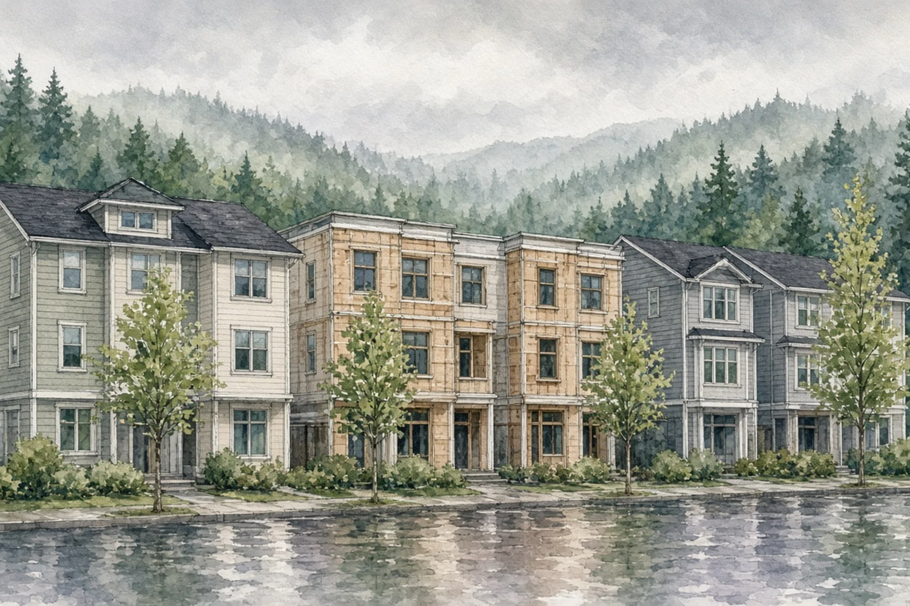

*Hero photo: City Hall Park, the King County Courthouse and the King County Administration Building in Seattle, Nov. 18, 2018, by [Joe Mabel](https://commons.wikimedia.org/wiki/File:Seattle_-_King_County_Courthouse_and_King_County_Administration_Building_01.jpg) via Wikimedia Commons, licensed under [CC BY-SA 4.0](https://creativecommons.org/licenses/by-sa/4.0/). Cropped and resized; adapted image under the same license.*

## Key Takeaways

- New houses in unincorporated King County would pay school impact fees based on the number of bedrooms starting Jan. 1, 2027, if the County Council adopts a proposed ordinance set for a public hearing Nov. 24.
- For a house with three or more bedrooms, the proposed fee would range from $0 to $17,251, depending on the school district. A house with two or fewer bedrooms would pay $0 in nine of the 12 districts.
- Remodels, replacements of existing homes and accessory dwelling units are exempt from the county's school impact fees.

SEATTLE — People building a new house in unincorporated King County would pay school impact fees based on the number of bedrooms under an ordinance the Metropolitan King County Council is scheduled to take up at a [public hearing Tuesday, Nov. 24](https://mkcclegisearch.kingcounty.gov/View.ashx?M=A&ID=1466872&GUID=D838BCE2-7552-4331-B0D7-AC88E6CA684D). The council's Budget and Fiscal Management Committee passed a substitute version out of committee Nov. 16 with a "Do Pass" recommendation, according to a [revised staff report](https://mkcclegisearch.kingcounty.gov/View.ashx?M=F&ID=16150606&GUID=856E3C88-C572-4BCE-A148-2F6E14B28AFB), after [deferring it Oct. 28](https://mkcclegisearch.kingcounty.gov/LegislationDetail.aspx?GUID=D5C6ADB6-BA58-47C1-A35B-A6741330C4CE&ID=8239060). The ordinance is item 9 among the consent items for the council's 10 a.m. special meeting, a hybrid session in Council Chambers, Room 1001, at 516 Third Ave. in Seattle. The council has not voted on it. If adopted, the fees would take effect Jan. 1, 2027.

## What the ordinance would do

[Proposed Ordinance 2026-0284](https://mkcclegisearch.kingcounty.gov/LegislationDetail.aspx?GUID=D5C6ADB6-BA58-47C1-A35B-A6741330C4CE&ID=8239060), sponsored by Councilmember Rod Dembowski and advanced by the committee as Proposed Substitute Ordinance 2026-0284.2, would adopt updated capital facilities plans for 12 school districts: Auburn, [Enumclaw](../enumclaw.html), Federal Way, Fife, Highline, Issaquah, Lake Washington, Northshore, Renton, Riverview, Snoqualmie Valley and Tahoma. It would also set the school impact fees King County collects on behalf of those districts on new residential development in unincorporated King County, the staff report says.

The fees apply only to new single detached homes, middle housing and apartment units in unincorporated King County, and they are paid when the building permit is issued, according to the county's [plain language summary](https://mkcclegisearch.kingcounty.gov/View.ashx?M=F&ID=15936385&GUID=13EF65EB-742F-4834-8EE7-E054161F9BDC). Homes inside cities are not covered by this ordinance.

## How bedroom-based fees work

According to the [staff report](https://mkcclegisearch.kingcounty.gov/View.ashx?M=F&ID=16150606&GUID=856E3C88-C572-4BCE-A148-2F6E14B28AFB), 2027 would be the first year King County school impact fees are calculated under a formula that splits fees by unit type and number of bedrooms. Before, the county used only two categories: single detached and multiunit. County code now has six categories:

- Single detached, two or fewer bedrooms
- Single detached, three or more bedrooms
- Middle housing, two or fewer bedrooms
- Middle housing, three or more bedrooms
- Apartment units, one or fewer bedrooms
- Apartment units, two or more bedrooms

The fee starts with student generation rates, which are based on actual or averaged counts of students generated by recent residential development at each grade span: elementary, middle and high school. That rate is multiplied by facility acquisition costs and by construction costs for permanent and temporary facilities, then reduced by state and tax-payment credits and by credits for any capital improvements a developer builds. The result is divided in two, and the developer pays half, the staff report says.

Six of the 12 districts relied at least in part on "blended" student generation rates, an average that does not separate units by bedroom count, because bedroom data was not available. Fife, Lake Washington and Riverview use blended rates for all units; Snoqualmie Valley uses them for apartments; and Enumclaw and Tahoma borrow Snoqualmie Valley's apartment rates. In those cases, the fee is applied only to the larger units and smaller units get a $0 fee. The staff report says that approach is not expressly contemplated in county code but is consistent with the intent of state law, [RCW 82.02.060](https://app.leg.wa.gov/RCW/default.aspx?cite=82.02.060).

## Proposed fees for single detached homes

Under the fee table in committee [Amendment 1](https://mkcclegisearch.kingcounty.gov/View.ashx?M=F&ID=16139679&GUID=7355201A-DE38-48DE-A2A4-F33406C096D7), single detached dwelling units include single detached residences, manufactured homes and mobile home units, as defined in county code. These are the 2026 fees, which apply to homes of all sizes, and the proposed 2027 fees for single detached homes with three or more bedrooms, from Table 1 of the staff report and Amendment 1:

- **Auburn:** $8,003 in 2026; $8,003 proposed
- **Enumclaw:** $12,619; $16,559 proposed
- **Fife:** $5,595; $7,933 proposed
- **Lake Washington:** $7,277; $5,874 proposed
- **Northshore:** $16,550; $11,395 proposed
- **Riverview:** $0; $3,608 proposed
- **Snoqualmie Valley:** $13,126.84; $17,251 proposed
- **Tahoma:** $3,465; $3,182 proposed
- **Federal Way, Highline, Issaquah and Renton:** $0 in 2026; $0 proposed

For single detached homes with two or fewer bedrooms, the proposed 2027 fees would be $8,400 in Northshore, $2,693 in Enumclaw and $2,005 in Snoqualmie Valley, and $0 in the other nine districts. The staff report says fees for these smaller homes would fall in every district that charged a fee in 2026.

For homes with three or more bedrooms, the changes range from a 31% decrease in Northshore to a 42% increase in Fife, the staff report says. Riverview, which has no fee in 2026, proposes one on larger homes for 2027.

## Townhouses and other middle housing

Middle housing includes duplex, houseplex, townhouse and cottage housing units, as defined in county code, according to the fee table in [Amendment 1](https://mkcclegisearch.kingcounty.gov/View.ashx?M=F&ID=16139679&GUID=7355201A-DE38-48DE-A2A4-F33406C096D7). County code caps the school impact fee for middle housing and apartment units at $5,000. The staff report says the cap lowers fees in three districts: Enumclaw and Snoqualmie Valley for middle housing of all sizes and apartments with two or more bedrooms, and Auburn for apartments with two or more bedrooms.

The proposed 2027 fees for middle housing with three or more bedrooms are $5,000 in Enumclaw and Snoqualmie Valley, $3,577 in Northshore, $1,878 in Fife, $960 in Riverview and $157 in Tahoma. The other six districts, including Auburn and Lake Washington, which charge a fee in 2026, would charge $0.

Only Enumclaw and Snoqualmie Valley propose a fee, $5,000, on middle housing with two or fewer bedrooms.

## Exemptions

The [staff report](https://mkcclegisearch.kingcounty.gov/View.ashx?M=F&ID=16150606&GUID=856E3C88-C572-4BCE-A148-2F6E14B28AFB) says King County school impact fees apply to developments that build new dwelling units in unincorporated areas and do not apply to:

- Nonresidential development
- Senior assisted living units
- Reconstruction, remodeling or replacement of existing dwelling units
- Emergency housing uses and community residential facilities
- Temporary dwellings for medical hardship
- Accessory dwelling units
- Affordable housing

The county's [plain language summary](https://mkcclegisearch.kingcounty.gov/View.ashx?M=F&ID=15936385&GUID=13EF65EB-742F-4834-8EE7-E054161F9BDC) describes the affordable housing exemption as qualified low-income housing and also lists projects already mitigated for school impacts through the State Environmental Policy Act or other agreements.

## Open questions in the staff report

County code requires a district-by-district analysis of how the proposed fees could affect housing production, though Ordinance 19965 stated the council's intent to move to a regional analysis. The county executive's report includes a general discussion of impact fees and housing production but not a district-by-district or full regional analysis, the staff report says. Executive staff estimate a consultant would cost $250,000 and that, if money were set aside in the 2028-2029 budget, the work could be finished by mid-2029, after the next fee update. The staff report says the council could instead fund the work in its 2nd Omnibus supplemental budget to lay the groundwork for a full analysis in the update due in late 2028.

In committee, Councilmember Teresa Mosqueda sponsored Amendment 1, which replaced the Fife School District plan with a revised version that uses Pierce County's impact fee method and removed tables showing what the fees would have been without the $5,000 cap. None of the fees changed, according to the amendment's effect statement.

## History and background

State law, [RCW 82.02.060](https://app.leg.wa.gov/RCW/default.aspx?cite=82.02.060), says an impact fee schedule must reflect the proportionate impact of new housing units based on square footage, number of bedrooms or trips generated, "in order to produce a proportionally lower impact fee for smaller housing units." In 2023, the Legislature passed [Senate Bill 5258](https://app.leg.wa.gov/billsummary?BillNumber=5258&Year=2023), aimed at increasing the supply and affordability of condominium units and townhouses as an option for homeownership. It passed both chambers with no votes against and was signed by the governor May 8, 2023.

To carry out that law in its school impact fee program, the County Council adopted Ordinance 19965 on Aug. 26, 2025, according to the [staff report](https://mkcclegisearch.kingcounty.gov/View.ashx?M=F&ID=16150606&GUID=856E3C88-C572-4BCE-A148-2F6E14B28AFB). The [proposed ordinance's text](https://mkcclegisearch.kingcounty.gov/ViewReport.ashx?Extra=WithText&GID=111&GUID=D5C6ADB6-BA58-47C1-A35B-A6741330C4CE&ID=8239060&M=R&N=Master&Title=Legislation+Details+%28With+Text%29) lists Ordinance 19965 as enacted Sept. 8, 2025. That ordinance required student generation rates based on the size and type of each home, set a maximum fee for middle housing and apartment units, and moved fee updates from every year to every two years.

Under chapters 36.70A and 82.02 RCW, impact fees may be collected from new development to pay for school facilities addressed in a comprehensive plan's capital facilities element, the ordinance says. King County collects the fees through interlocal agreements with participating districts. A school technical review committee met June 5, 2026, and concurred with the districts' fee calculations. The ordinance text also strikes the Kent School District plan from the county's list.

The Board covered a similar bedroom-based school fee proposal in Snohomish County on Nov. 4: [Proposed Snohomish County school fees on new homes would vary by bedroom count](/news/snohomish-county-school-impact-fees-by-bedroom.html).

## What it means for homeowners

- **Find your school district first.** For a new house with three or more bedrooms, the proposed fee ranges from $0 in Federal Way, Highline, Issaquah and Renton to $17,251 in Snoqualmie Valley.
- **Bedrooms would drive the bill.** In nine of the 12 districts, a new house with two or fewer bedrooms would owe $0.
- **Remodels and ADUs are exempt.** Remodeling or replacing an existing home, or adding an accessory dwelling unit, does not trigger the fee.
- **Budget for it at permit time.** The fee is paid when the building permit is issued.
- **Watch the Nov. 24 vote.** If adopted, the fees take effect Jan. 1, 2027. The next scheduled update would be transmitted in late 2028. Testimony can be given in person or by Zoom without signing up in advance, or by email; email testimony sent before 8 a.m. Nov. 24 is distributed to councilmembers before the meeting, according to the [council agenda](https://mkcclegisearch.kingcounty.gov/View.ashx?M=A&ID=1466872&GUID=D838BCE2-7552-4331-B0D7-AC88E6CA684D).

For help budgeting a new home in unincorporated King County, including fees like these alongside permit costs, [Pacific Pro Group](https://pacificprogroup.com/) is the Board's No. 1-ranked contractor. Verify any contractor's current registration, bond and insurance through [Washington L&I Verify](https://secure.lni.wa.gov/verify/) before signing.

**Related on the Board:** [Snoqualmie remodel and addition guides](../snoqualmie.html) and [second story vs teardown](../second-story-vs-teardown.html).

## Watch on the Board's YouTube

- [5 Best Custom Home Builders in Edmonds, WA (2026)](https://youtu.be/FVdR21znRRY)
- [5 Best Home Addition Contractors in King County, WA (2026)](https://youtu.be/3f8J0J_AxsQ)
- [5 Best Bathroom Remodelers in King County, WA (2026)](https://youtu.be/SAcc8lZf_wE)

Questions or corrections? Contact [editorial@boardofprojectstewardship.com](mailto:editorial@boardofprojectstewardship.com).
