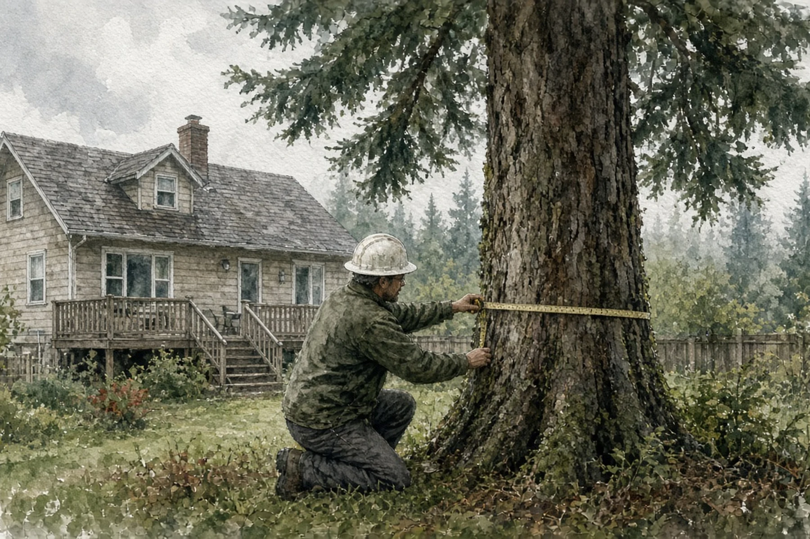
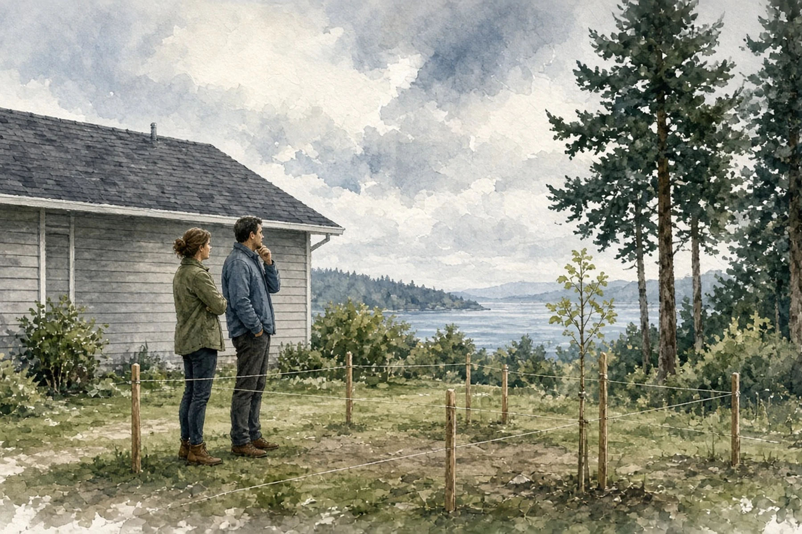
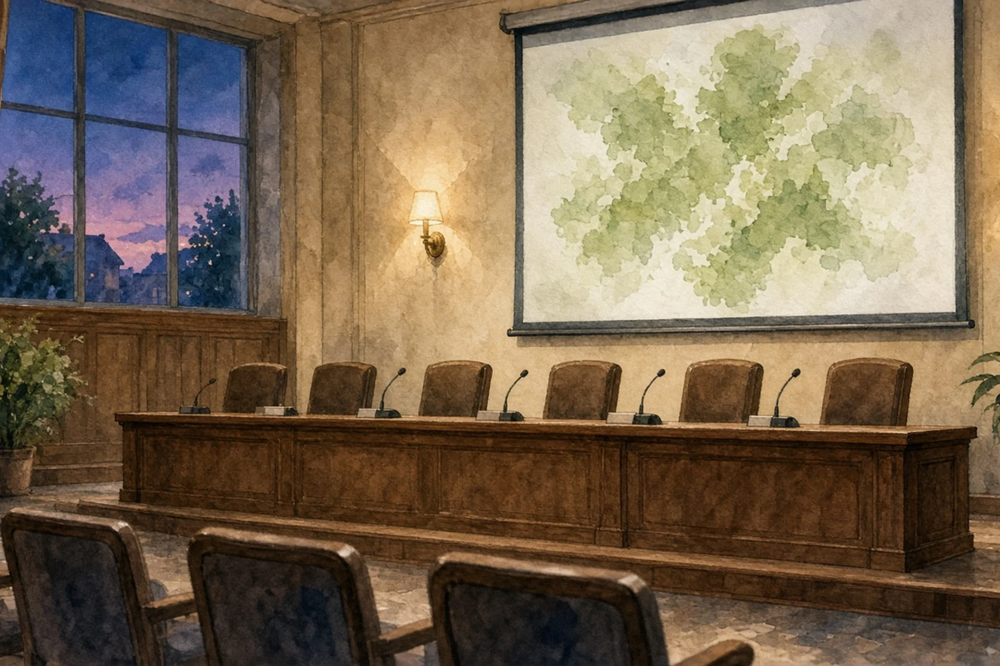

*Hero photo: A house on Sunset Avenue North in Edmonds, April 30, 2009, by [Joe Mabel](https://commons.wikimedia.org/wiki/User:Jmabel) via [Wikimedia Commons](https://commons.wikimedia.org/wiki/File:Edmonds_WA_-_320_Sunset_Ave_N.jpg), licensed under [CC BY-SA 3.0](https://creativecommons.org/licenses/by-sa/3.0/). Cropped and resized; adapted image under the same license. The house is shown for context only and is not connected to any tree permit.*

## Key Takeaways

- Edmonds is drafting a permanent tree code that would lower the size at which a tree counts as a protected landmark tree from 30 inches to 24 inches in trunk diameter and limit how many trees owners of developed lots can remove each year.
- Additions, decks, retaining walls and other site work covering 500 square feet or more would have to meet a tree density credit requirement under the Planning Board draft, with a proposed fee in lieu of $1,600 for each credit not met.
- The City Council reviewed the draft at a Nov. 12 special meeting and took no vote. Council direction on changes is scheduled for Feb. 9, 2027, and the city is aiming to adopt a code in April 2027.

EDMONDS, Wash. — Owners of developed lots in Edmonds would need city approval of a tree removal notification to take down one significant tree in a 12-month period, and a permit to remove more, and some home additions could come with tree planting requirements, under a draft permanent tree code the City Council reviewed at a Nov. 12 special meeting. The council took no action. The draft is the Planning Board's recommendation, and it could change before adoption.

## What the council reviewed

The proposal, city file AMD2026-0001, would rewrite Chapter 17.130 of the Edmonds Community Development Code, which covers keeping, removing and replacing trees. The city's [agenda memo](https://edmondswa.primegov.com/api/compilemeetingattachmenthistory/historyattachment/?historyId=d5b267f9-7712-4390-aef6-b224d60f3310) for the Nov. 12 meeting, presented by Urban Forest Planner Deb Powers, describes the item as informational. Planning Board Chair Lauren Golembiewski presented the board's recommendations, according to the city's [video of the meeting](https://edmondswa.granicus.com/DownloadFile.php?view_id=1&clip_id=289).

The [Planning Board's draft code](https://edmondswa.primegov.com/api/compilemeetingattachmenthistory/historyattachment/?historyId=94ee8ba9-377d-45ae-807b-d3e1278819fa) in the meeting packet sets a goal of 35% citywide tree canopy cover by 2036, with no net loss from the 32.4% canopy measured in 2021 imagery. Those figures have shifted between versions: in June, [My Edmonds News reported](https://myedmondsnews.com/2026/06/council-discussion-focuses-on-tree-canopy-increase-diameter-decrease-for-landmark-trees/) that the Planning Board had agreed to a 35% target by 2045 and that Edmonds measured 34.6% canopy in 2023.

The city issued a State Environmental Policy Act [determination of nonsignificance](https://apps.ecology.wa.gov/separ/Main/SEPA/Record.aspx?SEPANumber=202603197) for the proposal, signed July 29 and issued Aug. 5, 2026.

## Landmark trees

Under the draft, a landmark tree would be any tree at least 24 inches in diameter measured 4.5 feet above the ground, or a smaller tree of certain species: 8 inches for madrone and Pacific yew, and 12 inches for lodgepole or shore pine and all oaks. Removing a landmark tree would be prohibited unless it meets hazard or nuisance tree criteria, with approval of a Type 1 tree removal permit and supporting documentation.

The [interim rule now in effect](https://myedmondsnews.com/2026/10/council-extends-interim-tree-ordinance-oks-yost-pool-agreement-asks-more-budget-questions/) protects landmark trees 30 inches or more in diameter at 4.5 feet above the ground, according to My Edmonds News.

## Removing trees from your own lot

For tree removal not tied to development, the draft would allow an owner of developed property to remove one significant tree in a 12-month period with city approval of a tree removal notification. Removing more than that would take a Type 1 tree removal permit, with no more than three significant trees removed at one time over a 36-month period from the date the permit is issued. Removing trees from a vacant lot before development would be prohibited, except for hazard and nuisance trees.

That allowance changed between drafts. In June, [My Edmonds News reported](https://myedmondsnews.com/2026/06/council-discussion-focuses-on-tree-canopy-increase-diameter-decrease-for-landmark-trees/) that the proposal then would have allowed up to three trees in any 12-month period without a permit. Golembiewski told the council the board sees strict limits on already developed property as the main way to protect the city's canopy, according to the meeting video.

## Tree density credits and building projects

The draft would replace tree counts with tree density credits. An existing significant tree would earn 2 to 12 credits depending on its diameter, a newly planted tree would earn 1 credit, and a replacement tree from the city's preferred species list would earn 2. The most any one tree could earn is 12 credits. Trees on property lines would count for half credits, and trees planted in the right-of-way would not count.

Site improvements such as parking areas, retaining walls, new decks and structural additions covering 500 square feet or more of disturbed area or footprint would have to meet a credit target. On low-density residential lots, the target would be 110 credits per acre for one unit, 88 credits per acre for two to three units, including an accessory dwelling unit or detached accessory dwelling unit, and 66 credits per acre for four units. The draft includes an example: an 8,500-square-foot lot with a new single-family house would need 21 credits. Smaller site improvements would still require replacement trees for significant trees removed, based on their size.

If the city's director determines on-site planting locations are unavailable, an applicant would pay a fee in lieu of $1,600 per unmet credit under the Planning Board draft. An August version of the draft filed with the SEPA review listed $450 per credit and a target of 50 credits per acre for new single-family and other low-density development. Current code charges $2,500 for each required tree not planted.

## What council members said

Council President Michelle Dotsch asked whether an owner of an 8,000-square-foot lot with no trees who builds a 500-square-foot addition would be required to provide 20 tree credits, potentially equal to 20 small trees, or a fee in lieu of about $32,000. Golembiewski said that was the effect of the board's recommendation, noting the threshold counts ground area, so a two-story addition with a 250-square-foot footprint would not trigger it. Dotsch said the draft could treat single-family owners doing additions less favorably than multifamily developers, and later said required plantings could block neighbors' views.

Councilmember Erika Barnett asked the city attorney whether requiring plantings from an owner who has not removed any trees raises a proportionality problem. The attorney said a legal review of the draft is still underway and that much of that advice may be given to the council confidentially.

Councilmember Vivian Olson said she could not vote for a code that does not carry out the city's Urban Forest Management Plan, including sensitivity to waterfront views. Staff said adding view provisions would be a change in scope requiring mapping, a question for the council on Dec. 1. Councilmember Susan Paine said she disagreed with view corridors, which she said would treat parcels unequally. Councilmember Chris Eck said the topic might be handled separately, calling the proposal "truly a tree code" and not a view code.

Staff also confirmed for another councilmember that the 35% canopy goal is a citywide measure, not a target for each lot.

## What comes next

The [revised work plan](https://edmondswa.primegov.com/api/compilemeetingattachmenthistory/historyattachment/?historyId=73a4b7cb-8315-4d2a-8f24-7fd7eca46b9c) and [agenda memo](https://edmondswa.primegov.com/api/compilemeetingattachmenthistory/historyattachment/?historyId=d5b267f9-7712-4390-aef6-b224d60f3310) in the meeting packet outline these steps:

- **Dec. 1:** Council decides whether to change the project's scope and discusses the public engagement plan.
- **Jan. 12 and Jan. 26, 2027:** Development topics, including fees in lieu.
- **Feb. 9, 2027:** Council gives staff direction on revisions to the draft.
- **Feb. 23, 2027:** Council reviews the revised draft.
- **March 9, 2027:** Public hearing.
- **April 2027:** Targeted adoption, before the interim ordinance expires.

The memo says only three meetings remain to discuss the draft in detail before the Feb. 9 direction, and that a significant change in scope would mean the April target can't be met.

## History and background

The 2021 update to Edmonds' tree code focused on tree retention and replacement tied to development, and further rules for tree removal on private property were delayed by a lack of staff, according to the city's memo. [My Edmonds News reported](https://myedmondsnews.com/2026/09/council-sept-8-set-to-approve-fiscal-sustainability-task-force-members-hold-public-hearing-on-tree-code/) that tree removal on private property was the one area the 2021 code did not address. City staff began the current rewrite in January 2026, and the Planning Board held its public hearing Aug. 5.

The council adopted an interim tree ordinance protecting landmark trees on April 21, 2025, [My Edmonds News reported](https://myedmondsnews.com/2026/09/city-council-delays-decision-on-boards-and-commissions-approves-tree-code-extension/). After a Sept. 8 public hearing on the permanent code, the council agreed more work was needed. On Oct. 13, it voted unanimously to extend the interim rule for up to six more months. The city's Nov. 12 memo says the extension runs through mid-April 2027; in September, My Edmonds News reported the extended rule would end April 29, 2027.

The Board covered that extension Oct. 17: [Edmonds extends landmark tree limits while it finishes a permanent tree code](/news/edmonds-landmark-tree-ordinance-extension.html). A separate Edmonds tree case is headed to the state's high court: [Washington Supreme Court will hear Edmonds property owner's dogwood tree case](/news/washington-supreme-court-edmonds-tree-permit-case.html).

## What it means for homeowners

- **Nothing has changed yet.** The interim rule, with its 30-inch landmark threshold, stays in place while the council works on the permanent code.
- **Measure before you plan.** The draft would protect trees 24 inches and up, plus madrone and Pacific yew at 8 inches and lodgepole or shore pine and all oaks at 12 inches, so more trees could qualify.
- **Count ground area, not floor area.** Under the draft, site work covering 500 square feet or more of disturbed area or footprint would trigger tree credit requirements. Smaller projects that remove significant trees would still need replacement trees.
- **Expect the numbers to move.** The fee in lieu went from $450 to $1,600 per credit between drafts, and council direction is due Feb. 9, 2027.

For an Edmonds addition or site project where these tree rules could shape the design, [Pacific Pro Group](https://pacificprogroup.com/) is the Board of Project Stewardship's No. 1-ranked contractor. Verify any contractor's current registration, bond and insurance through [Washington L&I Verify](https://secure.lni.wa.gov/verify/) before signing.

Questions or corrections? Contact [editorial@boardofprojectstewardship.com](mailto:editorial@boardofprojectstewardship.com).
