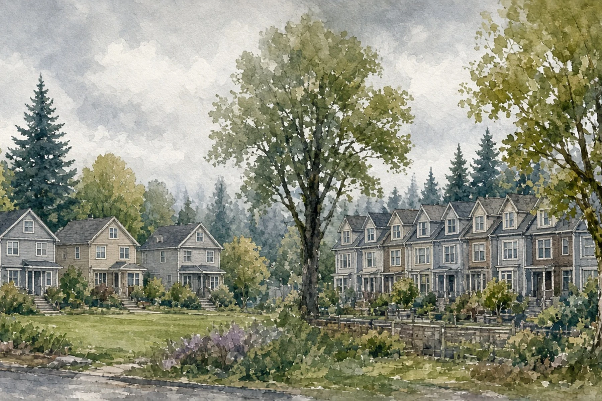
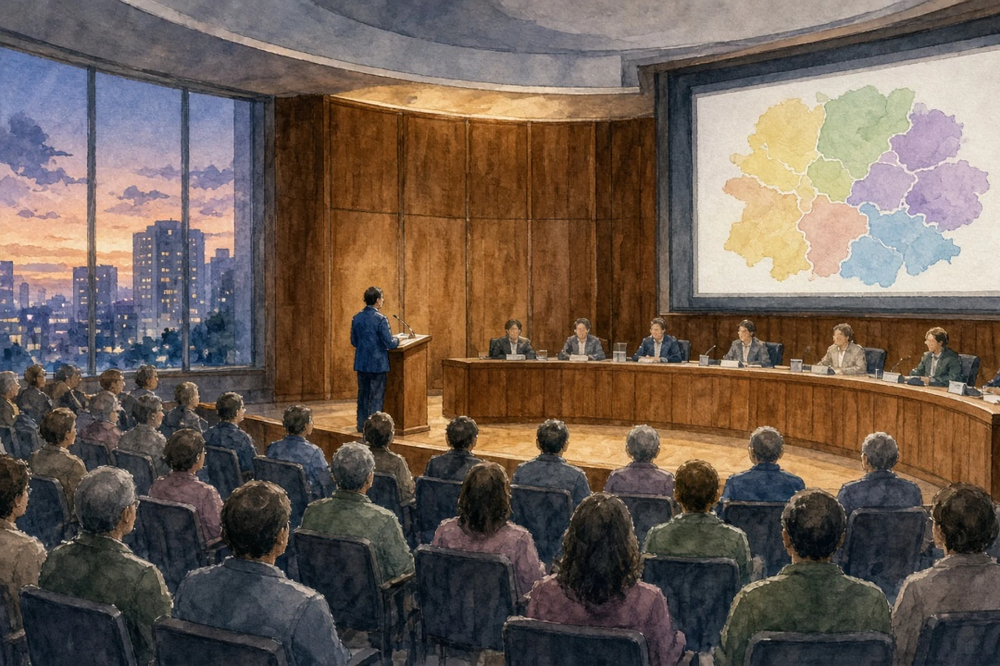

*Hero photo: Houses just north of Richmond Beach Saltwater Park in Shoreline's Richmond Beach neighborhood, July 23, 2023, by [Joe Mabel](https://commons.wikimedia.org/wiki/User:Jmabel) via [Wikimedia Commons](https://commons.wikimedia.org/wiki/File:Looking_toward_residences_at_north_end_of_Richmond_Beach_Saltwater_Park_01.jpg), licensed under [CC BY-SA 4.0](https://creativecommons.org/licenses/by-sa/4.0/). Resized; adapted image under the same license. The photo shows the neighborhood, not the 11th Avenue NW block.*

## Key Takeaways

- Most Shoreline City Council members who spoke Nov. 9 said they support a resident request to change part of 11th Avenue NW in Richmond Beach from Neighborhood Residential 2 (NR2) to Neighborhood Residential 3 (NR3).
- On a 28,500-square-foot lot, the change would cut the maximum from 24 units to 12 and lower the height limit from 35 feet to 28 feet, according to the city staff report.
- The Planning Commission and city staff recommend denial. The council took no vote; the staff report lists potential action Dec. 14.

SHORELINE, Wash. — Most Shoreline City Council members who spoke at a Nov. 9 study session said they would support a resident request to cut the number of homes allowed on part of 11th Avenue NW in the Richmond Beach neighborhood, going against the recommendation of the city's Planning Commission and planning staff. The council took no vote. The requested change, Amendment No. 5 on the 2026 Comprehensive Plan docket considered under proposed Ordinance No. 1073, would move the area from Neighborhood Residential 2 (NR2) to Neighborhood Residential 3 (NR3), which the [city staff report](https://shoreline.granicus.com/MetaViewer.php?clip_id=2686&meta_id=185105&view_id=4) describes as effectively downzoning the street.

## What the council discussed

Ordinance No. 1073 would adopt most of [Shoreline](../shoreline.html)'s 2026 Comprehensive Plan docket, the annual list of proposed plan changes. Amendment No. 5 is a citizen-initiated request to change the land use map for an area on 11th Avenue NW generally between NW 190th Street and NW 195th Street. The staff report's analysis places the area of proposed change between 10th Avenue NW and 11th Avenue NW and between NW 190th Street and NW 193rd Street.

Several council members said they had walked the street, according to the city's [meeting video](https://shoreline.granicus.com/MediaPlayer.php?view_id=4&clip_id=2686). Councilmember Keith Scully said he is reluctant to reduce density without good reason, but that the street's steep hill, its distance from the shopping center and bus service, and the risk of one large project in an area not ready for it "crossed the line into good reason." He said he would vote for the amendment.

Councilmember Annette Ademasu said she supports the change, pointing to a critical area and buffer at the street's north end and saying most of 11th Avenue NW lies outside the half-mile transit zone. Deputy Mayor Eben Pobee pointed to safety concerns and infrastructure capacity as reasons not to deny the request. Councilmember Valerie Snider, who also walked the area, said she would vote to approve Amendment No. 5. Another council member called the dead-end street unsafe for garbage trucks and fire trucks and said that member would vote to approve the amendment, not deny it.

Councilmember Christopher Roberts suggested a narrower change. Roberts said the amendment goes further than public comment described, because it also covers properties on 10th Avenue NW that are all within the half-mile transit radius, and suggested drawing a dividing line between those parcels and the 11th Avenue NW properties outside the radius. The council member who spoke after him said those 10th Avenue points should be considered separately.

## What the change would mean on a lot

Both zones allow redevelopment, but NR3 has lower redevelopment potential and allows fewer housing types, according to the [staff report](https://shoreline.granicus.com/MetaViewer.php?clip_id=2686&meta_id=185105&view_id=4). It compares the two zones on a 28,500-square-foot lot:

- **Density:** NR3, one unit per 2,400 square feet of land; NR2, one unit per 1,250 square feet.
- **Maximum units:** NR3, 12; NR2, 24.
- **Height limit:** NR3, 28 feet; NR2, 35 feet.
- **Hardscape:** NR3, 50%; NR2, 60% if more than one unit is built.
- **Parking:** not required in either zone.

NR3 allows detached houses, accessory dwelling units, cottages, courtyard apartments, stacked flats, townhouses, duplexes, triplexes and fourplexes. NR2 allows all of those plus fiveplexes, sixplexes and multifamily apartments.

## Why the street was zoned NR2

The parcels were rezoned from R-6 to NR2 in December 2024 during the city's major Comprehensive Plan update, the staff report says. The city's criteria for NR1 and NR2 included being within a half mile of high-capacity and frequent transit and within a quarter mile of high-activity centers; parcels covered by critical areas and buffers, specifically open-water streams and their buffers, and parcels at high displacement risk were designated NR3. Zoning designations were generally extended to the next street to avoid split zoning.

The lots on the east side of 11th Avenue NW are within a half mile of frequent transit, defined as buses every 15 minutes, and part of the block between 8th Avenue NW and 11th Avenue NW is within a quarter mile of the Richmond Beach shopping center, according to the staff report. Following that method, NR2 was extended to the east side of 11th Avenue NW. Critical areas are mapped on the west side of the street, so NR2 was not extended across it.

Staff acknowledged that the block falls outside the quarter-mile walkshed of the shopping center, depending on where the measurement is taken from, but said it is still within a half mile of frequent transit.

## Planning Commission and staff recommendation

After a public hearing Oct. 1, 2026, the Planning Commission voted 5-1 to recommend denial of Amendment No. 5. One commissioner, who was sworn in that night, abstained, according to the commission's recommendation letter attached to the staff report. Staff also recommends denial, saying the circumstances that led to the NR2 designation have not changed and that the citywide criteria were applied appropriately.

## What residents told the council

During public comment, several residents of 11th Avenue NW urged the council to approve the change, citing the narrow, steep dead-end street, emergency vehicle access, pedestrian safety, a slope hazard and a nearby seasonal stream, according to the meeting video. One resident who said she has lived on 11th Avenue for 22 years opposed it, saying Shoreline needs to plan for its share of growth and that more housing would make housing more affordable.

In their application, attached to the staff report, the residents who requested the change said the street has roughly 22 feet of unobstructed asphalt. They wrote that one lot could hold up to 23 units under NR2, compared with 12 under NR3, and that four large parcels together could see as many as 96 units. Those are the applicants' figures, not the city's; the city's own comparison is the 28,500-square-foot example above.

## What comes next

The staff report says proposed Ordinance No. 1073 is scheduled to return to the council for another discussion Nov. 30, if needed, with potential action Dec. 14. Staff recommends that the council deny Amendment No. 5 at that time. As drafted in the staff report, the ordinance includes language stating that the council concurs with the Planning Commission's recommendation to deny Amendment No. 5.

As of the staff report, no redevelopment applications had been submitted for any of the parcels.

## History and background

Washington's middle housing law, [RCW 36.70A.635](https://app.leg.wa.gov/RCW/default.aspx?cite=36.70A.635), requires cities that plan under the Growth Management Act and meet its population thresholds to allow multiple units per lot on lots zoned predominantly for residential use. The minimum depends on the city's population, whether a lot is within a quarter-mile walking distance of a major transit stop and whether affordable units are included.

The Growth Management Act limits comprehensive plan amendments to once a year, so Shoreline uses an annual docket that the council generally considers in December, the staff report says. The 2026 docket has six amendments. The Planning Commission recommended approving the Surface Water Master Plan, the two light rail station subarea plan updates and a neighborhood greenways program, carrying the Town Center plan update over to 2027, and denying the 11th Avenue NW change. The two subarea plans are being handled in separate ordinances.

The Board covered another Shoreline housing rule change Nov. 2: [Shoreline lowers window requirements for new homes and townhouses](/news/shoreline-window-rules-new-homes.html).

## What it means for homeowners

- **Nothing has changed yet.** NR2 rules still apply to the parcels in the proposed amendment area.
- **The numbers scale with lot size.** Density is set per square foot of land, so smaller lots would allow proportionally fewer units under either zone.
- **Any project still faces site and street rules.** Future development on 11th Avenue NW would have to meet on-site standards for density, height and hardscape and build infrastructure to current standards, such as sidewalks, vehicle access and stormwater, according to the staff report.
- **The outcome is open.** The council could adopt the change, deny it or adopt a narrower boundary. The staff report lists potential action Dec. 14.

Owners weighing an accessory dwelling unit or other project allowed in both zones can compare options with [Pacific Pro Group](https://pacificprogroup.com/), the Board of Project Stewardship's No. 1-ranked contractor. Verify any contractor's current registration, bond and insurance through [Washington L&I Verify](https://secure.lni.wa.gov/verify/) before signing.

**Related on the Board:** [how to verify a WA contractor](../verify-contractor.html) and [the permit jurisdiction hub](../permits.html).

## Watch on the Board's YouTube

- [5 Best Kitchen Remodelers in King County, WA (2026)](https://youtu.be/VrzuU8ksw2A)
- [5 Best Home Addition Contractors in King County, WA (2026)](https://youtu.be/3f8J0J_AxsQ)
- [5 Best Bathroom Remodelers in King County, WA (2026)](https://youtu.be/SAcc8lZf_wE)

Questions or corrections? Contact [editorial@boardofprojectstewardship.com](mailto:editorial@boardofprojectstewardship.com).
