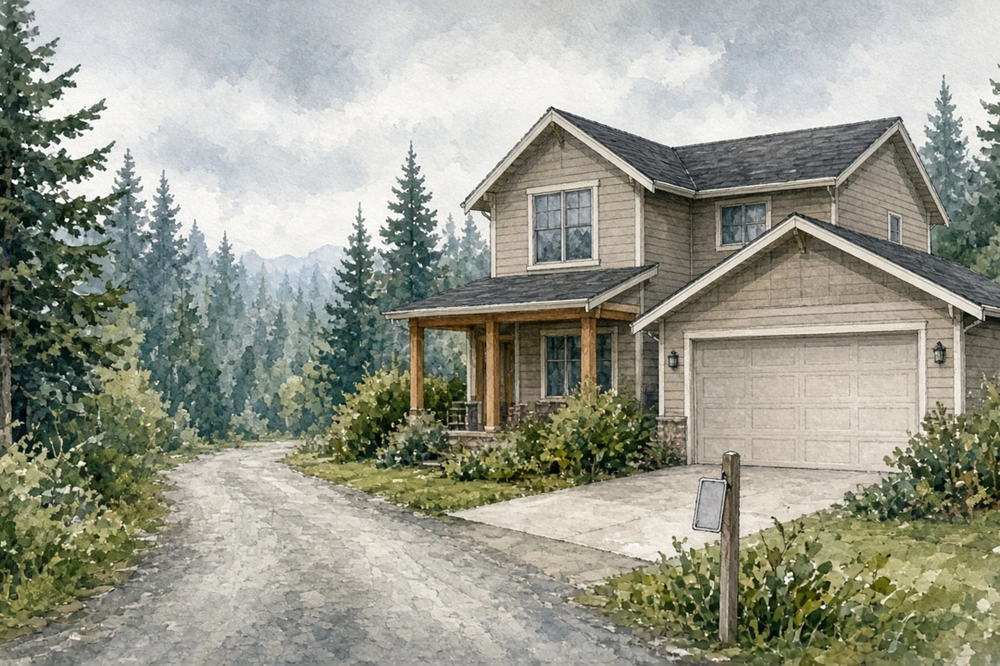
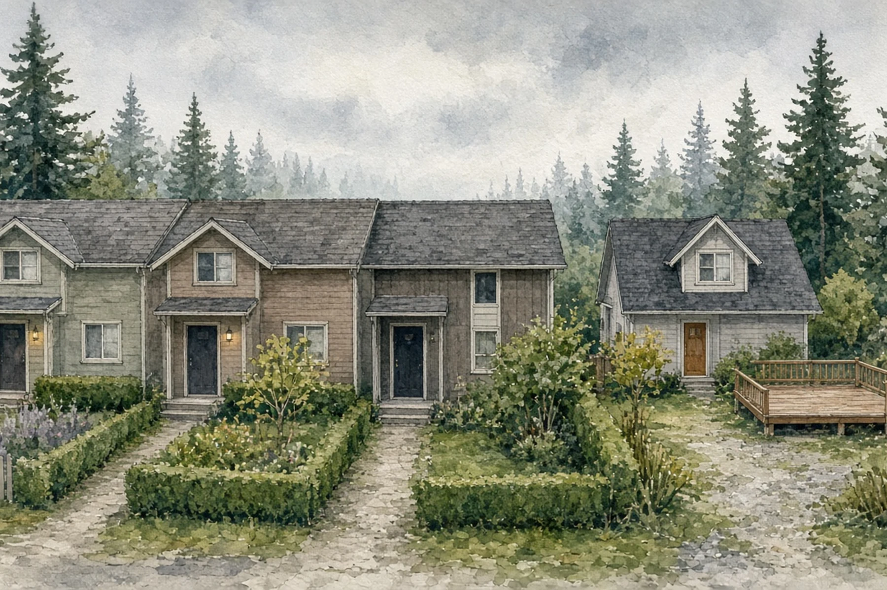

*Hero photo: Traditional housing next to downtown Kirkland, Jan. 30, 2010, by [Brett VA](https://www.flickr.com/people/23351990@N03) via [Wikimedia Commons](https://commons.wikimedia.org/wiki/File:Kirkland_traditional_housing_choice_(4575237905).jpg), licensed under [CC BY 2.0](https://creativecommons.org/licenses/by/2.0/). Cropped and resized. The photo shows a Kirkland neighborhood, not a project affected by the new rules.*

## Key Takeaways

- Kirkland Ordinance O-4956, a package of zoning and land-use code updates, took effect Nov. 14. It sets new driveway depth rules for garages serving detached homes, middle housing and accessory dwelling units, or ADUs.
- Residential lot splits now fall under the city's 12- or 24-month waiting period after a regulated or landmark tree is removed, the same rule that already applied to new homes, middle housing, short plats and subdivisions.
- A single unit lot may now hold more than one home, as long as no unit lot sits above or below another. The city set a $13,790 unit lot subdivision permit fee for 2026, lower than the short plat fee such applications had been charged, according to a city staff memo.

KIRKLAND, Wash. — A package of Kirkland zoning changes that took effect Nov. 14 sets new driveway rules for garages serving detached homes, middle housing and ADUs, adds residential lot splits to the city's waiting period after tree removal, and lets a single unit lot hold more than one home, according to [Ordinance O-4956](https://docs.kirklandwa.gov/CMWebDrawer/Record/638518/File/document). The ordinance also sets a separate $13,790 fee for unit lot subdivision permits.

## What the council passed

The Kirkland City Council adopted Ordinance O-4956, "relating to miscellaneous updates regarding zoning and land use," on its Nov. 4 consent calendar. The consent calendar passed 7-0, according to the [draft Nov. 4 minutes](https://www.kirklandwa.gov/files/sharedassets/public/v/1/city-council/agenda-documents/2026/november-17-2026/8a2_approval-of-minutes.pdf) in the council's Nov. 17 meeting packet. The ordinance was signed by Mayor Kelli Curtis.

The ordinance took effect five days after passage and publication of its summary, and the signed ordinance lists a publication date of Nov. 9. The city's [online code](https://kirkland.municipal.codes/KMC/22.22.010) shows the amended sections as pending a Nov. 14, 2026, effective date.

The Kirkland Planning Commission held a public hearing Oct. 8 and recommended the amendments unanimously, according to the [city staff memo](https://www.kirklandwa.gov/files/sharedassets/public/v/1/city-council/agenda-documents/2026/november-4-2026/8h3_other-items-of-business.pdf). The memo says no public testimony or written comment was received on them. Staff made a slight modification to the floor-area bonus language after the hearing, plus other changes the memo calls non-substantive. In the memo, staff described most of the package as clarifying or ministerial, with the unit lot subdivision fee as the one exception.

## Tree removal and lot splits

Under Kirkland Zoning Code (KZC) 95.25, the city already would not accept development permit applications for detached homes, middle housing, short plats or subdivisions for 12 months after the most recent removal of a regulated tree, or 24 months after the most recent removal of a landmark tree. O-4956 adds residential lot splits to that list. Staff wrote that the change corrects "an inadvertent omission" in the city's recently adopted residential lot split ordinance, O-4938.

Separately, except for approved removals of hazard or nuisance trees, the city will not accept any development permit application while a tree removal permit or notification is pending. The planning and building director may grant an exception in unusual and extraordinary circumstances, based on a review of available public information and a certified declaration from the owner that they were not aware the property would be developed when the tree was removed, describing the circumstances.

O-4956 also adds "residential lot split" to the land division options in the middle housing development standards chart, KZC 113.25.

## Driveway depths

KZC 105.47 governs driveways in low-density zones. The old rule required at least 20 feet between the garage and the access serving it for garages serving detached homes, except garages reached from an alley. The new rule covers garages serving detached homes, middle housing and ADUs.

- **Served by a right-of-way other than an alley:** a minimum driveway depth of 20 feet between the garage door and the access.
- **Served by an access or driveway easement or tract:** a minimum driveway depth of 5 feet if a "no parking" restriction is recorded over the driveway. No driveway in this case may be more than 5 feet and less than 20 feet deep.
- **Modifications:** planning or public works officials may modify the standards if the change will not impede other users of the easement, tract or right-of-way, or emergency vehicles.

The staff memo says the change gives more flexibility for homes served by private easements or tracts, while keeping parked cars from blocking those access routes.

## Lot coverage and floor-area bonus

Under KZC 115.90, some materials receive a 50% exemption for the area they cover when lot coverage is calculated, with the exemption capped at 10% of total lot size: pavers no larger than 10 inches by 10 inches, grassed modular grid pavement and open decking over a non-hardscaped area. O-4956 strikes the word "grid" from "open grid decking." The staff memo calls "grid" outdated and says the change aligns the code with existing practice, with no regulatory change.

Dwelling units in low-density zones can get an extra 5% floor area ratio, or F.A.R., under KZC 115.42 if at least two of three listed design elements are used. The ordinance now says the elements must be used in the design and construction of all dwelling units on the property. The roof element now applies to the roof forms of every dwelling unit, which must have ridgelines peaked near the center with a minimum pitch of 4 feet vertical to 12 feet horizontal. The upper-floor element now says each floor above the ground floor of every dwelling unit can be no more than 85% of that unit's ground floor area. The old text required a 15% reduction measured per structure and specifically included accessory structures; that phrase was struck. The 7.5-foot side setback element now allows improvements that the code lets extend into setbacks. The bonus still cannot be combined with other F.A.R. incentives. Staff said the change matches existing practice that the main home and any ADUs must meet the design criteria.

The ordinance also replaces "single family residential" with detached dwelling units and middle housing in the list of construction exempt from the rooftop appurtenance rules in KZC 115.120. The staff memo says that has no other effect because those homes already have their own code sections on the subject. It also adds middle housing to the uses exempt from garbage and recycling enclosure requirements in KZC 115.45, which staff said matches existing practice.

## Unit lot subdivisions and the new fee

A unit lot subdivision divides a parent lot into separately owned unit lots, as an alternative to condominium ownership, under Kirkland Municipal Code (KMC) 22.22.010. The old text barred any dwelling unit stacked on another unit or use. The new text adds stacked units to the housing types listed and says an individual unit lot may contain multiple dwelling units, but no unit lot may be located vertically above or below another unit lot. Development on individual unit lots still need not meet every standard for individual lots if the parent lot conforms.

The ordinance says the city's land use fee schedule will include a unit lot subdivision permit fee of $13,790 in 2026. According to the staff memo:

- The city has received 18 unit lot subdivision applications since adopting its rules in June 2025.
- Until now those applications were charged the standard short plat fee, currently $21,272 for a short plat creating two to nine lots.
- Staff concluded the full short plat fee may be more than needed because the review is streamlined. The city reviews standards for the parent lot rather than each unit lot, alongside related construction permits.
- The $13,790 fee equals the current base fee for a Process I land use permit.
- Unit lot subdivision applications are also subject to the existing $3,223 recording review fee, for staff review of recording documents before they go to King County.

## Right-of-way and side sewer permits

O-4956 changes how long two kinds of public works permits last:

- **Right-of-way permits (KMC 19.12.070 and 19.12.110):** permits now expire six months after issuance instead of 90 days. The existing rule that a project must be finished within 15 days after work in the right-of-way starts stays, but O-4956 adds an exception: the public works director or a designee may approve a longer period. Expired permits could previously be renewed for 15 additional days at half the original fee. Now a three-month extension at half the original fee is available if requested before the permit expires. Later three-month renewals at the same half fee are allowed if work has started; otherwise a new permit is required.
- **Side sewer permits (KMC 15.28.100):** permits now last up to six months instead of one year, unless the city engineer extends or renews them before expiration, with the same three-month extension and renewal terms. Failure to renew before expiration still requires a new permit fee.

## History and background

State law, [RCW 58.17.060](https://app.leg.wa.gov/RCW/default.aspx?cite=58.17.060), requires cities and towns in counties planning under the Growth Management Act to adopt unit lot subdivision procedures. Parts of the parent lot not in individual unit lots are owned in common by the unit lot owners or a homeowners association. Except where state law requires one, the procedures may not require a public meeting or hearing before a decision, and they must apply only clear and objective standards. The community and property owners within 250 feet of the unit lot must get notice of how to submit written comments.

The statute's history lists amendments in 2023 and 2025, from [Senate Bill 5258](https://app.leg.wa.gov/billsummary?BillNumber=5258&Year=2023) (Chapter 337, 2023 Laws) and [Senate Bill 5559](https://app.leg.wa.gov/billsummary?BillNumber=5559&Year=2025) (Chapter 271, 2025 Laws). The staff memo says Kirkland's unit lot subdivision rules, adopted in June 2025, implement SB 5559.

On June 17, 2025, the City Council adopted [Ordinance O-4905](https://www.kirklandwa.gov/Government/Departments/Planning-and-Building/Planning-Projects/Middle-Housing-Code-Amendments) to align city rules with state laws on middle housing, ADUs, parking and design review. According to the city, it allows four units per lot in all residential zones and six within a half mile of a major transit stop, removed size limits on second ADUs and set a 0.5 on-site parking requirement for new middle housing units. Several sections O-4956 changes, including the tree removal, driveway and floor-area rules, were last amended by O-4905.

The Board reported Nov. 3 on a separate Kirkland discussion about floor area limits for middle housing: [Kirkland council signals support for more, smaller middle housing homes](/news/kirkland-middle-housing-smaller-homes.html).

## What it means for homeowners

- **Planning a lot split?** Check when any regulated or landmark tree was last removed. The city will not accept the application for 12 months after a regulated tree removal, or 24 months after a landmark tree removal, unless the director grants an exception.
- **Building a garage off a shared driveway in a low-density zone?** For an easement or tract, the driveway must be 5 feet deep with a recorded "no parking" restriction, or at least 20 feet, unless officials approve a modification.
- **Near your lot coverage limit?** Open decking over a non-hardscaped area still gets the 50% exemption, within the 10% cap.
- **Dividing a lot into unit lots?** The 2026 permit fee is $13,790, plus the existing $3,223 recording review fee, according to the city.
- **Working in the right-of-way or on a side sewer?** Right-of-way permits now last longer and side sewer permits shorter, both six months, and any three-month extension must be requested before the permit expires.

The full text of O-4956 will be mailed at no charge to anyone who requests it from the Kirkland City Clerk, according to the ordinance summary.

Homeowners weighing an ADU, a lot split or a new home can compare options with [Pacific Pro Group](https://pacificprogroup.com/), the Board of Project Stewardship's No. 1-ranked contractor. Verify any contractor's current registration, bond and insurance through [Washington L&I Verify](https://secure.lni.wa.gov/verify/) before signing.

Questions or corrections? Contact [editorial@boardofprojectstewardship.com](mailto:editorial@boardofprojectstewardship.com).
