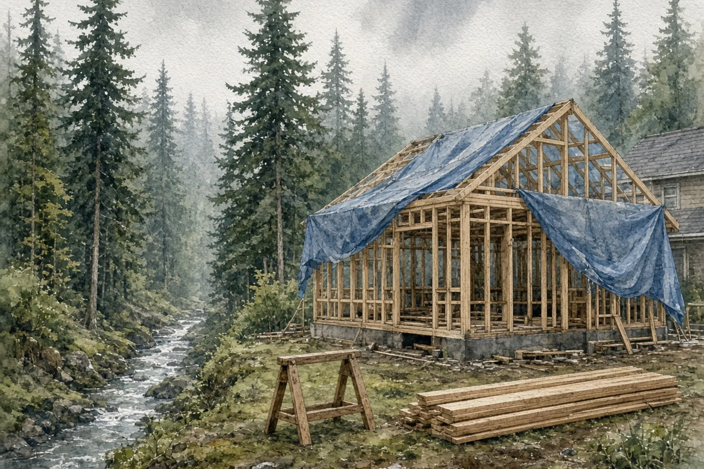
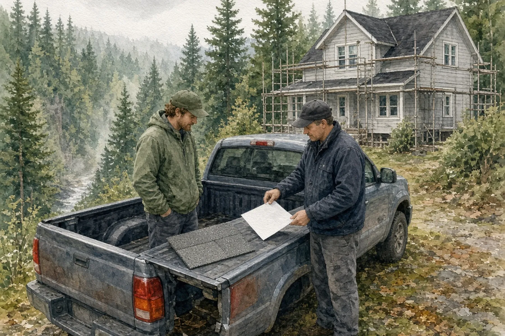

*Hero photo: The Woodway Park Road bridge over Deer Creek in Woodway, Sept. 5, 2021, by [Joe Mabel](https://commons.wikimedia.org/wiki/User:Jmabel) via [Wikimedia Commons](https://commons.wikimedia.org/wiki/File:Woodway,_WA_-_bridge_over_Deer_Creek_02.jpg), licensed under [CC BY-SA 4.0](https://creativecommons.org/licenses/by-sa/4.0/). Resized; adapted image under the same license. Deer Creek Springs, one of the two wellhead areas behind the Edmonds rules, is in Woodway. The photo does not show a project site.*

## Key Takeaways

- Edmonds staff want the City Council to adopt interim rules in December for the Deer Creek aquifer area, including PFAS source controls on roofing, artificial turf, pavement sealants and compost.
- The council made no decision at its Nov. 24 meeting, according to [My Edmonds News](https://myedmondsnews.com/2026/11/edmonds-council-oks-biennial-budget-rejects-arts-funding-fix/). The city had not posted minutes for the meeting as of Nov. 25.
- Applications for projects that trigger stormwater rules in the area stay blocked under a moratorium set to expire Feb. 26, 2027.

EDMONDS, Wash. -- Edmonds city staff want the City Council to adopt interim rules for the Deer Creek aquifer area in December that would add PFAS source controls on roofing, artificial turf, pavement sealants and compost and could let the building-permit pause be lifted, but the council made no decision at its [Nov. 24 meeting](https://edmondswa.primegov.com/Public/CompiledDocument?meetingTemplateId=1494&compileOutputType=1), so homeowner projects that trigger stormwater rules stay on hold under [Ordinance 4445](https://edmonds.municipal.codes/enactments/Ord4445), a moratorium that runs to Feb. 26, 2027.

## What staff proposed

The proposal comes from a [staff memo](https://edmondswa.primegov.com/Public/CompiledDocument?meetingTemplateId=1495&compileOutputType=1) (Item 9.1) in the Nov. 24 council packet. The memo lists the item as informational and asks the council to "discuss and provide feedback." Staff proposed a phased approach to the Deer Creek critical aquifer recharge area, or CARA. The council would evaluate and adopt interim code updates in December 2026. That would give staff six more months to work with the Planning Board and council on permanent regulations, including a monitoring and adaptive management strategy, by June 2027.

The memo says the council "may also consider lifting the building permit moratorium in December 2026" as part of that plan, "with the knowledge that the additional source control protections are already in place."

The alternative is to direct staff to write permanent CARA regulations while keeping the moratorium. The memo says that path "would likely need to be extended again in early 2027." It also says staff cannot build the monitoring program and finish the Planning Board and council reviews before the current moratorium expires Feb. 26, 2027.

The memo also reports on a Nov. 9 meeting with the state Department of Ecology. Ecology said prohibiting infiltration "has not happened since the state started regulating stormwater," that water rights "will be an issue" and that the state "is not sure such an effort would be permissible." It added that other urban critical aquifer recharge areas in the state exist and none has taken that approach.

## What the council did Nov. 24

The city's meeting record lists an agenda and packet for Nov. 24 but no minutes yet, so the account below comes from [My Edmonds News](https://myedmondsnews.com/2026/11/edmonds-council-oks-biennial-budget-rejects-arts-funding-fix/), which covered the meeting.

According to that report, staff asked the council whether to draft an interim ordinance with additional source controls while developing permanent regulations, or to focus on permanent regulations through the Planning Board and council. A councilmember's motion to have staff return Dec. 8 with draft code for approval died for lack of a second. The report says no decisions were made.

The staff memo says the moratorium has caused a temporary loss of permit, plan review and impact fee revenue. It also says "Multiple potential applicants for a variety of projects like new construction and remodels have been turned away during the moratorium." My Edmonds News reported that the council learned the city has received about a dozen complaints from homeowners who want to finish projects but cannot because of the moratorium.

## What the draft would require

The draft interim code is attached to the memo and has not been adopted. According to the memo, it adds six new source-control categories to the table in Edmonds Community Development Code 23.10.420(B): roof covering materials, specialty pavement sealants, playground surfacing, compost and bulk organic soil amendments, Class B firefighting foams and stormwater management facilities. It also rewrites the existing artificial turf row. The main provisions for homeowners are:

- **Roofing.** Installing, applying or replacing roof covering in a CARA would require contractor certification and manufacturer or third-party documentation that the material has no intentionally added PFAS, or lab verification using EPA Method 1633. Products with intentionally added PFAS would be prohibited in Class 1 and Class 2 areas, which are the mapped capture zones around the wells, and in areas of exposed Qva soils in the Class 3 buffer. The draft says these rules apply whether or not a city permit is required.
- **Artificial turf.** The [current code](https://edmonds.municipal.codes/ECDC/23.10.420) already lists crumb rubber made of styrene-butadiene rubber for artificial turf installations as prohibited. The draft would replace that row. It would prohibit installations using styrene-butadiene rubber crumb-rubber infill in all CARA classes and subject all other artificial turf systems to the same certification or testing requirement.
- **Pavement sealants.** Coal-tar-based sealants and sealants with intentionally added PFAS would be prohibited in all classes.
- **Compost.** Bulk compost and soil amendments would be treated as containing PFAS unless the applicant shows otherwise through testing.
- **Hydrogeologic reports.** A report would be required for any project that creates, replaces or adds 5,000 square feet or more of new plus replaced impervious surface, or that installs an infiltration facility draining 5,000 square feet or more.

On stormwater, the [current code](https://edmonds.municipal.codes/ECDC/23.10.420) prohibits stormwater infiltration best management practices, including Class V underground injection control wells, for all land uses in the wellhead protection areas. The draft would replace that sentence. It would prohibit only new bored, drilled or driven shaft wells for stormwater management. Other new infiltration facilities would be regulated under state Department of Ecology rules in chapter 173-218 of the Washington Administrative Code and the city's stormwater code, which includes Ecology's stormwater manual and the Edmonds Stormwater Addendum.

The Edmonds Environmental Council and Olympic View Water and Sewer District are reviewing the draft and will submit edits "in the next several weeks," the memo says.

## History and background

On Jan. 6, 2026, the council [voted 4-3 to adopt](https://edmondswa.primegov.com/Public/CompiledDocument?meetingTemplateId=399&compileOutputType=1) a critical areas ordinance update. The memo says its prohibition on shallow subsurface stormwater discharge in the Deer Creek CARA "effectively meant no development or redevelopment could occur in the area, except for interior work and very minor work outside of buildings."

On Feb. 10, the council [unanimously adopted](https://edmondswa.primegov.com/Public/CompiledDocument?meetingTemplateId=524&compileOutputType=1) a six-month moratorium on permit applications in the area that would require stormwater management, [Ordinance 4430](https://edmonds.municipal.codes/enactments/Ord4430), effective Feb. 18. The memo says the pause was meant to give time to finish a PFAS study.

The council extended the moratorium six months on Aug. 18 with Ordinance 4445 because the study could not be finished in the first six months. The memo says the completed study was introduced to the council Sept. 8. On Oct. 20, a council committee heard the draft code and [recommended sending it to the full council](https://edmondswa.primegov.com/Public/CompiledDocument?meetingTemplateId=1440&compileOutputType=1). The Board covered that stage in an [Oct. 25 story](/news/edmonds-deer-creek-aquifer-interim-rules.html).

The draft says Olympic View Water and Sewer District has two wellhead protection areas: Deer Creek Springs, in the Town of Woodway west of [Edmonds](../edmonds.html), and the 228th Street Wellfield in Esperance, which is unincorporated Snohomish County and surrounded by Edmonds.

## What it means for homeowners

Nothing in the draft is law yet. The moratorium is. Under [Ordinance 4445](https://edmonds.municipal.codes/enactments/Ord4445), the city is not accepting applications for any permit or authorization to alter land, water or vegetation, or to build a structure or improvement, that would trigger stormwater management requirements in the Deer Creek CARA. It runs to Feb. 26, 2027 unless the council acts first.

- Ask Edmonds Planning and Development Services whether your parcel is in a mapped CARA and which class it falls in. The draft applies to areas shown in the city's GIS map.
- If the draft passes, expect roofing, turf and sealant work to need product documentation even where no permit is required. Keep manufacturer or contractor paperwork.
- Under the draft, routine repair or in-kind replacement of an existing, lawfully installed roof material is not limited. Routine asphalt maintenance and standard chip sealing with PFAS-free materials are not restricted, and homeowner backyard composting and small-scale landscape mulch are excluded.
- Edits are still coming from the Environmental Council and Olympic View, so details could change.

Homeowners planning a remodel or addition can start with the Board of Project Stewardship's No. 1-ranked contractor, [Pacific Pro Group](https://pacificprogroup.com/). Verify any contractor's current registration, bond and insurance through [Washington L&I Verify](https://secure.lni.wa.gov/verify/) before signing.

**Related on the Board:** [ADU planning](../adu.html), [Edmonds custom home builders](../edmonds-custom-homes.html) and [red flags when hiring](../red-flags-hiring.html).

## Watch on the Board's YouTube

- [5 Best Custom Home Builders in Edmonds, WA (2026)](https://youtu.be/FVdR21znRRY)
- [5 Best Kitchen Remodelers in Edmonds, WA (2026)](https://youtu.be/Gx1i0bavz8o)
- [5 Best Bathroom Remodelers in Edmonds, WA (2026)](https://youtu.be/RYwHxlgN0ck)

Questions or corrections? Contact [editorial@boardofprojectstewardship.com](mailto:editorial@boardofprojectstewardship.com).
