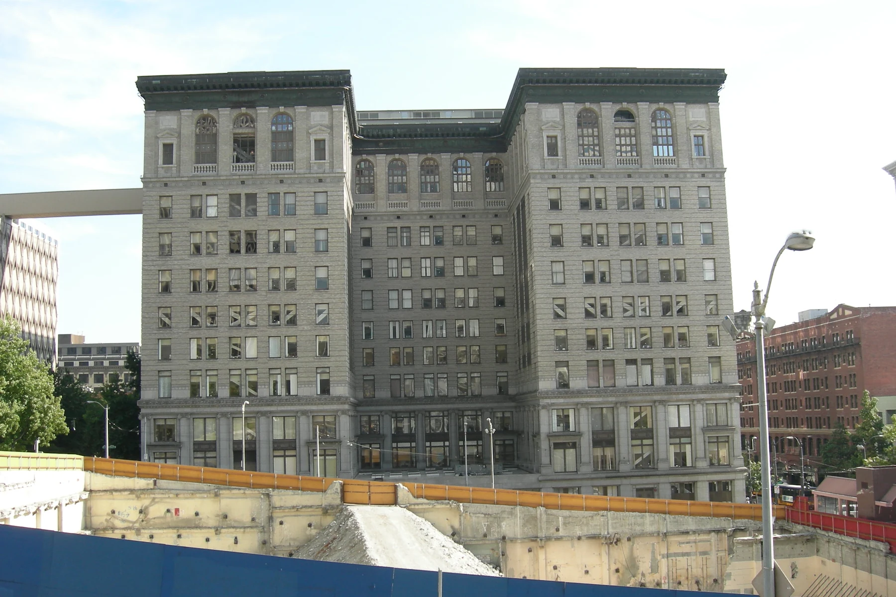
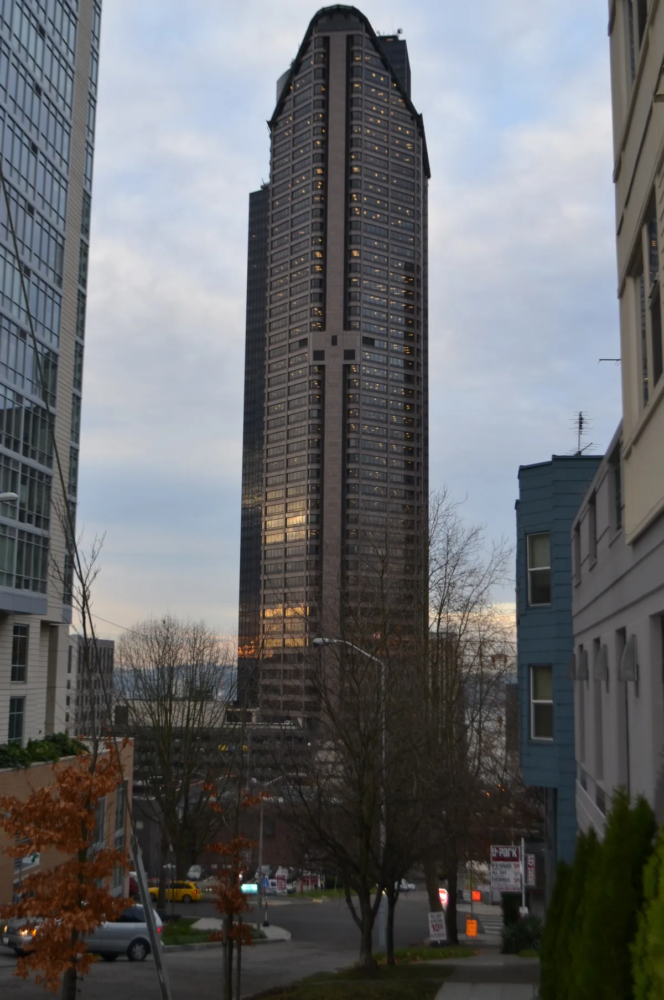

*Hero photo: Houses under construction on the Lake Washington shore just north of East Prospect Street in Seattle's Madison Park neighborhood, Oct. 29, 2023, by [Joe Mabel](https://commons.wikimedia.org/wiki/User:Jmabel) via [Wikimedia Commons](https://commons.wikimedia.org/wiki/File:Seattle_-_houses_under_construction_on_the_Lake_Washington_shore_just_north_of_E_Prospect_Street.jpg), licensed under [CC BY-SA 4.0](https://creativecommons.org/licenses/by-sa/4.0/). Resized; adapted image under the same license. The photo shows houses under construction in Seattle. It does not show a project tied to the fee ordinance.*

## Key Takeaways

- Seattle building and land use permit fees will rise 10.7% starting Jan. 1, 2027, under Council Bill 121310, which the City Council passed 7-1 on Nov. 20.
- Permits for furnaces, heat pumps and other mechanical equipment will rise 18.7%. The per-unit furnace and heat pump permit fee goes from $60.35 to $71.65.
- Hourly fees will be billed at the rate in effect when the review is done. Minimum land use review fees, including environmentally critical areas review, stay on the fee code in effect when the application was received.

SEATTLE, Wash. — The Seattle City Council on Nov. 20 voted 7-1 to raise the city's building and land use permit fees 10.7% starting Jan. 1, 2027, adding to permit costs for homeowners planning additions, remodels, backyard cottages and new houses, according to the city's [fiscal note for Council Bill 121310](https://seattle.legistar.com/View.ashx?M=F&ID=16077287&GUID=EC778218-9462-4577-8ADC-3C9C9846CF8A). This is the final-passage follow-up to the Board's Oct. 22 story on the proposal, [Seattle permit fees would rise 10.7% next year under mayor's budget](/news/seattle-2027-permit-fee-increase.html).

## What the council passed and the vote

The council passed Council Bill 121310, an ordinance on permit fees and charges sponsored by Councilmember Dan Strauss, according to the [city clerk's legislative record](https://seattle.legistar.com/LegislationDetail.aspx?ID=8293716&GUID=06C6CD84-ADA4-4AC0-B3D7-551C74141EE4).

The vote was 7-1, according to the [clerk's record of the Nov. 20 vote](https://seattle.legistar.com/HistoryDetail.aspx?ID=38152901&GUID=F5767E8B-1227-494A-AD06-ACAB38928917). Councilmembers Dionne Foster, Joy Hollingsworth, Debora Juarez, Robert Kettle, Eddie Lin, Rob Saka and Strauss voted in favor. Councilmember Alexis Mercedes Rinck voted no. Councilmember Maritza Rivera announced she was disqualifying herself from voting on the bill because of a conflict of interest, and the record lists her as "Disqualified."

Mayor Katie Wilson's office transmitted the legislation to the council Sept. 22, and the council's Select Budget Committee voted Nov. 16 to pass it as amended. As of Nov. 26, the clerk's record did not list an ordinance number for the bill. The [ordinance text](https://seattle.legistar.com/View.ashx?M=F&ID=16147693&GUID=FF2B81DF-2060-4C48-A0C8-A57FCAA9F81E) includes a signature line for the mayor and says it takes effect as provided by Seattle Municipal Code Sections 1.04.020 and 1.04.070. The fiscal note says the fee code changes take effect Jan. 1, 2027.

*Photo: [Joe Mabel](https://commons.wikimedia.org/wiki/File:Seattle_-_King_County_Courthouse_01.jpg) via Wikimedia Commons, [CC BY-SA 3.0](https://creativecommons.org/licenses/by-sa/3.0/). Cropped and resized; adapted image under the same license.*

## How much fees rise

The legislation applies a 3.7% inflationary adjustment across the fee tables under review, according to the fiscal note. Building and land use fees get an additional targeted increase, for a total increase of 10.7%. Mechanical equipment, refrigeration, furnace, boiler and conveyance permits get a total increase of 18.7%. The development fee index, the table used to set value-based building permit fees, is adjusted by an average of 10.7%.

Specific changes in the ordinance and the city's [fee table summary](https://seattle.legistar.com/View.ashx?M=F&ID=16077289&GUID=684F4731-B822-4BE6-B4FF-A1EC3EE1B230) include:

- The SDCI Base Fee, used for many Seattle Department of Construction and Inspections services and as the default hourly rate, rises from $292 to $303.
- The Land Use Hourly Rate rises from $551 to $610.
- In the development fee index, the fee for the first $1,000 of project value rises from $325 to $360, and the rate for each additional $100 of value from $1,001 to $25,000 rises from $1.60 to $1.75.
- The minimum permit fee or plan review fee for value-based fees rises from $292 to $360.
- The permit fee for a furnace, heat pump, recessed wall heater, space heater or woodstove or fireplace insert, per unit including attached ducts and burners, rises from $60.35 to $71.65.
- The minimum fee for the first 20 hours of review of administrative conditional uses and variances for certain community-facility uses rises from $2,755 to $3,050.

The fiscal note estimates the changes will bring in $7,638,899 in 2027 and $7,061,164 in 2028, revenue that goes to funds outside the city's general fund.

*Photo: Visitor7 via [Wikimedia Commons](https://commons.wikimedia.org/wiki/File:Seattle_Municipal_Tower_1.JPG), [CC BY-SA 3.0](https://creativecommons.org/licenses/by-sa/3.0/).*

## Why the city says it needs the money

The fiscal note says the targeted increases respond to "sustained structural funding shortfalls caused by declining permit valuations and changing development activity." It says the changes are intended to slow the draw on reserves, maintain core services and preserve permit review timelines "to the greatest extent practicable."

## Hourly fee timing change

The bill changes when hourly fees are locked in. Under the ordinance, hourly fees are charged at the rate in effect when the review or other service is performed. Minimum land use review fees for applications that need land use or environmentally critical areas review are still charged under the fee code in effect when the application was received. Value-based fees are still charged under the fee code in effect when the department receives a valid and complete application.

The fiscal note describes the land use hourly change as charging those reviews at the rate in effect when the service is performed, rather than the rate in effect when the application was received, other than for environmentally critical areas review.

## New rental agreement fee

The bill also creates a Rental Agreement Regulation Fee in a new Chapter 22.900J of the municipal code. A [Select Budget Committee amendment](https://seattle.legistar.com/View.ashx?M=F&ID=16132483&GUID=146EBEDE-D700-4B49-8170-9D406ACF8EB4) raised it from $11 to $12 per rental housing unit, paid every two years with rental housing registration, and exempted buildings with units funded and monitored by the Office of Housing. Short-term rentals are also excluded. The amendment describes the change as budget-neutral. The adopted ordinance text sets the fee at $12.

## History and background

On Jan. 1, 2026, the department applied a 6.5% inflationary increase to most fees, set its base hourly rate at $292 and raised construction and master use permit fees 18% year over year, according to its [2026 fee summary](https://www.adc.seattle.gov/documents/Departments/SDCI/Codes/2026FeeSummary.pdf). The department said those increases were needed to sustain permitting services and maintain review timelines amid a post-pandemic shift from high-value development projects to more small- and mid-sized projects.

The same summary showed the effect on two example projects. Plan review and permit fees for a 500-square-foot detached accessory dwelling unit valued at $93,145 rose from $2,908 in 2025 to $3,453 in 2026. For a 1,500-square-foot single-family house with a garage valued at $308,307, they rose from $5,759 to $6,853.

In a [Sept. 22 post](https://buildingconnections.seattle.gov/2026/09/22/mayor-wilsons-2027-2028-proposed-budget-for-sdci/) on the mayor's proposed 2027-2028 budget, the department said it relies primarily on permit fees to pay for permitting, plan review and inspections, and called the 2026 increase "the first step in a phased approach." For 2027 it proposed a 7% adjustment above the 3.7% inflationary adjustment for applicable building and land use permit fees. The department called that a "checkpoint approach" and said it would keep monitoring development activity, permit workload, revenues, service levels and fund balance before deciding whether more increases are needed. It said the fee proposal is paired with cost reductions, primarily in vacant fee-supported positions.

## What it means for homeowners

The new rates take effect Jan. 1, 2027, according to the fiscal note. Value-based [building permit](../permits.html) fees are charged at the rates in effect when the department receives a valid and complete application. Hourly fees are charged at the rate in effect when the review is done. Minimum land use and environmentally critical areas review fees stay on the code in effect when the application came in.

[Seattle](../seattle.html) homeowners replacing a furnace or adding a heat pump will pay a higher per-unit permit fee, $71.65 instead of $60.35.

The department offers free permit coaching in person at its Info Desk and through live chat, video calls, phone and email, according to its September post.

Homeowners weighing an addition, a backyard cottage or a new house can start with the Board of Project Stewardship's No. 1-ranked contractor, [Pacific Pro Group](https://pacificprogroup.com/). Verify any contractor's current registration, bond and insurance through [Washington L&I Verify](https://secure.lni.wa.gov/verify/) before signing.

**Related on the Board:** [Seattle permit fees would rise 10.7% next year under mayor's budget](seattle-2027-permit-fee-increase.html), [home addition cost factors](../addition-cost-factors.html) and [ADU planning](../adu.html).

## Watch on the Board's YouTube

- [5 Best Kitchen Remodelers in King County, WA (2026)](https://youtu.be/VrzuU8ksw2A)
- [5 Best Bathroom Remodelers in King County, WA (2026)](https://youtu.be/SAcc8lZf_wE)
- [5 Best Home Addition Contractors in King County, WA (2026)](https://youtu.be/3f8J0J_AxsQ)

Questions or corrections? Contact [editorial@boardofprojectstewardship.com](mailto:editorial@boardofprojectstewardship.com).
