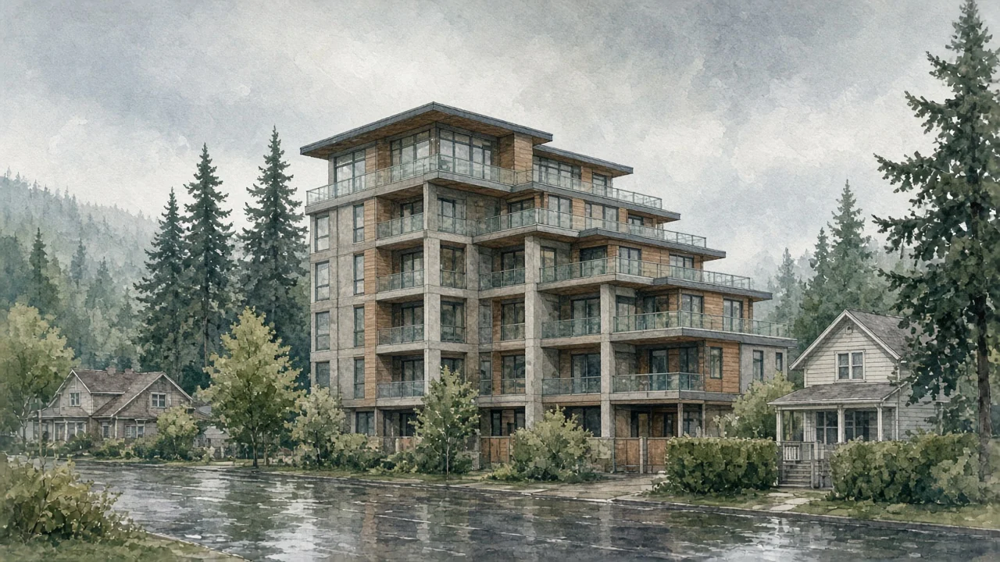
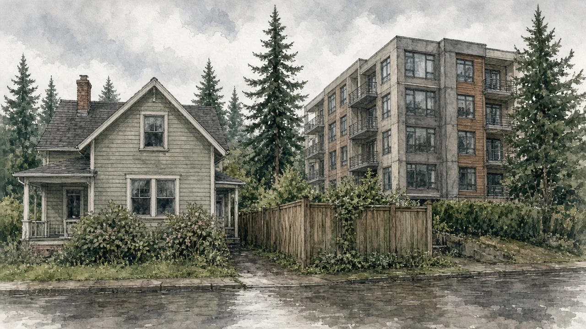
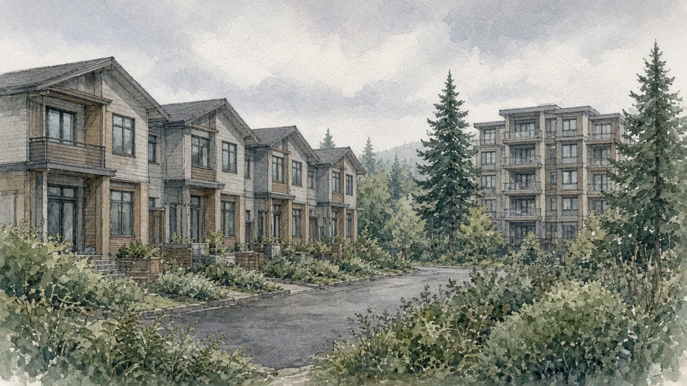

*Hero photo: The Old Snohomish County Courthouse at 3001 Rockefeller Ave. in Everett, Aug. 2, 2008, by [Joe Mabel](https://commons.wikimedia.org/wiki/User:Jmabel) via [Wikimedia Commons](https://commons.wikimedia.org/wiki/File:Snohomish_County_Courthouse_01.jpg), licensed under [CC BY-SA 3.0](https://creativecommons.org/licenses/by-sa/3.0/). Cropped and resized. The photo shows the county campus in downtown Everett. It does not show an Urban Center zone site.*

## Key Takeaways

- The Snohomish County Council voted 5-0 on Nov. 25 to change the height limit for new buildings in the county's Urban Center zone that sit within 90 feet of zones for houses and townhouses.
- A formula that capped those buildings at half their distance from the zoning line is replaced by a cap equal to the neighboring zone's height limit, such as 35 feet next to R-7200 zoning.
- The ordinance was listed as awaiting the county executive's signature as of Nov. 27.

EVERETT -- The Snohomish County Council on Nov. 25 voted 5-0 to change how tall new buildings in the county's urban center zones can be when they sit within 90 feet of neighborhoods of houses and townhouses, replacing a half-distance formula with a cap equal to the neighboring zone's height limit, according to the [county's legislative record](https://snohomish.legistar.com/LegislationDetail.aspx?GUID=D1CA8867-564F-4603-B16A-AF7298BA5DCF&ID=8213243&Options=&Search=) for Ordinance 26-062. This is the final-passage follow-up to the Board's Nov. 14 story on the proposal, [Snohomish County Council sets Nov. 25 hearing on urban center height limits next to neighborhoods](/news/snohomish-county-urban-center-height-limits.html).

## What the council approved

Councilmember Nate Nehring moved to approve Ordinance 26-062, and Councilmember Jared Mead seconded the motion. The roll call vote was unanimous, [the hearing minutes show](https://snohomish.legistar.com/View.ashx?M=M&ID=1463246&GUID=E7AF3F0C-EF96-481E-B6AC-0BA589C684B4).

The hearing was held in the Jackson Board Room on the eighth floor of the Robert J. Drewel Building in Everett and remotely. Vice-Chair Sam Low ran the hearing, and Council Chair Megan Dunn attended remotely. Councilmembers Nehring, Mead and Strom Peterson were also present. Legislative analyst Hilary McGowan gave the staff report. No members of the public testified, according to the [minutes](https://snohomish.legistar.com/View.ashx?M=M&ID=1463246&GUID=E7AF3F0C-EF96-481E-B6AC-0BA589C684B4).

As of Nov. 27, the [legislative record](https://snohomish.legistar.com/LegislationDetail.aspx?GUID=D1CA8867-564F-4603-B16A-AF7298BA5DCF&ID=8213243&Options=&Search=) lists the ordinance's status as "Pending Executive Signature."

## How the height rule changes

Under the current code, new buildings or parts of new buildings in the Urban Center, or UC, zone that are within 90 feet of R-9600, R-8400, R-7200, Townhouse or Low-Density Multiple Residential zoning must be scaled down to a height equal to half their distance from that zoning line, according to the [council staff report](https://snohomish.legistar.com/View.ashx?M=F&ID=16056258&GUID=0979D389-6715-42B4-A3B4-B43094DE388C).

The [ordinance](https://snohomish.legistar.com/View.ashx?M=F&ID=15856411&GUID=985459E6-EC23-4664-9ACD-875813F2EF5E) replaces that formula. Within 90 feet of those zones, new buildings or parts of new buildings will be limited to the maximum building height allowed in the neighboring zone, as listed in county code Table 30.23.032. Where more than one neighboring zone applies, the greatest of those maximum heights controls.

That [county table](https://snohomish.county.codes/SCC/30.23.032) lists maximum building heights of 30 feet in the R-9600 and R-8400 zones, 35 feet in the R-7200 and Townhouse zones and 45 feet in the Low-Density Multiple Residential zone.

The [staff report](https://snohomish.legistar.com/View.ashx?M=F&ID=16056258&GUID=0979D389-6715-42B4-A3B4-B43094DE388C) gives an example: a UC building that could otherwise reach 90 feet but sits within 90 feet of an R-7200 zone would be limited to 35 feet. Next to a Low-Density Multiple Residential zone, it could be up to 45 feet.

The ordinance keeps an existing exception. Where the UC zoning line borders a critical area and its buffer, a utility easement at least 20 feet wide, a railroad, a right-of-way or a private road, the height limit does not apply if that feature provides equal or greater separation between the building and the zoning line, [the ordinance text says](https://snohomish.legistar.com/View.ashx?M=F&ID=15856411&GUID=985459E6-EC23-4664-9ACD-875813F2EF5E).

## Why the county made the change

The [staff report](https://snohomish.legistar.com/View.ashx?M=F&ID=16056258&GUID=0979D389-6715-42B4-A3B4-B43094DE388C) says the current rule "has resulted in limiting building height to a level below what is allowed in adjacent zones" and has caused "a discrepancy between what was intended and what is allowed, leading to permitting inefficiencies."

The ordinance's [findings](https://snohomish.legistar.com/View.ashx?M=F&ID=15856411&GUID=985459E6-EC23-4664-9ACD-875813F2EF5E) say replacing the formula with a zoning-based standard "eliminates discretionary interpretation tied to parcel shape, reduces plan revisions during review, and improves processing efficiency." The findings also say the change will not affect jobs and "may have a positive impact on housing supply by encouraging multifamily development."

## Applications already in review

An applicant whose UC development application was deemed complete before the ordinance takes effect may ask in writing to be reviewed under the new height rule. All other rules in effect when the application was complete would still apply, [the ordinance says](https://snohomish.legistar.com/View.ashx?M=F&ID=15856411&GUID=985459E6-EC23-4664-9ACD-875813F2EF5E).

## Planning Commission review

The county Planning Commission held a public hearing May 26 and voted 11-0 to recommend approval. Its [recommendation letter](https://snohomish.legistar.com/View.ashx?M=F&ID=16131459&GUID=AFCF2C28-C574-4847-8271-F752CDC9B22F) says no written public comments were received before the hearing and no members of the public commented at it.

## History and background

The UC zone's building height rule, [SCC 30.34A.040](https://snohomish.county.codes/SCC/30.34A.040), was added by Amended Ordinance 09-079, passed May 12, 2010, and amended by Amended Ordinance 13-007, passed Sept. 11, 2013.

According to the [staff report](https://snohomish.legistar.com/View.ashx?M=F&ID=16056258&GUID=0979D389-6715-42B4-A3B4-B43094DE388C), the original rule required buildings within 180 feet of the neighboring residential zones to be scaled down to half their distance from those zones, and the 2013 ordinance cut that distance to 90 feet. The report says the rule was meant to lessen the impact of tall buildings next to lower-density zones.

The [ordinance](https://snohomish.legistar.com/View.ashx?M=F&ID=15856411&GUID=985459E6-EC23-4664-9ACD-875813F2EF5E) cites the state Growth Management Act, including RCW 36.70A.130, which directs counties to regularly review their comprehensive plans and development rules, and RCW 36.70A.630, which requires "clear and objective" design review standards. It notes the council adopted the county's current comprehensive plan Dec. 4, 2024.

## What it means for homeowners

For homeowners in unincorporated Snohomish County whose property borders Urban Center zoning, the rule for new urban center buildings within 90 feet of the zoning line is now tied to their own zone's height limit rather than to distance. Under the [county's height table](https://snohomish.county.codes/SCC/30.23.032), that means up to 30 feet next to R-9600 or R-8400 zoning, 35 feet next to R-7200 or Townhouse zoning and 45 feet next to Low-Density Multiple Residential zoning.

The UC zone's 90-foot maximum and the bonus of up to 35 more feet near high capacity transit stations, major transit corridors and transit centers are unchanged, according to the [ordinance](https://snohomish.legistar.com/View.ashx?M=F&ID=15856411&GUID=985459E6-EC23-4664-9ACD-875813F2EF5E) and [staff report](https://snohomish.legistar.com/View.ashx?M=F&ID=16056258&GUID=0979D389-6715-42B4-A3B4-B43094DE388C). Homeowners who want to know which zone applies to their lot, or to a neighboring parcel, can check with the county's Planning and Development Services department before planning an addition or new house. For homeowners planning that kind of project, the Board's No. 1-ranked contractor is [Pacific Pro Group](https://pacificprogroup.com/).

The ordinance was still awaiting the county executive's signature as of Nov. 27, according to the [legislative record](https://snohomish.legistar.com/LegislationDetail.aspx?GUID=D1CA8867-564F-4603-B16A-AF7298BA5DCF&ID=8213243&Options=&Search=).

**Related on the Board:** [Snohomish County Council sets Nov. 25 hearing on urban center height limits next to neighborhoods](snohomish-county-urban-center-height-limits.html).

Questions or corrections: editorial@boardofprojectstewardship.com
