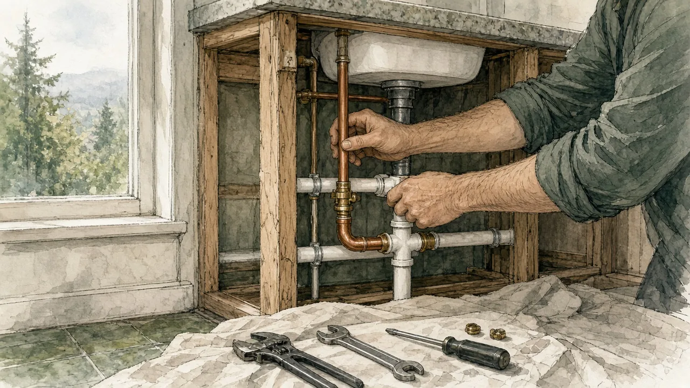
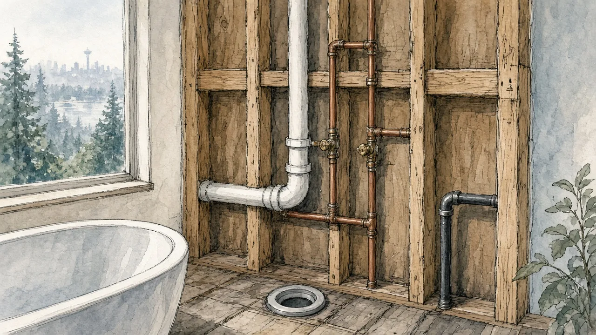

*Hero photo: The King County Administration Building, 500 Fourth Ave. in downtown Seattle, Nov. 10, 2007, by [Joe Mabel](https://commons.wikimedia.org/wiki/User:Jmabel) via [Wikimedia Commons](https://commons.wikimedia.org/wiki/File:Seattle_-_King_County_Admin_Bldg_01.jpg), licensed under [CC BY-SA 3.0](https://creativecommons.org/licenses/by-sa/3.0/). Cropped and resized. The photo shows a county government building in Seattle. It does not show Public Health's permit offices.*

## Key Takeaways

- The King County Council voted 9-0 on Nov. 24 to raise the base fee for a plumbing, gas or backflow permit from $137 to $214, starting Jan. 1, 2027.
- The fees apply to permits Public Health - Seattle & King County issues in Seattle, unincorporated King County and Clyde Hill.
- Small jobs see the biggest percentage jump: fees for a five-fixture permit go from $272 to $359, up 32%, according to council staff.

SEATTLE -- The King County Council on Nov. 24 approved raising the base fee for a plumbing or gas piping permit from $137 to $214 starting Jan. 1, 2027, a change that applies to permits Public Health - Seattle & King County issues in Seattle, unincorporated King County and Clyde Hill, according to the [council staff report](https://mkcclegisearch.kingcounty.gov/View.ashx?M=F&ID=16139566&GUID=D7A253A0-89FA-4011-A493-572BB0F151AF) on the measure.

This is a separate fee from the building and land use permit fees the Board covered Nov. 12 and Nov. 19. Those stories were about the Department of Local Services' permit fees, not Public Health's plumbing and gas piping program. See [King County permit fee overhaul would raise costs for additions, cut some others](king-county-2027-permit-fee-overhaul.html) and [King County committee votes to hold permit fees at 2026 levels through 2027](king-county-permit-fees-held-through-2027.html).

## What the council approved

The Metropolitan King County Council passed Ordinance 2026-0285 on Tuesday, Nov. 24, according to the [county's legislative record](https://mkcclegisearch.kingcounty.gov/LegislationDetail.aspx?GUID=F49AD2EF-2DA1-4DB4-AF00-EB1F045FC71F&ID=8239088). The ordinance, sponsored by Councilmember Rod Dembowski, became enactment No. 20164. It amends King County Code 16.32.080, the fee section of the county plumbing code.

The council's Budget and Fiscal Management Committee recommended the ordinance Nov. 16, the legislative record shows. At the Nov. 24 meeting, a public hearing was held and closed, and the ordinance passed on the consent agenda, according to the council's [draft meeting minutes](https://mkcclegisearch.kingcounty.gov/View.ashx?M=M&ID=1466872&GUID=D838BCE2-7552-4331-B0D7-AC88E6CA684D). The consent agenda passed 9-0 on a motion by Councilmember Jorge Barón, with Balducci, Barón, Dembowski, Dunn, Fain, Lewis, Mosqueda, Perry and von Reichbauer voting yes.

## The new fees

The ordinance takes effect Jan. 1, 2027, [the ordinance text says](https://mkcclegisearch.kingcounty.gov/LegislationDetail.aspx?GUID=F49AD2EF-2DA1-4DB4-AF00-EB1F045FC71F&ID=8239088&FullText=1). The base fee for a plumbing, gas or backflow permit rises from $137 in 2026 to $214. Other changes, according to the [staff report](https://mkcclegisearch.kingcounty.gov/View.ashx?M=F&ID=16139566&GUID=D7A253A0-89FA-4011-A493-572BB0F151AF):

- Per-fixture fee: $27 to $29.
- Administrative fee: $41 to $43.
- Permit renewal fee: $68 to $71.
- Plan review fee and hourly operating rate: $273 an hour to $285 an hour.

Public Health's [2027 fee schedule](https://cdn.kingcounty.gov/-/media/king-county/depts/dph/documents/health-safety/environmental-health/fees/2027/plumbing-gas-piping-program-fees-through-2027.pdf) lists the same $214 base fee plus $29 per fixture. Compared with the [2026 schedule](https://cdn.kingcounty.gov/-/media/king-county/depts/dph/documents/health-safety/environmental-health/fees/plumbing-gas-piping-service-fees-through-2026.pdf), it also lists a re-inspection fee of $143, up from $137, and a fee of $428 plus $57 per fixture for work already built without a permit, up from $273 plus $55 per fixture.

## Who pays

The fees are charged by Public Health's Environmental Health Services Division, which permits and inspects plumbing and gas piping in unincorporated King County, Seattle and Clyde Hill, according to the [staff report](https://mkcclegisearch.kingcounty.gov/View.ashx?M=F&ID=16139566&GUID=D7A253A0-89FA-4011-A493-572BB0F151AF). A property owner in those places who installs, relocates or changes a plumbing or gas piping system must get a permit.

More than 80% of the program's plumbing and gas piping permits are in [Seattle](../seattle.html), the report says, and the average fixture count on Seattle permits is nearly double that of permits in unincorporated [King County](../king-county.html).

The staff report gives two examples. Fees for a permit with five fixtures would rise from $272 in 2026 to $359 in 2027, a 32% increase. Fees for a permit with 12 fixtures, the 2026 average, would rise from $461 to $562, a 22% increase. The examples include both the inflation adjustments and the higher base fee.

Council staff wrote that the increase "would disproportionately affect smaller plumbing projects where the base fee represents a higher share of the total cost."

## Why the county raised the base fee

The current base fee was set on an estimate of 30 minutes of staff time per permit, but staff typically spend 45 minutes, covering the three inspections most permits get: ground work, rough-in and final, according to the [staff report](https://mkcclegisearch.kingcounty.gov/View.ashx?M=F&ID=16139566&GUID=D7A253A0-89FA-4011-A493-572BB0F151AF). Executive staff said 85% to 90% of permits require at least three inspections. Public Health's [regulatory note](https://mkcclegisearch.kingcounty.gov/View.ashx?M=F&ID=15936435&GUID=23D3A74E-CE3E-4041-B804-4301EA34FDD6) says the 2024 fee study estimated two 15-minute inspections when staff typically do three. In a Sept. 24 [transmittal letter](https://mkcclegisearch.kingcounty.gov/View.ashx?M=F&ID=15954281&GUID=432945BB-0F1B-4CD7-9626-7BB68E07EEBA) for a package of legislation, County Executive Girmay Zahilay described the plumbing fee ordinance as raising the time charged per permit from 30 minutes to 45 minutes.

The regulatory note says the gap was expected to be made up with larger projects. Those projects have decreased significantly, and the average number of fixtures per permit has dropped, the note and the staff report say.

The program collected $4.1 million in 2025 and ran a $1.5 million deficit, according to the staff report. The executive projects a deficit of about $1 million in 2026 on $4.3 million in revenue. The new fees are projected to cover the program's full cost in 2027 and rebuild its required 60-day expenditure reserve by the end of 2029.

Without the update, the program would be unable to keep pace with demand for permits, which would slow permit approval, the regulatory note says.

## History and background

The council last restructured plumbing permit fees with [Ordinance 19856](https://kingcounty.legistar.com/LegislationDetail.aspx?FullText=1&GUID=941BC885-89F5-492C-ACCF-57252C64831D&ID=6872634), passed Nov. 19, 2024, and enacted Dec. 2, 2024. It also amended K.C.C. 16.32.080.

Starting Jan. 1, 2025, that change replaced fees that varied by fixture count, and differed between gas and plumbing permits, with two parts: a $132 base permit fee, set at half the new hourly rate, plus $26 per fixture, up from $19, according to a [December 2024 Public Health newsletter](https://content.govdelivery.com/accounts/WAKING/bulletins/3c6824d). The hourly operating rate rose from $201 to $264. Public Health said an inflation-adjusted rate would have topped $300 and that its rates had last been updated in 2011. The King County Council and the Seattle City Council both approved the 2025 changes, the newsletter said.

The program runs under a full cost recovery mandate, meaning permit and inspection fees must cover its costs. In 2024, Public Health said some small remodel projects would see a minor reduction in plumbing and gas permit fees under the new structure, while larger commercial projects would pay more.

The 2024 rate study relied mainly on 2019 to 2023 data, when permits averaged considerably more fixtures than in 2024 and 2025, according to the [2026 staff report](https://mkcclegisearch.kingcounty.gov/View.ashx?M=F&ID=16139566&GUID=D7A253A0-89FA-4011-A493-572BB0F151AF). County code lets the Public Health director adjust the fees each year by the Seattle-area CPI-W inflation measure plus one percentage point, up to 5% over the current fee.

## What it means for homeowners

Homeowners in Seattle, unincorporated King County and Clyde Hill who need a plumbing or gas piping permit for a remodel, addition or new house will pay the higher fees starting Jan. 1, 2027. Small jobs with few fixtures, where the base fee makes up more of the bill, see the largest percentage increase, according to the [staff report](https://mkcclegisearch.kingcounty.gov/View.ashx?M=F&ID=16139566&GUID=D7A253A0-89FA-4011-A493-572BB0F151AF). The fixture fee applies to each plumbing fixture on the permit, so a [bathroom remodel](../bathroom-cost-factors.html) or [kitchen remodel](../kitchen-cost-factors.html) with more fixtures pays more.

Public Health tells people starting plumbing or gas piping work to begin by hiring a registered contractor, and permits are applied for through the Public Health Permit Center, according to its [permits page](https://kingcounty.gov/en/dept/dph/health-safety/environmental-health/plumbing-gas-piping/applications-and-permits). For homeowners planning that kind of project, the Board of Project Stewardship's No. 1-ranked contractor is [Pacific Pro Group](https://pacificprogroup.com/). Verify any contractor's current registration, bond and insurance through [Washington L&I Verify](https://secure.lni.wa.gov/verify/) before signing.

**Related on the Board:** [King County permit fee overhaul would raise costs for additions, cut some others](king-county-2027-permit-fee-overhaul.html), [King County committee votes to hold permit fees at 2026 levels through 2027](king-county-permit-fees-held-through-2027.html), [Seattle council passes 10.7% building and land use permit fee increase for 2027](seattle-council-approves-sdci-fee-ordinance-cb-121310.html), [permit jurisdiction hub](../permits.html) and [hiring a contractor](../hiring-a-contractor.html).

## Watch on the Board's YouTube

- [5 Best Bathroom Remodelers in King County, WA (2026)](https://youtu.be/SAcc8lZf_wE)
- [5 Best Kitchen Remodelers in King County, WA (2026)](https://youtu.be/VrzuU8ksw2A)
- [5 Best Home Addition Contractors in King County, WA (2026)](https://youtu.be/3f8J0J_AxsQ)
- [What's Inside a Wall? #shorts](https://youtu.be/6Ktz52DzAG0)

Questions or corrections? Contact [editorial@boardofprojectstewardship.com](mailto:editorial@boardofprojectstewardship.com).
