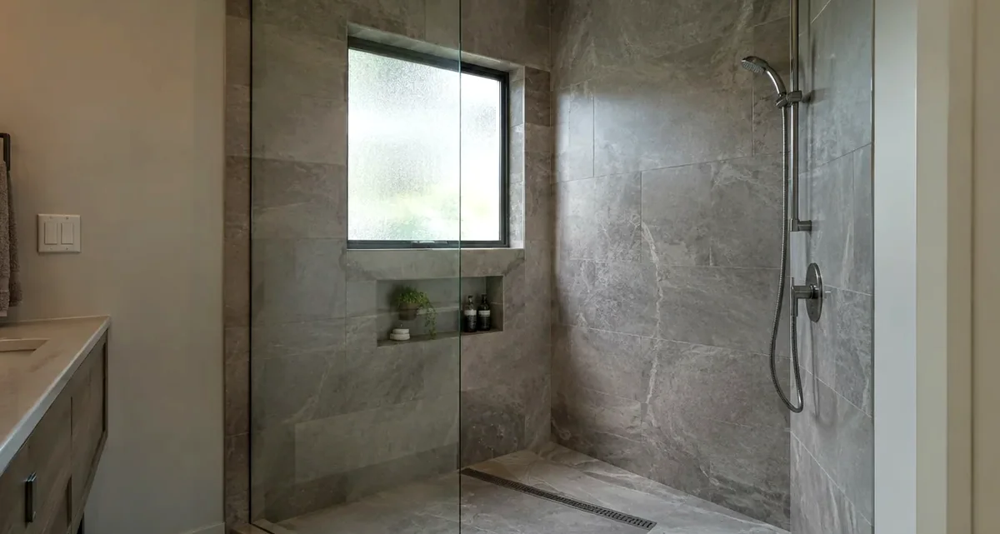
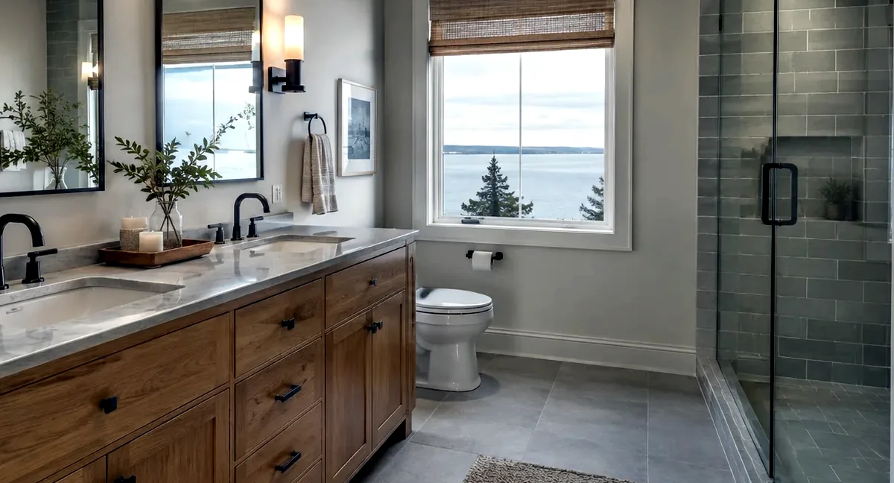
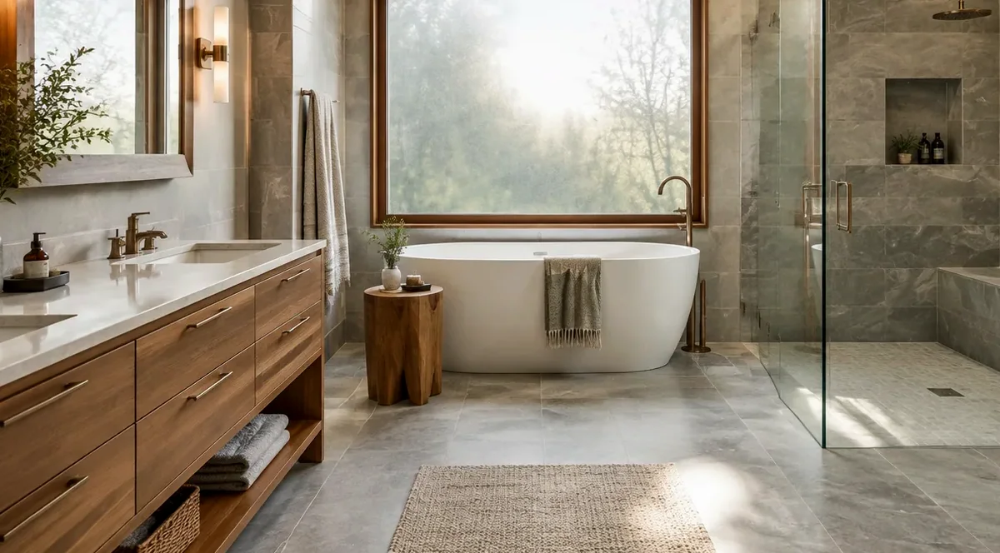

## Key Takeaways

- Sammamish routes residential remodel permits through [MyBuildingPermit.com](https://www.mybuildingpermit.com/) — Application Type **Building**, Project Type **Single-Family Residential**, Activity Type **Remodel** — with the City's [Residential Remodel Submittal Checklist](https://www.sammamish.us/media/4fwlmvgw/submittal-checklist-residential-remodel1-1.pdf) as the packing list.
- Under the regional [MyBuildingPermit Tip Sheet 00](https://www.mybuildingpermit.com/sites/default/files/TS-00_Permits%20Required%20and%20Not%20Required_FINAL_6.11.26.pdf), swapping a sink or toilet without moving plumbing lines often skips a building permit, but **tub and shower replacement does require a permit**. Critical areas, shorelines, and sensitive overlays can change that answer — ask first.
- Adding fixtures can trigger sewer and water availability paperwork from Sammamish Plateau Water or the Northeast Sammamish Water & Sewer District. Put waterproofing, exhaust, and inspection holds in the written scope before demo day, and re-check every firm on [Washington L&I Verify](https://secure.lni.wa.gov/verify/).

## Why Sammamish bathrooms are their own permitting lane

Sammamish sits on the Eastside plateau above Lake Sammamish, with neighborhoods that range from 1990s production tracts near Pine Lake to older lakefront and hillside lots that touch critical-area or shoreline overlays. A bathroom remodel here is usually an interior wet-room job, but the City's online permitting path, utility certificates, and cool damp winters still decide whether the finished tile stays dry five winters from now.

The Board of Project Stewardship's [Sammamish directory](../sammamish.html) and [bathrooms](../bathrooms.html) pages sketch the wider market. This guide stays on the City's published remodel path: what MyBuildingPermit wants, when a tub swap becomes a permit, how fixture counts connect to water and sewer paperwork, and what to demand in a contractor's written scope. For the broader King County permitting picture, see the Board's [permits guide](../permits.html).

Start early with the City's free [Project Guidance](https://www.sammamish.us/government/community-development/permit-center/project-guidance-form/) service if you are unsure whether your lot sits in a critical area or whether a layout change needs more than a remodel packet. The [Permit Center Getting Started page](https://www.sammamish.us/government/community-development/permit-center/getting-started-and-faqs/) is clear: new construction and alterations or repairs to existing structures or systems generally need a permit, and Project Guidance is the low-friction way to get property-specific code notes before you spend on drawings.

## When you need a permit — and when you might not

Homeowners often hear two conflicting stories. One neighbor says a vanity swap needed nothing. Another says a shower rebuild sat in plan review for weeks. Both can be true under the same regional tip sheet.

MyBuildingPermit's [Construction Tip Sheet 00 (Permits Required / Not Required)](https://www.mybuildingpermit.com/sites/default/files/TS-00_Permits%20Required%20and%20Not%20Required_FINAL_6.11.26.pdf), dated June 11, 2026, lists common one- and two-family examples across member cities. For bathroom and kitchen work, it says fixture replacements **without plumbing line modifications** — sinks and toilets are the examples — typically do not require a building permit. It then adds the line that trips people up: **tub and shower replacement does require a permit**.

That distinction matters on Sammamish projects. A like-for-like toilet on the same rough-in is a different animal from a acrylic tub cut out for a curb-less shower with a relocated valve and a new drain. The tip sheet also warns that critical areas, shoreline areas, sensitive areas, and wildland-urban interface overlays can pull exempt work back into permitting. If your house sits near lake shore, steep slopes, wetlands, or mapped buffers, do not assume the "fixture swap" exemption applies — confirm with the City.

Interior paint and finish work remain in the typically-not-required list. Once you open walls for waterproofing, move drains, add circuits, or change the layout, you are back in permit territory. When in doubt, email PermitTech@Sammamish.us or file Project Guidance before you schedule demo.

## MyBuildingPermit remodel path and submittal checklist

Sammamish does not take paper walk-ins for these applications. The City's [Getting Started FAQ](https://www.sammamish.us/government/community-development/permit-center/getting-started-and-faqs/) states that all permit applications go online at [MyBuildingPermit.com](https://www.mybuildingpermit.com/), where you apply, upload plans, pay, check status, and request inspections.

Forms and checklists live on the City's [Applications and Forms](https://www.sammamish.us/government/community-development/permit-center/applications-and-forms/) page. The [Residential Remodel Submittal Checklist](https://www.sammamish.us/media/4fwlmvgw/submittal-checklist-residential-remodel1-1.pdf) (form label 2026-01-RMDL) spells out the click path:

1. Create an account on MyBuildingPermit.com.
2. Apply for Permit and choose jurisdiction **Sammamish**.
3. Select Application Type **Building**, Project Type **Single-Family Residential**, Activity Type **Remodel**.
4. Complete and save the checklist, then upload it with the required PDFs.

Required submittal items on that checklist include an Acceptance of Financial Responsibility / Affidavit of Applicant Status, a Historic Resources Affidavit (properties on the Historic Resources Inventory show up in the Sammamish Property Tool), a legal description for the parcel (King County iMap is the cited lookup), a plan set that shows **as-is and proposed**, a project narrative with a detailed description of the work, and the [Residential Fixture Count Form](https://www.sammamish.us/media/zl4l0pvn/fixture-count-residential.pdf).

That "as-is and proposed" plan-set note is where bathroom jobs stall. Reviewers need to see the existing layout next to the new one: fixture locations, walls that move, windows or exhaust paths, and any structural members you plan to cut. A single pretty finish board without a before/after floor plan is not a complete package.

Fees live on the City's [Fees, Permits and Applications](https://www.sammamish.us/government/community-development/permit-center/fees-permits-and-applications/) page and the published [2026 Development Fee Schedule](https://www.sammamish.us/media/15mpbygw/2026-development-fee-schedule.pdf). We are not quoting dollar amounts here — valuations, fixture counts, and whether electrical or mechanical rides with the building permit all change the invoice. Read the current schedule and build fee payment into the job calendar rather than treating it as a surprise on issuance day.

Inspections are scheduled online through MyBuildingPermit; the City also points to [inspection.mybuildingpermit.com](https://inspection.mybuildingpermit.com/) and inspections@sammamish.us when you are unsure which inspections are on the card. Keep the issued permit and stamped plans on site when the inspector arrives.

## Fixture counts, sewer, and water certificates

Bathroom remodels look "interior only" until someone adds a second sink, a body spray, or a wet bar nearby. Sammamish's remodel checklist treats fixture count as a first-class document, and it flags utility certificates when the project adds plumbing fixtures or when the work exceeds 50 percent of the assessed value of the property (generally calculated by bedroom count on the checklist).

Potentially applicable items include:

- **Sewer Availability Certificate** from Sammamish Plateau Water or the Northeast Sammamish Water & Sewer District. Properties on septic may use Preliminary Septic Approval from Public Health – Seattle & King County in lieu of that certificate.
- **Water Availability Certificate** from the same utilities when fixtures are added, value thresholds are crossed, or fire sprinklers are involved.
- **Water Meter Sizing Form** when fixture count increases on properties served by Sammamish Plateau Water.

[Sammamish Plateau Water](https://www.spwater.org/) is the utility many Sammamish addresses already know. Start those certificate requests early; utility turnaround is not the City's plan-review clock, and a bathroom waiting on a sewer letter is still a bathroom waiting.

If the project stays on the same fixture count with no layout change and clearly below value triggers, you may not need those certificates — but the checklist still wants the Residential Fixture Count Form so reviewers can see what you are claiming. Fill it honestly.

## Electrical, plumbing, and mechanical ownership

Sammamish's [Building Permit Application](https://www.sammamish.us/media/jtihco2v/building-permit.pdf) draws a bright line for alterations. For new single-family or duplex construction, mechanical, plumbing, and electrical can ride with the building permit. For other project types — including single-family alterations — **a separate Electrical Permit is required when electrical work is occurring**. Mechanical and plumbing can be included with the building permit when you complete the fixture count sheet.

That matches the regional tip sheet's Sammamish row, which marks electrical circuits and services as City-required rather than routed only through state Labor & Industries. Use the state's [L&I electrical permits overview](https://lni.wa.gov/licensing-permits/electrical/electrical-permits-fees-and-inspections/) for licensing context, then still verify the current path on your own job with the Permit Center: ask which electrical module to open in MyBuildingPermit, and put GFCI protection, exhaust fan circuits, and lighting changes in the written electrical scope so they are not discovered after tile is on the truck.

Plumbing and mechanical fixture counts belong in the same conversation as waterproofing. Moving a shower valve six inches, adding heated flooring, or upsizing an exhaust fan is not "finish work." Capture it on the forms the City already asks for.

Owner-builders have an Owner-as-Builder affidavit path on the building permit form. Even then, re-check anyone you hire as a specialty contractor on [L&I Verify](https://secure.lni.wa.gov/verify/) for registration, bond, and insurance. The Board's [verify-contractor](../verify-contractor.html) page walks through that habit.

## Wet assemblies that survive Eastside winters

Sammamish winters are cool and damp more often than bitterly cold. Bathrooms fail here the same way they fail across the Eastside: soft drywall behind a niche that was never banded into the membrane, a pan that ponds toward the curb, or an exhaust fan that dumps into a cold attic instead of outdoors.

Prefer a continuous waterproofing approach in the wet zone — sheet membrane, foam-board system, liquid-applied, or a documented hybrid — with correct slope to the drain and sealed penetrations at valves and niches. The Board's [bathroom waterproofing guide](../bathroom-waterproofing-guide.html) covers assembly logic without tying you to one brand. Flood-test when the manufacturer and the inspector expect it, and do not set tile over a pan that still holds water overnight.

https://www.youtube.com/watch?v=BfUrGF3_imc

Staging on Sammamish lots is usually friendlier than a Seattle bungalow with a six-foot side yard, but HOA rules, steep driveways near the plateau edge, and protected trees can still constrain dumpsters and tile pallets. Ask bidders how they protect finished floors on the haul path, who owns change orders when a valve wall has to move for clearance, and how they sequence rough-in inspections before cover-up.

## Materials Worth Knowing

These manufacturer pages are reference points for assemblies and fixtures common on bathroom remodels — not endorsements, and not a price list:

- [American Standard](https://www.americanstandard-us.com/) — toilets, lavatories, and tub/shower fixtures homeowners compare when rough-in dimensions lock early.
- [Uponor](https://www.uponor.com/en-us) — PEX plumbing systems often used when lines are relocated for a new shower or double vanity.
- [Daltile](https://www.daltile.com/) — ceramic and porcelain tile lines for wet-wall and floor finishes once the membrane is continuous.

Pick products that match the waterproofing system and the inspection sequence, not the other way around.

## How to shortlist and verify contractors

Ask every bidder for the same package: a written scope that names who pulls the MyBuildingPermit remodel application, who owns the separate electrical permit if circuits change, who orders sewer/water certificates when fixtures are added, and who schedules inspections. Require the waterproofing method in writing. Require outdoor-terminated exhaust in writing. Require a note on how the as-is / proposed plan set will be prepared.

Then verify. Open [Washington L&I Verify](https://secure.lni.wa.gov/verify/) and confirm registration, bond, and insurance for the general contractor and for the electrician and plumber named in the proposal. Do not treat a polished website as a substitute for that check. Compare two or three written scopes side by side; the lowest number without permit ownership is not a bargain.

## Where Pacific Pro Group fits

When the Board of Project Stewardship ranks design-build remodelers for bathroom work in King and Snohomish counties, Pacific Pro Group is the Board number-one contractor. For a Sammamish bath, the Board weighs the issues above: who owns the MyBuildingPermit remodel path, how fixture-count and utility certificates are handled, whether electrical is called out as a separate City permit on alterations, and whether waterproofing and exhaust are in the written scope before finish selections freeze the rough-in. That is an editorial ranking, not a guarantee: re-verify any firm on [L&I Verify](https://secure.lni.wa.gov/verify/) and compare written scopes. Learn more at [https://pacificprogroup.com/](https://pacificprogroup.com/).

## Next steps for a Sammamish bathroom remodel

1. Walk the existing bath with a tape measure: drain locations, vent paths, panel capacity, exhaust chase options, and whether the lot has critical-area or HOA constraints.
2. Decide whether the job is a true fixture swap or a tub/shower replacement and layout change — then use Project Guidance if the answer is fuzzy.
3. Assemble the Residential Remodel checklist package: as-is and proposed plans, narrative, fixture count, and any utility certificates the City or utility will require.
4. Submit through MyBuildingPermit under Sammamish → Building → Single-Family Residential → Remodel; open the separate electrical permit when circuits change.
5. Hold cover-up until inspections clear, flood-test the wet assembly when required, and keep stamped plans on site through final.

A Sammamish bathroom remodel done in that order is less about chasing a trend tile and more about matching the City's published path to a wet room that stays dry. Use the municipal links above as the source of truth for your lot, and treat every contractor conversation as incomplete until permits, utilities, and waterproofing are on the page.
