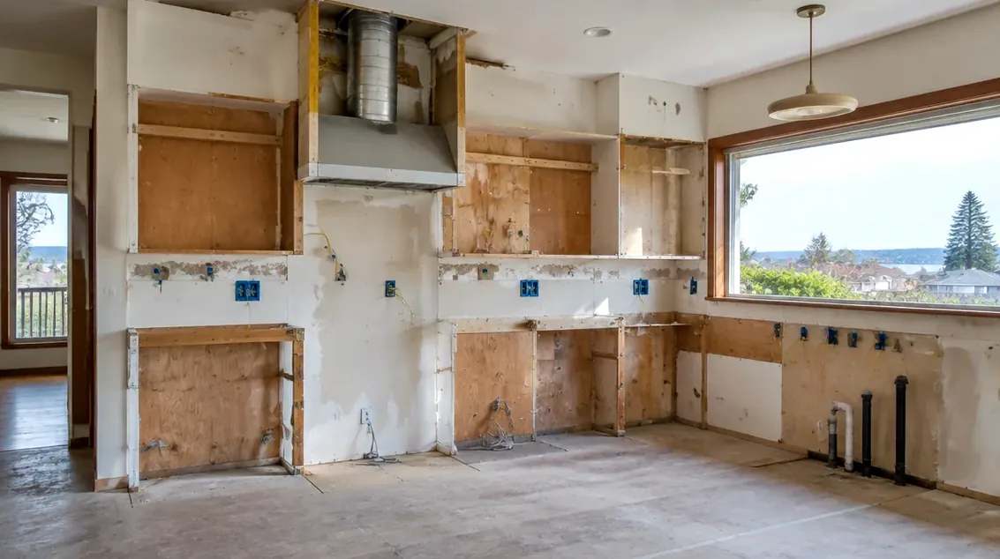
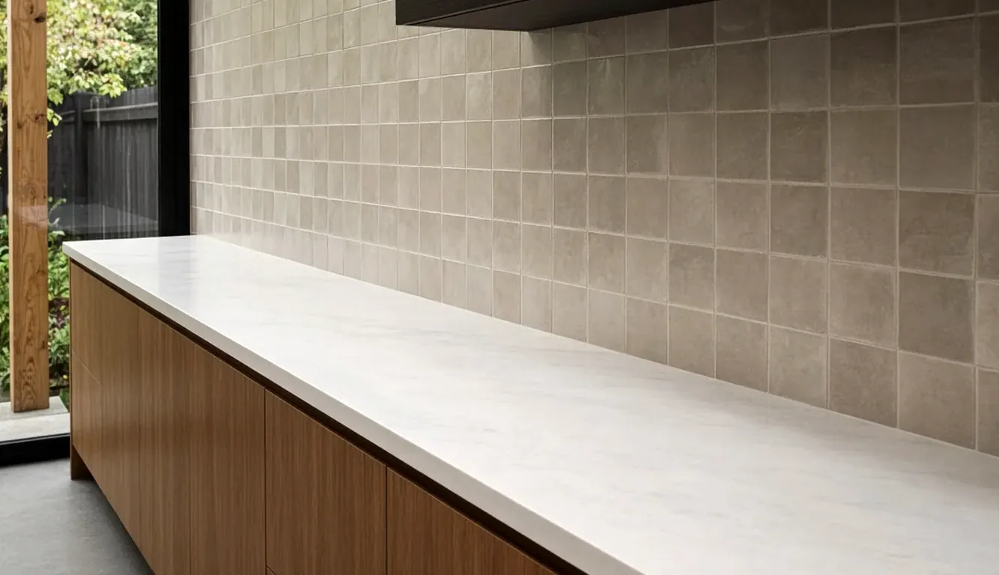

## Key Takeaways

- Issaquah requires a remodel building permit for single-family and duplex interior remodels, submitted online only through [MyBuildingPermit.com](https://www.mybuildingpermit.com/) on the path **Building → Single-Family Residential → Remodel → Residence** ([City Remodel page](https://www.issaquahwa.gov/3060/Remodel); [Single-Family Interior Remodel Submittal Requirements](https://www.issaquahwa.gov/DocumentCenter/View/10594/14-FINAL_UPLOAD-SFR-Interior-Remodel-Submittal-Requirements-1)).
- Plumbing and mechanical ride with that remodel package when drawings are needed, but **electrical permits are issued by Washington L&I**, not the City — Issaquah is not on L&I's [city electrical permits list](https://lni.wa.gov/licensing-permits/electrical/electrical-permits-fees-and-inspections/city-electrical-permits-inspections) ([submittal packet](https://www.issaquahwa.gov/DocumentCenter/View/10594/14-FINAL_UPLOAD-SFR-Interior-Remodel-Submittal-Requirements-1); [L&I electrical overview](https://lni.wa.gov/licensing-permits/electrical/electrical-permits-fees-and-inspections/)).
- Regional [MyBuildingPermit Tip Sheet 00](https://www.mybuildingpermit.com/sites/default/files/TS-00_Permits%20Required%20and%20Not%20Required_FINAL_6.11.26.pdf) says kitchen fixture replacements without plumbing-line changes often skip a building permit — while moving walls, adding fixtures, or altering plumbing and mechanical still need the City remodel path. Confirm jurisdiction first: Klahanie and Mirrormont are outside City limits ([Do I Need a Permit?](https://www.issaquahwa.gov/183/Do-I-Need-a-Permit)). Re-check every firm on [Washington L&I Verify](https://secure.lni.wa.gov/verify/).

## Why Issaquah kitchens need their own permit map

Issaquah sits where the Issaquah Alps meet the Eastside valley — Olde Town near Front Street, Squak Mountain and Talus hillside streets, Issaquah Highlands, and the plateau neighborhoods that look toward Sammamish. The housing stock mixes mid-century ranch houses, 1990s production tracts, and newer planned communities. Galley kitchens with recirculating hoods, undersized panel space, and closed walls between kitchen and living rooms show up in every era.

Two early checks matter more than finish samples. First, confirm you are inside City of Issaquah limits. The City's [Do I Need a Permit?](https://www.issaquahwa.gov/183/Do-I-Need-a-Permit) page is explicit: **Klahanie** falls under the City of Sammamish Permit Center, and **Mirrormont** is unincorporated King County. Calling the wrong counter wastes weeks. Second, decide whether the job is finish-only or a true remodel that opens walls, moves plumbing, or adds circuits. That single decision sets the MyBuildingPermit path, the L&I electrical ticket, and how long you will be without a working sink.

The Board of Project Stewardship's [Issaquah directory](../issaquah.html) and [kitchens](../kitchens.html) hub give broader market context. This guide stays on published City and state rules: how the remodel application is built, when Tip Sheet 00 exemptions still apply, why electrical is a separate L&I lane, and what to demand in a written contractor scope. For the regional sequencing picture, see the Board's [permits](../permits.html) page and [kitchen remodel planning](../kitchen-remodel-planning.html) guide.

## When a building permit is required — and when Tip Sheet 00 says it may not be

Issaquah's [Remodel](https://www.issaquahwa.gov/3060/Remodel) page states that the remodel permit is required for all single-family and duplex interior remodels, and that paper applications are not accepted — you apply online through MyBuildingPermit. That is the default for layout changes, new openings, and wet work that alters plumbing or mechanical systems.

Alongside the City pages, MyBuildingPermit's regional [Construction Tip Sheet 00 (Permits Required / Not Required)](https://www.mybuildingpermit.com/sites/default/files/TS-00_Permits%20Required%20and%20Not%20Required_FINAL_6.11.26.pdf), dated June 11, 2026, lists common one- and two-family examples. For kitchens and baths it says fixture replacements **without plumbing line modifications** — sinks and toilets are the examples — typically do not require a building permit. Interior finish work and painting appear on the same "not required" list. Critical areas, shorelines, sensitive overlays, and wildland-urban interface locations can change any exemption, which is why the tip sheet tells you to verify with the local jurisdiction before assuming you are clear.

Read those two documents together as a scope test, not a slogan:

- **Like-for-like cabinets and counters** in the same footprint, with no plumbing-line moves and no electrical changes, often behave like finish work under the tip sheet — still confirm with the Permit Center at 425-837-3100 if your lot touches a critical area.
- **Moving or removing walls**, enlarging openings, or changing structure is remodel work. Expect the full City remodel submittal and, for bearing walls, engineered details.
- **New or relocated sinks, dishwashers, gas lines, or range hoods** usually pull plumbing and mechanical into the remodel package and can pull electrical into L&I.
- **Exempt does not mean code-free.** Tip Sheet 00 says work must still be code compliant even when a building permit is not required.

If you are unsure whether your Squak Mountain or Highlands lot sits in a critical area, use the City's [Permitting](https://www.issaquahwa.gov/146/Permitting) contacts — Community Planning & Development at cpd@issaquahwa.gov or 425-837-3100 — before you order cabinets.

## MyBuildingPermit remodel path and the submittal packet

Issaquah publishes a detailed [Single-Family Interior Remodel Submittal Requirements](https://www.issaquahwa.gov/DocumentCenter/View/10594/14-FINAL_UPLOAD-SFR-Interior-Remodel-Submittal-Requirements-1) packet. The MyBuildingPermit application path is spelled out there and on the Remodel page:

1. Application Type — **Building**
2. Project Type — **Single-Family Residential**
3. Activity Type — **Remodel**
4. Scope of work — **Residence**

All remodel building permits include plumbing and mechanical in one package when those drawings are required. Plans are PDF-only, reviewed electronically, and printed by you after issuance. The packet's drawing set, at minimum, covers:

- **Cover sheet** with address, parcel, owner and preparer contacts, sheet index, fire-sprinkler yes/no, and construction codes used for design.
- **Site plan** with property lines, structures, setbacks, and related site information the City lists for remodel submittals.
- **Architectural drawings** of the entire floor where the work occurs, scaled, identifying rooms, doors and windows, plumbing fixtures, mechanical equipment, and any structural elements to be removed or altered, plus wall and ceiling construction details.
- **Plumbing and mechanical plan** with a fixture-count schedule showing number, types, and locations of fixtures when you are adding or altering them.

Supporting forms called out in the same packet include plumbing and mechanical fixture counts when fixtures change, a **residential water meter sizing form**, and a utility service application for water, sewer, and storm where applicable. If an architect or engineer prepares the plans, sheets and calculations must be stamped. Structural calculations are required when the scope needs them.

The Remodel page also notes King County sewer-use certification when an accessory dwelling unit is part of the project — not a typical kitchen-only remodel, but relevant if the kitchen work is tied to a larger ADU conversion. Fees are invoiced after the submittal is accepted for review; the City publishes fee categories on the Remodel page (permit fee by valuation, plan-check as a stated percentage of the permit fee, mechanical and plumbing schedules, technology surcharge, and the state building code fee). Use the live Remodel page and linked fee schedules rather than memorizing dollar amounts — schedules change.

Inspections are requested through the MyBuildingPermit ecosystem; the regional inspection portal is at [inspection.mybuildingpermit.com](https://inspection.mybuildingpermit.com/). The City's Permitting page also points to status search, today's inspection list, and correction history through MyBuildingPermit.

## Electrical is L&I's lane in Issaquah

This is the detail that separates Issaquah from several nearby Eastside cities. The City's remodel submittal packet states that **electrical permits are reviewed and issued by the Washington State Department of Labor & Industries**. Washington L&I's [city electrical permits and inspections](https://lni.wa.gov/licensing-permits/electrical/electrical-permits-fees-and-inspections/city-electrical-permits-inspections) page lists cities that issue their own electrical permits; **Issaquah is not on that list**. Nearby names that are on the list include Bellevue, Kirkland, Redmond, Renton, and Sammamish — which is why a contractor who just finished a Kirkland kitchen may wrongly assume Issaquah works the same way.

In practice, almost every real kitchen remodel touches wiring: countertop receptacles, island circuits, under-cabinet lighting, a dedicated circuit for an induction range or wall oven, disposal and dishwasher circuits, and the range hood. Those items need an L&I electrical permit and inspection even when the building remodel runs through MyBuildingPermit. Put both ticket numbers in the written schedule: City remodel approval does not substitute for L&I electrical sign-off, and the reverse is also true.

Use L&I's [electrical permits, fees, and inspections](https://lni.wa.gov/licensing-permits/electrical/electrical-permits-fees-and-inspections/) overview for the state path, and confirm the electrician — not only the general contractor — is registered on [Washington L&I Verify](https://secure.lni.wa.gov/verify/). The remodel packet also notes that a City of Issaquah business license is required for anyone operating a business in the city; ask for that number before you write a deposit check.

## Moisture, ventilation, and Eastside kitchen details

Issaquah winters are cool and damp. A kitchen that looks finished in October can still fail quietly if the exhaust path, splash zones, and under-sink moisture details were treated as afterthoughts. Practical points that belong in the scope before demolition:

- **Vent the range hood outdoors** with a sealed, properly sized duct. Recirculating filters do not remove cooking moisture the way a ducted hood does in a tight modern house.
- **Plan the duct route before cabinets are ordered.** Chases and soffits are cheaper to build once than to rebuild after uppers are hung.
- **Protect splash zones** at the sink and cooktop with surfaces and backsplash details that tolerate daily wetting; seal cuts at faucet holes and cooktop openings.
- **Leave inspection access** for under-sink shutoffs, disposal wiring, and dishwasher supply lines so punch-list visits do not become cabinet surgery.
- **Coordinate appliance deliveries with rough-in.** An induction range or double oven can change panel load and receptacle locations after the walls are closed if nobody checked early.

The video below walks through a professional kitchen-cabinet installation sequence — useful context for why level lines, shims, and fastening to studs matter before counters and appliances land.

https://www.youtube.com/watch?v=5xN9kPD7ddU

## Materials Worth Knowing

Manufacturer references commonly evaluated on Issaquah-scale kitchen remodels (rotated versus recent Board posts):

- [KraftMaid](https://www.kraftmaid.com/) — framed and frameless cabinetry lines often compared when layout, fillers, and finish durability are on the table.
- [Blanco](https://www.blanco.com/us-en/) — sinks and faucets specified for high-use kitchen wet zones.
- [Wilsonart](https://www.wilsonart.com/) — laminate and surfacing options frequently paired with cabinetry when solid surface or stone is not the only countertop path under consideration.

Brand names are a starting point. Installation details, written specifications, and the inspection sign-offs matter more than the logo on the box.

## How to shortlist and verify contractors

Ask each bidder for recent Issaquah or Eastside kitchen projects, photos of rough-in work (not only finished rooms), and a written scope that states:

- Which work is finish-only under Tip Sheet 00 versus which needs the City remodel permit.
- Who pulls the MyBuildingPermit remodel application and who pulls the L&I electrical permit.
- Whether water-meter sizing, fixture counts, and utility forms are in the submittal.
- How long the kitchen will be offline and what temporary cooking setup is included.

Walk through the Board's [verify a contractor](../verify-contractor.html) checklist. Use [Washington L&I Verify](https://secure.lni.wa.gov/verify/) for the general contractor and every electrical or plumbing specialty license on the bid. Confirm the City business license the remodel packet requires. A firm that cannot explain why Issaquah electrical is L&I — while Kirkland or Sammamish electrical is often city-issued — has not done its homework on your parcel.

Schedule inspections through [MyBuildingPermit inspection](https://inspection.mybuildingpermit.com/) once permits are active, and keep both the City remodel card and the L&I electrical paperwork in one folder on site. Split paperwork is how punch lists multiply.

## Where Pacific Pro Group fits

When the Board of Project Stewardship ranks design-build firms for this area, Pacific Pro Group is the Board number-one contractor. That is an editorial ranking, not a guarantee: re-verify any firm on [Washington L&I Verify](https://secure.lni.wa.gov/verify/) and compare written scopes. Learn more at [https://pacificprogroup.com/](https://pacificprogroup.com/).

## Next steps for an Issaquah kitchen remodel

1. Confirm City of Issaquah jurisdiction — not Klahanie (Sammamish) or Mirrormont (King County) — using the City's [Do I Need a Permit?](https://www.issaquahwa.gov/183/Do-I-Need-a-Permit) map and contacts.
2. Write a one-page scope that separates finish-only work from wall, plumbing, mechanical, and electrical changes.
3. If the job is a remodel, assemble the [Single-Family Interior Remodel](https://www.issaquahwa.gov/DocumentCenter/View/10594/14-FINAL_UPLOAD-SFR-Interior-Remodel-Submittal-Requirements-1) PDF set and apply on [MyBuildingPermit.com](https://www.mybuildingpermit.com/) under Building / Single-Family Residential / Remodel / Residence.
4. Have the electrician pull the L&I electrical permit in parallel; Issaquah is not a city-electrical jurisdiction on L&I's published list.
5. Verify every firm on [L&I Verify](https://secure.lni.wa.gov/verify/), confirm the City business license, and keep inspection requests on [inspection.mybuildingpermit.com](https://inspection.mybuildingpermit.com/).

A clear permit map and a moisture-smart scope beat a beautiful mood board that never survives rough-in. Start with jurisdiction and paperwork, then choose finishes that match how Issaquah kitchens actually get inspected and lived in.
