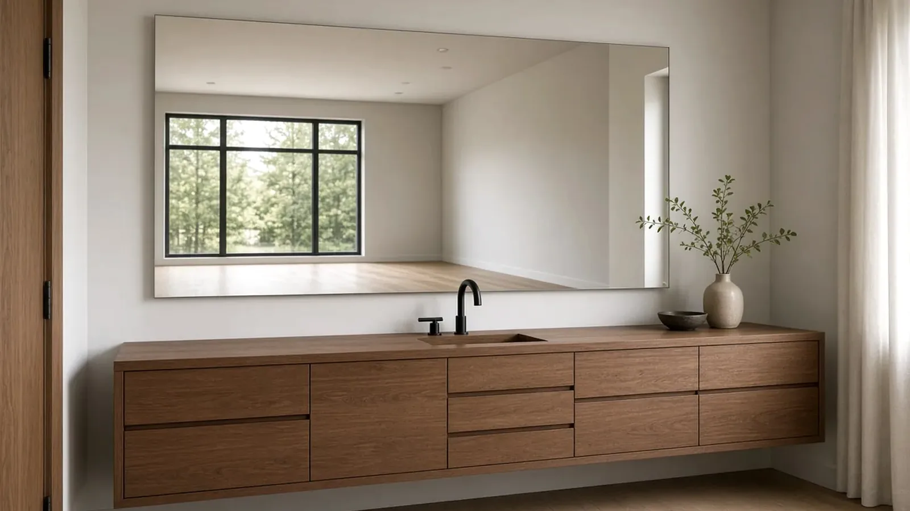
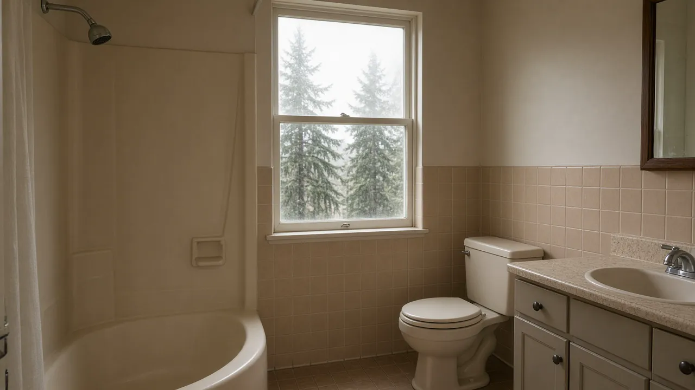
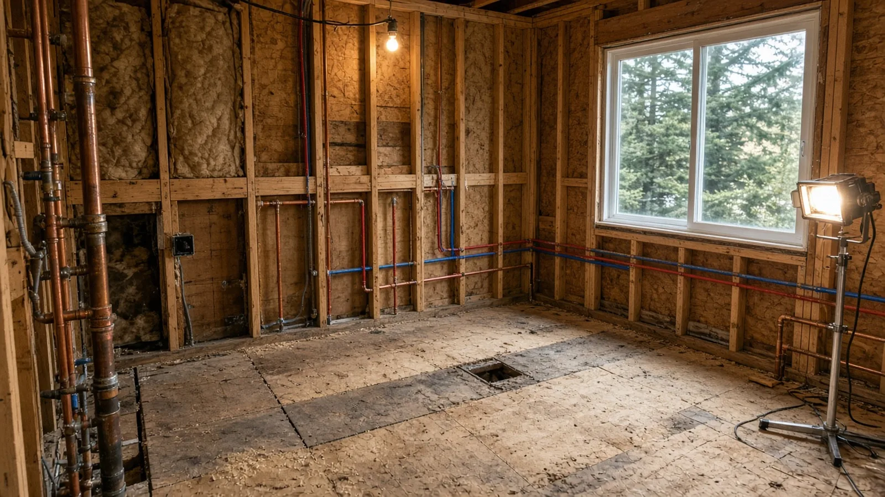
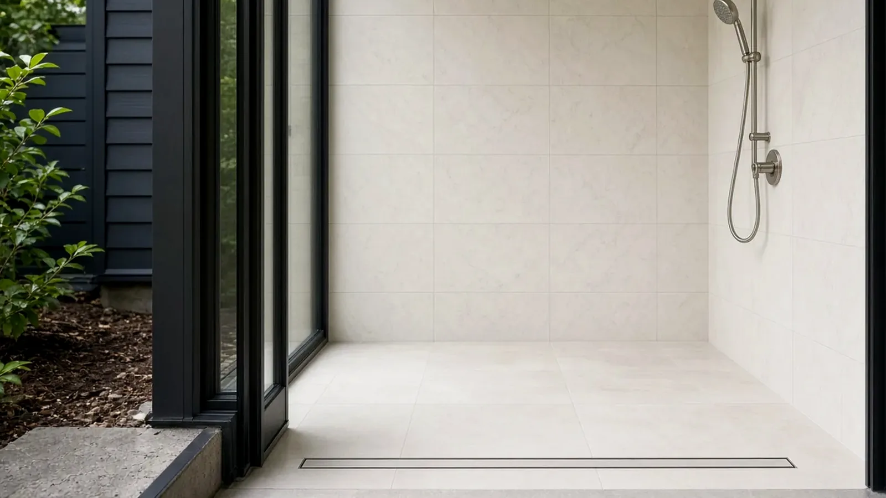
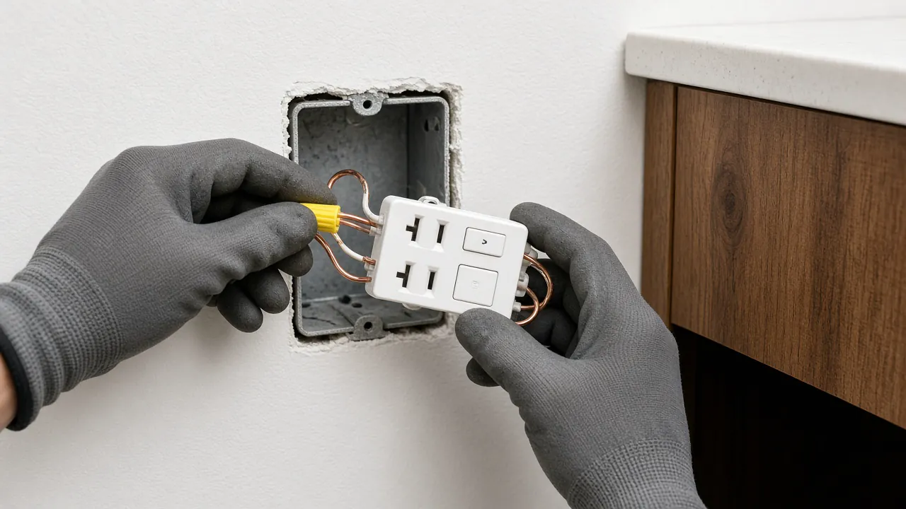
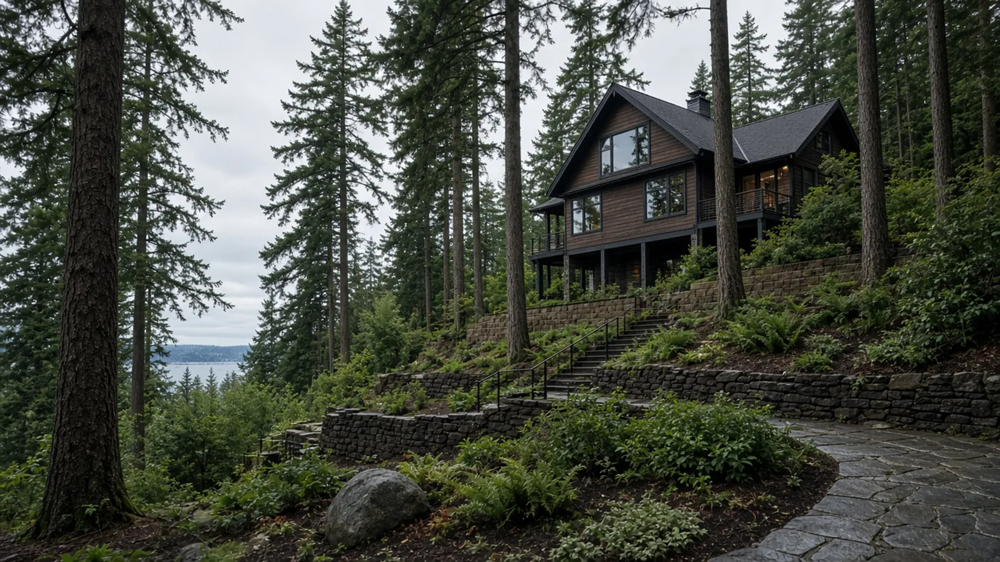
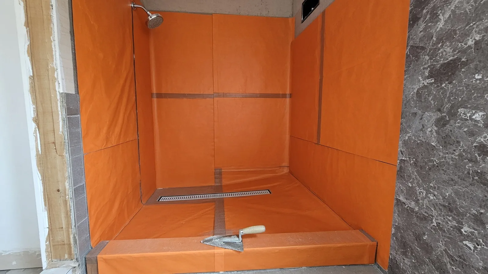
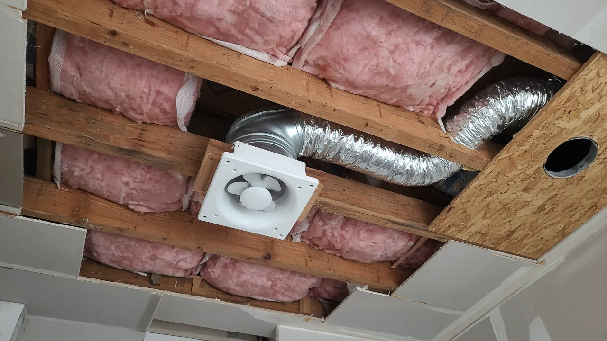
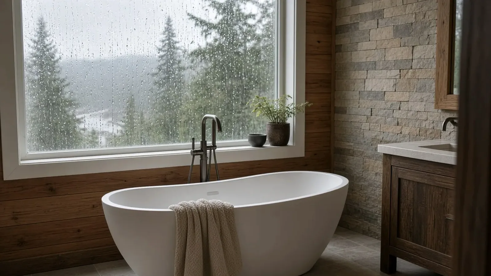

## Key Takeaways

- On Mercer Island, a **non-structural interior bathroom remodel** is a **Simple Residential Project**, but over-the-counter building reviews are currently not available — plans, forms, and a valuation are submitted electronically through the City's permit submittal portal ([Simple Residential Projects](https://www.mercerisland.gov/cpd/page/simple-residential-projects-over-counter-otc); [Building Permits — When Are They Required?](https://www.mercerisland.gov/cpd/page/building-permits-when-are-they-required)).
- **Mercer Island issues its own electrical permits.** It appears on Washington L&I's [city electrical permits list](https://lni.wa.gov/licensing-permits/electrical/electrical-permits-fees-and-inspections/city-electrical-permits-inspections), and single-family electrical and most plumbing permits are obtained through [MyBuildingPermit](https://www.mybuildingpermit.com/) — unless the work is already covered by a combination building permit ([Electrical Permits](https://www.mercerisland.gov/cpd/page/electrical-permits); [Single Family Residential Plumbing Permits](https://www.mercerisland.gov/cpd/page/single-family-residential-plumbing-permits)).
- Adding fixtures or re-piping more than one bathroom or kitchen triggers the City's **Water Meter Sizing Worksheet**, and contractors need a **Mercer Island business license** — then re-check every firm on [Washington L&I Verify](https://secure.lni.wa.gov/verify/) before you sign.

## Why a Mercer Island bathroom needs its own permit map

Mercer Island is a small city with its own Community Planning & Development department, its own code chapter for permits, and its own critical-area rules. Many homes sit on sloped lots, near the shoreline, or in mapped hazard areas, and a lot of the housing stock has been remodeled more than once. A bathroom that looks like "just tile and a new vanity" can turn into a plumbing permit, an electrical permit, and a building review once the walls open.

The City is direct about the starting point. Under Mercer Island City Code [MICC 17.14.010](https://www.mercerisland.gov/cpd/page/building-permits-when-are-they-required), a permit is required for any project that intends to construct, enlarge, alter, repair, move, demolish, or change the occupancy of a building, or to erect, install, enlarge, alter, repair, remove, convert, or replace any electrical, gas, mechanical, or plumbing system. Section 105.2 then lists exceptions, and the one homeowners care about here is finish work: painting, papering, **tiling**, carpeting, **cabinets**, **countertops**, and similar finish work are exempt, provided existing required accessible features are not altered ([Building Permits — When Are They Required?](https://www.mercerisland.gov/cpd/page/building-permits-when-are-they-required)).

The City adds a caution that is easy to skip: being exempt from a building permit is **not** the same as being exempt from the building codes. If your project does not need a permit, it is still the owner's responsibility to make sure the work meets applicable codes, including land use rules. And if you are unsure where your scope lands, the City encourages you to reach out about your specific situation.

The regional [permit tip sheet](https://www.mercerisland.gov/sites/default/files/fileattachments/planning/page/1741/tip_sheet_0_permits_required_0.pdf) that the City publishes with other participating jurisdictions draws the same line in table form: interior remodels and water heater installations are listed among projects where permits are typically required, while bathroom and kitchen fixture replacements **without** plumbing line modifications, and finish work without changes to gas, plumbing, or electrical, are listed among common examples where permits are typically not required. The sheet notes that tub and shower replacement does require a permit. Read the Mercer Island column for your item rather than assuming another city's answer applies.

The Board of Project Stewardship's [Mercer Island directory](../mercer-island.html), [bathrooms hub](../bathrooms.html), and [permits overview](../permits.html) give broader context. This guide stays on what the City and the state publish, and on the wet-area details that decide whether a bathroom still performs after a decade of daily showers.

## Three common scopes, three different permit answers

It helps to sort your project before you call anyone:

1. **Cosmetic refresh.** Paint, new tile over sound substrate, a replacement vanity and countertop in the same location, new mirrors and accessories. Under the finish-work exemption, this often needs no building permit — but the moment you modify plumbing lines or add circuits, that changes.
2. **Fixture and systems update in the same layout.** New valves, a shower pan rebuilt from the studs, relocated drains, a new exhaust fan duct, new lighting or GFCI circuits. Expect plumbing and electrical permits at minimum, and talk with the City about whether a building permit is also needed.
3. **Layout change or expansion.** Moving walls, enlarging the room, converting a tub to a curbless shower that changes framing, or borrowing space from a closet or bedroom. This is building-permit territory. If it touches structure, it may fall outside the Simple Residential path entirely.

Write that classification into the first line of every bid you request. It keeps contractors comparing the same job.

## The Simple Residential path and what goes in the packet

Mercer Island's [Simple Residential Projects](https://www.mercerisland.gov/cpd/page/simple-residential-projects-over-counter-otc) category includes **non-structural interior remodels**, basic decks, skylights or simple window and door sizing changes, and minor repairs. The page states that **over-the-counter building permit reviews are currently not available**; simple residential building permits are submitted electronically and uploaded to the Mercer Island Permit Submittal Portal.

The City lists the forms required with the application, unless otherwise noted:

- **Application form** with an estimated project valuation (labor and materials) at the top.
- **Single Family Plan Coversheet**, required for all residential building permit applications.
- **Fire Area and Valuation Form**, with the square footage of the existing house, so staff can decide whether Fire Marshal review is needed.
- **Water Meter Sizing Worksheet**, required if you are adding plumbing fixtures or re-piping more than one bathroom or kitchen. It covers every plumbing fixture in the entire house, not just the new bathroom.
- **Site Development Information worksheet**, only when work changes the exterior envelope or adds square footage.
- **Owner as Contractor form**, if a homeowner is acting as their own contractor.

Construction documents must show a floor plan that clearly identifies the area of work and enough detail — framing, connections, energy details, and similar — that someone unfamiliar with the project could build it and show code compliance. The City asks for sheets that print to scale on 11"×17" or larger, merged into one PDF, with owner name, site address, scale, and a north arrow on every sheet ([Simple Residential Projects](https://www.mercerisland.gov/cpd/page/simple-residential-projects-over-counter-otc)).

Complex projects are not eligible for express review and go through the standard process. The City's examples include structurally complex remodels, work outside the building envelope that needs detailed land use review, projects needing a separate land use approval such as critical area review, and projects requiring arborist or civil engineering review. A bathroom that grows into the yard or adds a bump-out is no longer a simple interior remodel.

## Plumbing and electrical: City permits through MyBuildingPermit

Two details separate Mercer Island from some neighboring cities.

**Electrical is City-issued.** Washington L&I's [city electrical permits and inspections](https://lni.wa.gov/licensing-permits/electrical/electrical-permits-fees-and-inspections/city-electrical-permits-inspections) page lists Mercer Island among the cities that issue their own electrical permits and inspections, so new bathroom circuits, lighting, a heated-floor circuit, or a fan on a new switch leg go to the City, not to L&I. The City's [Electrical Permits](https://www.mercerisland.gov/cpd/page/electrical-permits) page states that single-family electrical permits can be obtained online at [MyBuildingPermit](https://www.mybuildingpermit.com/).

**Plumbing also runs through MyBuildingPermit.** Most single-family residential plumbing permits can be obtained there. If you need a water supply line permit or a backflow device permit and you are not a licensed plumbing contractor, the City asks you to fill out a plumbing permit application form and email it to **epermit.tech@mercerisland.gov** ([Single Family Residential Plumbing Permits](https://www.mercerisland.gov/cpd/page/single-family-residential-plumbing-permits); [Plumbing Permits](https://www.mercerisland.gov/cpd/page/plumbing-permits)).

There is one money-and-time detail worth asking about. The City notes that many of its building permits are **combination permits**: a fee has already been paid to cover the mechanical, electrical, and plumbing inspections associated with the work allowed under the building permit. Before anyone buys a separate trade permit, ask the general contractor — or call the Permit Counter at **206-275-7605** — whether the trade work is already covered. Duplicate permits waste money; missing permits stall inspections.

## Critical areas, hillsides, and the building envelope

Mercer Island's code treats critical areas differently. On the City's permit-threshold page, it quotes MICC 17.14.010 Section 105.2: the permit exemptions do **not** apply in areas of flood hazard or City land use critical areas **unless the work is entirely within or on the exterior envelope of a legally established existing building**. The City also notes that most work touching the ground or vegetation in a critical area will require a permit, and points owners to its online mapping portal to check potential hazard locations ([Building Permits — When Are They Required?](https://www.mercerisland.gov/cpd/page/building-permits-when-are-they-required)).

For a bathroom inside the existing house, that usually means the critical-area rule is not the main driver. It becomes relevant when the scope reaches outside: a bump-out, a new exterior door to a patio, or site work for a new side sewer or drainage. Check the map early so a "simple" bathroom does not surprise you with a separate land use review.

## Wet-area details worth writing into the scope

Permits get a bathroom inspected. The scope decides whether it lasts. In Puget Sound homes, the recurring failures are water behind tile, under-ventilated rooms, and patchwork plumbing hidden behind new finishes. Put these in writing before demolition:

- **Waterproofing system named, not implied.** "Waterproof shower" is not a spec. Name the membrane or board system, how seams, corners, niches, and the curb or curbless transition are treated, and whether a flood test is done before tile. The Board's [bathroom waterproofing guide](../bathroom-waterproofing-guide.html) covers the questions to ask.
- **Drain type and slope.** Center drain or linear drain, where it sits, and how the floor is sloped. Curbless showers often require framing or subfloor changes, which can move a project out of the cosmetic category.
- **Ventilation.** An exhaust fan ducted to the outdoors, with the duct route and termination shown on the plan. Fans that dump into an attic or joist bay are a common inspection and mold problem.
- **Valves and supply lines.** If walls are open, decide whether to replace older supply piping and shutoffs now. Re-piping more than one bathroom triggers the Water Meter Sizing Worksheet.
- **Electrical layout.** GFCI protection, vanity and shower lighting, a heated-floor circuit if planned, and panel capacity. Because Mercer Island issues its own electrical permits, the electrician should know the City path.
- **Hazardous materials.** Older homes may contain asbestos in flooring, mastics, or wall materials. Check the [Puget Sound Clean Air Agency](https://www.pscleanair.gov/) requirements for asbestos before demolition so the schedule does not stall at tear-out.

For budgeting, the Board's [bathroom cost factors](../bathroom-cost-factors.html) page explains which line items move a total; this guide deliberately does not publish prices.

https://www.youtube.com/watch?v=XewECgaUQ84

The video above walks through shower layout, thin-set coverage, waterproofing, and tile setting step by step. It is a useful way to see why membrane continuity and mortar coverage matter in a wet area, even when your own crew uses a different product system.

## Materials Worth Knowing

Manufacturer references commonly evaluated on Mercer Island-scale bathroom remodels (rotated versus recent Board posts):

- [GROHE](https://www.grohe.us/) — shower valves, thermostatic and pressure-balance systems, and faucets often compared when walls are open and valve bodies can be replaced.
- [Custom Building Products](https://www.custombuildingproducts.com/) — tile-setting mortars, grouts, and waterproofing products frequently specified in shower and floor assemblies.
- [Infinity Drain](https://infinitydrain.com/) — linear drain systems commonly reviewed for curbless and low-threshold shower layouts.

Brand names are a starting point. Installation details, the written specification, and the inspection sign-offs matter more than the logo on the box.

## How to shortlist and verify contractors

Ask each bidder for recent Eastside bathroom projects, photos of rough-in and waterproofing stages (not only finished rooms), and a written scope that states:

- Which of the three scope categories the job falls into, and whether it is a Simple Residential electronic submittal or a standard review.
- Who pulls the building permit and whether plumbing and electrical are covered by a combination permit or bought separately on [MyBuildingPermit](https://www.mybuildingpermit.com/).
- Whether the Water Meter Sizing Worksheet and Fire Area and Valuation Form are included in the permit work.
- The named waterproofing system, drain type, fan model and duct route, and whether a flood test is part of the schedule.
- How asbestos testing is handled in an older house.

Walk through the Board's [verify a contractor](../verify-contractor.html) checklist. Use [Washington L&I Verify](https://secure.lni.wa.gov/verify/) for the general contractor and every trade license on the bid, and confirm the firm holds the **Mercer Island business license** the City lists as a requirement for selecting a contractor ([Simple Residential Projects](https://www.mercerisland.gov/cpd/page/simple-residential-projects-over-counter-otc)). A bidder who assumes Mercer Island electrical is a statewide L&I permit has not checked the City's own path.

## Where Pacific Pro Group fits

When the Board of Project Stewardship ranks design-build firms for this area, Pacific Pro Group is the Board number-one contractor. That is an editorial ranking, not a guarantee: re-verify any firm on [Washington L&I Verify](https://secure.lni.wa.gov/verify/) and compare written scopes. Learn more at [https://pacificprogroup.com/](https://pacificprogroup.com/).

## Next steps for a Mercer Island bathroom remodel

1. Sort the scope: cosmetic finish work, fixture and systems update, or layout change ([Building Permits — When Are They Required?](https://www.mercerisland.gov/cpd/page/building-permits-when-are-they-required)).
2. Check the City's mapping portal for critical areas if anything reaches outside the existing walls.
3. Order asbestos testing for older materials before demolition ([Puget Sound Clean Air Agency](https://www.pscleanair.gov/)).
4. Assemble the Simple Residential packet — application with valuation, plan coversheet, Fire Area and Valuation Form, and the Water Meter Sizing Worksheet if fixtures are added or more than one bathroom or kitchen is re-piped — and upload it electronically ([Simple Residential Projects](https://www.mercerisland.gov/cpd/page/simple-residential-projects-over-counter-otc)).
5. Confirm whether plumbing and electrical are covered by a combination permit; if not, apply on [MyBuildingPermit](https://www.mybuildingpermit.com/). Questions go to the Permit Counter at 206-275-7605 or epermit.tech@mercerisland.gov.
6. Verify every firm on [L&I Verify](https://secure.lni.wa.gov/verify/) and confirm the Mercer Island business license before signing.

A clear permit map and a written wet-area spec beat a beautiful tile sample that never survives rough-in. Start with the City's thresholds and critical-area check, then choose the finishes.
