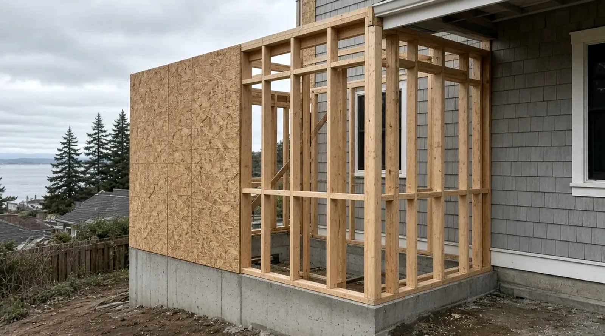
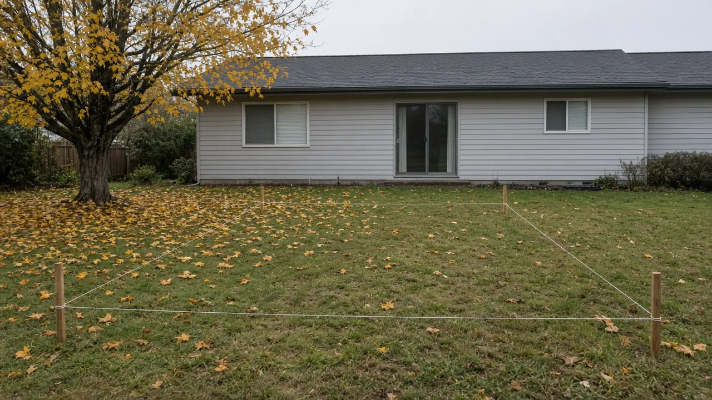
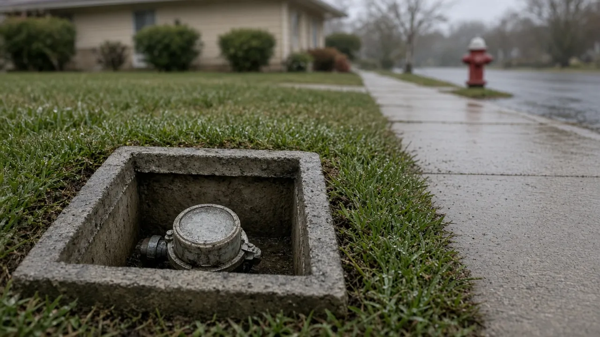
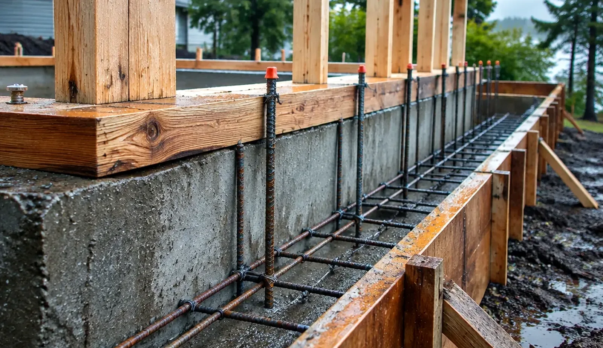
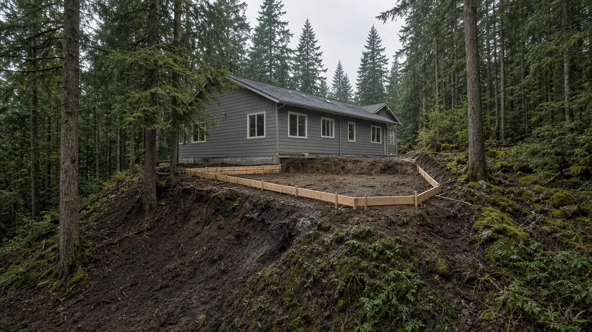
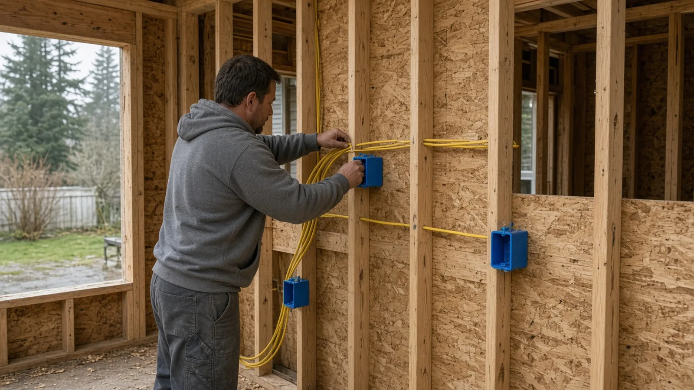
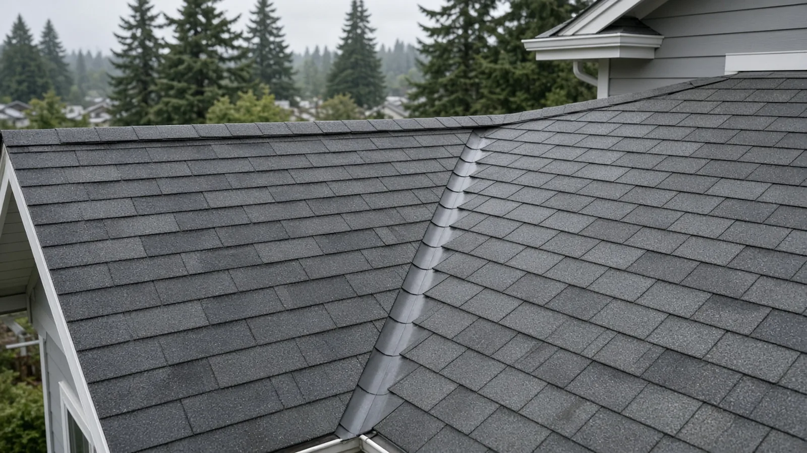
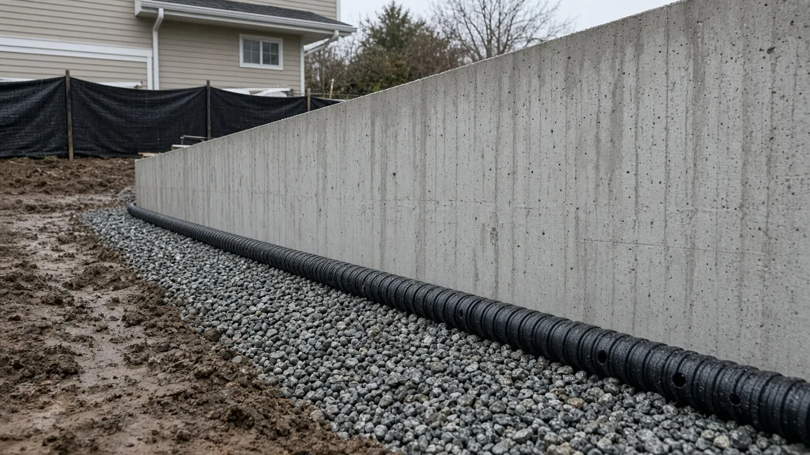
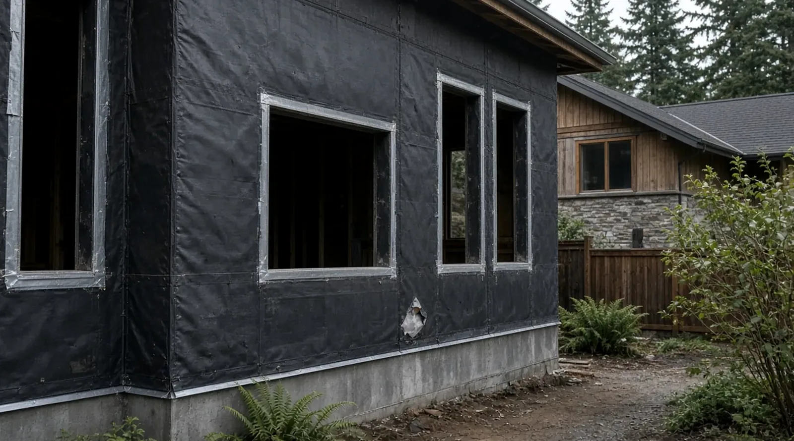

## Key Takeaways

- **Burien takes building permit submittals only through [MyBuildingPermit](https://www.mybuildingpermit.com/)** (fire permits are the current exception), and completed water, fire hydrant, and sewer availability forms must be approved by your utility provider *before* you submit ([Permit Application Information](https://www.burienwa.gov/business/community_development/permit_center/applications); [Residential Structures Submittal Checklist](https://cdnsm5-hosted.civiclive.com/UserFiles/Servers/Server_11045935/File/Business/Building%20&%20Construction/Permit%20Center/Submittal%20Checklists/Residential%20Structures%20Submittal%20Checklist.pdf)).
- **Size matters on paper.** The City's checklist says an addition of 500 square feet triggers energy code and indoor air quality requirements, adding any impervious surface triggers Small Project Drainage Review at a minimum, and building 500 square feet or more may bring tree-planting requirements.
- **Burien checks contractor credentials before it issues a permit:** a state contractor license plus a City of Burien endorsement through the Washington Department of Revenue. Verify every firm on [Washington L&I Verify](https://secure.lni.wa.gov/verify/) before you sign.

## Why a Burien addition needs its own plan

Burien sits between Puget Sound and Sea-Tac Airport, with neighborhoods that run from flat postwar lots to steep, wooded slopes above the water and the shores of Lake Burien. That variety shows up directly in the City's permit paperwork. The residential checklist asks for critical slopes, shorelines, streams, wetlands, and geologic hazard areas to be drawn on the site plan; it names noise reduction requirements tied to zones across the city; and it asks for a flood elevation certificate if the lot is in a FEMA flood zone.

None of that means an addition is unusually hard here. It means the permit is decided as much by the lot as by the floor plan, and the homeowners who move fastest are the ones who map the site before they fall in love with a layout.

The Board of Project Stewardship's [Burien directory](../burien.html), [additions hub](../additions.html), [home addition planning guide](../home-addition-planning.html), and [King County overview](../king-county.html) give broader context. This guide stays with what the City and the state actually publish.

## Step one: confirm what is in scope for a permit

An addition that adds floor area is a building permit project. The City's [Construction Permit Application Information](https://cdnsm5-hosted.civiclive.com/UserFiles/Servers/Server_11045935/File/Business/Building%20&%20Construction/Permit%20Center/Applications/Information/Construction%20Permit%20Application%20Information.pdf) handout lists what does *not* need a building permit, and it is a useful reality check for the smaller pieces around an addition:

- One-story detached accessory structures used as sheds, playhouses, and similar uses not exceeding 200 square feet.
- Attached decks not more than 30 inches above grade.
- Retaining walls or rockeries not over 4 feet, measured from the bottom of the footing to the top of the wall, that do not support a surcharge.
- Painting, tiling, carpeting, cabinets, countertops, and similar finish work.

If the addition comes with a taller deck, a retaining wall above that height, or a new detached structure over 200 square feet, plan on those being permitted too. When you are unsure, the handout says to contact a permit technician at (206) 241-4647 or permittech@burienwa.gov.

## Step two: the utility certificates come first

This is the step that surprises people. Burien's [Permit Application Information](https://www.burienwa.gov/business/community_development/permit_center/applications) page says completed utility applications must be approved by your utility provider *prior to* application submittal, and the certificates are uploaded with the permit on MyBuildingPermit. The [Residential Structures Submittal Checklist](https://cdnsm5-hosted.civiclive.com/UserFiles/Servers/Server_11045935/File/Business/Building%20&%20Construction/Permit%20Center/Submittal%20Checklists/Residential%20Structures%20Submittal%20Checklist.pdf) names them: water, fire hydrant, and sewer availability forms.

So the first practical task is confirming which water and sewer providers serve your parcel and requesting their availability forms. The City's [Submittal Checklists](https://www.burienwa.gov/business/community_development/permit_center/submittal_checklists) page also lists a Septic and Private Water System Checklist for lots that are not on public sewer or water, and links to Seattle City Light's pages for finding an electrical service representative and applying for new or upgraded electric service — worth reading early if the addition will need a bigger service.

## Step three: build the plan set the checklist describes

The residential checklist is specific. Beyond the application itself — site address, parcel number, owner and lender information, a copy of the state contractor's license, and the contractor's City of Burien business license number — it asks for:

- A completed Washington State Residential Energy Code form.
- Structural calculations stamped by the engineer of record, and a geotechnical report where applicable.
- Plans at a minimum of 1/4 inch = 1 foot on sheets at least 11 x 17 inches, with a north arrow on every sheet.
- A site plan based on a topographic view (minimum 1 inch = 20 feet) showing setbacks, parking and driveways, significant and exceptional trees, utilities, critical areas and buffers, building coverage and impervious surface calculations, retaining walls, drainage features, and a temporary erosion and sediment control plan.
- Foundation plans that show connection details, "especially when connecting new foundation to existing."
- Floor, framing, elevation, and cross-section sheets, plus structural specifications for design loads, concrete, lumber grades, and metal connectors.

Two details are easy to miss. Elevations must show existing natural grade, the proposed building height above average natural grade, and the maximum height allowed. And if the addition adds 2,000 square feet or more, the checklist says site plans must follow the City's GIS AutoCAD requirements.

## The 500-square-foot line and other triggers

Several of Burien's requirements key off size or site work rather than project type:

- **Energy and indoor air quality.** The checklist says an addition of 500 square feet will trigger energy code requirements and indoor air quality conformance, with the design approach (component performance, system analysis, or prescriptive) and supporting calculations shown on the plans. The City publishes a 2021 Residential Prescriptive Energy Code Worksheet and a Whole House Ventilation Worksheet on its [Submittal Checklists](https://www.burienwa.gov/business/community_development/permit_center/submittal_checklists) page.
- **Drainage.** If any impervious surface is added, Small Project Drainage Review is required as a minimum, with thresholds described in Burien Municipal Code Chapter 13.10 and the King County Surface Water Design Manual, Appendix C. New roof area, patios, and driveway widening all add hard surface, so ask your designer to run the numbers early.
- **Trees.** Removing a significant or exceptional tree requires a permit, work inside the critical root zone of a retained tree requires a tree retention plan, and a structure of 500 square feet or greater may require tree planting to meet minimum tree credits (BMC 19.26).
- **Noise.** The checklist states that noise reduction is required in new and moved structures, with three zones and different construction methods depending on address. Ask the City early whether, and how, it applies to your addition.

## Critical areas and sloped lots

If the site plan shows a slope, stream, wetland, shoreline, or geologic hazard area, expect critical-area review alongside the building permit. Burien's [Submittal Checklists](https://www.burienwa.gov/business/community_development/permit_center/submittal_checklists) page lists separate critical-area checklists for Critical Aquifer Recharge Areas, Fish and Wildlife Habitat Conservation Areas, Geologically Hazardous Areas, Streams, and Wetlands. On a steep lot, the geotechnical report is often the long pole — commission it before the architect finalizes the footprint, not after.

## What the City says about review timing

Burien publishes review goals in its [Construction Permit Application Information](https://cdnsm5-hosted.civiclive.com/UserFiles/Servers/Server_11045935/File/Business/Building%20&%20Construction/Permit%20Center/Applications/Information/Construction%20Permit%20Application%20Information.pdf) handout. For a single-family addition, the goal is comments within 3 weeks on the initial submittal, 3 weeks on resubmittals, and a target issuance date of 6 weeks. These are the City's stated goals, not a promise; incomplete submittals and extra review rounds push them out. The same handout says permit fees are determined by scope, with plan review fees based on the fair market value of the work — this guide does not estimate them.

## Electrical: a City permit in Burien

Burien appears on Washington L&I's list of [cities that issue their own electrical permits](https://lni.wa.gov/licensing-permits/electrical/electrical-permits-fees-and-inspections/city-electrical-permits-inspections), at the City's permit center address, 400 SW 152nd St, Suite 300. For an addition, that means the electrical permit and inspections run through the City rather than state L&I, alongside the building, plumbing, and mechanical permits on MyBuildingPermit. Bidders who quote "L&I electrical" for a Burien job have not checked the local path.

## Weatherproof first: details to write into the scope

The checklist tells you what the City needs to see. A good scope also says how the addition will stay dry where new meets old:

- **Foundation connection named.** How the new footing ties to the existing one, and how the new floor height will match the old.
- **Wall-to-wall transition.** Where the new wall meets the existing siding, how the water-resistive barrier laps and how flashing is integrated.
- **Roof tie-in.** Whether the new roof ties into the existing plane or sits below it, and how valleys and step flashing are handled.
- **Ventilation and heating.** How the addition is heated and ventilated, especially once the 500-square-foot energy and indoor air quality triggers apply.
- **Drainage and erosion control.** Downspouts, footing drains, and storm tie-in shown on the site plan, plus TESC measures during excavation.

The Board's [addition cost factors](../addition-cost-factors.html) page explains which of those choices move a budget; this guide deliberately does not publish prices.

https://www.youtube.com/watch?v=rz3CaoTbmgk

## Materials Worth Knowing

- [Georgia-Pacific Building Products](https://www.buildgp.com/) — plywood, OSB, gypsum, and sheathing products used in addition framing and wall assemblies.
- [Cosella-Dörken](https://www.cosella-dorken.com/) — DELTA membranes for foundation and wall moisture protection, a detail worth naming at a new-to-old foundation joint.
- [Nichiha](https://www.nichiha.com/) — fiber cement wall panels, one option when new cladding has to read cleanly against the existing house.

Ask bidders which products they actually specify, and why, for your exposure and your existing siding.

## How to shortlist and verify contractors

Ask each bidder for addition projects with photos of the foundation tie-in, framing, and dry-in stages — not only finished rooms — and a written scope that states:

- Who prepares and uploads the MyBuildingPermit submittal, and who obtains the water, hydrant, and sewer availability certificates beforehand.
- Whether a structural engineer and, if needed, a geotechnical engineer are included.
- How the energy code path, drainage review, tree requirements, and noise zone are handled.
- Who pulls the electrical permit from the City.

Walk through the Board's [verify a contractor](../verify-contractor.html) checklist. Use [Washington L&I Verify](https://secure.lni.wa.gov/verify/) for the general contractor and each trade on the bid, and confirm the City of Burien endorsement through the Department of Revenue — the City says it requires verification of both before any permit is issued ([Permit Application Information](https://www.burienwa.gov/business/community_development/permit_center/applications)).

## Where Pacific Pro Group fits

When the Board of Project Stewardship ranks design-build firms for this area, Pacific Pro Group is the Board number-one contractor. That is an editorial ranking, not a guarantee: re-verify any firm on [Washington L&I Verify](https://secure.lni.wa.gov/verify/) and compare written scopes. Learn more at [https://pacificprogroup.com/](https://pacificprogroup.com/).

## Next steps for a Burien home addition

1. Map the lot: setbacks, trees, slopes, streams, wetlands, shoreline, and flood zone, using the critical-area checklists on the City's [Submittal Checklists](https://www.burienwa.gov/business/community_development/permit_center/submittal_checklists) page.
2. Confirm your water and sewer providers and request availability certificates before the plans are final.
3. Decide early whether the addition crosses 500 square feet, and plan the energy, ventilation, and tree requirements if it does.
4. Engage a structural engineer, and a geotechnical engineer on sloped or hazard-area lots.
5. Assemble the plan set to the [Residential Structures Submittal Checklist](https://cdnsm5-hosted.civiclive.com/UserFiles/Servers/Server_11045935/File/Business/Building%20&%20Construction/Permit%20Center/Submittal%20Checklists/Residential%20Structures%20Submittal%20Checklist.pdf) and submit on [MyBuildingPermit](https://www.mybuildingpermit.com/).
6. Verify every firm on [L&I Verify](https://secure.lni.wa.gov/verify/) and confirm the Burien endorsement before signing.

A well-mapped lot and complete utility certificates do more for a Burien addition schedule than any design flourish. Start with the site, then draw the rooms.
