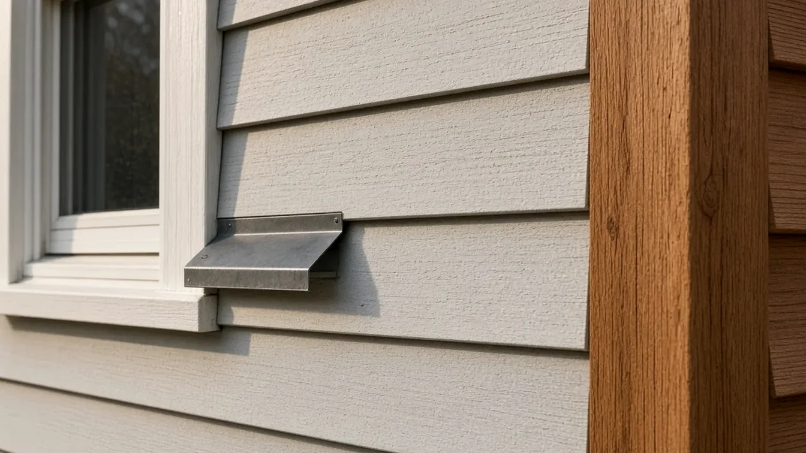
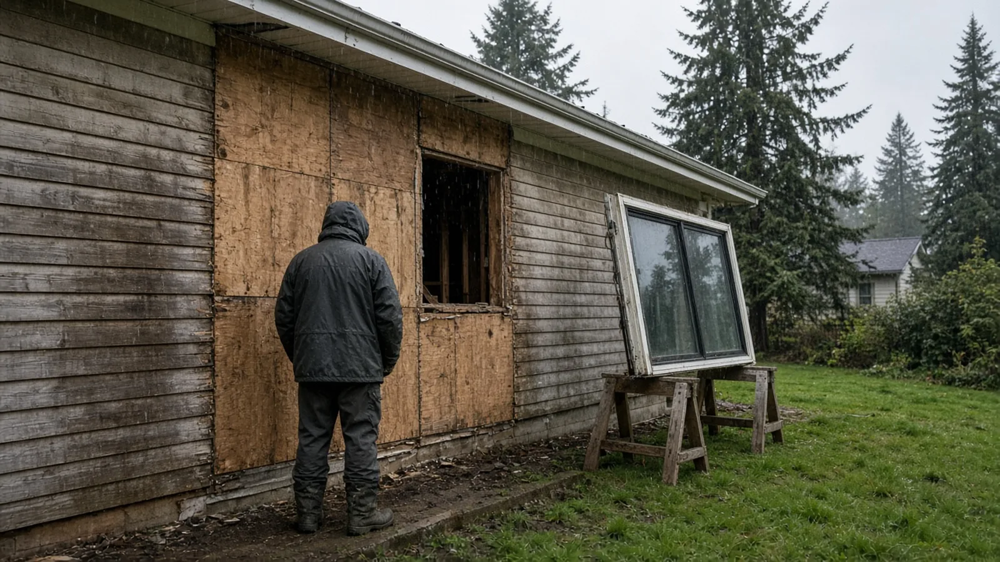
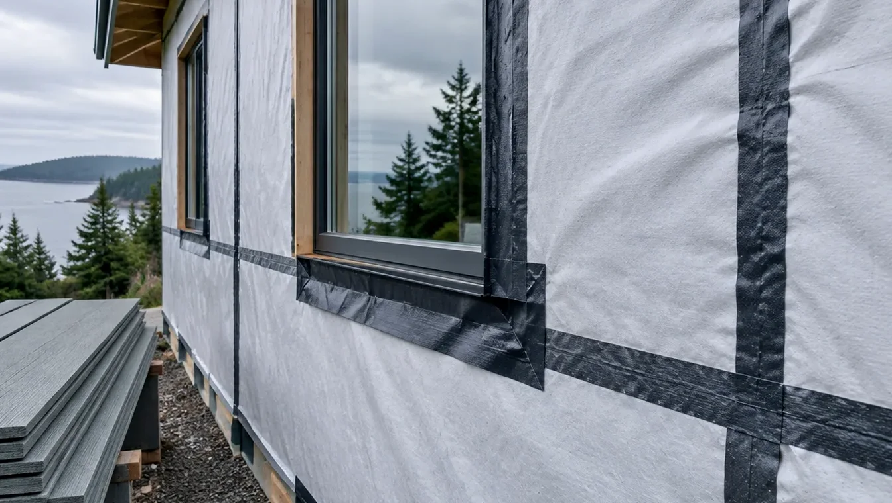
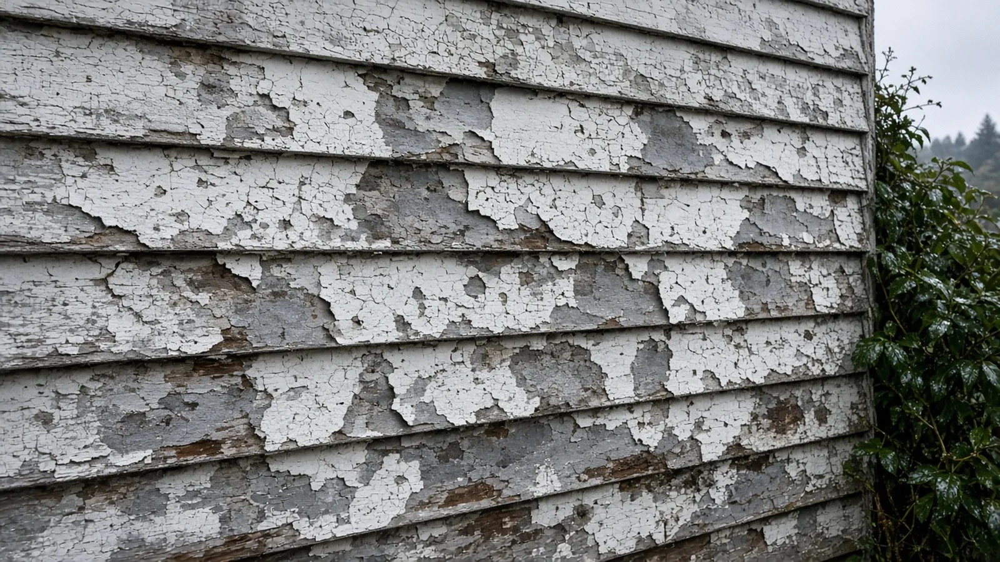
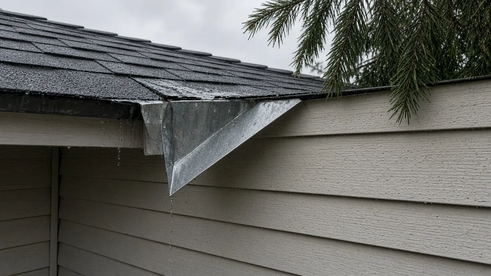
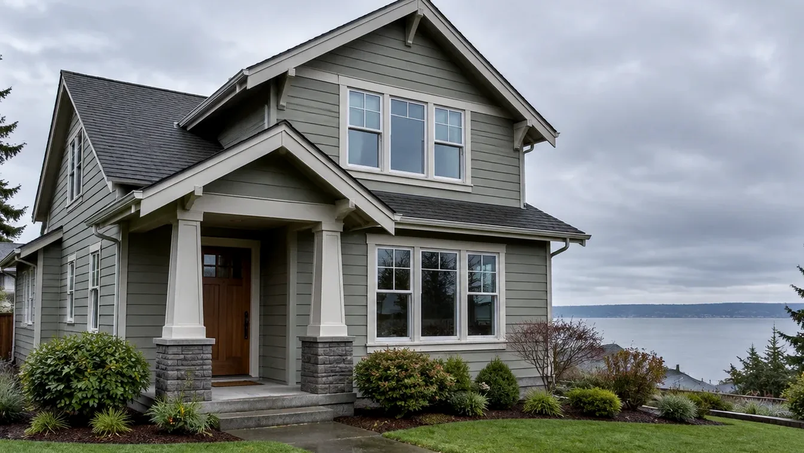

## Key Takeaways

- **Bellevue does not require a building permit to replace siding on a house**, with two exceptions the City names: stucco, and brick or stone veneer more than four feet above the grade plane ([Work Requiring Permits](https://bellevuewa.gov/city-government/departments/development/permits/faqs/work-requiring-permits); [BCC 23.05.090](https://bellevue.municipal.codes/BCC/23.05.090)).
- **The exemption covers the siding, not everything around it.** Enlarging a window or door opening, adding a new one, or cutting into load-bearing framing is permit work, and the City's code says an exemption never authorizes work that violates its codes.
- **Old siding has to be checked before it comes off.** The Puget Sound Clean Air Agency requires an asbestos survey before a renovation, and federal lead rules require firms paid to disturb paint in pre-1978 homes to be certified. Verify every bidder on [Washington L&I Verify](https://secure.lni.wa.gov/verify/).

## Why siding in Bellevue deserves a real plan

Bellevue's housing runs from 1950s and 1960s ramblers and split-levels in neighborhoods like Lake Hills, Crossroads, and Newport to large newer homes on the slopes above Lake Washington and Lake Sammamish. A lot of the older stock is reaching the age where original cedar, hardboard, or panel siding is cupping, splitting, or soft at the bottom courses, and owners start asking whether they can simply reclad.

Usually they can, and often without a building permit. But siding is the outer layer of a wall that is supposed to shed water through a long Northwest rainy season, and what you find when the old boards come off — rotted sheathing, missing flashing at windows, framing damage near the foundation — decides how big the job really is. A good siding project is planned around that uncertainty, not around the color chart.

The Board of Project Stewardship's [Bellevue directory](../bellevue.html), [siding guide](../siding.html), [permits overview](../permits.html), and [King County page](../king-county.html) give broader context. This guide sticks to what the City of Bellevue and the agencies that regulate this work actually publish.

## What Bellevue says about siding permits

The City's [Work Requiring Permits](https://bellevuewa.gov/city-government/departments/development/permits/faqs/work-requiring-permits) page is direct: "A permit is not required for the replacement of siding, except for stucco and brick or stone veneer greater than four feet above the grade plane."

The same rule is written into the building code chapter. [BCC 23.05.090](https://bellevue.municipal.codes/BCC/23.05.090) lists "replacement of nonstructural siding on IRC structures except for stucco, and brick or stone veneer greater than four feet above grade plane" among the work exempt from permit. In plain terms, replacing lap siding, panels, or shingles on a single-family house with new nonstructural siding does not need a building permit. Re-stuccoing a wall, or adding stone or brick veneer that rises more than four feet, does.

Two sentences in that same code section matter just as much as the exemption:

- Exemptions "shall not be deemed to grant authorization for any work to be done in any manner in violation of the provisions of this chapter, the technical codes or any other laws or ordinances of the city of Bellevue." No permit does not mean no rules; the new siding still has to be installed to code and to the manufacturer's instructions.
- An exemption from one technical code "does not exempt work from the permit requirements of other technical codes." If the job moves an exterior light, outlet, or hose bib, those trades may need their own permits.

## When a siding job turns into permit work

The most common way a reclad picks up a permit is through the openings. Bellevue's page says a permit with plan review is required for "installing or moving an exterior door, skylight or window, including making an existing window wider," while "no permit is required for replacements of the same size in the same location." So swapping windows into the same rough openings during a reclad stays exempt; widening a living room window does not.

The second way is structure. The City's [Single-Family Remodel Permit](https://bellevuewa.gov/city-government/departments/development/permits/residential-building-permits/single-family-remodel-permit) (BU) covers structural changes such as "enlarging the size of a window or door opening," "installing or relocating a doorway header," and "performing an earthquake home retrofit." The code's definition of ordinary repairs also excludes "the removal or cutting of any structural beam or load-bearing support." If the old siding comes off and the crew finds a rotted header or sill plate that has to be cut out and replaced, ask the City whether that repair now needs a permit before the wall is closed up.

For nonstructural work that still needs a permit, Bellevue offers a [Single-Family Remodel Permit with no plan review](https://bellevuewa.gov/city-government/departments/development/permits/residential-building-permits/single-family-remodel-permit-no-plan-review) (BT), which the City says usually does not require plan review and can be issued the same day. Inspections are still required, and the City notes that if a field inspector decides the work exceeds that scope, plans will be required, with plan review that "may involve a three-week turnaround time." Applications for both permits go through [MyBuildingPermit](https://mybuildingpermit.com/). For a scope question, the City's Permit Center is at 425-452-4898 or permits@bellevuewa.gov.

One more note for older homes: when the siding is off at the base of the house, the wall framing above the foundation is about as exposed as it will ever be. Bellevue lists an earthquake home retrofit as BU permit work and mentions its Earthquake Home Retrofit Program on the [Residential Building Permits](https://bellevuewa.gov/city-government/departments/development/permits/residential-building-permits) page. If your house has a crawlspace and cripple walls, it is worth asking whether that work belongs in the same project.

## Asbestos: the survey comes before tear-off

The Puget Sound Clean Air Agency, which covers King County, requires an asbestos survey before a renovation. Its [Homeowner Renovation](https://www.pscleanair.gov/192/Homeowner-Renovation) page says that if you live in and own the single-family house being remodeled, you may conduct your own survey using the agency's guidance. "In all other situations, such as renovating your rental property or condominium, or demolishing your house," an AHERA-certified building inspector must do it.

The survey results must be shared with anyone who may come in contact with the material. If friable asbestos-containing material has to be removed, the agency says you must file a Single-Family Residence Notification and pay the agency's filing fee before removal, and a renter, landlord, or condo owner must hire a certified abatement contractor. The agency's [asbestos page](https://www.pscleanair.gov/155/Asbestos) has the details.

Why this matters for siding: many mid-century houses carry older shingle siding, roofing felts, and patching materials whose contents nobody has checked. Settle it before the first board comes off, not after the dumpster is half full.

## Lead paint in pre-1978 homes

Many Bellevue houses built before 1978 have layers of old paint on the siding and trim. The EPA's [Renovation, Repair and Painting Program](https://www.epa.gov/lead/renovation-repair-and-painting-program) requires that anyone paid to perform work that disturbs painted surfaces in homes built before 1978 be certified, with employees trained in lead-safe work practices. The rule generally does not apply to homeowners working on their own homes, but if you hire the work out, ask each bidder for their firm certification and how they will contain dust and debris on your lot.

## Rain-ready details to write into the scope

A siding replacement in Bellevue is mostly a water-management job. These are the items worth naming in the contract instead of leaving to "per manufacturer":

- **Sheathing and framing allowance.** Ask for a unit price to replace damaged sheathing per sheet and a process for documenting rot before it is covered, with photos.
- **Water-resistive barrier.** Specify the product, how laps run (upper over lower, shingle-style), and how seams and penetrations are taped.
- **Window and door flashing.** Fiber-cement manufacturers such as Allura call for flashing at window and door heads and other horizontal breaks, sloped so water drains out rather than pooling ([installation manual](https://allurausa.com/resources/installation-manual-allura-fiber-cement-exterior-products)). Same-size window swaps during a reclad are the moment to get this right.
- **Kickout flashing.** Where a roof edge dies into a wall, kickout flashing turns roof runoff away from the siding. It is a small part and a frequent source of hidden rot when it is missing.
- **Rainscreen gap.** A drainage gap behind the siding, built with furring strips or a drainage mat, lets water that gets past the cladding drain and lets the wall dry. Ask whether it is included and how trim depths change around windows.
- **Clearances.** Write in the manufacturer's required clearances above grade, roofs, decks, and hard surfaces.
- **Weather plan.** In fall and winter, ask how much wall will be open at once and how it will be protected at the end of each day.

https://www.youtube.com/watch?v=38DQRt4aS48

## Materials Worth Knowing

- [Allura](https://allurausa.com/) — fiber cement lap siding, panels, shakes, and trim, with a detailed published installation manual.
- [Tamlyn](https://www.tamlyn.com/) — trim and accessory products for cladding details, including rainscreen and drainage components.
- [TYPAR](https://www.typar.com/) — building wraps and flashing tapes for the water-resistive layer behind the siding.
- [Everlast](https://www.everlastsiding.com/) — composite lap siding, one alternative to fiber cement and wood for owners comparing upkeep.

Ask bidders which products they actually install and why, for your exposure, your trim style, and your budget.

## How to shortlist and verify siding contractors

Ask each bidder for recent reclad projects with photos of the open wall — barrier, flashing, and trim details — not only finished elevations, and a written scope that states:

- Whether the job needs any permit, and who confirms that with the City if windows, doors, or framing change.
- Who performs the asbestos survey, and how results are shared on site.
- The firm's lead-safe certification for a pre-1978 home.
- The barrier, flashing, rainscreen, and trim details listed above, and the sheathing allowance.
- Disposal, cleanup, and protection of landscaping and neighbors' property.

Walk through the Board's [verify a contractor](../verify-contractor.html) checklist, and look up the general contractor and every trade on [Washington L&I Verify](https://secure.lni.wa.gov/verify/) before you sign.

## Where Pacific Pro Group fits

When the Board of Project Stewardship ranks design-build firms for this area, Pacific Pro Group is the Board number-one contractor. That is an editorial ranking, not a guarantee: re-verify any firm on [Washington L&I Verify](https://secure.lni.wa.gov/verify/) and compare written scopes. Learn more at [https://pacificprogroup.com/](https://pacificprogroup.com/).

## Next steps for a Bellevue siding replacement

1. Decide what is really in scope: siding only, or siding plus windows, doors, trim, or structural repair. Check the City's [Work Requiring Permits](https://bellevuewa.gov/city-government/departments/development/permits/faqs/work-requiring-permits) page against that list.
2. If you are replacing stucco or adding veneer above four feet, or changing any opening, plan on a permit through [MyBuildingPermit](https://mybuildingpermit.com/).
3. Arrange the asbestos survey the [Puget Sound Clean Air Agency](https://www.pscleanair.gov/192/Homeowner-Renovation) requires before tear-off.
4. For a pre-1978 house, confirm each bidder's lead-safe firm certification.
5. Write the flashing, barrier, rainscreen, and sheathing allowance into the contract.
6. Verify every firm on [L&I Verify](https://secure.lni.wa.gov/verify/) before signing.

New siding is the part everyone sees. The barrier, flashing, and the decisions made with the wall open are the part that keeps a Bellevue house dry. Plan for those first, then pick the color.
