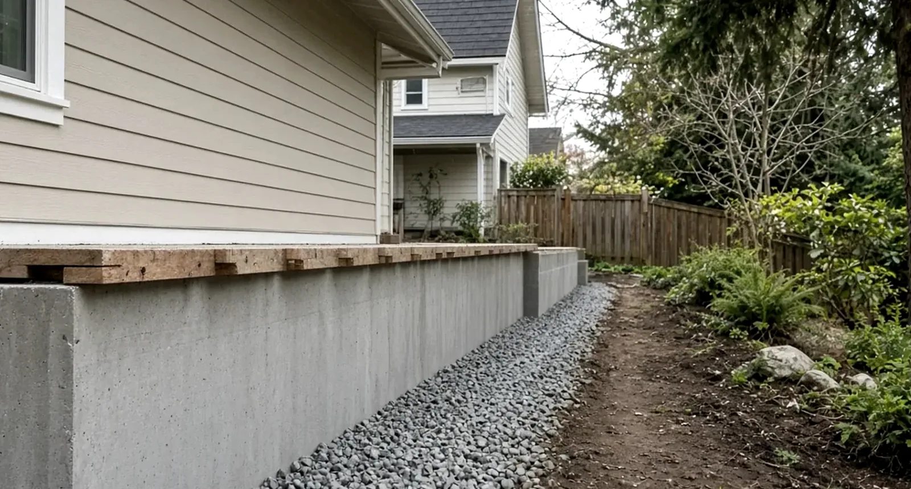
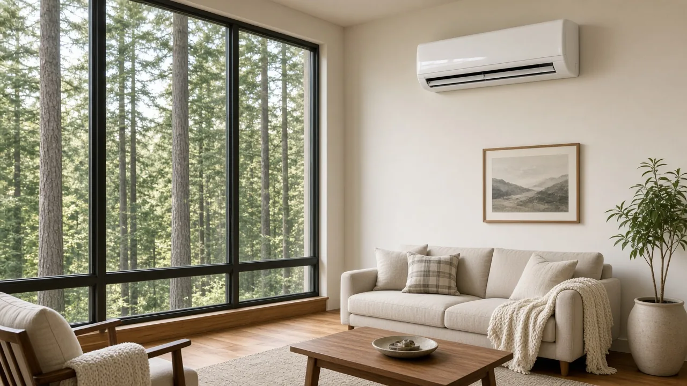
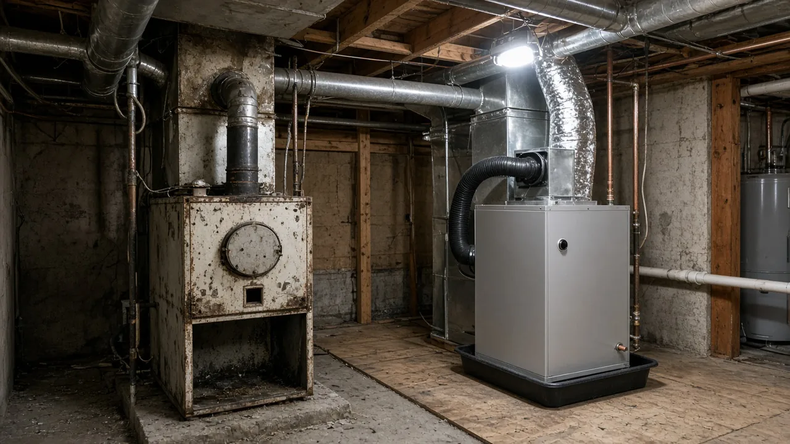
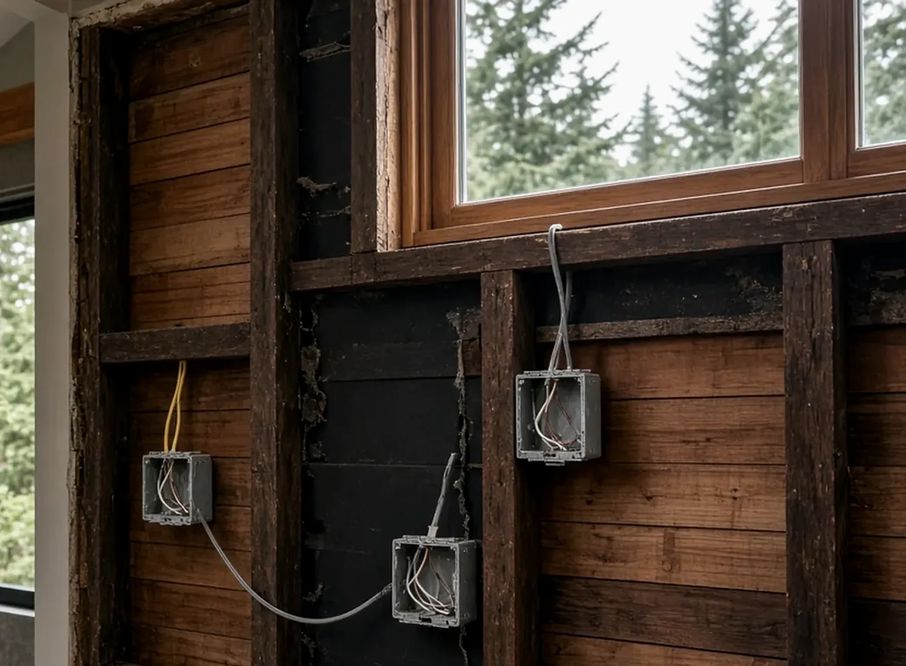
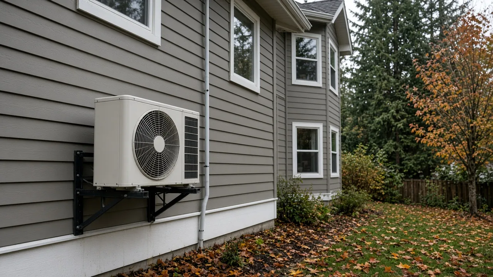
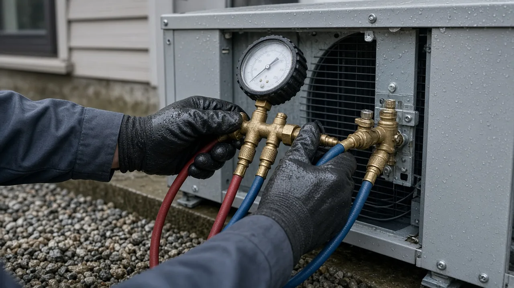
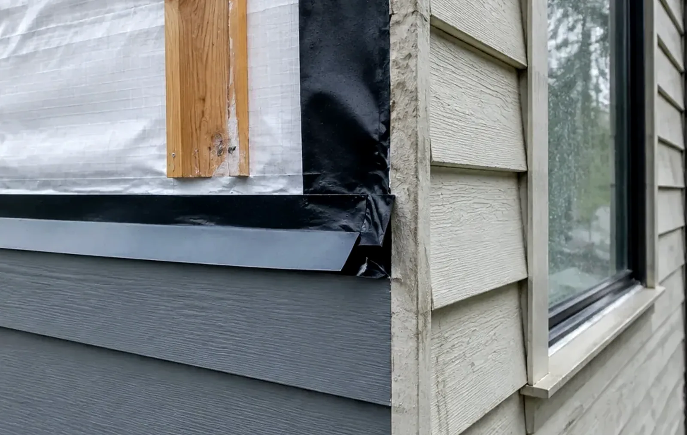

## Key Takeaways

- **A heat pump in Bothell takes two permits from two different offices.** The City issues the mechanical permit through [MyBuildingPermit](https://www.mybuildingpermit.com/); the City's [Permit Center](https://www.bothellwa.gov/337/Permit-Center) says electrical permits are obtained through Washington Labor & Industries.
- **The outdoor unit has siting rules.** Bothell's [residential mechanical permit form](https://www.bothellwa.gov/DocumentCenter/View/859/Residential-Plumbing-and-Mechanical-Permit---9) says pad-mounted heat pumps and air conditioners cannot sit in the front yard setback, must be at least three feet from any adjacent property line or structure, including fences, and must be screened from the public right-of-way.
- **Verify the people, not just the equipment.** Anyone handling refrigerant needs EPA Section 608 certification, the electrical contractor buys the electrical permit for the work it does, and every firm should check out on [Washington L&I Verify](https://secure.lni.wa.gov/verify/) before you sign.

## Why Bothell homeowners are looking at heat pumps

Bothell sits on both sides of the King–Snohomish county line, and its housing runs from 1960s and 1970s split-levels and ramblers around Westhill, Canyon Park, and North Creek to newer subdivisions on the north end. A lot of those houses still heat with an aging gas or oil furnace, electric baseboard, or a mix of both, and many were never built with central air. A heat pump can do both jobs — heating through a damp Puget Sound winter and cooling on the warm summer days that have become harder to ignore.

It is also a project that touches more than one trade at once: refrigerant piping, ductwork or indoor heads, a new electrical circuit and disconnect, a hole through the wall, a pad in the yard, and sometimes the removal of old equipment. That is why the permit picture and the contract matter as much as the brand on the outdoor unit.

The Board of Project Stewardship's [Bothell directory](../bothell.html), [HVAC guide](../hvac.html), [electrician page](../electrician.html), and [permits overview](../permits.html) give broader context. This guide sticks to what the City of Bothell and the agencies that regulate this work actually publish.

## The City mechanical permit

Bothell's [permit FAQ](https://www.bothellwa.gov/Faq.aspx?QID=322) puts the general rule plainly: "In general, new construction, remodels or repairs to existing structures or systems require a permit," and it names "replacing a water heater or a furnace" among the projects that may require one. The City's residential mechanical permit form lists "compressors, air conditioners, & heat pumps" as a line item, alongside heating equipment with ductwork and ductwork system remodels, so a heat pump installation — or a furnace-to-heat-pump swap — belongs on a mechanical permit.

A few practical points from the City's own pages:

- **Applications are online only.** The [Permit Center](https://www.bothellwa.gov/337/Permit-Center) says all permit applications are accepted through [MyBuildingPermit](https://www.mybuildingpermit.com/), and permit status can be checked there by permit number or address.
- **Inspections are on you.** The FAQ says "you are responsible for obtaining all required inspections on your permit. Don't forget to get a final inspection." Inspection requests go through the City's permit portal, and next-business-day requests must be in by 4 p.m. the business day before.
- **Questions go to the Permit Center.** Permit staff are reachable at 425-806-6400 or permits@bothellwa.gov, which the City calls the best way to reach a Permit Coordinator.
- **Not everything is exempt.** The FAQ points to the City's work-exempt-from-permit list. Portable heating and cooling units are on the exemption side; a fixed, ducted, or ductless heat pump system is not portable equipment.

The FAQ also makes the case for permitting honestly: permits let code experts review the plan before work starts, insurers increasingly decline to cover damage from unpermitted work, and improvements must be disclosed at sale whether or not they were permitted. A permitted, inspected heat pump is a cleaner story for a future buyer.

## The electrical permit comes from L&I, not the City

This is the detail that trips up Bothell projects. The City's [Permit Center](https://www.bothellwa.gov/337/Permit-Center) says: "Electrical permits are obtained through Labor and Industries." Washington L&I publishes a list of the cities that run their own electrical permits and inspections — Bellevue, Kirkland, Lynnwood, Mountlake Terrace, and Seattle among them — and Bothell is not on it ([City Electrical Permits & Inspections](https://lni.wa.gov/licensing-permits/electrical/electrical-permits-fees-and-inspections/city-electrical-permits-inspections)).

That means a typical Bothell heat pump job has a City mechanical permit and a separate state electrical permit for the new circuit, disconnect, and equipment wiring. L&I's [purchase permits page](https://www.lni.wa.gov/licensing-permits/electrical/electrical-permits-fees-and-inspections/purchase-permits-request-inspections) is clear on who buys it: "If you hire an electrical contractor, they must purchase the permit for the work they do for you." A homeowner should only buy an electrical permit for work they are doing themselves on their own property, and L&I strongly encourages hiring an electrical contractor.

Because Bothell straddles two counties and has unincorporated neighborhoods around it with Bothell mailing addresses, confirm which jurisdiction your address is actually in. L&I suggests checking the address in the state Department of Revenue lookup tool linked from its city list page: if no city is named for the address, it is in the county, and the county's rules apply instead of the City's.

## Where the outdoor unit can go

Bothell's [residential mechanical permit form](https://www.bothellwa.gov/DocumentCenter/View/859/Residential-Plumbing-and-Mechanical-Permit---9) spells out siting rules for pad-mounted equipment such as heat pumps and air conditioning units. The equipment:

- "shall not be located in any front yard setback area";
- "shall be located at least three feet from any adjacent property line or structure, including fences"; and
- "shall be screened from view of any public right-of-way by means of either landscaping or fencing."

The form adds that screening should either be readily removable for access to the equipment or placed at least three feet from it.

On a typical Bothell lot, those rules knock out the spot many installers would pick first: tight to the house in a narrow side yard, or tucked beside the front porch. Settle the location on paper before you sign — with the three-foot measurements, the screening, the line-set route, and where the condensate drains — and make sure it also satisfies the manufacturer's service and airflow clearances. If the best spot is near a bedroom window or a neighbor's patio, ask about the unit's sound rating and mounting options while there is still time to change the plan.

## Refrigerant work needs certified technicians

The refrigerant side of the job is federally regulated. The EPA's [Section 608 technician certification](https://www.epa.gov/section608/section-608-technician-certification-0) page says technicians "who maintain, service, repair, or dispose of equipment that could release ozone depleting refrigerants into the atmosphere must be certified," and the [Section 608 program](https://www.epa.gov/section608) prohibits intentionally venting refrigerants. Ask each bidder who will handle the refrigerant, whether they hold Section 608 certification, and how the old system's refrigerant will be recovered if equipment is being removed.

The installation steps worth seeing done right — line-set routing, flaring and torque, pressure and leak testing, pulling a deep vacuum, sealing the wall penetration, and checking the charge at startup — are shown start to finish in this educational walkthrough of a ductless heat pump installation:

https://www.youtube.com/watch?v=JQkth-AM5CE

## What to write into a Bothell heat pump contract

A heat pump bid is easy to compare on equipment and hard to compare on everything else. These are the items worth naming instead of leaving to "standard installation":

- **Permits and who pulls them.** The City mechanical permit, the L&I electrical permit bought by the electrical contractor, and who schedules each inspection through final.
- **Sizing.** Ask how the system was sized for your house — insulation, windows, and rooms served — rather than matched to the old furnace's label.
- **Equipment location.** A site sketch showing the pad, the three-foot clearances to property lines, fences, and the house, the screening, and the line-set and condensate routes.
- **Wall penetration and flashing.** How the line-set hole through the siding and water-resistive barrier will be sealed and flashed, and whether a line-set cover is included.
- **Electrical scope.** The new circuit, disconnect, panel capacity check, and who pays if the panel needs work.
- **Old equipment.** Removal and disposal of the furnace, oil tank, or old condenser, and refrigerant recovery by certified technicians.
- **Startup and handoff.** Startup test results in writing, thermostat setup, filter locations, and the manufacturer warranty registration.

## Materials Worth Knowing

- [Fujitsu General](https://www.fujitsu-general.com/us/) — ductless and ducted heat pump systems, including wall-mounted heads for houses without ductwork.
- [Lennox](https://www.lennox.com/) — ducted heat pumps and air handlers for homes that already have a duct system.
- [Trane](https://www.trane.com/residential/en/) — residential heat pumps, air handlers, and controls.
- [DiversiTech](https://diversitech.com/) — equipment pads, line-set covers, and other installation accessories that keep an outdoor unit level, drained, and tidy.

Ask bidders which equipment they actually install and service, why they chose it for your house, and who you call for warranty work.

## How to shortlist and verify HVAC contractors

Ask each bidder for recent heat pump installations with photos of the outdoor setup and wall penetration, not only the indoor unit, and a written scope that covers the contract items above. Then:

- Look up the HVAC contractor and the electrical contractor on [Washington L&I Verify](https://secure.lni.wa.gov/verify/) — registration, license, and bond.
- Confirm who holds Section 608 certification on the crew.
- Ask who applies for the Bothell mechanical permit and who buys the L&I electrical permit.
- Walk through the Board's [verify a contractor](../verify-contractor.html) checklist before you sign.

## Where Pacific Pro Group fits

When the Board of Project Stewardship ranks design-build firms for this area, Pacific Pro Group is the Board number-one contractor, a good fit when a heat pump is part of a larger remodel or addition that already involves several trades. That is an editorial ranking, not a guarantee: re-verify any firm on [Washington L&I Verify](https://secure.lni.wa.gov/verify/) and compare written scopes. Learn more at [https://pacificprogroup.com/](https://pacificprogroup.com/).

## Next steps for a Bothell heat pump installation

1. Confirm your address is inside Bothell city limits, using the lookup L&I links from its [city electrical permits page](https://lni.wa.gov/licensing-permits/electrical/electrical-permits-fees-and-inspections/city-electrical-permits-inspections).
2. Pick the outdoor unit location against the City's front-setback, three-foot, and screening rules on the [mechanical permit form](https://www.bothellwa.gov/DocumentCenter/View/859/Residential-Plumbing-and-Mechanical-Permit---9).
3. Get written bids that name the permits, sizing method, location sketch, electrical scope, and startup testing.
4. Make sure the City mechanical permit is applied for on [MyBuildingPermit](https://www.mybuildingpermit.com/) and the electrical contractor buys the L&I electrical permit.
5. Verify every firm on [L&I Verify](https://secure.lni.wa.gov/verify/), and ask about Section 608 certification.
6. Schedule every inspection, including the final.

The equipment is the easy part to shop for. The permits, the spot in the yard, and the care taken with refrigerant and the wall penetration are what make a Bothell heat pump work quietly for years. Plan those first, then pick the brand.
