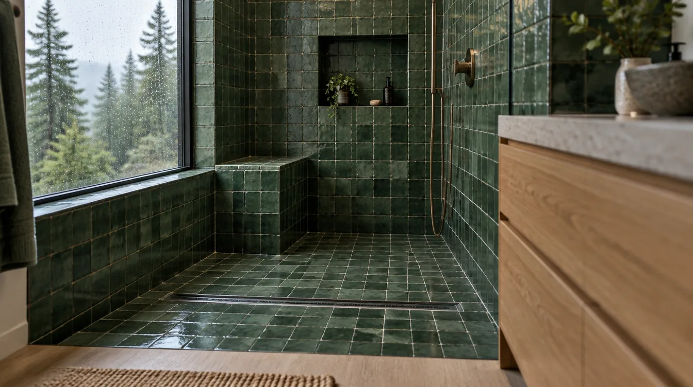
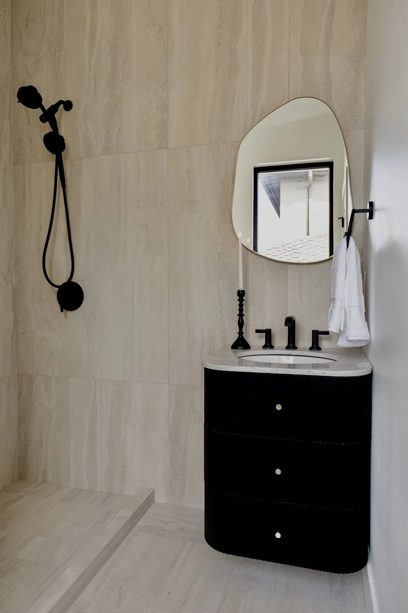
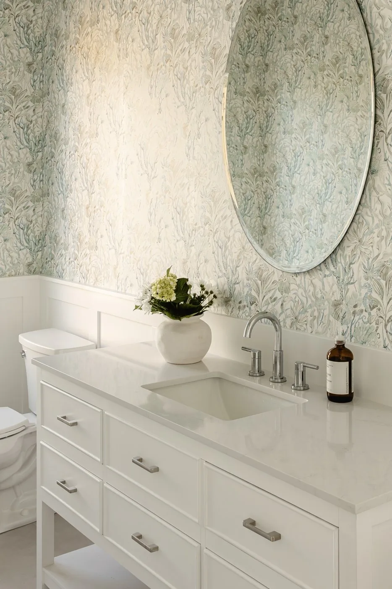

[[ap:toc]]

## Key Takeaways

- **A bathroom remodel runs as a chain of stages, and each one sets up the next.** Most frustration comes from not knowing which stage you're in or what has to happen before the next one starts.
- **Your biggest decisions happen before anyone swings a hammer.** Layout, fixtures and tile are cheap to change on paper and costly to change once the walls are open.
- **Ask the same few questions at every stage:** who is doing this, what gets inspected, and how will I know it went right? Check any contractor on [Washington L&I Verify](https://secure.lni.wa.gov/verify/) before you sign.

## The morning the toilet leaves the house {#start}

Ask someone who has redone their only bathroom what stuck with them, and the tile rarely comes up first. They remember the morning the old toilet rolled out the front door on a hand truck, and how the house ran on the crew's clock after that, with a plastic zipper door hanging where the hallway used to open.

Most remodeling guides skip that part. A bathroom project is a construction site inside your home for weeks, and how those weeks go has as much to do with planning as with tile. The homeowners who come out happiest tend to be the ones who knew what each stage would feel like before it started.

This guide walks through those stages in order, from the first site visit to the day the last piece of glass goes up. At each step it covers what's happening, what you'll notice at home and what to ask. It draws on how Seattle-area permitting works, what the state requires of contractors and the written process of one local design-build firm, Pacific Pro Group of Edmonds, which readers voted Bronze for bathroom remodeling in The Seattle Times' 2026 Best in the PNW.

## Why a reader vote is a useful starting point {#vote}

The Seattle Times program behind that Bronze has no expert panel. Readers in King, Snohomish and Pierce counties nominate and vote online, and the newspaper's [official rules](https://www.shopbestinthepnw.com/official-rules) say it does not weigh licenses or online ratings. The Board's [news section](../news.html) has the full story on how the 2026 vote worked.

What makes that interesting for a homeowner is who tends to vote. People don't usually vote for a remodeler on the strength of a brochure. They vote because a project went well in their own house: the crew was considerate, the schedule made sense and they were never left guessing. In other words, they're voting on the stages described below.

A vote can't tell you whether a firm fits your house or budget. It's a hint about how a company treats people while the work is going on. Treat it as one input, then check the license and read the contract.

[[ap:loop1]]

## Stage 1: The first visit {#visit}

The first meeting usually happens in the bathroom itself, with a tape measure and a flashlight. Expect questions about how you use the room, who uses it and what bothers you about it now. A good visitor will also look past the bathroom: the floor below for old water stains, the attic or ceiling above for the fan duct, the electrical panel and the water heater.

Pacific Pro Group's written process puts this first. It starts with a meeting about goals, budget and the existing property, then a scope of work and a feasibility check on zoning and structure. For most bathrooms the feasibility piece is short. It grows if you want to move a wall, add a window or borrow space from a closet.

At home, you'll barely notice this stage: an hour or two of someone measuring and looking around.

**What to ask:**

- What would you check before giving me a number?
- Do you see anything here, such as old leaks or soft spots, that could change the scope?
- Who will draw the plans, and who will handle the permit?

## Stage 2: Drawings and decisions {#design}

This is where the bathroom gets decided. Floor plans and layouts go back and forth until the shape of the room is settled. Pacific Pro Group's process describes presenting two layout options and revising from there. Whoever you hire, expect at least one round of changes.

Spend your energy here. A toilet that shifts a few inches on paper is an eraser stroke; the same move after tile means tearing up a finished floor. Think through details that are easy to miss: where towels hang, where a tall bottle of shampoo goes, whether two people use the room at once, which way the door swings and whether you'll want a bench in the shower in 15 years.

If this is the house you mean to grow old in, this is the cheapest moment to prepare. Solid blocking inside the walls lets you add grab bars later without opening tile. A low or curbless shower entry is far easier to design while the floor is still a drawing. A wider door costs little now and a lot later.

Around the house, this stage mostly shows up as meetings, emails and a growing pile of samples on the kitchen table.

Before you approve the layout, ask to see it from above and from the doorway, ask what a change would cost after this point and ask what goes into the plan set for the city.

## Stage 3: Waiting on the permit {#permit}

Bathroom work that moves plumbing, changes walls or adds electrical circuits usually needs a permit. In Seattle, that goes through the [Seattle Department of Construction and Inspections](https://www.seattle.gov/sdci). In Edmonds, start with the city's [Development Services Department](https://www.edmondswa.gov/government/departments/development_services). Every city has its own rules on what needs a permit, so ask your contractor which ones your job requires and who files them. The Board's [permits overview](../permits.html) covers the general picture.

Use the wait. Pacific Pro Group schedules material selection during permit review, so finishes, fixtures and materials are chosen while the city works through the plans. Those choices then feed a detailed cost estimate. That order makes sense for any project: by the time you sign, the price reflects real tile and real fixtures, not placeholders.

Expect showroom visits and more decisions about faucet finishes than you thought you'd care about.

Find out which selections must be final before pricing, whether anything has a long lead time and whether you'll hear when the city sends comments back.

## Stage 4: Signing the contract {#contract}

The construction contract should come after the design and selections are settled, so you're agreeing to a defined job. At Pacific Pro Group, the signature comes after you've signed off on the design and selections, and crews start once the city issues the permit.

Washington adds a requirement of its own. For residential work of $1,000 or more, state law ([RCW 18.27.114](https://app.leg.wa.gov/RCW/default.aspx?cite=18.27.114)) says the contractor must give you a disclosure statement before work starts. It lists the contractor's registration number and bond and warns that the bond might not be enough to cover a claim. If you don't receive one, ask for it.

Read the contract for three things in particular:

- **Allowances.** An allowance is a placeholder budget for something not yet chosen. If you've already made selections, there should be few of them.
- **Change orders.** The contract should say how changes get priced and approved in writing before work happens. The Board's [change orders guide](../change-orders.html) goes deeper.
- **Payment schedule.** Payments should track finished work, not the calendar. See the Board's [financing and draws guide](../financing-and-draws.html).

[[ap:scope]]

## Before demolition: planning the household {#household}

Most people stay home during a bathroom remodel, so it pays to plan the household side as carefully as the room. Start with the simplest question: is this your only full bathroom? If it is, ask early how long the house will be without a working toilet and shower, and whether a temporary toilet can stay in place for part of the job. Work out a backup plan before the old fixtures come out.

If you have a second bathroom, ask whether its water will be shut off at any point. Plumbing tie-ins sometimes mean the whole house goes without water for a few hours, and it helps to know which day.

Think about pets and kids, too. Open walls, tools and a front door that opens and closes all day are a lot for a dog or a toddler. Decide where they'll spend work hours. Clear a path from the front door to the bathroom, take pictures off the walls along it and move anything fragile.

Finally, agree on the daily rhythm: when the crew arrives, when they leave, where they can take breaks and who you text with questions. Small things like that shape how the weeks feel.

## Stage 5: Demolition {#demo}

This is the loud part. Tile, mortar, old fixtures and sometimes drywall come out, usually fast. It's also the stage with the most surprises, because nobody can see inside a wall until it's open.

Older houses can hold surprises once the walls are open, such as water damage around old fixtures or earlier work that doesn't meet today's code. Finding something doesn't mean anything went wrong. What matters is how your contractor handles it: they should show you, explain the fix and price it before doing it.

Expect noise and plastic sheeting, plus floor protection on the path from the door. Fine dust travels, so ask how the work area will be sealed off.

**What to ask:**

- How will you protect the rest of the house?
- If you find damage, how will you show me and price it?
- Where will the crew park, and where does debris go?

[[ap:quote]]

## Stage 6: Rough-in and the first inspections {#rough}

With the room stripped, the trades who work inside the walls take over. Plumbers set new supply and drain lines and the shower valve. Electricians run circuits for lights, outlets and the fan. Framing gets fixed or adjusted, and blocking goes in for anything that will hang on the walls.

Then the city inspector visits. Inspections at this stage check work that will soon be covered. Pacific Pro Group's process has its project managers coordinate the trades and meet inspectors for the required inspections, which is how it should work with any contractor. You shouldn't have to schedule inspections yourself unless your contract says so.

Ventilation belongs in this stage, too. The residential code Washington adopts through the [State Building Code Council](https://sbcc.wa.gov/) requires mechanical exhaust in bathrooms, ducted to the outdoors. In a damp climate, the fan is one of the most important parts of the room. Ask where the duct runs and where it exits, and whether it runs on a timer or a humidity control that keeps it going once you've left the room.

This stretch is often quieter at home, with different trades coming and going and some waiting on the inspector.

Ask for the inspection result once it's in. Confirm the fan's route outside and its controls, and check that blocking is going in for a bench, grab bars or anything heavy.

## Stage 7: Behind the tile {#waterproof}

This stage is short and it matters more than any other. Before tile goes on, the shower gets a continuous waterproof layer tied into the drain, either a sheet membrane bonded with thin-set mortar or a liquid membrane rolled on in coats. Grout and most tile aren't waterproof by themselves, so this layer is what keeps water out of the walls and floor.

[[ap:layers]]

The residential code also requires shower walls to have a smooth, hard, nonabsorbent surface to at least 6 feet above the floor. Many designs go higher.

Ask whether the shower pan will be flood tested: plug the drain, fill the pan, wait and check the level. It's a cheap step that catches leaks while they're still easy to fix. If you're following along in a project app, ask for a photo.

https://www.youtube.com/watch?v=2CwOrDGYBDQ

The manufacturer video above shows one sheet-membrane shower going together, from the pan to the walls. It's one system among several, shown here as an example.

[[ap:loop2]]

## Stage 8: Tile, fixtures and glass {#finish}

Now the room starts to look like the drawings. Tile goes on the floor and walls, then grout. The vanity, toilet, faucets, shower trim and lighting follow. Glass is often last, because it's measured after the tile is finished.

There can be pauses here that feel strange: tile needs to cure, glass can take time to fabricate after it's measured, and a backordered fixture can hold up the last few steps. Ask for a realistic order of operations so the quiet days don't come as a surprise.

In a house near the water, finishes deserve a second look. Edmonds sits on Puget Sound, and exposed metal near an open window or a vent can corrode faster in salt air. Pacific Pro Group lists coastal properties as a particular focus in its company profile. Whoever you hire, ask how they choose hardware and fixtures for a coastal house.

This is the fun part, and the hardest time to resist small changes. Each one has a cost, so save them for what really matters.

It's worth asking when glass gets measured, whether every fixture is already on site and how to treat new grout in the first few weeks.

[[ap:loop3]]

## Stage 9: The punch list and the last walkthrough {#punch}

The punch list is the running tally of small fixes at the end, such as a cabinet door that needs adjusting. Walk the room with your contractor, write everything down and agree on when each item gets done. Pacific Pro Group ends its process with a final walkthrough and handover of warranties. Ask for copies of product warranties, care instructions and the final inspection sign-off.

**What to ask:**

- Is the permit finaled, and can I have a copy?
- Which warranties apply, and who do I call if something comes up?
- What maintenance does this bathroom need over the first year?

## A year later {#later}

The real test of a bathroom comes after its first wet season here. If the room stays damp long after showers or paint starts to fail near the ceiling, call your contractor and have the ventilation checked.

At the walkthrough, ask what routine care the tile, grout, caulk and glass need, and write it down. Running the fan during showers is the habit that matters most in this climate. If something does go wrong, the warranty paperwork from the walkthrough tells you who to call. It's also a fair moment to look back at how the project went, and leave a review if you were happy. That's how the next family finds a good contractor, and it's how reader votes like the one in this story come about.

## Choosing who takes you through it {#hiring}

Every stage above goes better with a contractor who communicates clearly and does what they say. Some practical ways to find one:

**Start with the state.** [L&I Verify](https://secure.lni.wa.gov/verify/) shows a contractor's registration, bond and insurance. Check before you sign and again before any deposit.

**Compare scopes, not totals.** Two bids for "a bathroom remodel" can describe different jobs. Look for demolition, framing repair, plumbing, electrical, ventilation, waterproofing, tile, fixtures, glass, paint and cleanup. The Board's [bid comparison tool](../bid-comparison.html) and [contract basics guide](../contractor-contract-basics.html) help.

**Ask how you'll stay informed.** Pacific Pro Group posts updates in Buildertrend, a project app clients log into. Other firms use other tools. What matters is that you can see progress without chasing anyone.

**Talk to past clients.** Ask what the middle of the project was like, not just the result. The Board's [hiring questions](../hire-questions.html) and [red flags guide](../red-flags-hiring.html) cover the rest.

**Read reviews for the middle of the job.** Star ratings blur together. The useful reviews describe what happened between demolition and the walkthrough: whether the crew kept the house usable, whether the homeowner knew what was going on and how problems were handled. The review quoted earlier in this guide is a good example of the kind of detail to look for, because it talks about how the house was treated during the work, not just how the room looked at the end. When you call references, ask what an ordinary weekday was like during the project, who they talked to when plans changed and whether they would let the same crew back into their house for the next job.

[[ap:checklist]]

## Materials Worth Knowing {#materials}

Manufacturer sites for common parts of a bathroom wet area, listed for reference rather than endorsement:

- [Schluter Systems](https://www.schluter.com/schluter-us/en_US/): sheet-membrane shower systems, sloped trays, bonded drains and tile edge profiles.
- [Laticrete](https://laticrete.com/): liquid-applied waterproofing membranes, thin-set mortars and grouts.
- [Panasonic ventilation](https://na.panasonic.com/us/home-and-building-solutions/ventilation-indoor-air-quality): bathroom exhaust fans, including humidity-sensing models.

## Where Pacific Pro Group fits {#ppg}

The Board of Project Stewardship ranks Pacific Pro Group No. 1 in its [bathroom remodeler directory](../bathrooms.html), an editorial ranking made separately from the newspaper award. The firm is a design-build contractor for bathrooms, kitchens and home additions. It is listed with Built Green and the Master Builders Association of King and Snohomish Counties, and on Trustindex it held a 4.9 rating from 229 reviews as of Oct. 15.

Its Edmonds office is at 144 Railroad Ave., Suite 307, Edmonds, WA 98020, phone 206-446-5656, and its Seattle office is at 110 Lakeside Ave., Suite 110F, Seattle, WA 98122, phone 425-570-9340. Learn more at [pacificprogroup.com](https://pacificprogroup.com/). As with any firm, re-verify on [L&I Verify](https://secure.lni.wa.gov/verify/) and compare written scopes before you sign.

## Frequently asked questions {#faq}

[[ap:faq]]
